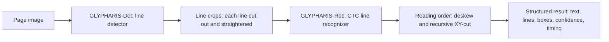

# GLYPHARIS

A lightweight OCR engine that reads English printed text from document images and returns it as
structured output: lines, boxes, confidence and timing.

[](https://pypi.org/project/glypharis/)
[](https://pypi.org/project/glypharis/)
[](LICENSE)
[](release/weights/LICENSE-WEIGHTS)
[](https://github.com/DuhItzAniket/Glypharis/actions/workflows/ci.yml)
[](https://doi.org/10.5281/zenodo.24433864)
[](https://huggingface.co/DuhItzAniket/glypharis-v1)

**Release v1.0.** The code is the Python package [`glypharis`](https://pypi.org/project/glypharis/)
1.0.0 under Apache-2.0. The v1 weights (GW-REC-034 with GW-DET-001) are the asset
`glypharis-v1.tar.gz` of the GitHub release
[`v1.0`](https://github.com/DuhItzAniket/Glypharis/releases/tag/v1.0), under CC BY-SA 4.0, which
`glypharis.download_model` fetches and checks against pinned hashes.

GLYPHARIS is also a research project. Every model was trained and evaluated on a single laptop GPU,
every experiment was registered before it ran, and every reported number traces back to a generated
report under `reports/`.

## What it does

- Reads scanned, photographed, degraded or image-only document pages, one image at a time, from a
  path, image file bytes, a PIL image or a NumPy array.
- Finds text lines with **GLYPHARIS-Det**, a DBNet-style line detector with a MobileNetV3-Large
  backbone, and reads each line with **GLYPHARIS-Rec**, an SVTR-style CTC line recognizer.
- Returns the lines in reading order, each with its text, box, recognition confidence and detection
  score, plus the time spent in each step, as Python objects or JSON.
- Runs on PyTorch (the default, on the CPU) or ONNX Runtime, from Python, the command line or a
  local HTTP server.
- Stands alone: any application can call it with an image. It contains no application-specific code.

## How it works



The steps are those of `GlypharisOCR.predict` in
[`glypharis/pipeline/ocr.py`](glypharis/pipeline/ocr.py): the image is decoded to RGB, the detector
returns line outlines, each line is cut from the grey page along its four-point box and rectified as
the training crops were, the recognizer reads the crops in width-sorted batches with greedy CTC
decoding, and [`reading_order.py`](glypharis/pipeline/reading_order.py) sorts the lines. There is no
page-orientation step. The settings of each stage are in [docs/ARCHITECTURE.md](docs/ARCHITECTURE.md)
and in the model card's [architecture](MODEL_CARD.md#architecture) section.

## Quick start

GLYPHARIS needs Python 3.11 (3.11.4 or later, below 3.12).

```
pip install glypharis
```

pip installs the default PyTorch build for your platform. For a particular build (CPU only, or a
CUDA version), install `torch` and `torchvision` from the
[PyTorch index](https://pytorch.org/get-started/locally/) first; the project's pins are in
[requirements/README.md](requirements/README.md). The package holds no weights; they are fetched
once:

```python
import glypharis
from glypharis import GlypharisOCR

glypharis.download_model("glypharis-v1")  # once: fetches and checks the release asset
ocr = GlypharisOCR.from_pretrained("glypharis-v1")  # a model bundle by name or path
result = ocr.predict("page.png")  # path, image file bytes, PIL image or numpy array

print(result.text)  # lines in reading order
for line in result.lines:
    print(line.text, line.confidence, line.bbox)
print(result.to_json())  # the same as structured JSON
```

`from_pretrained` never downloads. It looks for the bundle in `$GLYPHARIS_MODELS`,
`~/.glypharis/models` and `./models`; `download_model` installs it in the first `GLYPHARIS_MODELS`
entry, else `~/.glypharis/models`. The default backend is PyTorch on the CPU; `backend="onnx"` uses
ONNX Runtime, which matches PyTorch within the export tolerances (GW-EFF-006) but is slower on the
CPU (F34).

### Command line

The package installs three commands. `glypharis-ocr` reads images (in a checkout, `python infer.py`
is the same):

```
glypharis-ocr --image page.png --output results
glypharis-ocr --input-dir scans/ --recursive --format json txt
glypharis-ocr --image page.png --backend onnx --threads 4
```

Each image gives `results/<name>.json` and `results/<name>.txt`. Other flags: `--model` (a bundle
name or directory, default `glypharis-v1`), `--no-download` and `--version`.

`glypharis-serve` is a local HTTP server, standard library only, one request at a time:

```
glypharis-serve --model glypharis-v1 --port 8080
curl --data-binary @page.png http://127.0.0.1:8080/ocr
```

`POST /ocr` takes the image file as the request body and answers with the same JSON; `GET /health`
reports the versions. It listens on `127.0.0.1` unless `--host` says otherwise and has no
authentication or TLS: it is an integration boundary for local use, not a network service. Its other
flags are `--backend`, `--threads`, `--no-download`, `--max-bytes` and `--max-pixels`.

`glypharis-check` confirms an install: the bundle's files match its manifest, the manifest matches
the pinned hash, and a sample page shipped with the package reads exactly as expected. Passing says
nothing about accuracy.

```
glypharis-check --model glypharis-v1 [--models-dir DIR] [--threads 4] [--download] [--offline]
```

`glypharis-ocr` and `glypharis-serve` fetch a registered model that is not installed, unless
`--no-download` is given or `GLYPHARIS_OFFLINE` is set; `glypharis-check` fetches only with
`--download`. Threads, errors, storing results and offline use are covered in the
[integration guide](docs/INTEGRATION.md).

### From a checkout

```
pip install torch==2.14.1 torchvision==0.29.1 --index-url https://download.pytorch.org/whl/cpu
pip install .                # core: reads pages with either backend
pip install ".[export]"      # adds onnx, for writing bundles and ONNX files
pip install ".[train]"       # adds plotting, font, PDF and monitoring packages for training
```

For development, install the exact versions instead: `pip install -r requirements/lock.txt`, then
`pip install -e . --no-deps` ([docs/ENVIRONMENT.md](docs/ENVIRONMENT.md)).

## Results

Selected rows of the model card's [summary table](MODEL_CARD.md#summary), copied unchanged. CER is
the character error rate in percent, lower is better; square brackets hold the 95% bootstrap
interval. GDC is this project's test set of printed pages captured with a phone, FUNSD a set of
forms and OmniDocBench a set of document pages. Page CER also counts detection failures, which line
CER from ground-truth crops does not.

Source: GW-REC-039 [`reports/external/recognition.md`](reports/external/recognition.md); GW-E2E-007
[`reports/external/end_to_end.md`](reports/external/end_to_end.md); GW-EFF-007
[`reports/efficiency/phase16/cost_table.md`](reports/efficiency/phase16/cost_table.md).

| Measure | Value | Set and unit | Experiment |
|---|---|---|---|
| GDC line CER from ground-truth crops | 4.17 [3.72, 4.67] % | phone captures of printed pages, CI by line | GW-REC-039 |
| GDC line detection F1 @0.5 | 80.80 [72.63, 88.07] % | phone captures of printed pages, CI by page | GW-E2E-007 |
| GDC page CER, detector and recognizer together | 22.35 [15.87, 30.11] % | phone captures of printed pages, bag of lines, CI by page | GW-E2E-007 |
| FUNSD page CER, detector and recognizer together | 32.05 [24.28, 39.85] % | forms, bag of lines, CI by page | GW-E2E-007 |
| OmniDocBench page CER, order-aware | 27.28 [23.95, 30.57] % | English document pages, this project's metric, CI by page | GW-E2E-007 |
| Parameters | 11,116,044 | detector and recognizer | GW-EFF-007 |

The [model card](MODEL_CARD.md) has the rest: the HierText results, CPU latency, the
[comparison with baselines](MODEL_CARD.md#comparison-with-baselines), calibration, robustness, and
the [limitations](MODEL_CARD.md#limitations) and
[known failure modes](MODEL_CARD.md#known-failure-modes). In short: curved pages and pages
photographed sideways are not handled well; some baselines do better on some sets; every line and
page latency target of [ADR-0011](docs/decisions/ADR-0011-cpu-latency-target.md) was missed on the
laptop CPU (GW-EFF-007); handwriting, vertical text, tables and formulas are out of scope; and no set
of old scans was evaluated.

Phase 22 re-ran the frozen v1 on every test set and got the same predictions in every test file
(GW-E2E-018, [`reports/final_validation/v1_reproduction.md`](reports/final_validation/v1_reproduction.md)).
The strict reproduction verdict failed only on official OmniDocBench scores, through that
evaluator's per-page time limit, and the owner accepted this as a disclosed limitation.

## Model and weights

v1 is the recognizer **GW-REC-034**, trained from random initialisation on HierText training lines,
and the detector **GW-DET-001**, trained on HierText training pages with a MobileNetV3-Large backbone
initialised from ImageNet-1K weights. No weights trained for text detection or recognition were used
([ADR-0007](docs/decisions/ADR-0007-pretrained-weights-policy.md)). The configuration was chosen on
validation data only and frozen in [`configs/final/glypharis_v1.yaml`](configs/final/glypharis_v1.yaml)
before the frozen model read any test set.

The weights ship as the bundle `glypharis-v1` (model version `glypharis_v1`): `manifest.json`, two
PyTorch release files and two ONNX files at opset 17. A bundle is identified by the SHA-256 of its
manifest, which lists the SHA-256 of every other file.

| Item | Value |
|---|---|
| Release asset | [`glypharis-v1.tar.gz`](https://github.com/DuhItzAniket/Glypharis/releases/tag/v1.0) |
| Archive size | 82,975,077 bytes (GW-E2E-022) |
| Archive SHA-256 | `3b90c1c74147747d7474a86b550e198f0df83d447961bd6aec88d4c24846541d` (GW-E2E-022) |
| Bundle manifest SHA-256 | `875357a6346e8b1f989005fa96c557b00bf687461043368dc5e3dc532839f037` (GW-EFF-006) |
| Mirror | [huggingface.co/DuhItzAniket/glypharis-v1](https://huggingface.co/DuhItzAniket/glypharis-v1), the same files |

The pins are in [`glypharis/hub.py`](glypharis/hub.py). `download_model` checks the archive's size
and SHA-256 and the manifest hash before it installs the bundle, and loading a bundle checks every
file against the manifest. The package fetches from the GitHub release only; if the mirror ever
differs, the release asset is the reference. Manual verification steps are in the
[release notes](docs/RELEASE_NOTES_v1.0.md#verify-the-downloads).

**Terms.** The weights are distributed under CC BY-SA 4.0 with attribution to HierText and Open
Images ([ADR-0014](docs/decisions/ADR-0014-weights-and-backbone-terms.md)); the archive carries
`LICENSE-WEIGHTS` and a `NOTICE.md` with the attribution, the changes made and the disclosure
([release/weights/](release/weights/)). The detector's backbone was initialised from ImageNet-1K
weights, whose terms do not clearly allow commercial use; it is kept as a disclosed exception to the
project's commercial-use rule ([ADR-0009](docs/decisions/ADR-0009-no-synthtext.md)). The weights are
not described as cleared for commercial use. The owner decided to publish them under these terms
without the qualified advice ADR-0014 had asked for; this is the project's chosen handling, not a
legal conclusion.

**Phones.** Phones are the target hardware, but v1 itself was not measured on a phone. The phone
candidate, an all-ONNX build with fused attention (GW-EFF-013), is a new version, not v1: it met
H11's non-inferiority tests against v1 (GW-E2E-021), and only its networks were measured on two
phones, without decoding, post-processing, cropping or reading order (GW-EFF-015). It is not
released.

## Documentation

| Group | Document | What's in it |
|---|---|---|
| Using it | [Model card](MODEL_CARD.md) | What v1 is, its intended use, results and limitations |
| | [Integration guide](docs/INTEGRATION.md) | Install, model lookup and download, threads, server, errors, checks |
| | [Release notes](docs/RELEASE_NOTES_v1.0.md) | What v1.0 ships, its terms, how to install, fetch and verify it |
| | [Datasets](DATASETS.md) | Provenance, licences and roles of every dataset |
| How it was built | [Architecture](docs/ARCHITECTURE.md) | The system as built, the bundle and the public interface |
| | [Decisions](docs/decisions/) | Architecture decision records |
| | [Experiment protocol](docs/EXPERIMENT_PROTOCOL.md) | Metrics, splits, statistics, diagnostics, leakage rules |
| | [Implementation plan](docs/IMPLEMENTATION_PLAN.md) | The phases with tasks, deliverables, exit criteria and deviations |
| | [Roadmap](docs/ROADMAP.md) | Milestones, versions, dependency graph, success criteria |
| | [Approach survey](research/approach_survey.md) | Alternatives considered and why this design was chosen |
| | [Workflow](docs/WORKFLOW.md) | Branching, commits, phase gate, experiment IDs |
| | [Environment](docs/ENVIRONMENT.md) | Development machine and where its generated record lives |
| | [Reproducing](docs/REPRODUCING.md) | From a fresh clone to an evaluated model |
| Research record | [Phase status](docs/PHASE_STATUS.md) | Every phase, with its gate, evidence and known issues |
| | [Experiments](EXPERIMENTS.md) | Generated summary of every registered experiment |
| | [Research log](research/) | Hypotheses, experiment registry, ablations, failures, findings |
| | [Paper notes](research/paper/) | Methodology, experiments, results, error analysis, efficiency, limitations |
| | [Comparison table](reports/benchmark_results/comparison_table.md) | Generated table of accuracy, latency and size by model and dataset |
| | [Final validation](docs/FINAL_VALIDATION.md) | The Phase 22 record: walkthrough, reproduction, phone candidate |
| | [Reports](reports/README.md) | What each generated report folder holds |
| | [Risk register](docs/RISK_REGISTER.md) | Known risks and mitigations |
| Release | [Changelog](CHANGELOG.md) | Changes by version |
| | [Release runbook](docs/RELEASE_RUNBOOK.md) | The release-day steps, in order, and who does each |
| | [Release evidence](docs/RELEASE_EVIDENCE.md) | Each v1.0 release precondition mapped to its evidence |
| | [Adviser brief](docs/ADVISER_BRIEF.md) | The open questions on the weights' terms |
| | [Weights notice](release/weights/NOTICE.md) | The attribution and disclosure shipped with the weights |
| Project | [Documentation index](docs/README.md) | Every document, grouped by who needs it |
| | [Contributing](CONTRIBUTING.md) | How changes are made, checked and reviewed |
| | [Security policy](SECURITY.md) | Supported versions and how to report a vulnerability |

The numbers in these documents trace to the generated reports under `reports/`. An archive of the
repository made with `git archive`, such as the Zenodo archive of the release, holds the code and
documentation only: `reports/` and the evaluation records under `data/manifests` are left out
(`export-ignore` in [.gitattributes](.gitattributes), checked by
[scripts/check_git_archive.py](scripts/check_git_archive.py)). Tracing every number needs the tagged
repository on GitHub.

## Research questions

1. How effective is a lightweight detector + CTC recognizer for document OCR?
2. How much does document-style synthetic data help, how does it scale, and which generator factors
   matter?
3. Which degradation augmentations improve robustness on degraded documents?
4. How does it compare with Tesseract, PaddleOCR (PP-OCRv5) and TrOCR-Small under one protocol?
5. Which failure modes dominate, detector or recognizer?
6. How large is the gap between document-domain and scene-text performance?
7. What is the accuracy / latency / memory trade-off for local deployment?
8. Is the model's confidence calibrated?

The answers and their evidence are in [research/findings.md](research/findings.md) and the
[paper notes](research/paper/).

## Repository layout

```
glypharis/      the package: models, pipeline, training, evaluation, export, CLI and server
configs/        all hyperparameters (YAML); configs/final/ holds the v1 freeze record
scripts/        data preparation, evaluation, reports and checks
tests/          pytest suite, with tiny fixtures and tiny models only
data/           dataset sources and manifests are committed; raw and processed data are not
reports/        generated analysis, curves and benchmark tables
research/       research log, hypotheses, experiment registry, findings and paper notes
docs/           architecture, plan, protocol, integration, release and decision records
release/        the weights' licence and notice, and the Hugging Face model card
mobile/         the Android bench app used for the phone measurements (GW-EFF-015)
requirements/   lock files, one per environment
train.py        training entry point
infer.py        the same command as glypharis-ocr
```

## Hardware

Training ran on one NVIDIA GeForce RTX 4050 Laptop GPU, and all of v1's latency numbers were
measured on that laptop's Intel Core i7-14650HX CPU under Windows 11; CI runs on Linux, CPU only.
The machine is recorded in the generated [environment report](reports/environment/env_report.md).
Training supports CUDA with automatic CPU fallback, mixed precision (bf16/fp16), gradient
accumulation, checkpoint resume and VRAM monitoring.

## Reproducing

[docs/REPRODUCING.md](docs/REPRODUCING.md) gives the order of work from a fresh clone: install,
download and prepare the data, obtain the model, read a page and evaluate. Some datasets are for
evaluation only; read [DATASETS.md](DATASETS.md) first.

## Citing

If you use GLYPHARIS, please cite the software:

```bibtex
@software{glypharis_2026,
  author  = {DuhItzAniket},
  title   = {GLYPHARIS},
  version = {1.0.0},
  year    = {2026},
  doi     = {10.5281/zenodo.24433864},
  url     = {https://github.com/DuhItzAniket/Glypharis}
}
```

The Zenodo record ([10.5281/zenodo.24433864](https://doi.org/10.5281/zenodo.24433864)) holds the
code and documentation only, not the weights. [CITATION.cff](CITATION.cff) holds the citation
metadata, and the methods and datasets behind the model are cited in the model card's
[citation information](MODEL_CARD.md#citation-information).

## Licence

The code and the project's own text are under the Apache License, Version 2.0 ([LICENSE](LICENSE)),
with the exceptions that [NOTICE](NOTICE) lists, such as the HierText-derived material in the
reports and the model card. The Apache License does not cover the weights.

The weights are distributed separately under CC BY-SA 4.0 with attribution to HierText and Open
Images ([release/weights/](release/weights/),
[ADR-0014](docs/decisions/ADR-0014-weights-and-backbone-terms.md)). The detector's ImageNet-1K
initialisation is a disclosed exception to the project's commercial-use rule, and the weights are
not described as cleared for commercial use. The terms of each dataset are in
[DATASETS.md](DATASETS.md).
