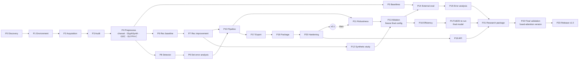

# GLYPHARIS — Roadmap

The bird's-eye view. The detail lives in [IMPLEMENTATION_PLAN.md](IMPLEMENTATION_PLAN.md); live status lives
in [PHASE_STATUS.md](PHASE_STATUS.md).

## 1. Milestones and versions

Execution order follows [ADR-0008](decisions/ADR-0008-usable-engine-first.md): a usable engine (v0.1)
ships right after the pipeline works, and the research studies run afterwards. Phase numbers are unchanged
so the brief stays traceable; only the order differs.

| Milestone | Phases (in execution order) | Outcome | Version | Gate | Status (tags) |
|---|---|---|---|---|---|
| **M0 Planning** | 0 | Plan, protocol, dataset cards, ADRs, research scaffolding | — | Phase 0 record + tag | passed (`phase-00`) |
| **M1 Foundation** | 1 | Reproducible env, config/seed/logging, CI | — | CI green, determinism test | passed (`phase-01`) |
| **M2 Data** | 2–4 | Datasets with provenance, audit reports, charset, line crops, GlyphSynth, GDC, GLYPH-C | — | Manifests + quality report + frozen test sets | passed (`phase-02` to `phase-04`) |
| **M3 Reference points** | 5 | Tesseract / PaddleOCR / TrOCR-Small numbers on our protocol; CPU latency target set | — | Baseline report | passed (`phase-05`) |
| **M4 Recognizer** | 6–7 | CRNN baseline → improved GLYPHARIS-Rec | — | Validated run reports, resume test | passed (`phase-06`, `phase-07`) |
| **M5 Detector** | 8–9 | GLYPHARIS-Det + error analysis | — | Validation F1 + overlays | passed (`phase-08`, `phase-09`) |
| **M6 End to end** | 10 | Pipeline, reading order, confidence | — | Integration tests, oracle analysis | passed (`phase-10`) |
| **M7 Usable engine** | 17 → 18 → 20 | ONNX export, `GlypharisOCR` package, input hardening. Consumer can integrate. | **0.1** | Equivalence tests, API + failure-path tests | passed (`phase-17`, `phase-18`, `phase-20`, `v0.1`) |
| **M8 Studies** | 11–13 | Robustness, synthetic-data and ablation studies; final config frozen | 0.5 (label) | Ablation tables with CIs | passed (`phase-11` to `phase-13`) |
| **M9 Evaluation** | 14–15 | External benchmarks + error analysis | 0.6 (label) | Test access log closed | passed (`phase-14`, `phase-15`) |
| **M10 Final engineering** | 16, 19, re-run of 17 / 18 / 20 | Efficiency study, final export and package, optional API | 0.9 (label) | Equivalence tests, API tests | passed (`phase-16`, `phase-19`, `phase-17-v1`, `phase-18-v1`, `phase-20-v1`, `v1-code`) |
| **M11 Release** | 21–23 | Paper-ready research package, clean-machine validation, evaluation of the fused-attention build as a new version | **1.0** | Every criterion in §4 ticked | open: Phase 21 in progress |

`v0.1` is the only version tag so far. The 0.5, 0.6 and 0.9 entries were planning labels: no such tag
exists. The package version is `1.0.0` from Phase 23 (`glypharis.__version__`); the tag `v1.0` is
not set yet. No weights are
distributed; release is Phase 23.

## 2. Dependency graph

Phase 19 was planned after the re-runs and was built after Phase 11, while Phase 12 waited (owner request,
2026-10-29). It uses no model results. The Phase 20 re-run exercised its endpoint on the v1 bundle
(GW-E2E-012, `reports/hardening/GW-E2E-012.json`).

**Critical path to v0.1:** P1 → P2 → P3 → P4 → P6 → P7 → P10 → P17 → P18 → P20.

**Critical path to v1.0:** v0.1 → P11 → P13 → P14 → P21 → P22 → P23.

**Parallelisable** (the GPU runs one thing, but CPU and human work can overlap):
- P5 baselines (CPU-heavy) can run while P6 trains on the GPU.
- P8 detector work can start once P4 is done, alternating GPU time with P7.
- P12 dataset generation (CPU) can run while P11 trains.

## 3. Rough timeline

These are the Phase 0 estimates, kept as written. They were planning numbers, not commitments.

| Milestone | Est. sessions | Est. GPU-hours | Cumulative weeks (est.) |
|---|---|---|---|
| M0 | 1–2 | 0 | done |
| M1 | 2–3 | <1 | 1 |
| M2 | 8–12 | ~0 (CPU-heavy) | 3–4 |
| M3 | 2–3 | CPU | 4–5 |
| M4 | 7–10 | 40–80 | 6–8 |
| M5 | 4–6 | 20–40 | 8–10 |
| M6 | 3–4 | <5 | 9–11 |
| **M7 (v0.1)** | 4–6 | <5 | **10–12** |
| M8 | 6–8 | 80–160 | 14–18 |
| M9 | 4–6 | 5–10 | 15–20 |
| M10 | 4–6 | <5 | 17–22 |
| M11 | 4–6 | <5 | 18–24 |

Measured compute is in `reports/compute/ledger.md`: 217.2 GPU-hours and 61.7 CPU-hours in the queue logs,
of which 75.6 GPU-hours and 1.9 CPU-hours went to jobs that did not finish. The ledger leaves out jobs run
by hand and Phases 9, 10, 14 and 15, so these are lower bounds. Those phases' compute is in their records
in `docs/PHASE_STATUS.md`.

## 4. Success criteria (from the brief §67)

Ticked only when the phase gate for the responsible phase has passed. A criterion that names "all" phases
stays open until the last of them has passed.

| Criterion | Phase | Status | Gate and evidence |
|---|---|---|---|
| Reproducible environment | 1 | ☑ | `phase-01`; `reports/environment/env_report.md`, `requirements/lock.txt` |
| Dataset management | 2 | ☑ | `phase-02`; `scripts/download_datasets.py`, `data/manifests/` |
| Data preprocessing | 4 | ☑ | `phase-04`; `data/manifests/processed/`, `reports/charset/charset_report.md` |
| Detection model | 8 | ☑ | `phase-08`; GW-DET-001, `reports/training/GW-DET-001/report.md` |
| Recognition model | 6–7 | ☑ | `phase-06`, `phase-07`; v1's recognizer is GW-REC-034 (Phase 13) |
| End-to-end OCR | 10 | ☑ | `phase-10`; `glypharis/pipeline/`, GW-E2E-006 |
| Automated metrics | 5–6 | ☑ | `phase-05`, `phase-06`; `glypharis/eval/`, `reports/baselines/` |
| Overfitting detection | 6 | ☑ | `phase-06`; `glypharis/diagnostics/`, EXPERIMENT_PROTOCOL §6 |
| Underfitting detection | 6 | ☑ | `phase-06`; `glypharis/diagnostics/`, EXPERIMENT_PROTOCOL §6 |
| Error analysis | 9, 15 | ☑ | `phase-09`, `phase-15`; `reports/error_cases/` |
| Ablation experiments | 11–13 | ☑ | `phase-11` to `phase-13`; `reports/ablation/phase13_ladder.md`, `research/ablations.md` |
| External evaluation | 14 | ☑ | `phase-14`; `reports/external/`, `research/test_access_log.md` |
| Baseline comparisons | 5, 14 | ☑ | `phase-05`, `phase-14`; `reports/baselines/`, `reports/external/comparisons.md` |
| Model checkpointing | 6 | ☑ | `phase-06`; `glypharis/training/checkpoint.py` |
| Resume training | 6 | ☑ | `phase-06`; `scripts/rec_resume_check.py` |
| Experiment tracking | 1, 6 | ☑ | `phase-01`, `phase-06`; `research/experiments.md` |
| Model export | 17 | ☑ | `phase-17`, `phase-17-v1`; GW-EFF-006, GW-EFF-012 |
| Inference API | 18–19 | ☑ | `phase-18`, `phase-18-v1`, `phase-19`; GW-E2E-011 |
| Unit tests | 1+ | ☑ | `phase-01` and every gate since; `tests/` |
| CI/CD | 1 | ☑ | `phase-01`; `.github/workflows/ci.yml`. The release workflow belongs to Phase 23 |
| Git history | all | ☐ | Kept through Phase 22; open until Phase 23 |
| Phase documentation | all | ☐ | `docs/PHASE_STATUS.md`, through Phase 22; open until Phase 23 |
| Research documentation | all | ☐ | `research/`; open until Phase 23 |
| Model card | 21 | ☑ | `MODEL_CARD.md`, tag `phase-21` |
| Dataset documentation | 2, 21 | ☑ | `DATASETS.md`, tag `phase-21` |
| Reproducible final experiment | 13, 22 | ☑ | Configuration frozen and recorded. Phase 22 re-ran it: the predictions equal Phase 14's in every test file, and the strict verdict failed only on official OmniDocBench scores, through the evaluator's time limit; the owner accepted this as a disclosed limitation (GW-E2E-018, `reports/final_validation/v1_reproduction.md`). Accepted with a disclosed evaluator limitation; tag `phase-22`. `configs/final/glypharis_v1.yaml` |

## 5. Beyond v1.0 (not scheduled)

Ideas that are deliberately out of scope until v1.0 ships:
- Word-level boxes from CTC alignment (`word_boxes` field).
- Text orientation classifier (0°/180°) and page-level rotation correction. GLYPHARIS has no orientation
  step, and pages photographed sideways are not read correctly (F24).
- Layout-aware reading order (learned) for complex multi-column pages.
- Additional scripts/languages via charset extension.
- Distillation from a large OCR model as a teacher on unlabelled scans (needs a licence review).

## 6. Carried into Phase 22

Phase 22 carried two items beyond the clean-machine run ([ADR-0011](decisions/ADR-0011-cpu-latency-target.md),
IMPLEMENTATION_PLAN Phase 22). What it did with each is recorded in
[FINAL_VALIDATION](FINAL_VALIDATION.md):

- The phone candidate. Of the three arms measured, the selection rule chose the all-ONNX build with
  fused attention, reading one line per recognizer run (`fused-single-line`, GW-EFF-013,
  `reports/final_validation/candidate/GW-EFF-013/selection.md`), frozen as bundle format
  `glypharis-phone-bundle-1` (GW-EFF-014). A new version, not v1. Phase 22 evaluated it once per test
  set, and it met H11's six non-inferiority tests against v1 (GW-E2E-021,
  `reports/final_validation/candidate/h11.md`); its results sit beside v1's and replace none of them.
- The phone measurement. Phones are the target hardware. Phase 22 measured the phone candidate's
  networks on two phones, a Samsung Galaxy M52 5G and a Moto G35 5G (GW-EFF-015,
  `reports/final_validation/GW-EFF-015/`): network time and memory only, without decoding,
  post-processing, cropping or reading order; v1 itself was not measured on a phone. No phone target is
  set.
