# GLYPHARIS — Roadmap

The bird's-eye view. The detail lives in [IMPLEMENTATION_PLAN.md](IMPLEMENTATION_PLAN.md); live status lives
in [PHASE_STATUS.md](PHASE_STATUS.md).

## 1. Milestones and versions

Execution order follows [ADR-0008](decisions/ADR-0008-usable-engine-first.md): a usable engine (v0.1)
ships right after the pipeline works, and the research studies run afterwards. Phase numbers are unchanged
so the brief stays traceable; only the order differs.

| Milestone | Phases (in execution order) | Outcome | Version | Gate |
|---|---|---|---|---|
| **M0 Planning** | 0 | Plan, protocol, dataset cards, ADRs, research scaffolding | — | Phase 0 record + tag |
| **M1 Foundation** | 1 | Reproducible env, config/seed/logging, CI | — | CI green, determinism test |
| **M2 Data** | 2–4 | Datasets with provenance, audit reports, charset, line crops, GlyphSynth, GDC, GLYPH-C | — | Manifests + quality report + frozen test sets |
| **M3 Reference points** | 5 | Tesseract / PaddleOCR / TrOCR-Small numbers on our protocol; CPU latency target set | — | Baseline report |
| **M4 Recognizer** | 6–7 | CRNN baseline → improved GLYPHARIS-Rec | — | Validated run reports, resume test |
| **M5 Detector** | 8–9 | GLYPHARIS-Det + error analysis | — | Validation F1 + overlays |
| **M6 End to end** | 10 | Pipeline, reading order, confidence | — | Integration tests, oracle analysis |
| **M7 Usable engine** | 17 → 18 → 20 | ONNX export, `GlypharisOCR` package, input hardening. **Consumer can integrate.** | **0.1** | Equivalence tests, API + failure-path tests |
| **M8 Studies** | 11–13 | Robustness, synthetic-data and ablation studies; final config frozen | **0.5** | Ablation tables with CIs |
| **M9 Evaluation** | 14–15 | External benchmarks + error analysis | **0.6** | Test access log closed |
| **M10 Final engineering** | 16, re-run of 17 / 18 / 20, 19 | Efficiency study, final export and package, optional API | **0.9** | Equivalence tests, API tests |
| **M11 Release** | 21–23 | Paper-ready research package, clean-machine validation | **1.0** | Every criterion in §4 ticked |

## 2. Dependency graph

```mermaid
flowchart LR
  P0[P0 Discovery] --> P1[P1 Environment]
  P1 --> P2[P2 Acquisition] --> P3[P3 Audit] --> P4[P4 Preprocess<br/>charset · GlyphSynth · GDC · GLYPH-C]
  P4 --> P5[P5 Baselines]
  P4 --> P6[P6 Rec baseline] --> P7[P7 Rec improvement]
  P4 --> P8[P8 Detector] --> P9[P9 Det error analysis]
  P5 --> P14
  P7 --> P10[P10 Pipeline]
  P9 --> P10
  P10 --> P11[P11 Robustness] --> P13[P13 Ablation<br/>freeze final config]
  P7 --> P12[P12 Synthetic study] --> P13
  P13 --> P14[P14 External eval] --> P15[P15 Error analysis]
  P10 --> P17[P17 Export] --> P18[P18 Package] --> P20[P20 Hardening] --> V01((v0.1))
  V01 -. then .-> P11
  P13 --> P16[P16 Efficiency] --> P17F[P17/18/20 re-run<br/>final model] --> P19[P19 API]
  P15 --> P21[P21 Research package]
  P19 --> P21 --> P22[P22 Final validation] --> P23[P23 Release v1.0]
```

**Critical path to v0.1:** P1 → P2 → P3 → P4 → P6 → P7 → P10 → P17 → P18 → P20.

**Critical path to v1.0:** v0.1 → P11 → P13 → P14 → P21 → P22 → P23.

**Parallelisable** (the GPU runs one thing, but CPU and human work can overlap):
- P5 baselines (CPU-heavy) can run while P6 trains on the GPU.
- P8 detector work can start once P4 is done, alternating GPU time with P7.
- P12 dataset generation (CPU) can run while P11 trains.

## 3. Rough timeline

Estimates assume a few focused sessions a week plus overnight GPU runs. They are planning numbers, not
commitments, and get revised at the end of M2 and M4 with measured throughput.

| Milestone | Est. sessions | Est. GPU-hours | Cumulative weeks (est.) |
|---|---|---|---|
| M0 | 1–2 | 0 | done |
| M1 | 2–3 | <1 | 1 |
| M2 | 8–12 | ~0 (CPU-heavy) | 3–4 |
| M3 | 2–3 | CPU | 4–5 |
| M4 | 7–10 | 40–80 | 6–8 |
| M5 | 4–6 | 20–40 | 8–10 |
| M6 | 3–4 | <5 | 9–11 |
| **M7 (v0.1)** | 4–6 | <5 | **10–12** |
| M8 | 6–8 | 80–160 | 14–18 |
| M9 | 4–6 | 5–10 | 15–20 |
| M10 | 4–6 | <5 | 17–22 |
| M11 | 4–6 | <5 | 18–24 |

## 4. Success criteria (from the brief §67)

Ticked only when the phase gate for the responsible phase has passed.

| Criterion | Phase | Status |
|---|---|---|
| Reproducible environment | 1 | ☐ |
| Dataset management | 2 | ☐ |
| Data preprocessing | 4 | ☐ |
| Detection model | 8 | ☐ |
| Recognition model | 6–7 | ☐ |
| End-to-end OCR | 10 | ☐ |
| Automated metrics | 5–6 | ☐ |
| Overfitting detection | 6 | ☐ |
| Underfitting detection | 6 | ☐ |
| Error analysis | 9, 15 | ☐ |
| Ablation experiments | 11–13 | ☐ |
| External evaluation | 14 | ☐ |
| Baseline comparisons | 5, 14 | ☐ |
| Model checkpointing | 6 | ☐ |
| Resume training | 6 | ☐ |
| Experiment tracking | 1, 6 | ☐ |
| Model export | 17 | ☐ |
| Inference API | 18–19 | ☐ |
| Unit tests | 1+ | ☐ |
| CI/CD | 1 | ☐ |
| Git history | all | ☐ (started) |
| Phase documentation | all | ☐ (started) |
| Research documentation | all | ☐ (started) |
| Model card | 21 | ☐ |
| Dataset documentation | 2, 21 | ☐ (draft) |
| Reproducible final experiment | 13, 22 | ☐ |

## 5. Beyond v1.0 (not scheduled)

Ideas that are deliberately out of scope until v1.0 ships:
- Word-level boxes from CTC alignment (`word_boxes` field).
- Text orientation classifier (0°/180°) and page-level rotation correction.
- Layout-aware reading order (learned) for complex multi-column pages.
- Additional scripts/languages via charset extension.
- Distillation from a large OCR model as a teacher on unlabelled scans (needs a licence review).
