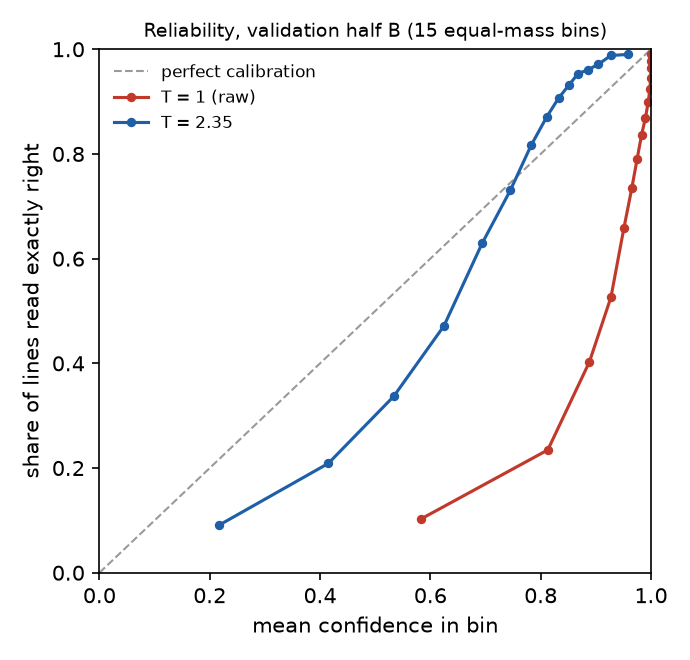

# Line-confidence calibration (GW-E2E-005)

Generated by `scripts/rec_calibrate.py`; do not edit by hand.
GW-REC-034 on every line of `processed/hiertext/lines_validation` (73,888 lines),
read through the pipeline's recognizer. A line is right when its text equals the label
exactly on the strict track. Temperature fitted
on half A (35,976 lines) by binary NLL; ECE (15 equal-mass bins) on
half B (37,912 lines, accuracy 0.724).

| | T | ECE on half B |
|---|---|---|
| raw | 1 | 0.2140 |
| fitted | 2.35 | 0.0886 |

Difference (fitted − raw): -0.1254 [-0.1296, -0.1217] (95% line bootstrap). Adopted: **yes**.

