# Detector error analysis: GW-DET-001

Generated by `scripts/det_analysis.py`; do not edit by hand. Definitions as registered in
`docs/PHASE_STATUS.md` (Phase 09) before this ran. Validation pages only, IoU 0.5, at
operating point `inverse10`; heights and angles at the 1280 px inference scale.

Pages 1,715; care lines 74,500; tp 44,316, fp 3,631, fn 30,184.

## Missed lines (fn) by category

| Category | Lines | Share of fn | 0–8 px | 8–12 px | 12–20 px | 20–40 px | >= 40 px |
|---|---|---|---|---|---|---|---|
| merged | 3,312 | 11.0% | 699 | 642 | 1,050 | 718 | 203 |
| split | 365 | 1.2% | 8 | 34 | 136 | 99 | 88 |
| poorly_localised | 671 | 2.2% | 147 | 144 | 211 | 133 | 36 |
| partly_found | 765 | 2.5% | 193 | 165 | 182 | 164 | 61 |
| missed_low_score | 13,916 | 46.1% | 4,417 | 4,236 | 3,392 | 1,483 | 388 |
| missed_dropped | 24 | 0.1% | 1 | 2 | 5 | 5 | 11 |
| missed_no_candidate | 11,131 | 36.9% | 6,059 | 2,445 | 1,649 | 787 | 191 |

`missed_low_score`: a candidate sat in the line but scored below `box_thresh`; `missed_dropped`: a candidate above it produced no box near the line (size filter); `missed_no_candidate`: no component of the binarised map sat in the line.

## False alarms (fp) by category

| Category | Predictions | Share of fp |
|---|---|---|
| merge | 888 | 24.5% |
| fragment | 1,499 | 41.3% |
| poorly_localised | 393 | 10.8% |
| background | 720 | 19.8% |
| other | 131 | 3.6% |

## Merges and splits

- Merge predictions (one box over at least two care lines): 1,628
- Split care lines (one line, at least two boxes): 718 (0.96% of care lines)

## Line recall by height, angle and box shape

| Height (rectangle short side) | Lines | Recall@0.5 |
|---|---|---|
| 0–8 px | 14,347 | 0.197 [0.170, 0.227] |
| 8–12 px | 17,745 | 0.568 [0.537, 0.597] |
| 12–20 px | 23,642 | 0.720 [0.695, 0.742] |
| 20–40 px | 14,854 | 0.772 [0.746, 0.798] |
| >= 40 px | 3,912 | 0.750 [0.724, 0.775] |

| abs(text angle) | Lines | Recall@0.5 |
|---|---|---|
| 0–5 ° | 53,860 | 0.676 [0.653, 0.699] |
| 5–15 ° | 9,228 | 0.550 [0.514, 0.583] |
| 15–45 ° | 6,345 | 0.299 [0.265, 0.338] |
| >= 45 ° | 5,067 | 0.181 [0.134, 0.232] |

| Box shape | Lines | Recall@0.5 |
|---|---|---|
| other | 64,533 | 0.662 [0.640, 0.684] |
| tall box (> 45° from horizontal) | 9,967 | 0.163 [0.132, 0.194] |

## Pages by density, blur and contrast

Quartiles over the validation pages with care lines; page-bootstrap CIs.

**Care lines per megapixel**

| Care lines per megapixel quartile | Range | Pages | Precision@0.5 | Recall@0.5 | F1@0.5 |
|---|---|---|---|---|---|
| Q1 | 0.507–15.1 | 419 | 0.906 [0.884, 0.927] | 0.691 [0.667, 0.715] | 0.784 [0.764, 0.803] |
| Q2 | 15.1–24 | 414 | 0.933 [0.924, 0.942] | 0.634 [0.609, 0.657] | 0.755 [0.735, 0.772] |
| Q3 | 24–46.4 | 426 | 0.922 [0.908, 0.933] | 0.571 [0.545, 0.597] | 0.705 [0.683, 0.726] |
| Q4 | 46.4–830 | 420 | 0.927 [0.912, 0.941] | 0.572 [0.531, 0.615] | 0.707 [0.674, 0.742] |

**Blur (variance of the Laplacian; low = blurry)**

| Blur quartile | Range | Pages | Precision@0.5 | Recall@0.5 | F1@0.5 |
|---|---|---|---|---|---|
| Q1 | 7.54–253 | 420 | 0.915 [0.899, 0.928] | 0.590 [0.551, 0.629] | 0.717 [0.685, 0.748] |
| Q2 | 253–502 | 419 | 0.930 [0.919, 0.939] | 0.578 [0.546, 0.611] | 0.713 [0.686, 0.739] |
| Q3 | 502–1.05e+03 | 420 | 0.920 [0.905, 0.933] | 0.552 [0.508, 0.593] | 0.690 [0.655, 0.723] |
| Q4 | 1.05e+03–8.69e+03 | 420 | 0.930 [0.912, 0.943] | 0.645 [0.600, 0.692] | 0.762 [0.727, 0.796] |

**Contrast (grey-level std / 255)**

| Contrast quartile | Range | Pages | Precision@0.5 | Recall@0.5 | F1@0.5 |
|---|---|---|---|---|---|
| Q1 | 0.0328–0.194 | 420 | 0.928 [0.909, 0.944] | 0.631 [0.585, 0.677] | 0.751 [0.717, 0.786] |
| Q2 | 0.194–0.235 | 419 | 0.925 [0.909, 0.938] | 0.557 [0.510, 0.603] | 0.695 [0.654, 0.731] |
| Q3 | 0.235–0.274 | 420 | 0.922 [0.911, 0.934] | 0.591 [0.558, 0.622] | 0.721 [0.695, 0.744] |
| Q4 | 0.274–0.469 | 420 | 0.922 [0.908, 0.934] | 0.597 [0.551, 0.638] | 0.725 [0.689, 0.756] |

## Kernel excess (RISK_REGISTER R-21)

Predicted kernel width against the label kernel of the care line each candidate sits in (64,789 candidates): median excess -0.01 px, median ratio 1.00 (IQR 0.83–1.13). A ratio near 1 is the regime `inverse` unclip assumes; well above 1, the one `dbnet` unclip assumes.

## Galleries

Up to 24 crops per category, drawn by `default_rng([20261027, k])` over the sorted members (k = the category's position: missed-line categories first, then false-alarm ones), independent of results. Ground truth: found green, missed orange (thick); predictions: tp blue, fp red; don't-care lines not drawn. HierText annotations CC BY-SA 4.0, images CC BY 2.0.

- `fn_merged` (24 shown): 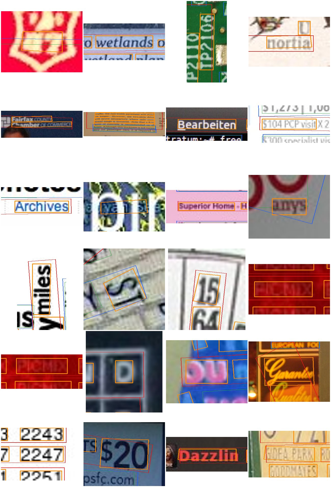
- `fn_split` (24 shown): 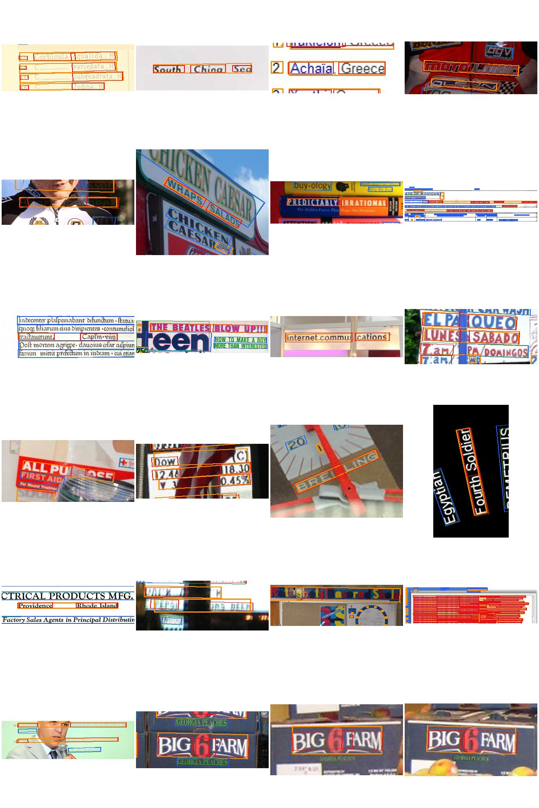
- `fn_poorly_localised` (24 shown): 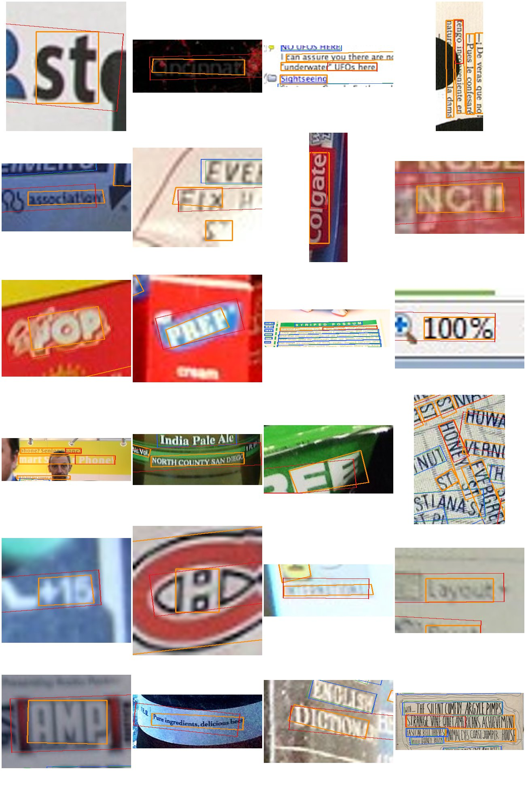
- `fn_partly_found` (24 shown): 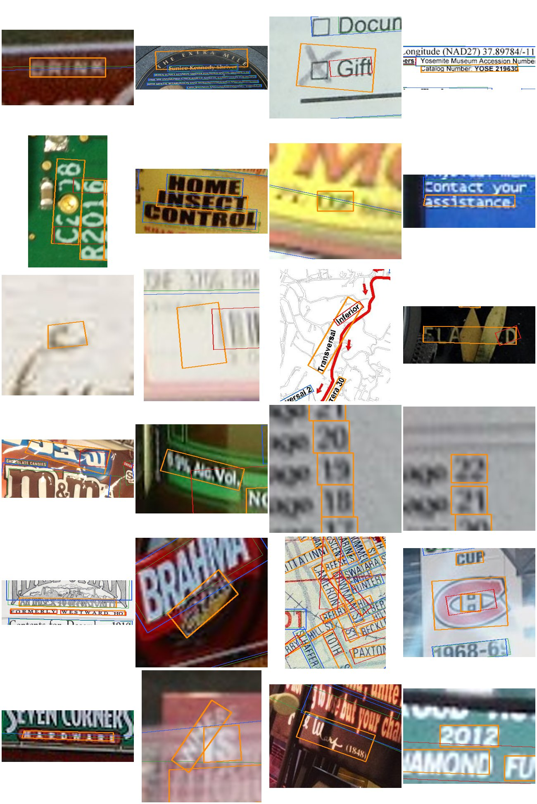
- `fn_missed_low_score` (24 shown): 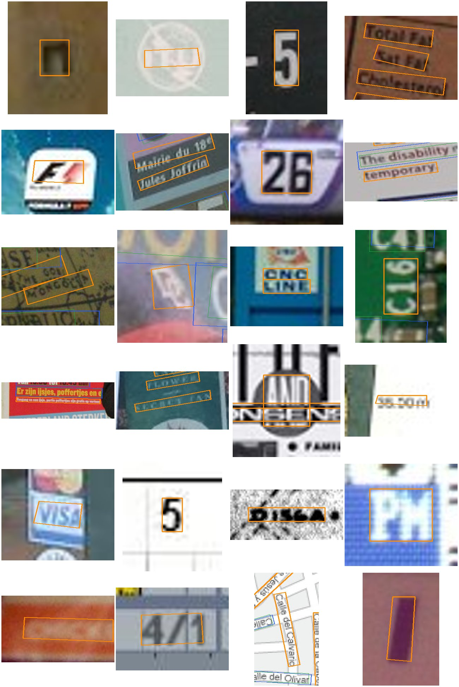
- `fn_missed_dropped` (24 shown): 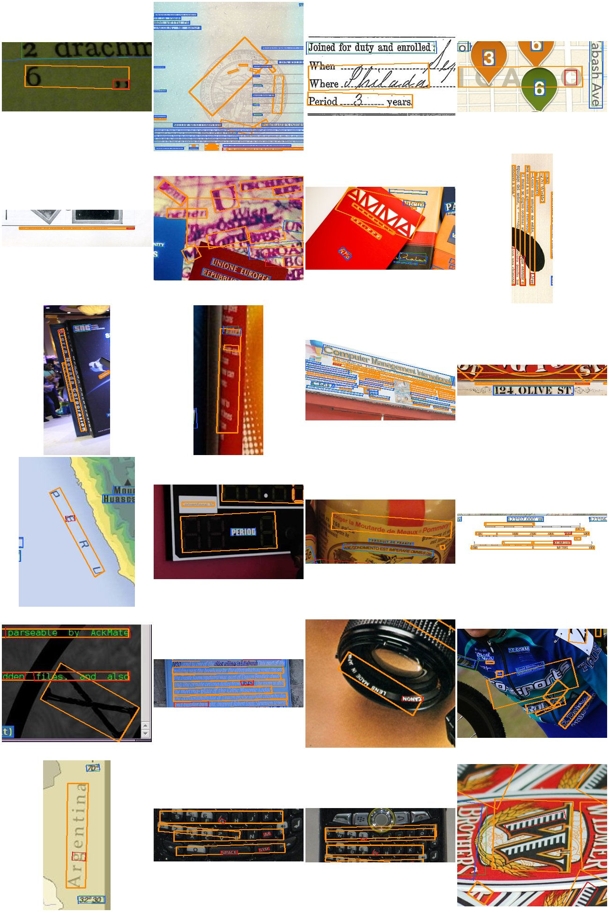
- `fn_missed_no_candidate` (24 shown): 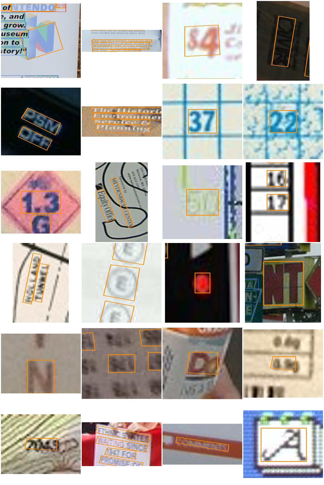
- `fp_merge` (24 shown): 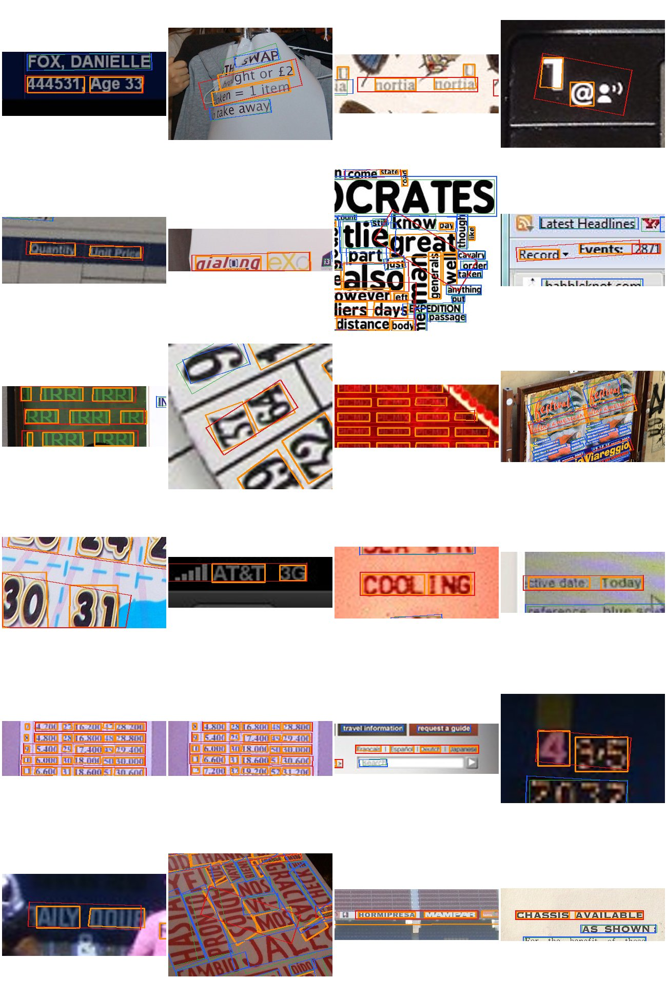
- `fp_fragment` (24 shown): 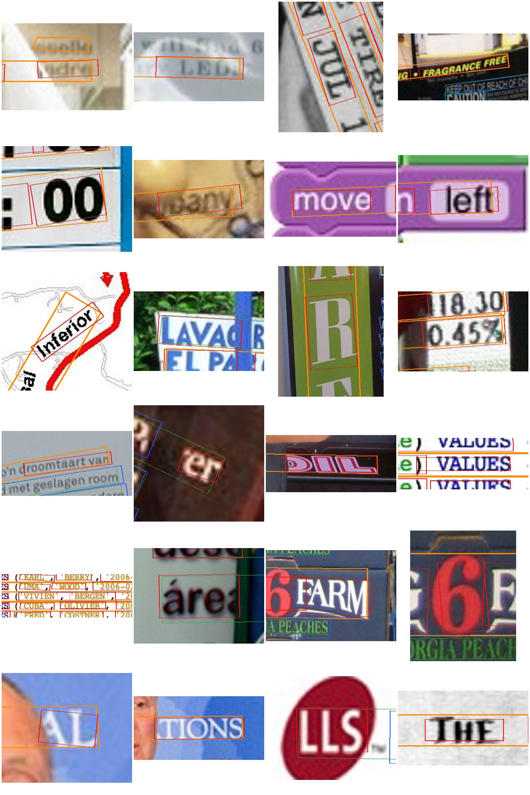
- `fp_poorly_localised` (24 shown): 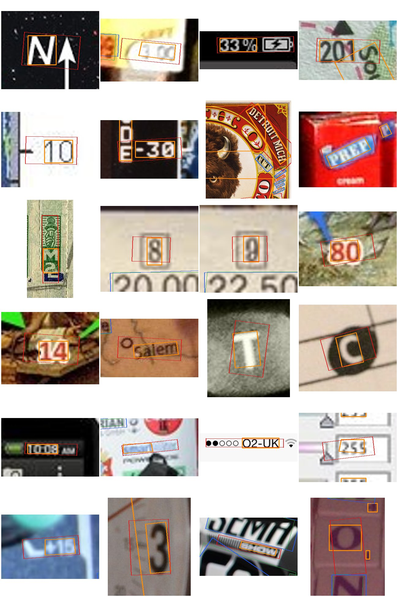
- `fp_background` (24 shown): 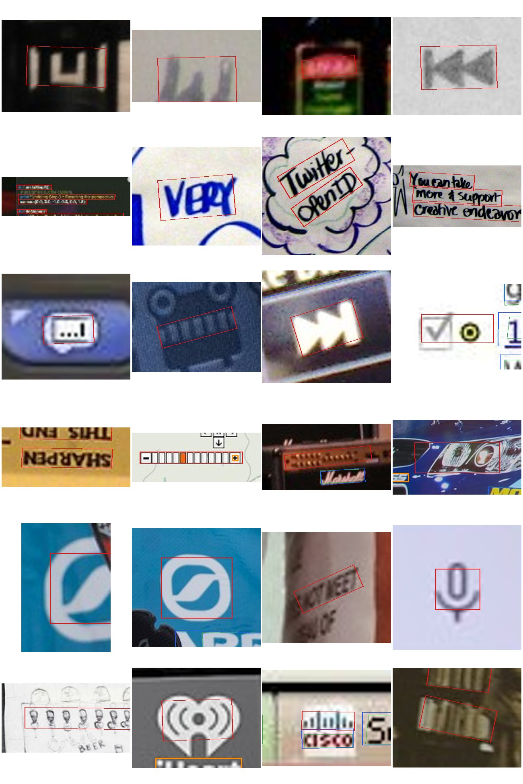
- `fp_other` (24 shown): 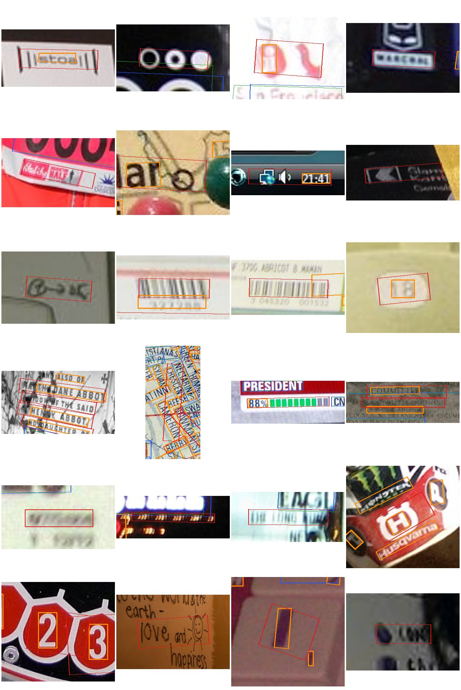
- worst 12 pages (lowest F1@0.5, at least 5 care lines): 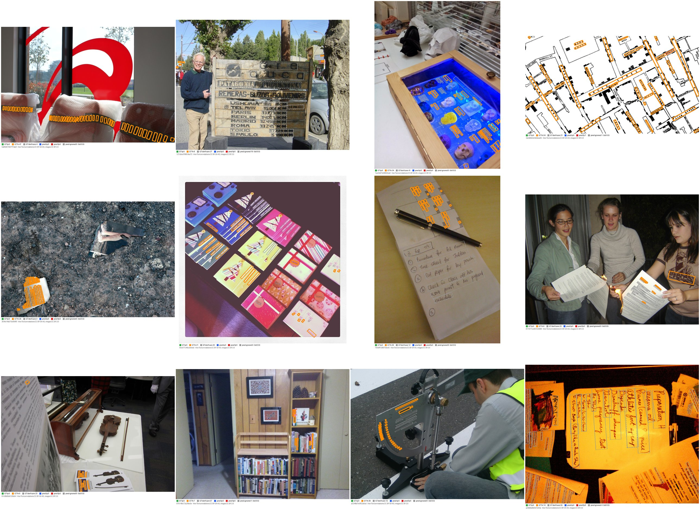
