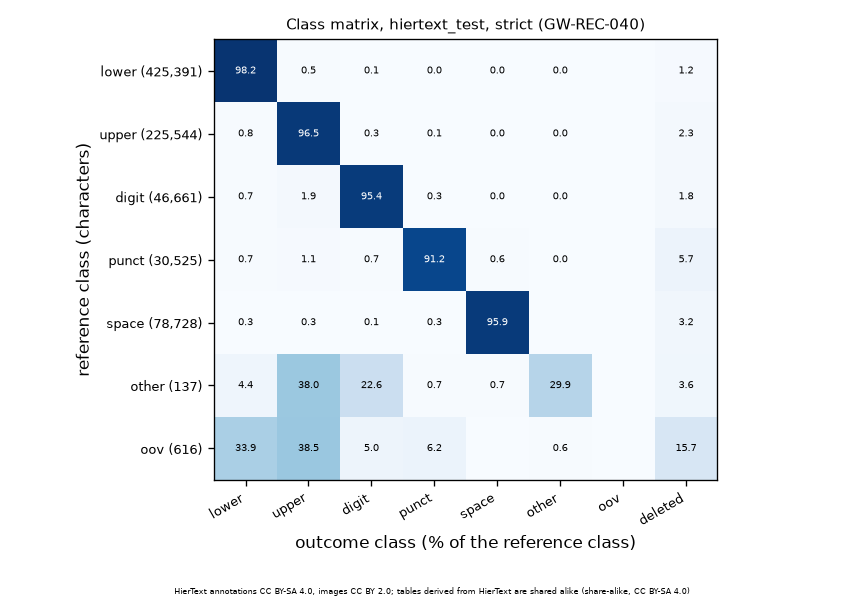
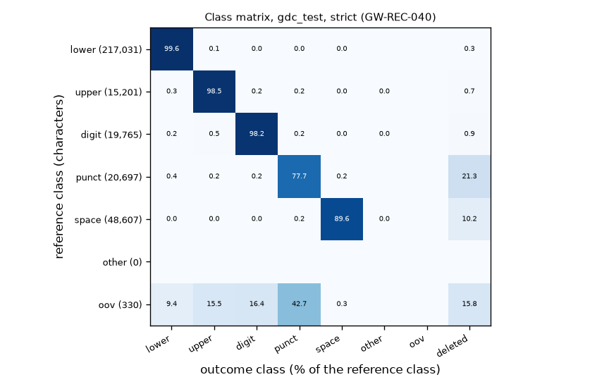

Generated by `scripts/phase15_errors.py` (GW-REC-040, GW-E2E-010); do not edit by hand.

# Phase 15: recognition errors (GW-REC-040)

Ground-truth crops through the frozen recognizer (GW-REC-039 on test, GW-REC-038 on HierText validation). Strict track first; the normalised track's CER beside it (IIIT5K: the alphanumeric track first). Lines whose normalised reference is empty are left out. Edit operations are Levenshtein's (`rapidfuzz`, the CER's own distance), so a line's substitutions, insertions and deletions add up to its char_errors (asserted); the alignment is one of several optimal ones, so a confusion inside a run of repeated characters is arbitrary. The one-character-away share is over substituted word pairs (an inserted or deleted word has no partner).

CIs: 95% percentile bootstrap, 1,000 resamples, seed 20261010, on the primary track only (the other tracks show values). The cited CI resamples pages (per-page sums; pages with no line in the slice stay in as 0/0; HierText validation's page is the image of the line id), GDC condition rows source documents, IIIT5K lines; the line bootstrap is beside it. A cell with fewer than 30 lines or 5 pages shows counts only, and so do the rows inside a GDC document group. Every share is a share of the whole set's character errors. Intervals are descriptive: no correction is applied, and no slice is called worse than another from two marginal intervals. Slices are marginal and confounded (blur on a resized crop goes with line height, condition with document).

Merged words are deleted spaces, split words inserted ones. Bin edges come from GW-REC-038 (README.md); line length is the strict-normalised reference length on every track. GDC lines of the CC BY-SA 3.0 textbooks (hefferon_linalg, mit_mcs) are listed by id and numbers only.

## hiertext_test (GW-REC-039)

HierText tables: HierText annotations CC BY-SA 4.0, images CC BY 2.0; tables derived from them are shared alike (share-alike, CC BY-SA 4.0).

| Track | Lines | Ref chars | Errors | CER % [cited CI] | CER % [line CI] | Charset ceiling % | Sub % | Ins % | Del % | Merged words | Split words |
|---|---|---|---|---|---|---|---|---|---|---|---|
| strict | 67,574 | 807,602 | 48,726 | 6.03 [5.60, 6.48] | 6.03 [5.89, 6.18] | 0.08 | 3.27 | 0.89 | 1.88 | 2512 | 1110 |
| normalised | 67,574 | 807,835 | 46,424 | 5.75 | n/a | 0.07 | 2.97 | 0.89 | 1.89 | 2550 | 1126 |

| Track | Ref words | Word errors | WER % | Substituted pairs one character away % |
|---|---|---|---|---|
| strict | 146,302 | 28,177 | 19.26 | 52.81 |
| normalised | 146,310 | 27,265 | 18.64 | 53.03 |

Character and word tables: `reports/confusion_analysis/GW-REC-040/characters_hiertext_test.md`, `reports/confusion_analysis/GW-REC-040/words_hiertext_test.md`.

**Class matrix (strict): rate per reference character.** A same-class cell holds the characters read correctly and the same-class substitutions together; Correct % counts only the characters read as themselves.

| Reference class | Chars | Correct % | lower | upper | digit | punct | space | other | oov | deleted |
|---|---|---|---|---|---|---|---|---|---|---|
| lower | 425,391 | 96.34 | 98.21 | 0.49 | 0.08 | 0.04 | 0.03 | 0.00 | 0.00 | 1.15 |
| upper | 225,544 | 93.24 | 0.77 | 96.47 | 0.35 | 0.10 | 0.05 | 0.01 | 0.00 | 2.25 |
| digit | 46,661 | 93.20 | 0.68 | 1.86 | 95.40 | 0.26 | 0.04 | 0.01 | 0.00 | 1.75 |
| punct | 30,525 | 88.02 | 0.69 | 1.13 | 0.66 | 91.23 | 0.63 | 0.01 | 0.00 | 5.66 |
| space | 78,728 | 95.91 | 0.26 | 0.26 | 0.11 | 0.27 | 95.91 | 0.00 | 0.00 | 3.19 |
| other | 137 | 26.28 | 4.38 | 37.96 | 22.63 | 0.73 | 0.73 | 29.93 | 0.00 | 3.65 |
| oov | 616 | 0.00 | 33.93 | 38.47 | 5.03 | 6.17 | 0.00 | 0.65 | 0.00 | 15.75 |

Inserted characters by class: lower 2,606, upper 1,929, digit 552, punct 943, space 1,110, other 10, oov 0.

**Slice: line_height_px**

| Bin | Lines | Pages | Ref chars | Errors | CER % [cited CI] | CER % [line CI] | Share of the set's errors % | Charset ceiling % | CER % normalised |
|---|---|---|---|---|---|---|---|---|---|
| &lt; 9.35 | 16,712 | 1099 | 133,783 | 14,734 | 11.01 [9.90, 12.22] | 11.01 [10.65, 11.37] | 30.24 | 0.04 | 10.53 |
| [9.35, 13.52) | 16,416 | 1295 | 209,982 | 9,549 | 4.55 [4.03, 5.10] | 4.55 [4.35, 4.76] | 19.60 | 0.09 | 4.35 |
| [13.52, 21.485) | 17,684 | 1430 | 243,923 | 8,932 | 3.66 [3.27, 4.11] | 3.66 [3.50, 3.85] | 18.33 | 0.07 | 3.48 |
| ≥ 21.485 | 16,762 | 1362 | 219,914 | 15,511 | 7.05 [6.27, 7.92] | 7.05 [6.72, 7.41] | 31.83 | 0.09 | 6.69 |

**Slice: blur**

| Bin | Lines | Pages | Ref chars | Errors | CER % [cited CI] | CER % [line CI] | Share of the set's errors % | Charset ceiling % | CER % normalised |
|---|---|---|---|---|---|---|---|---|---|
| &lt; 20.3355 | 16,249 | 1148 | 151,888 | 17,520 | 11.53 [10.67, 12.50] | 11.53 [11.21, 11.91] | 35.96 | 0.03 | 11.07 |
| [20.3355, 73.168) | 16,239 | 1345 | 182,445 | 10,071 | 5.52 [4.85, 6.26] | 5.52 [5.31, 5.73] | 20.67 | 0.09 | 5.26 |
| [73.168, 249.12) | 17,381 | 1411 | 206,755 | 7,499 | 3.63 [3.18, 4.17] | 3.63 [3.45, 3.80] | 15.39 | 0.09 | 3.41 |
| ≥ 249.12 | 17,705 | 1366 | 266,514 | 13,636 | 5.12 [4.50, 5.85] | 5.12 [4.82, 5.43] | 27.99 | 0.08 | 4.86 |

**Slice: contrast**

| Bin | Lines | Pages | Ref chars | Errors | CER % [cited CI] | CER % [line CI] | Share of the set's errors % | Charset ceiling % | CER % normalised |
|---|---|---|---|---|---|---|---|---|---|
| &lt; 28.713 | 16,043 | 1150 | 177,012 | 16,551 | 9.35 [8.49, 10.28] | 9.35 [9.00, 9.71] | 33.97 | 0.02 | 8.97 |
| [28.713, 43.0448) | 16,631 | 1321 | 200,658 | 13,724 | 6.84 [6.12, 7.56] | 6.84 [6.52, 7.16] | 28.17 | 0.11 | 6.53 |
| [43.0448, 59.1643) | 16,861 | 1319 | 206,395 | 10,900 | 5.28 [4.56, 6.10] | 5.28 [5.04, 5.56] | 22.37 | 0.07 | 5.02 |
| ≥ 59.1643 | 18,039 | 1110 | 223,537 | 7,551 | 3.38 [2.96, 3.83] | 3.38 [3.19, 3.58] | 15.50 | 0.09 | 3.16 |

**Slice: length**

| Bin | Lines | Pages | Ref chars | Errors | CER % [cited CI] | CER % [line CI] | Share of the set's errors % | Charset ceiling % | CER % normalised |
|---|---|---|---|---|---|---|---|---|---|
| &lt; 3 | 10,854 | 1183 | 16,020 | 3,370 | 21.04 [18.64, 23.26] | 21.04 [20.09, 22.02] | 6.92 | 0.25 | 19.36 |
| [3, 7) | 20,673 | 1458 | 90,611 | 10,275 | 11.34 [10.44, 12.24] | 11.34 [11.02, 11.64] | 21.09 | 0.05 | 10.60 |
| [7, 13) | 17,153 | 1480 | 154,453 | 12,511 | 8.10 [7.42, 8.90] | 8.10 [7.83, 8.37] | 25.68 | 0.11 | 7.70 |
| ≥ 13 | 18,894 | 1428 | 546,518 | 22,570 | 4.13 [3.71, 4.60] | 4.13 [3.96, 4.30] | 46.32 | 0.06 | 3.99 |

**Slice: confidence**

| Bin | Lines | Pages | Ref chars | Errors | CER % [cited CI] | CER % [line CI] | Share of the set's errors % | Charset ceiling % | CER % normalised |
|---|---|---|---|---|---|---|---|---|---|
| &lt; 0.626682 | 16,297 | 1410 | 159,312 | 38,257 | 24.01 [22.88, 25.25] | 24.01 [23.46, 24.55] | 78.51 | 0.28 | 23.02 |
| [0.626682, 0.801411) | 16,957 | 1526 | 251,263 | 8,273 | 3.29 [3.12, 3.48] | 3.29 [3.19, 3.39] | 16.98 | 0.04 | 3.07 |
| [0.801411, 0.87643) | 17,135 | 1502 | 284,754 | 1,761 | 0.62 [0.57, 0.68] | 0.62 [0.58, 0.66] | 3.61 | 0.02 | 0.57 |
| ≥ 0.87643 | 17,185 | 1430 | 112,273 | 435 | 0.39 [0.33, 0.44] | 0.39 [0.34, 0.43] | 0.89 | 0.02 | 0.34 |

**Slice: rotation**

| Bin | Lines | Pages | Ref chars | Errors | CER % [cited CI] | CER % [line CI] | Share of the set's errors % | Charset ceiling % | CER % normalised |
|---|---|---|---|---|---|---|---|---|---|
| &lt; 2 | 40,840 | 1497 | 542,065 | 24,168 | 4.46 [4.01, 4.94] | 4.46 [4.30, 4.62] | 49.60 | 0.08 | 4.24 |
| [2, 5) | 8,524 | 1231 | 99,280 | 7,336 | 7.39 [6.69, 8.19] | 7.39 [7.01, 7.82] | 15.06 | 0.11 | 7.04 |
| [5, 15) | 7,954 | 976 | 80,605 | 7,958 | 9.87 [8.81, 11.08] | 9.87 [9.36, 10.36] | 16.33 | 0.04 | 9.45 |
| ≥ 15 | 10,256 | 834 | 85,652 | 9,264 | 10.82 [9.60, 12.07] | 10.82 [10.33, 11.30] | 19.01 | 0.06 | 10.32 |

**Slice: digit**

| Bin | Lines | Pages | Ref chars | Errors | CER % [cited CI] | CER % [line CI] | Share of the set's errors % | Charset ceiling % | CER % normalised |
|---|---|---|---|---|---|---|---|---|---|
| no | 52,135 | 1595 | 648,562 | 37,926 | 5.85 [5.42, 6.33] | 5.85 [5.70, 6.00] | 77.84 | 0.08 | 5.53 |
| yes | 15,439 | 1302 | 159,040 | 10,800 | 6.79 [5.85, 7.88] | 6.79 [6.44, 7.16] | 22.16 | 0.06 | 6.62 |

**Slice: punct**

| Bin | Lines | Pages | Ref chars | Errors | CER % [cited CI] | CER % [line CI] | Share of the set's errors % | Charset ceiling % | CER % normalised |
|---|---|---|---|---|---|---|---|---|---|
| no | 49,933 | 1587 | 412,179 | 30,693 | 7.45 [6.91, 7.96] | 7.45 [7.26, 7.64] | 62.99 | 0.10 | 7.05 |
| yes | 17,641 | 1434 | 395,423 | 18,033 | 4.56 [3.98, 5.19] | 4.56 [4.36, 4.77] | 37.01 | 0.05 | 4.39 |

**Slice: upper**

| Bin | Lines | Pages | Ref chars | Errors | CER % [cited CI] | CER % [line CI] | Share of the set's errors % | Charset ceiling % | CER % normalised |
|---|---|---|---|---|---|---|---|---|---|
| no | 44,724 | 1558 | 607,354 | 31,485 | 5.18 [4.77, 5.64] | 5.18 [5.03, 5.33] | 64.62 | 0.08 | 4.87 |
| yes | 22,850 | 1393 | 200,248 | 17,241 | 8.61 [7.82, 9.45] | 8.61 [8.34, 8.89] | 35.38 | 0.08 | 8.39 |

**Slice: long_word**

| Bin | Lines | Pages | Ref chars | Errors | CER % [cited CI] | CER % [line CI] | Share of the set's errors % | Charset ceiling % | CER % normalised |
|---|---|---|---|---|---|---|---|---|---|
| no | 59,852 | 1593 | 576,710 | 39,118 | 6.78 [6.31, 7.32] | 6.78 [6.64, 6.93] | 80.28 | 0.07 | 6.44 |
| yes | 7,722 | 1266 | 230,892 | 9,608 | 4.16 [3.61, 4.75] | 4.16 [3.85, 4.46] | 19.72 | 0.10 | 4.01 |

**Slice: oov**

| Bin | Lines | Pages | Ref chars | Errors | CER % [cited CI] | CER % [line CI] | Share of the set's errors % | Charset ceiling % | CER % normalised |
|---|---|---|---|---|---|---|---|---|---|
| no | 67,292 | 1599 | 802,640 | 47,437 | 5.91 [5.49, 6.36] | 5.91 [5.78, 6.04] | 97.35 | 0.00 | 5.63 |
| yes | 282 | 109 | 4,962 | 1,289 | 25.98 [14.37, 39.80] | 25.98 [21.43, 31.39] | 2.65 | 12.41 | 29.12 |

**Primary categories (strict): 19,347 wrong lines, 48,726 character errors**

| Category | Lines | Share of wrong lines % | Errors | Share of errors % |
|---|---|---|---|---|
| out_of_charset | 282 | 1.46 | 1,289 | 2.65 |
| rotation_ge_5 | 6,606 | 34.14 | 17,014 | 34.92 |
| height_q1 | 4,195 | 21.68 | 10,381 | 21.30 |
| blur_q1 | 1,510 | 7.80 | 4,033 | 8.28 |
| contrast_q1 | 1,055 | 5.45 | 2,661 | 5.46 |
| digit | 1,303 | 6.73 | 3,523 | 7.23 |
| punctuation | 1,669 | 8.63 | 4,134 | 8.48 |
| long_word | 296 | 1.53 | 941 | 1.93 |
| other | 2,431 | 12.57 | 4,750 | 9.75 |

**Likely label fragments (strict)**: 15 lines, 145 character errors (0.30% of the set's), 139 insertions (1.94% of its insertions). Without them: CER 6.02%, sub 3.27%, ins 0.87%, del 1.88%.

**Character errors by reference length (ADR-0002's buckets; strict-normalised length)**

| Length | Lines | Errors | CER % | Share of errors % |
|---|---|---|---|---|
| 0-29 | 61,187 | 39,097 | 7.88 | 80.24 |
| 30-49 | 4,061 | 5,214 | 3.39 | 10.70 |
| 50-69 | 1,529 | 2,107 | 2.39 | 4.32 |
| 70+ | 797 | 2,308 | 3.31 | 4.74 |

**Baselines beside GLYPHARIS on hiertext_test** (rates per reference character; class columns: share of each reference class read as itself, GLYPHARIS charset classes; every system on the same lines)

HierText tables: HierText annotations CC BY-SA 4.0, images CC BY 2.0; tables derived from them are shared alike (share-alike, CC BY-SA 4.0).

| ID | System | Track | Lines | CER % | Sub % | Ins % | Del % | lower correct % | upper correct % | digit correct % | punct correct % | space correct % | other correct % | oov correct % |
|---|---|---|---|---|---|---|---|---|---|---|---|---|---|---|
| GW-REC-039 | GLYPHARIS v1 | strict | 67,574 | 6.03 | 3.27 | 0.89 | 1.88 | 96.34 | 93.24 | 93.20 | 88.02 | 95.91 | 26.28 | 0.00 |
| GW-REC-039 | GLYPHARIS v1 | normalised | 67,574 | 5.75 | 2.97 | 0.89 | 1.89 | 95.59 | 0.00 | 93.17 | 88.31 | 95.88 | 0.00 | 0.00 |
| GW-BASE-001 | Tesseract 5 | strict | 67,574 | 24.28 | 8.68 | 2.73 | 12.87 | 83.95 | 68.88 | 67.32 | 67.52 | 87.72 | 0.00 | 0.49 |
| GW-BASE-001 | Tesseract 5 | normalised | 67,574 | 23.17 | 7.49 | 2.76 | 12.92 | 79.95 | 0.00 | 67.24 | 71.27 | 87.70 | 0.00 | 0.54 |
| GW-BASE-002 | PP-OCRv5 mobile | strict | 67,574 | 9.23 | 3.81 | 1.13 | 4.30 | 93.40 | 90.85 | 91.84 | 85.62 | 90.04 | 1.46 | 1.62 |
| GW-BASE-002 | PP-OCRv5 mobile | normalised | 67,574 | 8.71 | 3.28 | 1.12 | 4.31 | 93.11 | 0.00 | 91.80 | 86.12 | 90.02 | 0.00 | 1.44 |
| GW-BASE-004 | TrOCR-small-printed | strict | 67,574 | 64.00 | 55.97 | 4.33 | 3.70 | 0.30 | 83.71 | 84.97 | 76.11 | 92.43 | 0.00 | 0.00 |
| GW-BASE-004 | TrOCR-small-printed | normalised | 67,574 | 20.21 | 11.50 | 4.65 | 4.06 | 83.88 | 0.00 | 84.90 | 76.41 | 92.59 | 0.00 | 0.00 |
| GW-BASE-005 | PP-OCRv6 tiny | strict | 67,574 | 10.82 | 5.65 | 1.07 | 4.10 | 92.99 | 87.41 | 90.08 | 80.46 | 88.29 | 10.22 | 6.66 |
| GW-BASE-005 | PP-OCRv6 tiny | normalised | 67,574 | 10.31 | 5.11 | 1.07 | 4.12 | 91.62 | 0.00 | 90.06 | 81.67 | 88.28 | 5.56 | 6.13 |
| GW-BASE-006 | PP-OCRv6 small | strict | 67,574 | 7.06 | 3.27 | 1.08 | 2.72 | 95.93 | 92.80 | 93.57 | 87.14 | 90.86 | 5.84 | 15.10 |
| GW-BASE-006 | PP-OCRv6 small | normalised | 67,574 | 6.74 | 2.94 | 1.07 | 2.73 | 95.18 | 0.00 | 93.53 | 87.84 | 90.85 | 11.11 | 14.05 |

**The 20 worst lines of hiertext_test (strict)**

HierText tables: HierText annotations CC BY-SA 4.0, images CC BY 2.0; tables derived from them are shared alike (share-alike, CC BY-SA 4.0).

| Key | Errors | Ref chars | Reference | Prediction |
|---|---|---|---|---|
| 743b79a125701778/p2/l2 | 116 | 229 | reditibur tampro Profacraribus quam ftudiasis dotavit Zuibus partea, Danor Normannorumg, invasione ting anlibue nterci Collegui deolatione tantum non ruinā, passum anDonec Guliclmi Archidiacni Dunelimensir pietate refectik inrtau | rehinhue taom pra Bufewrilut quam ftudaru, dotamt tyihns paetos, Bam ra Moh Maorc dg, tir nrior i  arudlue nirrealfie Coalegu deslatieoncx tanh  nan, aura, paenim cr Donce Dukicln hechiiaenm Dunedraenais pietutr g eairp'c iuriazas |
| 743b79a125701778/p2/l4 | 106 | 220 | ratum, & aliorumpmaxima ex parte Alumnor fuorum Gualteri feilicet Skirlam Epircopi Dunehmente ria Narthunbrie.cx inclita Perciari fire Saundi, Caroli Grmmood et DSimonis Benet uliaruung liberalitate aucum.et in pranentem | hatum x akierunnaximu, ex parte Ahmnorqy fuoraumn) Gualen, fakieet otirtan Epueop genncnfr tyeliolNorthmnbrc ce unckna Peraari frpe Comuts Semdk, Caruk Gromood, at D" Smnnir Beue, akorumg, lhorulrtate utumalt H, qireate |
| 404e7120588e648b/p1/l46 | 101 | 101 | TDT\_REVIEWED\_FINAL 190,7024114] sd 5:0:0:0: [sdb] 7834944 512-byte logical blockd: (4,01 GB/3,73 GIB) | n |
| 743b79a125701778/p2/l3 | 95 | 218 | Circa An:Sal: 872 Alfradus sine Mrredus Occidentatium Saxonum Rex rere magnus peno interurlua literaru Studio Oxanice rasusataturu Geimoaldu sipe Grimbaldum, virum sanctitate et doctrina celebrem nu non Regis(dum Romam | Cr gar lnasal. ,2&lr ohue sive Ur odias Oeadentalum Saxoum Rer ore magns pene interirtias litrauriyhuka deonie rerurciarus geimoal -eie grimlallom, sirin.-cackituate d dcrina odlebem ne noe Reielkimn Rkoman |
| 2688f5d887c4ace8/p24/l0 | 94 | 95 | Iftæ duæ cellulæ ab extra pofitaæ ponunF ad decorĕ: & ad demό ftrandũ gen' affin.fe lnõ hňt ph. | T  S |
| 41959baf35a42504/p9/l2 | 64 | 81 | 4.6% ABV irresistible. stout dy this renders smokiness of hint A content. alcohol | alcohol content, A hint of smokiness renders this dm stcut irresistible AV 4.6 |
| a63046e4f89d47c3/p0/l35 | 64 | 95 | AutoTracker AutoTracker AutoTracker AutoTracker AutoTracker AutoTracker AutoTracker AutoTracker | Aurab Are Auate Ade Aa Ad Aarde AatTrde |
| f0e0ae98e008bf92/p3/l0 | 64 | 101 | Although in every century many long-period comets appear brighter and more spectacular. Halley is the | sl ees p nne me fhat ie tang per e  yeare t ia the e se e e l e hle ltaley is the |
| 29fe0b8790f1fe7b/p16/l0 | 58 | 60 | owner of the work reproduced reserved. Unauthorised copying, |       nn |
| 40a9b3b0e1cccdc9/p49/l1 | 57 | 27 | www.scunet www.tahocom www. | ww.scutataktahoevacationhome.et wwww.tahoecabrrenitals.com. www.vacanoortlssed.com |
| f0e0ae98e008bf92/p3/l4 | 55 | 97 | Halley, is comet that can be seen every 75-76 years. It is the most famous of all periodic comets | Hfaliog h ia cvmre that can be ien ever Halioy ynd alin refoered at as Como alponoli, Halieys |
| def04935d5ffc60e/p1/l0 | 54 | 55 | UNITED BROTHERHOOD OF CARPENTERS AND JOINERS OF AMERICA | O |
| b1a7990ee239a62e/p33/l1 | 53 | 59 | University Of Hert fordshire, College Lane Campus, Hatfield | STHF ORUN HERTEORD SHIRE PMit |
| f0e0ae98e008bf92/p3/l3 | 49 | 100 | certain to return within a human lifetime. Halley's Comet last appeared in the inner Solar System in | fe, and wit n aithin a human liretire thleley the nakel cyes, and thus, the only ealar Sywiten in |
| 00713a488c747f1e/p11/l0 | 48 | 63 | The people of Scotland want to know that all three main parties | T eittta te aa e e e  |
| 8bc7e6c60e996cc9/p5/l22 | 48 | 11 | 4 4 4 4 4 4 | 4 730.321 4.772.974 4 783 705 4.819 153 4 882 671.4 920 442 |
| 476975e1b086039b/p6/l0 | 45 | 34 | http//visibltweets.com/#queryserOR | http://visbletweets.com/#query-ursereurs Of unlarent OR %23audimadananatiore2 |
| ae58d1bce7d9b332/p0/l0 | 44 | 44 | THE AUSTR ALIAN KOOK ABURRA 1 OZ. 999 SILVER | C |
| 4d1aa626a640903f/p0/l0 | 43 | 44 | G8 FROM LA MADDALENA TO L'AQUILA SUMMIT 2009 | Q |
| f0e0ae98e008bf92/p3/l1 | 43 | 100 | only short-period comet that is clearly visible to the naked eye, and thus, the only naked-eye comet | cnls shor penod come that is leary pierid tome saipe tybr ghue hand e nly ak e -cy e comie |

## gdc_test (GW-REC-039)

| Track | Lines | Ref chars | Errors | CER % [cited CI] | CER % [line CI] | Charset ceiling % | Sub % | Ins % | Del % | Merged words | Split words |
|---|---|---|---|---|---|---|---|---|---|---|---|
| strict | 8,372 | 321,631 | 13,418 | 4.17 [2.48, 6.22] | 4.17 [3.72, 4.67] | 0.10 | 0.86 | 0.12 | 3.19 | 4941 | 115 |
| normalised | 8,372 | 321,635 | 12,662 | 3.94 | n/a | 0.06 | 0.62 | 0.12 | 3.19 | 4960 | 115 |

| Track | Ref words | Word errors | WER % | Substituted pairs one character away % |
|---|---|---|---|---|
| strict | 56,979 | 8,298 | 14.56 | 64.00 |
| normalised | 56,981 | 7,720 | 13.55 | 59.77 |

Character and word tables: `reports/confusion_analysis/GW-REC-040/characters_gdc_test.md`, `reports/confusion_analysis/GW-REC-040/words_gdc_test.md`.

**Class matrix (strict): rate per reference character.** A same-class cell holds the characters read correctly and the same-class substitutions together; Correct % counts only the characters read as themselves.

| Reference class | Chars | Correct % | lower | upper | digit | punct | space | other | oov | deleted |
|---|---|---|---|---|---|---|---|---|---|---|
| lower | 217,031 | 99.38 | 99.61 | 0.08 | 0.01 | 0.03 | 0.01 | 0.00 | 0.00 | 0.26 |
| upper | 15,201 | 98.28 | 0.32 | 98.54 | 0.16 | 0.24 | 0.01 | 0.04 | 0.00 | 0.68 |
| digit | 19,765 | 97.74 | 0.15 | 0.46 | 98.17 | 0.22 | 0.05 | 0.03 | 0.00 | 0.93 |
| punct | 20,697 | 73.02 | 0.36 | 0.21 | 0.16 | 77.72 | 0.23 | 0.00 | 0.00 | 21.32 |
| space | 48,607 | 89.61 | 0.02 | 0.03 | 0.01 | 0.17 | 89.61 | 0.00 | 0.00 | 10.17 |
| other | 0 | 0.00 | 0.00 | 0.00 | 0.00 | 0.00 | 0.00 | 0.00 | 0.00 | 0.00 |
| oov | 330 | 0.00 | 9.39 | 15.45 | 16.36 | 42.73 | 0.30 | 0.00 | 0.00 | 15.76 |

Inserted characters by class: lower 145, upper 15, digit 39, punct 75, space 115, other 0, oov 0.

**Slice: line_height_px**

| Bin | Lines | Pages | Ref chars | Errors | CER % [cited CI] | CER % [line CI] | Share of the set's errors % | Charset ceiling % | CER % normalised |
|---|---|---|---|---|---|---|---|---|---|
| &lt; 9.35 | 113 | 18 | 113 | 69 | 61.06 [29.54, 98.00] | 61.06 [52.21, 69.91] | 0.51 | 7.08 | 56.52 |
| [9.35, 13.52) | 471 | 23 | 3,540 | 563 | 15.90 [8.36, 18.22] | 15.90 [13.54, 18.02] | 4.20 | 0.25 | 15.85 |
| [13.52, 21.485) | 2,009 | 68 | 34,957 | 1,428 | 4.09 [2.31, 6.65] | 4.09 [3.51, 4.70] | 10.64 | 0.05 | 3.81 |
| ≥ 21.485 | 5,779 | 106 | 283,021 | 11,358 | 4.01 [2.19, 6.32] | 4.01 [3.45, 4.51] | 84.65 | 0.10 | 3.78 |

**Slice: blur**

| Bin | Lines | Pages | Ref chars | Errors | CER % [cited CI] | CER % [line CI] | Share of the set's errors % | Charset ceiling % | CER % normalised |
|---|---|---|---|---|---|---|---|---|---|
| &lt; 20.3355 | 265 | 28 | 2,515 | 598 | 23.78 [16.34, 61.62] | 23.78 [19.00, 29.87] | 4.46 | 0.36 | 23.28 |
| [20.3355, 73.168) | 856 | 49 | 18,252 | 2,177 | 11.93 [4.41, 28.31] | 11.93 [8.37, 15.79] | 16.22 | 0.14 | 11.80 |
| [73.168, 249.12) | 2,829 | 93 | 75,943 | 4,433 | 5.84 [2.89, 10.31] | 5.84 [4.61, 7.12] | 33.04 | 0.08 | 5.39 |
| ≥ 249.12 | 4,422 | 105 | 224,921 | 6,210 | 2.76 [1.53, 4.27] | 2.76 [2.39, 3.16] | 46.28 | 0.11 | 2.59 |

**Slice: contrast**

| Bin | Lines | Pages | Ref chars | Errors | CER % [cited CI] | CER % [line CI] | Share of the set's errors % | Charset ceiling % | CER % normalised |
|---|---|---|---|---|---|---|---|---|---|
| &lt; 28.713 | 631 | 50 | 21,995 | 3,395 | 15.44 [6.32, 32.15] | 15.44 [11.80, 19.36] | 25.30 | 0.20 | 15.22 |
| [28.713, 43.0448) | 3,114 | 106 | 134,715 | 8,274 | 6.14 [3.61, 9.33] | 6.14 [5.28, 7.00] | 61.66 | 0.13 | 5.82 |
| [43.0448, 59.1643) | 4,172 | 101 | 160,523 | 1,691 | 1.05 [0.72, 1.49] | 1.05 [0.88, 1.23] | 12.60 | 0.06 | 0.89 |
| ≥ 59.1643 | 455 | 40 | 4,398 | 58 | 1.32 [0.76, 2.29] | 1.32 [0.95, 1.74] | 0.43 | 0.09 | 1.09 |

**Slice: length**

| Bin | Lines | Pages | Ref chars | Errors | CER % [cited CI] | CER % [line CI] | Share of the set's errors % | Charset ceiling % | CER % normalised |
|---|---|---|---|---|---|---|---|---|---|
| &lt; 3 | 512 | 75 | 716 | 137 | 19.13 [12.02, 26.14] | 19.13 [15.91, 22.56] | 1.02 | 4.19 | 17.97 |
| [3, 7) | 1,580 | 80 | 6,643 | 445 | 6.70 [3.65, 10.04] | 6.70 [5.81, 7.74] | 3.32 | 0.38 | 6.31 |
| [7, 13) | 696 | 87 | 6,472 | 668 | 10.32 [5.76, 14.94] | 10.32 [8.90, 11.77] | 4.98 | 0.37 | 9.97 |
| ≥ 13 | 5,584 | 106 | 307,800 | 12,168 | 3.95 [2.22, 6.09] | 3.95 [3.45, 4.42] | 90.68 | 0.08 | 3.73 |

**Slice: confidence**

| Bin | Lines | Pages | Ref chars | Errors | CER % [cited CI] | CER % [line CI] | Share of the set's errors % | Charset ceiling % | CER % normalised |
|---|---|---|---|---|---|---|---|---|---|
| &lt; 0.626682 | 588 | 65 | 10,988 | 3,058 | 27.83 [21.82, 36.66] | 27.83 [24.32, 31.76] | 22.79 | 0.96 | 26.82 |
| [0.626682, 0.801411) | 2,121 | 97 | 86,448 | 7,198 | 8.33 [4.43, 13.56] | 8.33 [6.97, 9.68] | 53.64 | 0.14 | 7.98 |
| [0.801411, 0.87643) | 4,150 | 104 | 197,712 | 3,055 | 1.55 [0.62, 2.94] | 1.55 [1.18, 1.93] | 22.77 | 0.05 | 1.38 |
| ≥ 0.87643 | 1,513 | 100 | 26,483 | 107 | 0.40 [0.19, 0.72] | 0.40 [0.31, 0.52] | 0.80 | 0.04 | 0.34 |

**Slice: rotation**

| Bin | Lines | Pages | Ref chars | Errors | CER % [cited CI] | CER % [line CI] | Share of the set's errors % | Charset ceiling % | CER % normalised |
|---|---|---|---|---|---|---|---|---|---|
| &lt; 2 | 7,514 | 96 | 286,120 | 12,986 | 4.54 [2.65, 6.82] | 4.54 [3.98, 5.07] | 96.78 | 0.10 | 4.29 |
| [2, 5) | 194 | 14 | 9,879 | 113 | 1.14 [0.59, 1.71] | 1.14 [0.85, 1.49] | 0.84 | 0.05 | 1.05 |
| [5, 15) | 380 | 13 | 11,565 | 134 | 1.16 [0.52, 2.58] | 1.16 [0.77, 1.65] | 1.00 | 0.10 | 0.99 |
| ≥ 15 | 284 | 11 | 14,067 | 185 | 1.32 [0.24, 3.50] | 1.32 [0.97, 1.70] | 1.38 | 0.12 | 1.19 |

**Slice: rotation_without_rotated_pages**

| Bin | Lines | Pages | Ref chars | Errors | CER % [cited CI] | CER % [line CI] | Share of the set's errors % | Charset ceiling % | CER % normalised |
|---|---|---|---|---|---|---|---|---|---|
| &lt; 2 | 7,328 | 94 | 279,123 | 12,955 | 4.64 [2.63, 7.33] | 4.64 [4.13, 5.19] | 96.55 | 0.11 | 4.39 |
| [2, 5) | 194 | 14 | 9,879 | 113 | 1.14 [0.63, 1.75] | 1.14 [0.85, 1.49] | 0.84 | 0.05 | 1.05 |
| [5, 15) | 380 | 13 | 11,565 | 134 | 1.16 [0.50, 2.62] | 1.16 [0.77, 1.65] | 1.00 | 0.10 | 0.99 |
| ≥ 15 | 68 | 6 | 2,594 | 64 | 2.47 [0.37, 6.87] | 2.47 [1.32, 3.91] | 0.48 | 0.66 | 2.24 |

**Slice: digit**

| Bin | Lines | Pages | Ref chars | Errors | CER % [cited CI] | CER % [line CI] | Share of the set's errors % | Charset ceiling % | CER % normalised |
|---|---|---|---|---|---|---|---|---|---|
| no | 4,051 | 105 | 175,747 | 2,550 | 1.45 [1.04, 1.89] | 1.45 [1.25, 1.68] | 19.00 | 0.08 | 1.24 |
| yes | 4,321 | 104 | 145,884 | 10,868 | 7.45 [3.98, 11.51] | 7.45 [6.48, 8.44] | 81.00 | 0.13 | 7.18 |

**Slice: punct**

| Bin | Lines | Pages | Ref chars | Errors | CER % [cited CI] | CER % [line CI] | Share of the set's errors % | Charset ceiling % | CER % normalised |
|---|---|---|---|---|---|---|---|---|---|
| no | 1,884 | 102 | 38,180 | 561 | 1.47 [0.84, 2.30] | 1.47 [1.12, 1.96] | 4.18 | 0.03 | 1.38 |
| yes | 6,488 | 106 | 283,451 | 12,857 | 4.54 [2.65, 6.81] | 4.54 [4.03, 5.10] | 95.82 | 0.11 | 4.28 |

**Slice: upper**

| Bin | Lines | Pages | Ref chars | Errors | CER % [cited CI] | CER % [line CI] | Share of the set's errors % | Charset ceiling % | CER % normalised |
|---|---|---|---|---|---|---|---|---|---|
| no | 8,193 | 105 | 317,492 | 11,647 | 3.67 [2.05, 5.58] | 3.67 [3.24, 4.14] | 86.80 | 0.10 | 3.43 |
| yes | 179 | 50 | 4,139 | 1,771 | 42.79 [3.71, 57.26] | 42.79 [33.40, 50.57] | 13.20 | 0.10 | 42.45 |

**Slice: long_word**

| Bin | Lines | Pages | Ref chars | Errors | CER % [cited CI] | CER % [line CI] | Share of the set's errors % | Charset ceiling % | CER % normalised |
|---|---|---|---|---|---|---|---|---|---|
| no | 5,511 | 106 | 142,710 | 8,560 | 6.00 [3.60, 8.80] | 6.00 [5.24, 6.89] | 63.79 | 0.16 | 5.68 |
| yes | 2,861 | 106 | 178,921 | 4,858 | 2.72 [1.30, 4.60] | 2.72 [2.22, 3.28] | 36.21 | 0.06 | 2.54 |

**Slice: oov**

| Bin | Lines | Pages | Ref chars | Errors | CER % [cited CI] | CER % [line CI] | Share of the set's errors % | Charset ceiling % | CER % normalised |
|---|---|---|---|---|---|---|---|---|---|
| no | 8,106 | 106 | 310,261 | 11,591 | 3.74 [2.08, 5.78] | 3.74 [3.30, 4.25] | 86.38 | 0.00 | 3.54 |
| yes | 266 | 58 | 11,370 | 1,827 | 16.07 [6.68, 27.47] | 16.07 [12.25, 20.23] | 13.62 | 2.90 | 21.30 |

**Slice: condition**

| Bin | Lines | Pages | Ref chars | Errors | CER % [cited CI] | CER % [line CI] | Share of the set's errors % | Charset ceiling % | CER % normalised |
|---|---|---|---|---|---|---|---|---|---|
| curved | 326 | 8 | 15,607 | 1,259 | 8.07 [0.42, 24.16] | 8.07 [5.07, 11.44] | 9.38 | 0.21 | 7.84 |
| distant | 1,051 | 11 | 42,417 | 1,330 | 3.14 [1.25, 8.37] | 3.14 [2.26, 4.06] | 9.91 | 0.07 | 2.89 |
| low\_light | 809 | 11 | 31,676 | 423 | 1.34 [0.87, 2.43] | 1.34 [1.12, 1.58] | 3.15 | 0.09 | 1.07 |
| photo\_angled | 1,684 | 16 | 50,935 | 1,470 | 2.89 [0.79, 6.88] | 2.89 [2.49, 3.28] | 10.96 | 0.08 | 2.62 |
| photo\_flat | 1,368 | 16 | 53,142 | 1,619 | 3.05 [1.04, 6.39] | 3.05 [2.47, 3.72] | 12.07 | 0.19 | 2.93 |
| rotated | 402 | 7 | 18,470 | 152 | 0.82 [0.25, 2.67] | 0.82 [0.61, 1.04] | 1.13 | 0.00 | 0.71 |
| scan\_app | 2,732 | 37 | 109,384 | 7,165 | 6.55 [2.42, 11.30] | 6.55 [5.37, 7.71] | 53.40 | 0.09 | 6.26 |

**Document groups (per-document CERs, no CI)**

| Group | Lines | Pages | CER % | Share of the set's errors % | Charset ceiling % | Documents (CER %) |
|---|---|---|---|---|---|---|
| book | 580 | 20 | 15.98 | 37.46 | 0.19 | calculus\_made\_easy 20.40; hilbert\_geometry 23.15; science\_hypothesis 0.23; whitehead\_maths 15.18 |
| form | 1,649 | 12 | 2.96 | 13.99 | 0.01 | irs\_1040 16.06; irs\_1040\_instructions 0.89; irs\_w9 1.30 |
| paper | 3,630 | 44 | 1.02 | 11.70 | 0.12 | blip2 0.78; cot 0.95; dpo 1.65; llama 1.15; llava15 0.88; mamba 1.05; mistral7b 0.50; qlora 0.90; smoothquant 1.15 |
| report | 1,993 | 18 | 7.56 | 28.98 | 0.05 | census\_income 12.54; frb\_fsr 0.93; nasa\_tm 1.28 |
| textbook | 520 | 12 | 5.05 | 7.88 | 0.28 | hefferon\_linalg 3.33; mit\_mcs 7.61 |

**Document groups inside scan_app (counts and CER, no CI)**

| Group | Lines | Pages | CER % | Share of the set's errors % | Charset ceiling % | Documents (CER %) |
|---|---|---|---|---|---|---|
| book | 228 | 7 | 23.65 | 21.32 | 0.30 | calculus\_made\_easy 15.35; hilbert\_geometry 24.35; science\_hypothesis 0.07; whitehead\_maths 35.26 |
| form | 643 | 5 | 2.94 | 5.80 | 0.02 | irs\_1040 12.07; irs\_1040\_instructions 0.81; irs\_w9 1.16 |
| paper | 886 | 11 | 0.74 | 2.12 | 0.06 | blip2 0.70; cot 1.51; dpo 0.52; llama 0.51; llava15 0.42; mamba 1.14; mistral7b 0.64 |
| report | 636 | 6 | 13.86 | 19.40 | 0.06 | census\_income 18.81; frb\_fsr 1.02; nasa\_tm 2.21 |
| textbook | 339 | 8 | 4.72 | 4.75 | 0.15 | hefferon\_linalg 1.52; mit\_mcs 7.26 |

**Conditions inside the paper group (counts and CER, no CI)**

| Group | Lines | Pages | CER % | Share of the set's errors % | Charset ceiling % | Documents (CER %) |
|---|---|---|---|---|---|---|
| curved | 88 | 3 | 0.26 | 0.13 | 0.09 | llama 1.16; mamba 0.17; mistral7b 0.34 |
| distant | 465 | 5 | 1.42 | 1.93 | 0.12 | mamba 1.39; mistral7b 0.59; qlora 1.38; smoothquant 2.10 |
| low\_light | 665 | 7 | 1.11 | 2.25 | 0.08 | llava15 1.25; mamba 1.24; mistral7b 0.40; smoothquant 1.11 |
| photo\_angled | 765 | 7 | 1.07 | 2.00 | 0.04 | blip2 1.15; cot 0.33; llama 1.41; qlora 0.94 |
| photo\_flat | 579 | 8 | 1.34 | 3.03 | 0.32 | blip2 1.02; cot 1.38; dpo 3.27; llava15 0.23; qlora 0.48; smoothquant 0.67 |
| rotated | 182 | 3 | 0.38 | 0.22 | 0.00 | blip2 0.28; cot 0.45; qlora 0.57 |
| scan\_app | 886 | 11 | 0.74 | 2.12 | 0.06 | blip2 0.70; cot 1.51; dpo 0.52; llama 0.51; llava15 0.42; mamba 1.14; mistral7b 0.64 |

**Condition x group (lines / pages)**

| Condition | book | form | paper | report | textbook |
|---|---|---|---|---|---|
| curved | 83 / 3 | 67 / 1 | 88 / 3 | 88 / 1 | - |
| distant | 19 / 1 | 310 / 2 | 465 / 5 | 204 / 2 | 53 / 1 |
| low_light | 47 / 2 | - | 665 / 7 | 97 / 2 | - |
| photo_angled | 94 / 3 | 175 / 1 | 765 / 7 | 551 / 3 | 99 / 2 |
| photo_flat | 24 / 1 | 319 / 2 | 579 / 8 | 417 / 4 | 29 / 1 |
| rotated | 85 / 3 | 135 / 1 | 182 / 3 | - | - |
| scan_app | 228 / 7 | 643 / 5 | 886 / 11 | 636 / 6 | 339 / 8 |

**Primary categories (strict): 2,288 wrong lines, 13,418 character errors**

| Category | Lines | Share of wrong lines % | Errors | Share of errors % |
|---|---|---|---|---|
| out_of_charset | 266 | 11.63 | 1,827 | 13.62 |
| rotation_ge_5 | 126 | 5.51 | 255 | 1.90 |
| height_q1 | 59 | 2.58 | 60 | 0.45 |
| blur_q1 | 107 | 4.68 | 531 | 3.96 |
| contrast_q1 | 168 | 7.34 | 2,738 | 20.41 |
| digit | 949 | 41.48 | 6,603 | 49.21 |
| punctuation | 518 | 22.64 | 1,253 | 9.34 |
| long_word | 30 | 1.31 | 46 | 0.34 |
| other | 65 | 2.84 | 105 | 0.78 |

**Character errors by reference length (ADR-0002's buckets; strict-normalised length)**

| Length | Lines | Errors | CER % | Share of errors % |
|---|---|---|---|---|
| 0-29 | 3,771 | 2,275 | 6.58 | 16.95 |
| 30-49 | 1,590 | 1,039 | 1.66 | 7.74 |
| 50-69 | 1,623 | 1,812 | 1.92 | 13.50 |
| 70+ | 1,388 | 8,292 | 6.37 | 61.80 |

**Baselines beside GLYPHARIS on gdc_test** (rates per reference character; class columns: share of each reference class read as itself, GLYPHARIS charset classes; every system on the same lines)

| ID | System | Track | Lines | CER % | Sub % | Ins % | Del % | lower correct % | upper correct % | digit correct % | punct correct % | space correct % | other correct % | oov correct % |
|---|---|---|---|---|---|---|---|---|---|---|---|---|---|---|
| GW-REC-039 | GLYPHARIS v1 | strict | 8,372 | 4.17 | 0.86 | 0.12 | 3.19 | 99.38 | 98.28 | 97.74 | 73.02 | 89.61 | 0.00 | 0.00 |
| GW-REC-039 | GLYPHARIS v1 | normalised | 8,372 | 3.94 | 0.62 | 0.12 | 3.19 | 99.36 | 0.00 | 97.77 | 75.54 | 89.60 | 0.00 | 0.00 |
| GW-BASE-001 | Tesseract 5 | strict | 8,372 | 6.42 | 2.69 | 0.68 | 3.05 | 98.01 | 94.18 | 87.29 | 71.42 | 90.69 | 0.00 | 8.79 |
| GW-BASE-001 | Tesseract 5 | normalised | 8,372 | 6.29 | 2.55 | 0.68 | 3.05 | 97.87 | 0.00 | 87.29 | 71.76 | 90.69 | 0.00 | 14.57 |
| GW-BASE-002 | PP-OCRv5 mobile | strict | 8,372 | 3.68 | 1.08 | 0.16 | 2.44 | 99.17 | 96.25 | 96.08 | 88.63 | 88.54 | 0.00 | 26.97 |
| GW-BASE-002 | PP-OCRv5 mobile | normalised | 8,372 | 3.38 | 0.79 | 0.16 | 2.43 | 99.13 | 0.00 | 96.12 | 90.99 | 88.54 | 0.00 | 42.21 |
| GW-BASE-003 | PP-OCRv5 server | strict | 8,372 | 11.24 | 1.13 | 0.08 | 10.03 | 96.82 | 94.36 | 92.11 | 67.62 | 59.68 | 0.00 | 16.67 |
| GW-BASE-003 | PP-OCRv5 server | normalised | 8,372 | 10.79 | 0.77 | 0.08 | 9.94 | 96.83 | 0.00 | 92.20 | 72.17 | 59.68 | 0.00 | 22.11 |
| GW-BASE-004 | TrOCR-small-printed | strict | 8,372 | 72.34 | 66.86 | 1.51 | 3.97 | 0.64 | 93.63 | 92.56 | 82.12 | 88.33 | 0.00 | 0.00 |
| GW-BASE-004 | TrOCR-small-printed | normalised | 8,372 | 13.07 | 6.76 | 1.92 | 4.38 | 89.05 | 0.00 | 92.59 | 84.44 | 88.65 | 0.00 | 0.00 |
| GW-BASE-005 | PP-OCRv6 tiny | strict | 8,372 | 4.00 | 1.29 | 0.17 | 2.55 | 98.98 | 97.30 | 96.41 | 87.83 | 87.11 | 0.00 | 41.21 |
| GW-BASE-005 | PP-OCRv6 tiny | normalised | 8,372 | 3.78 | 1.07 | 0.17 | 2.54 | 98.95 | 0.00 | 96.74 | 89.61 | 87.11 | 0.00 | 48.24 |
| GW-BASE-006 | PP-OCRv6 small | strict | 8,372 | 3.46 | 0.80 | 0.14 | 2.53 | 99.51 | 97.52 | 97.99 | 86.90 | 87.73 | 0.00 | 43.33 |
| GW-BASE-006 | PP-OCRv6 small | normalised | 8,372 | 3.21 | 0.54 | 0.14 | 2.53 | 99.49 | 0.00 | 98.05 | 89.22 | 87.73 | 0.00 | 53.27 |
| GW-BASE-007 | PP-OCRv6 medium | strict | 8,372 | 3.20 | 0.77 | 0.14 | 2.29 | 99.53 | 97.20 | 98.20 | 89.95 | 88.14 | 0.00 | 41.82 |
| GW-BASE-007 | PP-OCRv6 medium | normalised | 8,372 | 2.94 | 0.51 | 0.14 | 2.30 | 99.49 | 0.00 | 98.22 | 92.23 | 88.14 | 0.00 | 56.78 |

**The 20 worst lines of gdc_test (strict)**

| Key | Errors | Ref chars | Reference | Prediction | Source (document key, URL, licence) |
|---|---|---|---|---|---|
| gdc-0050/l44 | 159 | 166 | 2023. . . . . . . . . . . . . . . . . . . . . . . . . . . . . . . . . . . . . . . . . . . . . . . . . . . . . . . . . . . . . . . . . . . . . . . . . . . . . . . . 46 | 2023 46 | census\_income, https://www2.census.gov/library/publications/2024/demo/p60-282.pdf, public domain (US federal work) |
| gdc-0050/l4 | 147 | 171 | How Income Is Measured . . . . . . . . . . . . . . . . . . . . . . . . . . . . . . . . . . . . . . . . . . . . . . . . . . . . . . . . . . . . . . . . . . . . . . . . . 13 | How Income ls Measured 13 | census\_income, https://www2.census.gov/library/publications/2024/demo/p60-282.pdf, public domain (US federal work) |
| gdc-0050/l20 | 145 | 170 | Questions and Comments. . . . . . . . . . . . . . . . . . . . . . . . . . . . . . . . . . . . . . . . . . . . . . . . . . . . . . . . . . . . . . . . . . . . . . . . . 52 | Questions and Comments 52 | census\_income, https://www2.census.gov/library/publications/2024/demo/p60-282.pdf, public domain (US federal work) |
| gdc-0050/l26 | 145 | 157 | 1967 to 2023. . . . . . . . . . . . . . . . . . . . . . . . . . . . . . . . . . . . . . . . . . . . . . . . . . . . . . . . . . . . . . . . . . . . . . . . . | 1967 to 2023 | census\_income, https://www2.census.gov/library/publications/2024/demo/p60-282.pdf, public domain (US federal work) |
| gdc-0050/l6 | 144 | 172 | Cost-of-Living Adjustment . . . . . . . . . . . . . . . . . . . . . . . . . . . . . . . . . . . . . . . . . . . . . . . . . . . . . . . . . . . . . . . . . . . . . . . . 14 | Cost-of-Living Adjustment 14 | census\_income, https://www2.census.gov/library/publications/2024/demo/p60-282.pdf, public domain (US federal work) |
| gdc-0050/l30 | 141 | 157 | 2022 and 2023. . . . . . . . . . . . . . . . . . . . . . . . . . . . . . . . . . . . . . . . . . . . . . . . . . . . . . . . . . . . . . . . . . . . . . . 31 | 2022 and 2023 31 | census\_income, https://www2.census.gov/library/publications/2024/demo/p60-282.pdf, public domain (US federal work) |
| gdc-0050/l41 | 141 | 157 | 2022 and 2023. . . . . . . . . . . . . . . . . . . . . . . . . . . . . . . . . . . . . . . . . . . . . . . . . . . . . . . . . . . . . . . . . . . . . . . 45 | 2022 and 2023 45 | census\_income, https://www2.census.gov/library/publications/2024/demo/p60-282.pdf, public domain (US federal work) |
| gdc-0050/l47 | 141 | 157 | 2022 and 2023. . . . . . . . . . . . . . . . . . . . . . . . . . . . . . . . . . . . . . . . . . . . . . . . . . . . . . . . . . . . . . . . . . . . . . . 47 | 2022 and 2023 47 | census\_income, https://www2.census.gov/library/publications/2024/demo/p60-282.pdf, public domain (US federal work) |
| gdc-0050/l5 | 141 | 169 | Business Cycles—Recessions . . . . . . . . . . . . . . . . . . . . . . . . . . . . . . . . . . . . . . . . . . . . . . . . . . . . . . . . . . . . . . . . . . . . . . 13 | Business Cycles-Recessions 13 | census\_income, https://www2.census.gov/library/publications/2024/demo/p60-282.pdf, public domain (US federal work) |
| gdc-0050/l3 | 136 | 169 | Appendix A. Estimates of Income. . . . . . . . . . . . . . . . . . . . . . . . . . . . . . . . . . . . . . . . . . . . . . . . . . . . . . . . . . . . . . . . . . . . 13 | Appendix A Estimates of Income 13 | census\_income, https://www2.census.gov/library/publications/2024/demo/p60-282.pdf, public domain (US federal work) |
| gdc-0068/l38 | 136 | 147 | Conclusion . . . . . . . . . . . . . . . . . . . . . . . . . . . . . . . . . . . . . . . . . . . . . . . . . . . . . . . . . . . . . . . . . . . 80 | Conchnsion 80 | hilbert\_geometry, https://gutenberg.pglaf.org/1/7/3/8/17384/17384-pdf.pdf, public domain in the USA (Project Gutenberg) |
| gdc-0050/l8 | 130 | 166 | Appendix C. Additional Information. . . . . . . . . . . . . . . . . . . . . . . . . . . . . . . . . . . . . . . . . . . . . . . . . . . . . . . . . . . . . . . . . 50 | Appendix C Additional Information 50 | census\_income, https://www2.census.gov/library/publications/2024/demo/p60-282.pdf, public domain (US federal work) |
| gdc-0067/l2 | 124 | 136 | Introduction . . . . . . . . . . . . . . . . . . . . . . . . . . . . . . . . . . . . . . . . . . . . . . . . . . . . . . . . . . . . . . | Introduction  | hilbert\_geometry, https://gutenberg.pglaf.org/1/7/3/8/17384/17384-pdf.pdf, public domain in the USA (Project Gutenberg) |
| gdc-0050/l9 | 123 | 162 | Source and Accuracy of the Estimates. . . . . . . . . . . . . . . . . . . . . . . . . . . . . . . . . . . . . . . . . . . . . . . . . . . . . . . . . . . . . . 50 | Source and Accuracy of the Estimates 50 | census\_income, https://www2.census.gov/library/publications/2024/demo/p60-282.pdf, public domain (US federal work) |
| gdc-0050/l7 | 121 | 161 | Appendix B. Post-Tax Household Income. . . . . . . . . . . . . . . . . . . . . . . . . . . . . . . . . . . . . . . . . . . . . . . . . . . . . . . . . . . . . 43 | Appendix B. Post-Tax Household Income 43 | census\_income, https://www2.census.gov/library/publications/2024/demo/p60-282.pdf, public domain (US federal work) |
| gdc-0068/l35 | 108 | 129 | as sums of squares . . . . . . . . . . . . . . . . . . . . . . . . . . . . . . . . . . . . . . . . . . . . . . . . . . . . . . 74 | as sums of squares 74 | hilbert\_geometry, https://gutenberg.pglaf.org/1/7/3/8/17384/17384-pdf.pdf, public domain in the USA (Project Gutenberg) |
| gdc-0068/l9 | 106 | 128 | algebra of segments . . . . . . . . . . . . . . . . . . . . . . . . . . . . . . . . . . . . . . . . . . . . . . . . . . . . . 53 | algebra of segments 53 | hilbert\_geometry, https://gutenberg.pglaf.org/1/7/3/8/17384/17384-pdf.pdf, public domain in the USA (Project Gutenberg) |
| gdc-0068/l31 | 102 | 127 | transferer of segments . . . . . . . . . . . . . . . . . . . . . . . . . . . . . . . . . . . . . . . . . . . . . . . . . . . 71 | transferer of segments 71 | hilbert\_geometry, https://gutenberg.pglaf.org/1/7/3/8/17384/17384-pdf.pdf, public domain in the USA (Project Gutenberg) |
| gdc-0068/l25 | 97 | 122 | Non-pascalian geometry. . . . . . . . . . . . . . . . . . . . . . . . . . . . . . . . . . . . . . . . . . . . . . . . . 69 | Non-pascalian geometry 69 | hilbert\_geometry, https://gutenberg.pglaf.org/1/7/3/8/17384/17384-pdf.pdf, public domain in the USA (Project Gutenberg) |
| gdc-0050/l19 | 95 | 147 | Survey of Income and Program Participation (SIPP). . . . . . . . . . . . . . . . . . . . . . . . . . . . . . . . . . . . . . . . . . . . . . . . 52 | Survey of Income and Program Participation (SIPP) 52 | census\_income, https://www2.census.gov/library/publications/2024/demo/p60-282.pdf, public domain (US federal work) |

## gdc_scan_test (GW-REC-039)

Numbers only: no text, word, confusion, category or example table is built for this set.

| Track | Lines | Ref chars | Errors | CER % [cited CI] | CER % [line CI] | Charset ceiling % | Sub % | Ins % | Del % | Merged words | Split words |
|---|---|---|---|---|---|---|---|---|---|---|---|
| strict | 776 | 32,420 | 331 | 1.02 [0.79, 1.30] | 1.02 [0.85, 1.20] | 0.33 | n/a | n/a | n/a | n/a | n/a |
| normalised | 776 | 32,420 | 288 | 0.89 | n/a | 0.17 | n/a | n/a | n/a | n/a | n/a |

**Slice: line_height_px** (charset ceiling of the set: 0.33%)

| Bin | Lines | Pages | Ref chars | Errors | CER % [cited CI] | CER % [line CI] | Share of the set's errors % | CER % normalised |
|---|---|---|---|---|---|---|---|---|
| &lt; 9.35 | 3 | 2 | 3 | 3 | 100.00 | n/a | 0.91 | 33.33 |
| [13.52, 21.485) | 1 | 1 | 5 | 0 | 0.00 | n/a | 0.00 | 0.00 |
| ≥ 21.485 | 772 | 28 | 32,412 | 328 | 1.01 [0.78, 1.29] | 1.01 [0.85, 1.19] | 99.09 | 0.89 |

**Slice: blur** (charset ceiling of the set: 0.33%)

| Bin | Lines | Pages | Ref chars | Errors | CER % [cited CI] | CER % [line CI] | Share of the set's errors % | CER % normalised |
|---|---|---|---|---|---|---|---|---|
| &lt; 20.3355 | 3 | 2 | 3 | 3 | 100.00 | n/a | 0.91 | 33.33 |
| [73.168, 249.12) | 29 | 9 | 413 | 24 | 5.81 | n/a | 7.25 | 5.81 |
| ≥ 249.12 | 744 | 27 | 32,004 | 304 | 0.95 [0.72, 1.18] | 0.95 [0.79, 1.11] | 91.84 | 0.82 |

**Slice: contrast** (charset ceiling of the set: 0.33%)

| Bin | Lines | Pages | Ref chars | Errors | CER % [cited CI] | CER % [line CI] | Share of the set's errors % | CER % normalised |
|---|---|---|---|---|---|---|---|---|
| &lt; 28.713 | 5 | 2 | 319 | 31 | 9.72 | n/a | 9.37 | 9.72 |
| [28.713, 43.0448) | 52 | 14 | 2,412 | 36 | 1.49 [0.78, 2.22] | 1.49 [0.92, 2.20] | 10.88 | 1.24 |
| [43.0448, 59.1643) | 512 | 27 | 25,743 | 240 | 0.93 [0.67, 1.23] | 0.93 [0.78, 1.10] | 72.51 | 0.80 |
| ≥ 59.1643 | 207 | 24 | 3,946 | 24 | 0.61 [0.18, 1.02] | 0.61 [0.29, 0.97] | 7.25 | 0.56 |

**Slice: length** (charset ceiling of the set: 0.33%)

| Bin | Lines | Pages | Ref chars | Errors | CER % [cited CI] | CER % [line CI] | Share of the set's errors % | CER % normalised |
|---|---|---|---|---|---|---|---|---|
| &lt; 3 | 49 | 25 | 68 | 4 | 5.88 [0.00, 10.68] | 5.88 [1.35, 12.12] | 1.21 | 2.94 |
| [3, 7) | 103 | 28 | 513 | 29 | 5.65 [2.86, 8.78] | 5.65 [2.87, 8.93] | 8.76 | 5.65 |
| [7, 13) | 106 | 16 | 948 | 17 | 1.79 [0.71, 2.83] | 1.79 [0.93, 2.88] | 5.14 | 1.79 |
| ≥ 13 | 518 | 28 | 30,891 | 281 | 0.91 [0.67, 1.18] | 0.91 [0.75, 1.10] | 84.89 | 0.78 |

**Slice: confidence** (charset ceiling of the set: 0.33%)

| Bin | Lines | Pages | Ref chars | Errors | CER % [cited CI] | CER % [line CI] | Share of the set's errors % | CER % normalised |
|---|---|---|---|---|---|---|---|---|
| &lt; 0.626682 | 30 | 12 | 613 | 61 | 9.95 [5.75, 17.63] | 9.95 [6.24, 15.88] | 18.43 | 9.46 |
| [0.626682, 0.801411) | 199 | 25 | 10,076 | 196 | 1.95 [1.64, 2.41] | 1.95 [1.63, 2.28] | 59.21 | 1.73 |
| [0.801411, 0.87643) | 353 | 27 | 19,011 | 71 | 0.37 [0.25, 0.54] | 0.37 [0.28, 0.48] | 21.45 | 0.28 |
| ≥ 0.87643 | 194 | 26 | 2,720 | 3 | 0.11 [0.00, 0.25] | 0.11 [0.00, 0.31] | 0.91 | 0.11 |

**Slice: rotation** (charset ceiling of the set: 0.33%)

| Bin | Lines | Pages | Ref chars | Errors | CER % [cited CI] | CER % [line CI] | Share of the set's errors % | CER % normalised |
|---|---|---|---|---|---|---|---|---|
| &lt; 2 | 776 | 28 | 32,420 | 331 | 1.02 [0.79, 1.30] | 1.02 [0.85, 1.20] | 100.00 | 0.89 |

**Character errors by reference length (ADR-0002's buckets; strict-normalised length)**

| Length | Lines | Errors | CER % | Share of errors % |
|---|---|---|---|---|
| 0-29 | 438 | 81 | 1.55 | 24.47 |
| 30-49 | 75 | 17 | 0.59 | 5.14 |
| 50-69 | 35 | 26 | 1.24 | 7.85 |
| 70+ | 228 | 207 | 0.93 | 62.54 |

**The 20 worst lines of gdc_scan_test (strict)**

| Rank | Errors | Ref chars |
|---|---|---|
| 1 | 13 | 93 |
| 2 | 12 | 110 |
| 3 | 8 | 96 |
| 4 | 5 | 63 |
| 5 | 5 | 91 |
| 6 | 5 | 6 |
| 7 | 5 | 98 |
| 8 | 5 | 65 |
| 9 | 5 | 98 |
| 10 | 4 | 100 |
| 11 | 4 | 6 |
| 12 | 4 | 93 |
| 13 | 4 | 64 |
| 14 | 4 | 19 |
| 15 | 4 | 61 |
| 16 | 3 | 71 |
| 17 | 3 | 5 |
| 18 | 3 | 82 |
| 19 | 3 | 45 |
| 20 | 3 | 16 |

## funsd_test (GW-REC-039)

| Track | Lines | Ref chars | Errors | CER % [cited CI] | CER % [line CI] | Charset ceiling % | Sub % | Ins % | Del % | Merged words | Split words |
|---|---|---|---|---|---|---|---|---|---|---|---|
| strict | 2,647 | 50,146 | 3,525 | 7.03 [5.59, 8.61] | 7.03 [5.71, 8.66] | 0.11 | 2.12 | 1.45 | 3.46 | 640 | 83 |
| normalised | 2,647 | 50,146 | 3,451 | 6.88 | n/a | 0.11 | 1.97 | 1.46 | 3.45 | 640 | 83 |

| Track | Ref words | Word errors | WER % | Substituted pairs one character away % |
|---|---|---|---|---|
| strict | 8,729 | 2,259 | 25.88 | 44.74 |
| normalised | 8,729 | 2,220 | 25.43 | 44.20 |

Character and word tables: `reports/confusion_analysis/GW-REC-040/characters_funsd_test.md` (no word pairs for this set).

**Class matrix (strict): rate per reference character.** A same-class cell holds the characters read correctly and the same-class substitutions together; Correct % counts only the characters read as themselves.

| Reference class | Chars | Correct % | lower | upper | digit | punct | space | other | oov | deleted |
|---|---|---|---|---|---|---|---|---|---|---|
| lower | 21,305 | 95.97 | 97.57 | 0.21 | 0.05 | 0.15 | 0.03 | 0.00 | 0.00 | 1.99 |
| upper | 16,593 | 97.28 | 0.31 | 98.31 | 0.10 | 0.04 | 0.03 | 0.02 | 0.00 | 1.19 |
| digit | 3,796 | 86.54 | 0.34 | 1.58 | 87.46 | 1.00 | 0.00 | 0.05 | 0.00 | 9.56 |
| punct | 2,313 | 92.74 | 0.26 | 0.30 | 0.26 | 94.90 | 0.04 | 0.04 | 0.00 | 4.19 |
| space | 6,082 | 87.65 | 0.18 | 0.18 | 0.26 | 1.20 | 87.65 | 0.00 | 0.00 | 10.52 |
| other | 0 | 0.00 | 0.00 | 0.00 | 0.00 | 0.00 | 0.00 | 0.00 | 0.00 | 0.00 |
| oov | 57 | 0.00 | 1.75 | 38.60 | 14.04 | 22.81 | 0.00 | 0.00 | 0.00 | 22.81 |

Inserted characters by class: lower 295, upper 118, digit 11, punct 222, space 83, other 0, oov 0.

**Slice: line_height_px**

| Bin | Lines | Pages | Ref chars | Errors | CER % [cited CI] | CER % [line CI] | Share of the set's errors % | Charset ceiling % | CER % normalised |
|---|---|---|---|---|---|---|---|---|---|
| &lt; 9.35 | 49 | 17 | 455 | 99 | 21.76 [5.35, 54.19] | 21.76 [5.26, 48.49] | 2.81 | 0.44 | 21.32 |
| [9.35, 13.52) | 823 | 44 | 12,017 | 858 | 7.14 [4.58, 11.00] | 7.14 [5.49, 9.03] | 24.34 | 0.16 | 7.00 |
| [13.52, 21.485) | 1,605 | 50 | 32,894 | 1,242 | 3.78 [3.22, 4.37] | 3.78 [3.42, 4.14] | 35.23 | 0.11 | 3.67 |
| ≥ 21.485 | 170 | 50 | 4,780 | 1,326 | 27.74 [17.30, 38.51] | 27.74 [17.72, 38.20] | 37.62 | 0.02 | 27.32 |

**Slice: blur**

| Bin | Lines | Pages | Ref chars | Errors | CER % [cited CI] | CER % [line CI] | Share of the set's errors % | Charset ceiling % | CER % normalised |
|---|---|---|---|---|---|---|---|---|---|
| [20.3355, 73.168) | 11 | 8 | 85 | 19 | 22.35 | n/a | 0.54 | 2.35 | 22.35 |
| [73.168, 249.12) | 402 | 41 | 5,211 | 353 | 6.77 [3.85, 12.90] | 6.77 [4.44, 10.20] | 10.01 | 0.25 | 6.62 |
| ≥ 249.12 | 2,234 | 50 | 44,850 | 3,153 | 7.03 [5.57, 8.65] | 7.03 [5.58, 8.73] | 89.45 | 0.09 | 6.88 |

**Slice: contrast**

| Bin | Lines | Pages | Ref chars | Errors | CER % [cited CI] | CER % [line CI] | Share of the set's errors % | Charset ceiling % | CER % normalised |
|---|---|---|---|---|---|---|---|---|---|
| [28.713, 43.0448) | 13 | 12 | 98 | 92 | 93.88 | n/a | 2.61 | 0.00 | 93.88 |
| [43.0448, 59.1643) | 136 | 31 | 3,275 | 682 | 20.82 [10.47, 35.99] | 20.82 [10.70, 33.94] | 19.35 | 0.15 | 20.64 |
| ≥ 59.1643 | 2,498 | 50 | 46,773 | 2,751 | 5.88 [4.65, 7.21] | 5.88 [4.84, 7.07] | 78.04 | 0.11 | 5.74 |

**Slice: length**

| Bin | Lines | Pages | Ref chars | Errors | CER % [cited CI] | CER % [line CI] | Share of the set's errors % | Charset ceiling % | CER % normalised |
|---|---|---|---|---|---|---|---|---|---|
| &lt; 3 | 166 | 36 | 262 | 47 | 17.94 [8.61, 32.81] | 17.94 [12.40, 24.91] | 1.33 | 4.58 | 16.41 |
| [3, 7) | 553 | 50 | 2,604 | 181 | 6.95 [5.10, 8.89] | 6.95 [5.68, 8.40] | 5.13 | 0.19 | 6.37 |
| [7, 13) | 729 | 50 | 6,714 | 729 | 10.86 [9.44, 12.70] | 10.86 [9.39, 12.65] | 20.68 | 0.34 | 10.77 |
| ≥ 13 | 1,199 | 50 | 40,566 | 2,568 | 6.33 [4.61, 8.27] | 6.33 [4.71, 8.35] | 72.85 | 0.04 | 6.21 |

**Slice: confidence**

| Bin | Lines | Pages | Ref chars | Errors | CER % [cited CI] | CER % [line CI] | Share of the set's errors % | Charset ceiling % | CER % normalised |
|---|---|---|---|---|---|---|---|---|---|
| &lt; 0.626682 | 400 | 50 | 8,057 | 2,306 | 28.62 [21.41, 36.84] | 28.62 [21.93, 35.67] | 65.42 | 0.37 | 28.09 |
| [0.626682, 0.801411) | 1,170 | 50 | 28,359 | 940 | 3.31 [2.93, 3.73] | 3.31 [3.06, 3.59] | 26.67 | 0.09 | 3.22 |
| [0.801411, 0.87643) | 813 | 49 | 12,322 | 243 | 1.97 [1.49, 2.51] | 1.97 [1.67, 2.27] | 6.89 | 0.01 | 1.95 |
| ≥ 0.87643 | 264 | 46 | 1,408 | 36 | 2.56 [1.65, 3.49] | 2.56 [1.70, 3.56] | 1.02 | 0.00 | 2.56 |

**Slice: rotation**

| Bin | Lines | Pages | Ref chars | Errors | CER % [cited CI] | CER % [line CI] | Share of the set's errors % | Charset ceiling % | CER % normalised |
|---|---|---|---|---|---|---|---|---|---|
| &lt; 2 | 2,647 | 50 | 50,146 | 3,525 | 7.03 [5.59, 8.61] | 7.03 [5.71, 8.66] | 100.00 | 0.11 | 6.88 |

**Slice: digit**

| Bin | Lines | Pages | Ref chars | Errors | CER % [cited CI] | CER % [line CI] | Share of the set's errors % | Charset ceiling % | CER % normalised |
|---|---|---|---|---|---|---|---|---|---|
| no | 1,916 | 50 | 36,299 | 1,972 | 5.43 [3.71, 7.51] | 5.43 [3.91, 7.52] | 55.94 | 0.12 | 5.28 |
| yes | 731 | 50 | 13,847 | 1,553 | 11.22 [9.77, 12.65] | 11.22 [9.00, 14.06] | 44.06 | 0.09 | 11.09 |

**Slice: punct**

| Bin | Lines | Pages | Ref chars | Errors | CER % [cited CI] | CER % [line CI] | Share of the set's errors % | Charset ceiling % | CER % normalised |
|---|---|---|---|---|---|---|---|---|---|
| no | 1,222 | 50 | 16,663 | 1,292 | 7.75 [5.46, 10.72] | 7.75 [5.87, 10.31] | 36.65 | 0.00 | 7.55 |
| yes | 1,425 | 50 | 33,483 | 2,233 | 6.67 [5.00, 8.59] | 6.67 [5.06, 8.84] | 63.35 | 0.17 | 6.55 |

**Slice: upper**

| Bin | Lines | Pages | Ref chars | Errors | CER % [cited CI] | CER % [line CI] | Share of the set's errors % | Charset ceiling % | CER % normalised |
|---|---|---|---|---|---|---|---|---|---|
| no | 1,634 | 50 | 33,448 | 2,791 | 8.34 [6.49, 10.48] | 8.34 [6.47, 10.72] | 79.18 | 0.09 | 8.18 |
| yes | 1,013 | 50 | 16,698 | 734 | 4.40 [3.20, 6.00] | 4.40 [3.61, 5.26] | 20.82 | 0.16 | 4.28 |

**Slice: long_word**

| Bin | Lines | Pages | Ref chars | Errors | CER % [cited CI] | CER % [line CI] | Share of the set's errors % | Charset ceiling % | CER % normalised |
|---|---|---|---|---|---|---|---|---|---|
| no | 2,207 | 50 | 29,448 | 2,010 | 6.83 [5.89, 8.03] | 6.83 [5.89, 7.95] | 57.02 | 0.17 | 6.62 |
| yes | 440 | 49 | 20,698 | 1,515 | 7.32 [4.14, 10.98] | 7.32 [4.39, 11.29] | 42.98 | 0.04 | 7.25 |

**Slice: oov**

| Bin | Lines | Pages | Ref chars | Errors | CER % [cited CI] | CER % [line CI] | Share of the set's errors % | Charset ceiling % | CER % normalised |
|---|---|---|---|---|---|---|---|---|---|
| no | 2,590 | 50 | 49,586 | 3,436 | 6.93 [5.47, 8.52] | 6.93 [5.53, 8.48] | 97.48 | 0.00 | 6.78 |
| yes | 57 | 10 | 560 | 89 | 15.89 [8.77, 27.54] | 15.89 [12.69, 19.91] | 2.52 | 10.18 | 15.71 |

**Primary categories (strict): 1,018 wrong lines, 3,525 character errors**

| Category | Lines | Share of wrong lines % | Errors | Share of errors % |
|---|---|---|---|---|
| out_of_charset | 57 | 5.60 | 89 | 2.52 |
| rotation_ge_5 | 0 | 0.00 | 0 | 0.00 |
| height_q1 | 18 | 1.77 | 95 | 2.70 |
| blur_q1 | 0 | 0.00 | 0 | 0.00 |
| contrast_q1 | 0 | 0.00 | 0 | 0.00 |
| digit | 420 | 41.26 | 1,523 | 43.21 |
| punctuation | 310 | 30.45 | 1,104 | 31.32 |
| long_word | 54 | 5.30 | 404 | 11.46 |
| other | 159 | 15.62 | 310 | 8.79 |

**Character errors by reference length (ADR-0002's buckets; strict-normalised length)**

| Length | Lines | Errors | CER % | Share of errors % |
|---|---|---|---|---|
| 0-29 | 2,225 | 1,591 | 6.74 | 45.13 |
| 30-49 | 179 | 325 | 4.86 | 9.22 |
| 50-69 | 114 | 287 | 4.26 | 8.14 |
| 70+ | 129 | 1,322 | 10.09 | 37.50 |

**The 20 worst lines of funsd_test (strict)**

| Key | Errors | Ref chars |
|---|---|---|
| funsd-91814768\_91814769/e48/l0 | 292 | 365 |
| funsd-83772145/e34/l0 | 143 | 211 |
| funsd-87594142\_87594144/e70/l0 | 142 | 238 |
| funsd-89856243/e38/l0 | 130 | 186 |
| funsd-83553333\_3334/e49/l0 | 79 | 55 |
| funsd-83553333\_3334/e50/l1 | 68 | 98 |
| funsd-83635935/e16/l2 | 68 | 43 |
| funsd-83635935/e16/l4 | 37 | 50 |
| funsd-82562350/e33/l1 | 30 | 103 |
| funsd-83553333\_3334/e50/l0 | 28 | 134 |
| funsd-83635935/e16/l3 | 28 | 73 |
| funsd-83823750/e33/l0 | 26 | 140 |
| funsd-86075409\_5410/e48/l0 | 25 | 41 |
| funsd-87594142\_87594144/e32/l0 | 25 | 141 |
| funsd-82562350/e1/l0 | 24 | 25 |
| funsd-83772145/e33/l0 | 21 | 101 |
| funsd-93106788/e30/l0 | 20 | 73 |
| funsd-83573282/e53/l3 | 19 | 136 |
| funsd-86075409\_5410/e47/l1 | 19 | 52 |
| funsd-82504862/e12/l0 | 18 | 18 |

## iiit5k_test (GW-REC-039)

| Track | Lines | Ref chars | Errors | CER % [cited CI] | CER % [line CI] | Charset ceiling % | Sub % | Ins % | Del % | Merged words | Split words |
|---|---|---|---|---|---|---|---|---|---|---|---|
| alnum | 3,000 | 15,269 | 362 | 2.37 [2.06, 2.70] | cited | 0.00 | 1.39 | 0.21 | 0.77 | 0 | 0 |
| strict | 3,000 | 15,269 | 6,760 | 44.27 | n/a | 0.00 | 40.71 | 2.98 | 0.58 | 0 | 26 |
| normalised | 3,000 | 15,269 | 788 | 5.16 | n/a | 0.00 | 1.57 | 3.00 | 0.59 | 0 | 32 |

| Track | Ref words | Word errors | WER % | Substituted pairs one character away % |
|---|---|---|---|---|
| alnum | 3,000 | 256 | 8.53 | 72.62 |
| strict | 3,000 | 1,610 | 53.67 | 14.90 |
| normalised | 3,000 | 593 | 19.77 | 71.43 |

Character and word tables: `reports/confusion_analysis/GW-REC-040/characters_iiit5k_test.md` (no word pairs for this set).

**Class matrix (alnum): rate per reference character.** A same-class cell holds the characters read correctly and the same-class substitutions together; Correct % counts only the characters read as themselves.

| Reference class | Chars | Correct % | lower | upper | digit | punct | space | other | oov | deleted |
|---|---|---|---|---|---|---|---|---|---|---|
| lower | 14,494 | 97.76 | 99.14 | 0.00 | 0.06 | 0.00 | 0.00 | 0.00 | 0.00 | 0.80 |
| upper | 0 | 0.00 | 0.00 | 0.00 | 0.00 | 0.00 | 0.00 | 0.00 | 0.00 | 0.00 |
| digit | 775 | 99.35 | 0.13 | 0.00 | 99.74 | 0.00 | 0.00 | 0.00 | 0.00 | 0.13 |
| punct | 0 | 0.00 | 0.00 | 0.00 | 0.00 | 0.00 | 0.00 | 0.00 | 0.00 | 0.00 |
| space | 0 | 0.00 | 0.00 | 0.00 | 0.00 | 0.00 | 0.00 | 0.00 | 0.00 | 0.00 |
| other | 0 | 0.00 | 0.00 | 0.00 | 0.00 | 0.00 | 0.00 | 0.00 | 0.00 | 0.00 |
| oov | 0 | 0.00 | 0.00 | 0.00 | 0.00 | 0.00 | 0.00 | 0.00 | 0.00 | 0.00 |

Inserted characters by class: lower 32, upper 0, digit 0, punct 0, space 0, other 0, oov 0.

**Slice: blur**

| Bin | Lines | Pages | Ref chars | Errors | CER % [cited CI] | CER % [line CI] | Share of the set's errors % | Charset ceiling % | CER % strict | CER % normalised |
|---|---|---|---|---|---|---|---|---|---|---|
| &lt; 20.3355 | 2 | - | 4 | 0 | 0.00 | n/a | 0.00 | 0.00 | 75.00 | 25.00 |
| [20.3355, 73.168) | 25 | - | 115 | 0 | 0.00 | n/a | 0.00 | 0.00 | 18.26 | 6.09 |
| [73.168, 249.12) | 84 | - | 403 | 13 | 3.23 [1.18, 5.70] | cited | 3.59 | 0.00 | 40.94 | 4.96 |
| ≥ 249.12 | 2,889 | - | 14,747 | 349 | 2.37 [2.05, 2.70] | cited | 96.41 | 0.00 | 44.56 | 5.15 |

**Slice: contrast**

| Bin | Lines | Pages | Ref chars | Errors | CER % [cited CI] | CER % [line CI] | Share of the set's errors % | Charset ceiling % | CER % strict | CER % normalised |
|---|---|---|---|---|---|---|---|---|---|---|
| &lt; 28.713 | 195 | - | 973 | 10 | 1.03 [0.38, 1.96] | cited | 2.76 | 0.00 | 42.96 | 3.49 |
| [28.713, 43.0448) | 566 | - | 2,691 | 60 | 2.23 [1.62, 2.85] | cited | 16.57 | 0.00 | 51.51 | 4.94 |
| [43.0448, 59.1643) | 753 | - | 3,895 | 82 | 2.11 [1.52, 2.75] | cited | 22.65 | 0.00 | 45.26 | 5.13 |
| ≥ 59.1643 | 1,486 | - | 7,710 | 210 | 2.72 [2.23, 3.21] | cited | 58.01 | 0.00 | 41.41 | 5.46 |

**Slice: length**

| Bin | Lines | Pages | Ref chars | Errors | CER % [cited CI] | CER % [line CI] | Share of the set's errors % | Charset ceiling % | CER % strict | CER % normalised |
|---|---|---|---|---|---|---|---|---|---|---|
| &lt; 3 | 434 | - | 784 | 30 | 3.83 [2.30, 5.60] | cited | 8.29 | 0.00 | 37.63 | 8.67 |
| [3, 7) | 1,787 | - | 7,830 | 215 | 2.75 [2.33, 3.23] | cited | 59.39 | 0.00 | 41.33 | 5.25 |
| [7, 13) | 748 | - | 6,120 | 112 | 1.83 [1.39, 2.36] | cited | 30.94 | 0.00 | 45.33 | 4.20 |
| ≥ 13 | 31 | - | 535 | 5 | 0.93 [0.18, 2.04] | cited | 1.38 | 0.00 | 85.05 | 9.72 |

**Slice: confidence**

| Bin | Lines | Pages | Ref chars | Errors | CER % [cited CI] | CER % [line CI] | Share of the set's errors % | Charset ceiling % | CER % strict | CER % normalised |
|---|---|---|---|---|---|---|---|---|---|---|
| &lt; 0.626682 | 321 | - | 1,581 | 276 | 17.46 [15.23, 19.80] | cited | 76.24 | 0.00 | 55.91 | 20.43 |
| [0.626682, 0.801411) | 654 | - | 3,498 | 64 | 1.83 [1.41, 2.26] | cited | 17.68 | 0.00 | 41.17 | 6.03 |
| [0.801411, 0.87643) | 854 | - | 4,841 | 18 | 0.37 [0.22, 0.55] | cited | 4.97 | 0.00 | 40.03 | 3.45 |
| ≥ 0.87643 | 1,171 | - | 5,349 | 4 | 0.07 [0.00, 0.17] | cited | 1.10 | 0.00 | 46.70 | 1.63 |

**Slice: digit**

| Bin | Lines | Pages | Ref chars | Errors | CER % [cited CI] | CER % [line CI] | Share of the set's errors % | Charset ceiling % | CER % strict | CER % normalised |
|---|---|---|---|---|---|---|---|---|---|---|
| no | 2,725 | - | 14,388 | 356 | 2.47 [2.14, 2.83] | cited | 98.34 | 0.00 | 45.86 | 4.79 |
| yes | 275 | - | 881 | 6 | 0.68 [0.11, 1.39] | cited | 1.66 | 0.00 | 18.39 | 11.24 |

**Slice: punct**

| Bin | Lines | Pages | Ref chars | Errors | CER % [cited CI] | CER % [line CI] | Share of the set's errors % | Charset ceiling % | CER % strict | CER % normalised |
|---|---|---|---|---|---|---|---|---|---|---|
| no | 3,000 | - | 15,269 | 362 | 2.37 [2.06, 2.70] | cited | 100.00 | 0.00 | 44.27 | 5.16 |

**Slice: upper**

| Bin | Lines | Pages | Ref chars | Errors | CER % [cited CI] | CER % [line CI] | Share of the set's errors % | Charset ceiling % | CER % strict | CER % normalised |
|---|---|---|---|---|---|---|---|---|---|---|
| no | 293 | - | 768 | 10 | 1.30 [0.52, 2.28] | cited | 2.76 | 0.00 | 12.37 | 10.16 |
| yes | 2,707 | - | 14,501 | 352 | 2.43 [2.11, 2.76] | cited | 97.24 | 0.00 | 45.96 | 4.90 |

**Slice: long_word**

| Bin | Lines | Pages | Ref chars | Errors | CER % [cited CI] | CER % [line CI] | Share of the set's errors % | Charset ceiling % | CER % strict | CER % normalised |
|---|---|---|---|---|---|---|---|---|---|---|
| no | 2,857 | - | 13,554 | 334 | 2.46 [2.14, 2.84] | cited | 92.27 | 0.00 | 42.07 | 5.13 |
| yes | 143 | - | 1,715 | 28 | 1.63 [0.87, 2.41] | cited | 7.73 | 0.00 | 61.69 | 5.42 |

**Slice: oov**

| Bin | Lines | Pages | Ref chars | Errors | CER % [cited CI] | CER % [line CI] | Share of the set's errors % | Charset ceiling % | CER % strict | CER % normalised |
|---|---|---|---|---|---|---|---|---|---|---|
| no | 3,000 | - | 15,269 | 362 | 2.37 [2.06, 2.70] | cited | 100.00 | 0.00 | 44.27 | 5.16 |

**Primary categories (alnum): 256 wrong lines, 362 character errors**

| Category | Lines | Share of wrong lines % | Errors | Share of errors % |
|---|---|---|---|---|
| out_of_charset | 0 | 0.00 | 0 | 0.00 |
| rotation_ge_5 | 0 | 0.00 | 0 | 0.00 |
| height_q1 | 0 | 0.00 | 0 | 0.00 |
| blur_q1 | 0 | 0.00 | 0 | 0.00 |
| contrast_q1 | 8 | 3.12 | 10 | 2.76 |
| digit | 5 | 1.95 | 6 | 1.66 |
| punctuation | 0 | 0.00 | 0 | 0.00 |
| long_word | 19 | 7.42 | 28 | 7.73 |
| other | 224 | 87.50 | 318 | 87.85 |

**Character errors by reference length (ADR-0002's buckets; strict-normalised length)**

| Length | Lines | Errors | CER % | Share of errors % |
|---|---|---|---|---|
| 0-29 | 3,000 | 362 | 2.37 | 100.00 |
| 30-49 | 0 | 0 | 0.00 | 0.00 |
| 50-69 | 0 | 0 | 0.00 | 0.00 |
| 70+ | 0 | 0 | 0.00 | 0.00 |

**The 20 worst lines of iiit5k_test (alnum)**

| Key | Errors | Ref chars |
|---|---|---|
| iiit5k/test/2469\_2.png | 5 | 7 |
| iiit5k/test/41\_1.png | 5 | 8 |
| iiit5k/test/2244\_2.png | 4 | 7 |
| iiit5k/test/2524\_12.png | 4 | 5 |
| iiit5k/test/2524\_42.png | 4 | 4 |
| iiit5k/test/2621\_9.png | 4 | 6 |
| iiit5k/test/429\_1.png | 4 | 12 |
| iiit5k/test/127\_1.png | 3 | 4 |
| iiit5k/test/127\_3.png | 3 | 5 |
| iiit5k/test/2020\_1.png | 3 | 3 |
| iiit5k/test/2126\_1.png | 3 | 6 |
| iiit5k/test/2457\_1.png | 3 | 7 |
| iiit5k/test/2524\_13.png | 3 | 5 |
| iiit5k/test/2524\_18.png | 3 | 9 |
| iiit5k/test/2524\_22.png | 3 | 5 |
| iiit5k/test/2524\_23.png | 3 | 8 |
| iiit5k/test/2524\_25.png | 3 | 9 |
| iiit5k/test/2524\_28.png | 3 | 3 |
| iiit5k/test/2524\_35.png | 3 | 5 |
| iiit5k/test/2524\_38.png | 3 | 5 |

# Validation counterpart (GW-REC-038, HierText validation)

## hiertext_val (GW-REC-038)

HierText tables: HierText annotations CC BY-SA 4.0, images CC BY 2.0; tables derived from them are shared alike (share-alike, CC BY-SA 4.0).

| Track | Lines | Ref chars | Errors | CER % [cited CI] | CER % [line CI] | Charset ceiling % | Sub % | Ins % | Del % | Merged words | Split words |
|---|---|---|---|---|---|---|---|---|---|---|---|
| strict | 74,500 | 860,193 | 55,970 | 6.51 [5.98, 7.12] | 6.51 [6.36, 6.65] | 0.20 | 3.41 | 0.97 | 2.12 | 2860 | 1319 |
| normalised | 74,500 | 860,481 | 53,584 | 6.23 | n/a | 0.16 | 3.12 | 0.97 | 2.14 | 2910 | 1336 |

| Track | Ref words | Word errors | WER % | Substituted pairs one character away % |
|---|---|---|---|---|
| strict | 157,720 | 31,203 | 19.78 | 52.81 |
| normalised | 157,732 | 30,267 | 19.19 | 52.99 |

Character and word tables: `reports/confusion_analysis/GW-REC-040/characters_hiertext_val.md`, `reports/confusion_analysis/GW-REC-040/words_hiertext_val.md`.

**Class matrix (strict): rate per reference character.** A same-class cell holds the characters read correctly and the same-class substitutions together; Correct % counts only the characters read as themselves.

| Reference class | Chars | Correct % | lower | upper | digit | punct | space | other | oov | deleted |
|---|---|---|---|---|---|---|---|---|---|---|
| lower | 444,833 | 96.23 | 98.10 | 0.41 | 0.07 | 0.04 | 0.03 | 0.00 | 0.00 | 1.35 |
| upper | 243,762 | 92.89 | 0.86 | 96.16 | 0.32 | 0.10 | 0.05 | 0.01 | 0.00 | 2.50 |
| digit | 54,174 | 92.70 | 0.67 | 2.47 | 94.67 | 0.28 | 0.05 | 0.02 | 0.00 | 1.85 |
| punct | 32,355 | 87.25 | 0.97 | 0.96 | 0.59 | 90.18 | 0.67 | 0.01 | 0.00 | 6.63 |
| space | 83,220 | 95.62 | 0.27 | 0.32 | 0.08 | 0.27 | 95.62 | 0.00 | 0.00 | 3.44 |
| other | 161 | 29.81 | 7.45 | 39.13 | 8.07 | 4.35 | 0.00 | 34.16 | 0.00 | 6.83 |
| oov | 1,688 | 0.00 | 33.23 | 33.47 | 4.21 | 14.10 | 1.36 | 4.92 | 0.00 | 8.71 |

Inserted characters by class: lower 3,460, upper 2,186, digit 383, punct 1,005, space 1,319, other 4, oov 0.

**Slice: line_height_px**

| Bin | Lines | Pages | Ref chars | Errors | CER % [cited CI] | CER % [line CI] | Share of the set's errors % | Charset ceiling % | CER % normalised |
|---|---|---|---|---|---|---|---|---|---|
| &lt; 9.35 | 18,616 | 1189 | 147,078 | 15,231 | 10.36 [9.44, 11.28] | 10.36 [10.05, 10.69] | 27.21 | 0.11 | 9.93 |
| [9.35, 13.52) | 18,212 | 1353 | 210,098 | 10,741 | 5.11 [4.20, 6.35] | 5.11 [4.90, 5.34] | 19.19 | 0.04 | 4.88 |
| [13.52, 21.485) | 19,047 | 1487 | 260,669 | 11,516 | 4.42 [3.85, 5.13] | 4.42 [4.23, 4.61] | 20.58 | 0.14 | 4.20 |
| ≥ 21.485 | 18,625 | 1450 | 242,348 | 18,482 | 7.63 [6.66, 8.73] | 7.63 [7.27, 8.01] | 33.02 | 0.44 | 7.34 |

**Slice: blur**

| Bin | Lines | Pages | Ref chars | Errors | CER % [cited CI] | CER % [line CI] | Share of the set's errors % | Charset ceiling % | CER % normalised |
|---|---|---|---|---|---|---|---|---|---|
| &lt; 20.3355 | 18,625 | 1249 | 163,087 | 19,267 | 11.81 [10.43, 13.67] | 11.81 [11.46, 12.15] | 34.42 | 0.07 | 11.32 |
| [20.3355, 73.168) | 18,625 | 1434 | 198,254 | 11,304 | 5.70 [5.11, 6.36] | 5.70 [5.47, 5.92] | 20.20 | 0.13 | 5.46 |
| [73.168, 249.12) | 18,625 | 1495 | 220,360 | 10,060 | 4.57 [3.69, 5.58] | 4.57 [4.33, 4.83] | 17.97 | 0.45 | 4.34 |
| ≥ 249.12 | 18,625 | 1420 | 278,492 | 15,339 | 5.51 [4.83, 6.30] | 5.51 [5.25, 5.78] | 27.41 | 0.11 | 5.29 |

**Slice: contrast**

| Bin | Lines | Pages | Ref chars | Errors | CER % [cited CI] | CER % [line CI] | Share of the set's errors % | Charset ceiling % | CER % normalised |
|---|---|---|---|---|---|---|---|---|---|
| &lt; 28.713 | 18,625 | 1261 | 198,607 | 19,794 | 9.97 [8.50, 11.81] | 9.97 [9.63, 10.35] | 35.37 | 0.54 | 9.62 |
| [28.713, 43.0448) | 18,625 | 1418 | 209,713 | 14,665 | 6.99 [6.34, 7.76] | 6.99 [6.72, 7.28] | 26.20 | 0.09 | 6.65 |
| [43.0448, 59.1643) | 18,624 | 1395 | 229,075 | 12,830 | 5.60 [4.86, 6.47] | 5.60 [5.34, 5.86] | 22.92 | 0.11 | 5.36 |
| ≥ 59.1643 | 18,626 | 1136 | 222,798 | 8,681 | 3.90 [3.18, 4.76] | 3.90 [3.66, 4.12] | 15.51 | 0.08 | 3.70 |

**Slice: length**

| Bin | Lines | Pages | Ref chars | Errors | CER % [cited CI] | CER % [line CI] | Share of the set's errors % | Charset ceiling % | CER % normalised |
|---|---|---|---|---|---|---|---|---|---|
| &lt; 3 | 12,704 | 1279 | 19,097 | 3,849 | 20.15 [18.00, 22.64] | 20.15 [19.38, 20.91] | 6.88 | 1.08 | 18.86 |
| [3, 7) | 23,280 | 1546 | 103,336 | 12,300 | 11.90 [10.87, 13.02] | 11.90 [11.60, 12.22] | 21.98 | 0.17 | 11.24 |
| [7, 13) | 18,464 | 1568 | 166,999 | 14,344 | 8.59 [7.83, 9.48] | 8.59 [8.33, 8.85] | 25.63 | 0.11 | 8.23 |
| ≥ 13 | 20,052 | 1506 | 570,761 | 25,477 | 4.46 [3.90, 5.10] | 4.46 [4.28, 4.64] | 45.52 | 0.20 | 4.31 |

**Slice: confidence**

| Bin | Lines | Pages | Ref chars | Errors | CER % [cited CI] | CER % [line CI] | Share of the set's errors % | Charset ceiling % | CER % normalised |
|---|---|---|---|---|---|---|---|---|---|
| &lt; 0.626682 | 18,625 | 1482 | 169,122 | 44,162 | 26.11 [24.47, 28.06] | 26.11 [25.55, 26.64] | 78.90 | 0.85 | 25.13 |
| [0.626682, 0.801411) | 18,625 | 1606 | 256,235 | 8,439 | 3.29 [3.11, 3.48] | 3.29 [3.19, 3.39] | 15.08 | 0.06 | 3.08 |
| [0.801411, 0.87643) | 18,625 | 1594 | 313,926 | 2,786 | 0.89 [0.63, 1.34] | 0.89 [0.79, 1.01] | 4.98 | 0.02 | 0.83 |
| ≥ 0.87643 | 18,625 | 1504 | 120,910 | 583 | 0.48 [0.37, 0.62] | 0.48 [0.41, 0.58] | 1.04 | 0.03 | 0.46 |

**Slice: rotation**

| Bin | Lines | Pages | Ref chars | Errors | CER % [cited CI] | CER % [line CI] | Share of the set's errors % | Charset ceiling % | CER % normalised |
|---|---|---|---|---|---|---|---|---|---|
| &lt; 2 | 44,859 | 1574 | 572,232 | 26,636 | 4.65 [4.14, 5.21] | 4.65 [4.50, 4.80] | 47.59 | 0.24 | 4.43 |
| [2, 5) | 9,244 | 1317 | 99,160 | 7,903 | 7.97 [7.20, 8.76] | 7.97 [7.58, 8.41] | 14.12 | 0.10 | 7.63 |
| [5, 15) | 8,945 | 1031 | 91,400 | 9,474 | 10.37 [8.36, 13.21] | 10.37 [9.82, 10.86] | 16.93 | 0.14 | 9.98 |
| ≥ 15 | 11,452 | 914 | 97,401 | 11,957 | 12.28 [11.08, 13.81] | 12.28 [11.77, 12.78] | 21.36 | 0.11 | 11.83 |

**Slice: digit**

| Bin | Lines | Pages | Ref chars | Errors | CER % [cited CI] | CER % [line CI] | Share of the set's errors % | Charset ceiling % | CER % normalised |
|---|---|---|---|---|---|---|---|---|---|
| no | 55,443 | 1670 | 688,069 | 44,432 | 6.46 [5.95, 7.01] | 6.46 [6.30, 6.63] | 79.39 | 0.16 | 6.14 |
| yes | 19,057 | 1414 | 172,124 | 11,538 | 6.70 [5.70, 7.92] | 6.70 [6.41, 7.05] | 20.61 | 0.32 | 6.56 |

**Slice: punct**

| Bin | Lines | Pages | Ref chars | Errors | CER % [cited CI] | CER % [line CI] | Share of the set's errors % | Charset ceiling % | CER % normalised |
|---|---|---|---|---|---|---|---|---|---|
| no | 54,980 | 1665 | 444,657 | 35,603 | 8.01 [7.44, 8.55] | 8.01 [7.82, 8.21] | 63.61 | 0.08 | 7.63 |
| yes | 19,520 | 1526 | 415,536 | 20,367 | 4.90 [4.19, 5.70] | 4.90 [4.69, 5.11] | 36.39 | 0.32 | 4.73 |

**Slice: upper**

| Bin | Lines | Pages | Ref chars | Errors | CER % [cited CI] | CER % [line CI] | Share of the set's errors % | Charset ceiling % | CER % normalised |
|---|---|---|---|---|---|---|---|---|---|
| no | 50,317 | 1634 | 646,443 | 36,860 | 5.70 [5.07, 6.38] | 5.70 [5.54, 5.87] | 65.86 | 0.23 | 5.40 |
| yes | 24,183 | 1481 | 213,750 | 19,110 | 8.94 [8.30, 9.67] | 8.94 [8.65, 9.24] | 34.14 | 0.10 | 8.73 |

**Slice: long_word**

| Bin | Lines | Pages | Ref chars | Errors | CER % [cited CI] | CER % [line CI] | Share of the set's errors % | Charset ceiling % | CER % normalised |
|---|---|---|---|---|---|---|---|---|---|
| no | 66,444 | 1677 | 620,082 | 44,913 | 7.24 [6.65, 7.89] | 7.24 [7.10, 7.40] | 80.24 | 0.13 | 6.91 |
| yes | 8,056 | 1307 | 240,111 | 11,057 | 4.60 [3.84, 5.44] | 4.60 [4.31, 4.92] | 19.76 | 0.37 | 4.47 |

**Slice: oov**

| Bin | Lines | Pages | Ref chars | Errors | CER % [cited CI] | CER % [line CI] | Share of the set's errors % | Charset ceiling % | CER % normalised |
|---|---|---|---|---|---|---|---|---|---|
| no | 73,910 | 1678 | 852,420 | 53,617 | 6.29 [5.80, 6.86] | 6.29 [6.16, 6.43] | 95.80 | 0.00 | 6.05 |
| yes | 590 | 132 | 7,773 | 2,353 | 30.27 [17.80, 43.99] | 30.27 [26.25, 35.26] | 4.20 | 21.72 | 30.20 |

**Primary categories (strict): 21,891 wrong lines, 55,970 character errors**

| Category | Lines | Share of wrong lines % | Errors | Share of errors % |
|---|---|---|---|---|
| out_of_charset | 590 | 2.70 | 2,353 | 4.20 |
| rotation_ge_5 | 7,732 | 35.32 | 21,093 | 37.69 |
| height_q1 | 4,354 | 19.89 | 10,247 | 18.31 |
| blur_q1 | 1,616 | 7.38 | 3,893 | 6.96 |
| contrast_q1 | 1,138 | 5.20 | 2,847 | 5.09 |
| digit | 1,481 | 6.77 | 3,101 | 5.54 |
| punctuation | 1,687 | 7.71 | 4,538 | 8.11 |
| long_word | 327 | 1.49 | 1,410 | 2.52 |
| other | 2,966 | 13.55 | 6,488 | 11.59 |

**Likely label fragments (strict)**: 15 lines, 105 character errors (0.19% of the set's), 99 insertions (1.18% of its insertions). Without them: CER 6.49%, sub 3.41%, ins 0.96%, del 2.12%.

**Character errors by reference length (ADR-0002's buckets; strict-normalised length)**

| Length | Lines | Errors | CER % | Share of errors % |
|---|---|---|---|---|
| 0-29 | 67,755 | 45,620 | 8.56 | 81.51 |
| 30-49 | 4,256 | 5,840 | 3.60 | 10.43 |
| 50-69 | 1,775 | 2,500 | 2.43 | 4.47 |
| 70+ | 714 | 2,010 | 3.22 | 3.59 |
