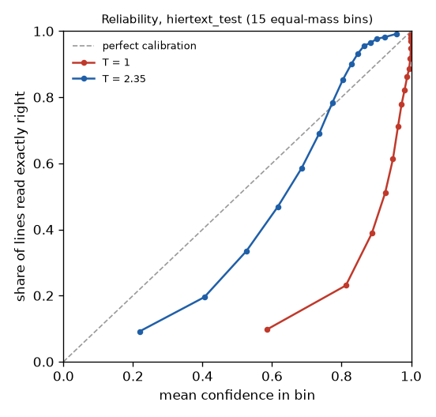
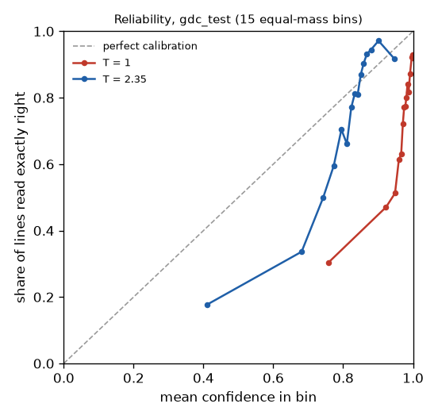
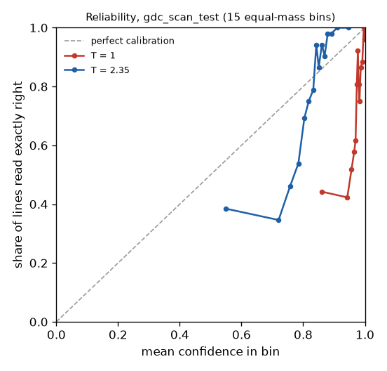
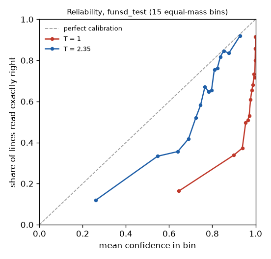
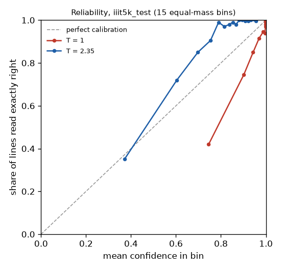
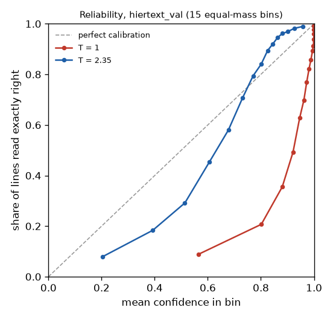

# Phase 14: calibration

Generated by `scripts/phase14_score.py` (GW-E2E-009); do not edit by hand. Line confidences of the frozen recognizer at T = 1 and T = 2.35; ECE with 15 equal-mass bins; a line is right when it matches its label exactly on the strict track (IIIT5K: alphanumeric track). Only GDC's crops carry H8′'s verdicts (README.md); every other row is information.

| ID | Set | Lines | Track | Accuracy | ECE T=1 | ECE T=2.35 | ECE(2.35) - ECE(1) [CI] |
|---|---|---|---|---|---|---|---|
| GW-REC-039 | hiertext_test | 67,574 | strict | 0.7137 | 0.2231 | 0.0920 | -0.1311 [-0.1345, -0.1277] |
| GW-REC-039 | gdc_test | 8,372 | strict | 0.7267 | 0.2345 | 0.1092 | -0.1253 [-0.1319, -0.1190] |
| GW-REC-039 | gdc_scan_test | 776 | strict | 0.7706 | 0.2019 | 0.1248 | -0.0771 [-0.0986, -0.0518] |
| GW-REC-039 | funsd_test | 2,647 | strict | 0.6154 | 0.3382 | 0.1227 | -0.2155 [-0.2181, -0.2052] |
| GW-REC-039 | iiit5k_test | 3,000 | alnum | 0.9147 | 0.0546 | 0.1118 | +0.0572 [+0.0431, +0.0716] |
| GW-REC-038 | hiertext_val | 74,500 | strict | 0.7062 | 0.2278 | 0.0904 | -0.1374 [-0.1409, -0.1344] |
| GW-E2E-007 | gdc_test (pipeline lines) | 9,057 | strict | 0.5315 | 0.4150 | 0.2489 | -0.1660 [-0.1678, -0.1643] |

