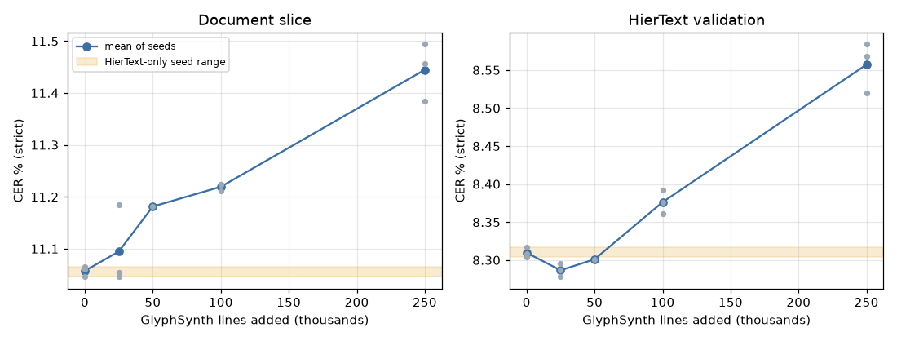

# Phase 12: synthetic data study (GW-DATA-022)

Generated by `scripts/synth_study.py compare`; do not edit by hand. CER % on the strict
track. Document slice: HierText validation pages with at least 100
validation lines (104 pages). Arms pool their seeds; Δ against
HierText only, paired over pages (HierText) or lines (GlyphSynth), 95% CI, 1,000
resamples. Verdict: CI on one side of zero and every seed beyond every control seed.

| Arm | Runs | Document slice | Δ vs HierText only | Verdict | HierText val | Δ | GlyphSynth val | Δ |
|---|---|---|---|---|---|---|---|---|
| HierText only | GW-REC-003, GW-REC-004, GW-REC-005 | 11.06 | — | control | 8.31 | — | 1.97 | — |
| +25K | GW-DATA-010, GW-DATA-011, GW-DATA-012 | 11.09 | +0.04 [-0.03, +0.11] | no clear effect | 8.29 | -0.02 [-0.05, +0.01] | 0.94 | -1.03 [-1.07, -0.98] |
| +50K | GW-DATA-013 | 11.18 | +0.12 [+0.03, +0.22] | hurts | 8.30 | -0.01 [-0.05, +0.04] | 0.73 | -1.24 [-1.29, -1.18] |
| +100K | GW-DATA-014, GW-DATA-015, GW-DATA-016 | 11.22 | +0.16 [+0.06, +0.26] | hurts | 8.38 | +0.07 [+0.03, +0.10] | 0.57 | -1.40 [-1.46, -1.34] |
| +250K | GW-DATA-017, GW-DATA-018, GW-DATA-019 | 11.44 | +0.39 [+0.25, +0.52] | hurts | 8.56 | +0.25 [+0.20, +0.30] | 0.38 | -1.58 [-1.66, -1.50] |
| +100K, 6 fonts | GW-DATA-020 | 11.13 | +0.07 [-0.04, +0.18] | no clear effect | 8.40 | +0.09 [+0.04, +0.13] | 0.61 | -1.36 [-1.43, -1.29] |
| +100K, no capture | GW-DATA-021 | 11.09 | +0.04 [-0.07, +0.15] | no clear effect | 8.38 | +0.07 [+0.03, +0.11] | 0.65 | -1.31 [-1.36, -1.26] |

H2'a (an improvement on the document slice at one size or more): sizes that help: none: **not supported**.
Document-slice CER points gained per 1,000 added lines: -0.0017 (25K to 100K), -0.0015 (100K to 250K): no gain at any size: CER rises as lines are added.

WER % (strict track, mean of the seeds; reported, not decided on):

| Arm | Document slice | HierText val |
|---|---|---|
| HierText only | 27.39 | 23.25 |
| +25K | 27.34 | 23.15 |
| +50K | 27.39 | 23.10 |
| +100K | 27.49 | 23.24 |
| +250K | 28.08 | 23.73 |
| +100K, 6 fonts | 27.48 | 23.40 |
| +100K, no capture | 27.43 | 23.31 |

Fonts: 6 families minus 85 on the document slice -0.09 [-0.21, +0.03]; many fonts show no clear advantage.
Capture effects: GLYPH-C mCE without minus with +0.31 [+0.27, +0.35]; capture helps; clean guard holds.
H2'b: **not supported**.
