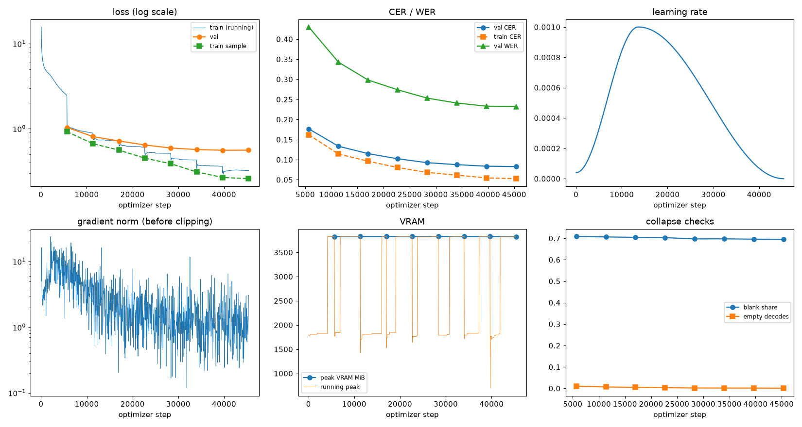
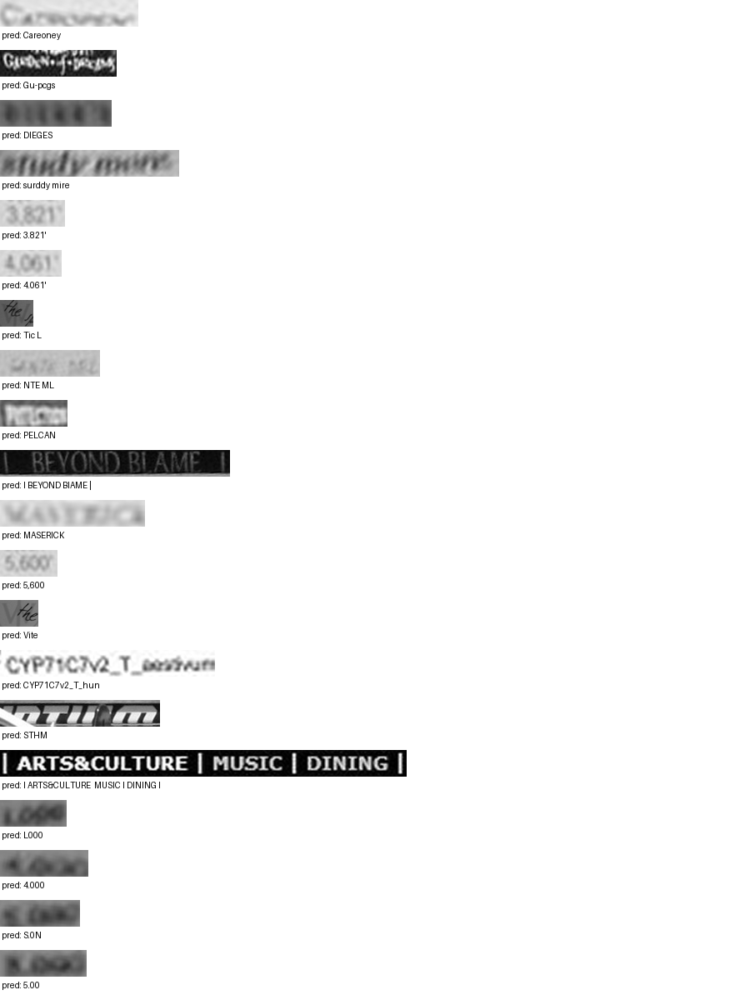

# Run report: GW-DATA-003

Generated by `glypharis.training.report`; do not edit by hand.

## Run

- Config hash `d56e52073bbcc83b`, git `ca7eb186d2e815554646a0177ceb9c19304cd905` (dirty: False)
- Device cuda (NVIDIA GeForce RTX 4050 Laptop GPU), precision bf16, torch 2.14.1+cu126
- Parameters 7,796,435 (29.8 MiB of weights and buffers); 348,935 training lines, 73,888 validation lines
- Epochs run 8, optimizer steps 45,368, stopped early: False; training time 1.04 h (1.04 GPU-hours)
- Data: `processed/hiertext/lines_train` 348,935 lines, sha256 b8cfff844ed2; `processed/hiertext/lines_validation` 73,888 lines, sha256 7db3ec6782ea

## Best and final epoch

| | Epoch | Step | Val CER % | Val WER % | Val loss | Train CER % |
|---|---|---|---|---|---|---|
| best (selected) | 7 | 45368 | 8.29 | 23.23 | 0.5596 | 5.27 |
| final | 7 | 45368 | 8.29 | 23.23 | 0.5596 | 5.27 |

The selected checkpoint is `best.pt`: the lowest validation CER (strict track), as the protocol requires (§7); the final epoch is shown for comparison.

Validation CER of the selected checkpoint: 8.29% [8.13, 8.45] (95% bootstrap CI over 73,888 lines).

## Notes

- Resumed from `last.pt` at step 40,000 (epoch 7); 6 log records written after that checkpoint were moved to metrics.dropped.jsonl.

## Diagnostics

No flags raised.

## Curves

## Worst validation lines

| Key | Reference | Prediction | CER |
|---|---|---|---|
| 013df9c6e5b5aed4/p0/l9 | G | Careoney | 8.00 |
| 8f80cc3eac928e4e/p21/l0 | C | Gu-pcgs | 7.00 |
| bde51cd0a0e194b1/p34/l0 | s | DIEGES | 6.00 |
| e20fbc5878d56a36/p1/l40 | 5: | surddy mire | 5.50 |
| 03221b6a82a5a02e/p85/l0 | 3 | 3.821' | 5.00 |
| 03221b6a82a5a02e/p87/l0 | 4 | 4.061' | 5.00 |
| 1177e2fd519784db/p0/l3 | W | Tic L | 5.00 |
| 983a43804c520cc0/p13/l0 | L | NTE ML | 5.00 |
| bd68198a86681f49/p22/l0 | P | PELCAN | 5.00 |
| 83265d4ad42b65eb/p21/l0 | \| \| | I BEYOND BIAME \| | 4.67 |
| 013df9c6e5b5aed4/p0/l11 | sc | MASERICK | 4.00 |
| 03221b6a82a5a02e/p84/l0 | 5 | 5,600 | 4.00 |
| 1177e2fd519784db/p14/l5 | W | Vite | 4.00 |
| 1427a2dd12744f8f/p22/l2 | _T_ | CYP71C7v2_T_hun | 4.00 |
| 39fd7d18c550a0f2/p23/l0 | m | STHM | 4.00 |
| 50140f555f4d26d0/p30/l0 | \| \| \| \| | I ARTS&CULTURE  MUSIC I DINING I | 4.00 |
| 75688de8882f42fa/p11/l0 | 1 | L000 | 4.00 |
| 75688de8882f42fa/p11/l1 | 4 | 4.000 | 4.00 |
| 75688de8882f42fa/p11/l2 | 5 | S.0N | 4.00 |
| 75688de8882f42fa/p11/l3 | 3 | 5.00 | 4.00 |

