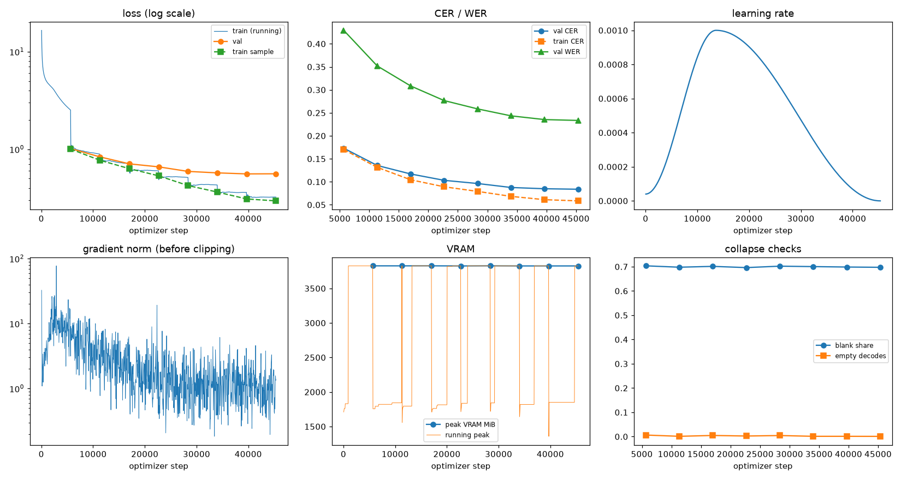
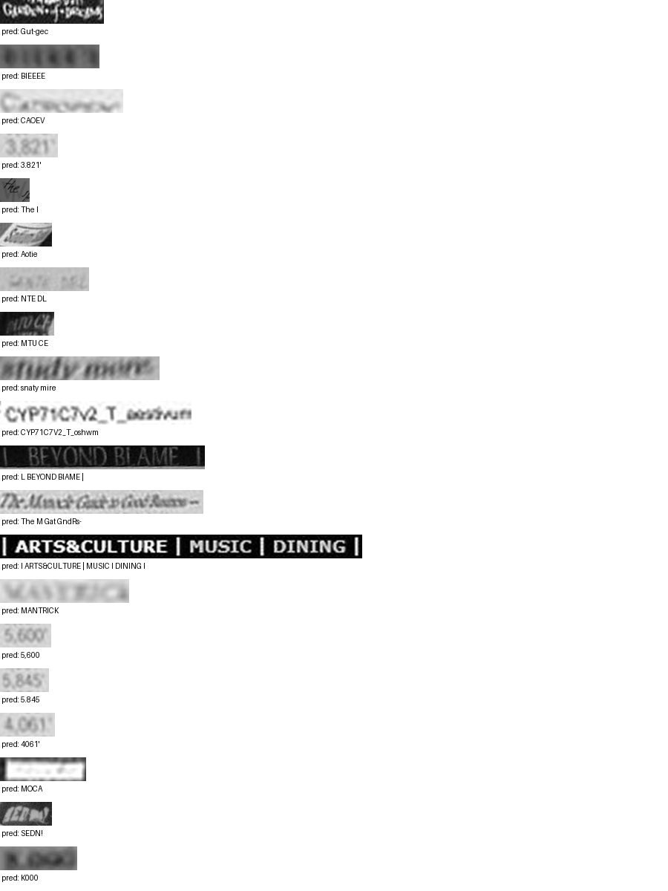

# Run report: GW-DATA-004

Generated by `glypharis.training.report`; do not edit by hand.

## Run

- Config hash `c4953485af71aece`, git `ca7eb186d2e815554646a0177ceb9c19304cd905` (dirty: False)
- Device cuda (NVIDIA GeForce RTX 4050 Laptop GPU), precision bf16, torch 2.14.1+cu126
- Parameters 7,796,435 (29.8 MiB of weights and buffers); 348,935 training lines, 73,888 validation lines
- Epochs run 8, optimizer steps 45,367, stopped early: False; training time 0.94 h (0.94 GPU-hours)
- Data: `processed/hiertext/lines_train` 348,935 lines, sha256 b8cfff844ed2; `processed/hiertext/lines_validation` 73,888 lines, sha256 7db3ec6782ea

## Best and final epoch

| | Epoch | Step | Val CER % | Val WER % | Val loss | Train CER % |
|---|---|---|---|---|---|---|
| best (selected) | 7 | 45367 | 8.38 | 23.34 | 0.5595 | 5.85 |
| final | 7 | 45367 | 8.38 | 23.34 | 0.5595 | 5.85 |

The selected checkpoint is `best.pt`: the lowest validation CER (strict track), as the protocol requires (§7); the final epoch is shown for comparison.

Validation CER of the selected checkpoint: 8.38% [8.23, 8.55] (95% bootstrap CI over 73,888 lines).

## Diagnostics

No flags raised.

## Curves

## Worst validation lines

| Key | Reference | Prediction | CER |
|---|---|---|---|
| 8f80cc3eac928e4e/p21/l0 | C | Gut-gec | 7.00 |
| bde51cd0a0e194b1/p34/l0 | s | BIEEEE | 6.00 |
| 013df9c6e5b5aed4/p0/l9 | G | CAOEV | 5.00 |
| 03221b6a82a5a02e/p85/l0 | 3 | 3.821' | 5.00 |
| 1177e2fd519784db/p0/l3 | W | The I | 5.00 |
| 902b8cf14489c26a/p18/l9 | S | Aotie  | 5.00 |
| 983a43804c520cc0/p13/l0 | L | NTE DL | 5.00 |
| dcee27acd6d6883b/p0/l110 | C | MTU CE | 5.00 |
| e20fbc5878d56a36/p1/l40 | 5: | snaty mire | 5.00 |
| 1427a2dd12744f8f/p22/l2 | _T_ | CYP71C7V2_T_oshwm | 4.67 |
| 83265d4ad42b65eb/p21/l0 | \| \| | L BEYOND BIAME \| | 4.67 |
| 102f2c6a35f05df6/p5/l0 | The | The M Gat GndRs- | 4.33 |
| 50140f555f4d26d0/p30/l0 | \| \| \| \| | I ARTS&CULTURE \| MUSIC I DINING I | 4.14 |
| 013df9c6e5b5aed4/p0/l11 | sc | MANTRICK | 4.00 |
| 03221b6a82a5a02e/p84/l0 | 5 | 5,600 | 4.00 |
| 03221b6a82a5a02e/p86/l0 | 5 | 5.845 | 4.00 |
| 03221b6a82a5a02e/p87/l0 | 4 | 4061' | 4.00 |
| 38b9387bf8718119/p0/l7 | _ | MOCA | 4.00 |
| 634e5932b6e6f347/p32/l0 | E | SEDN! | 4.00 |
| 75688de8882f42fa/p11/l3 | 3 | K000 | 4.00 |

