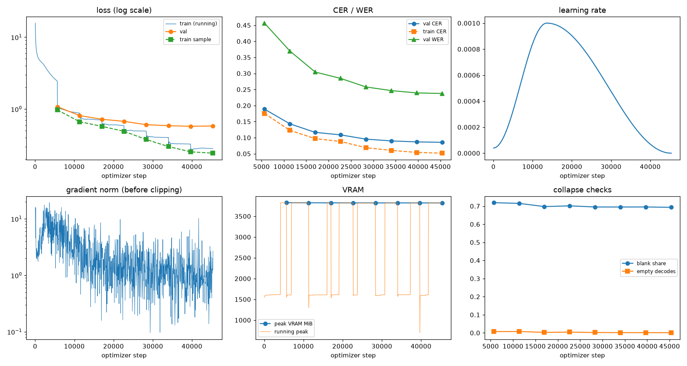
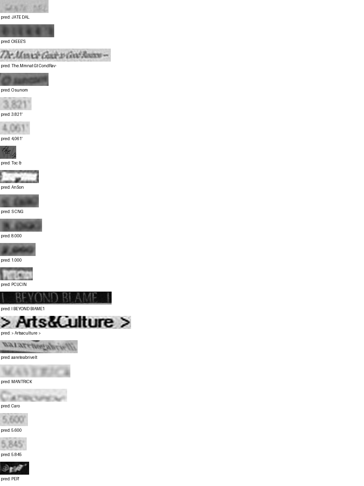

# Run report: GW-DATA-005

Generated by `glypharis.training.report`; do not edit by hand.

## Run

- Config hash `b3ee3ed1f6c2d8ea`, git `ca7eb186d2e815554646a0177ceb9c19304cd905` (dirty: False)
- Device cuda (NVIDIA GeForce RTX 4050 Laptop GPU), precision bf16, torch 2.14.1+cu126
- Parameters 7,796,435 (29.8 MiB of weights and buffers); 348,935 training lines, 73,888 validation lines
- Epochs run 8, optimizer steps 45,368, stopped early: False; training time 0.83 h (0.83 GPU-hours)
- Data: `processed/hiertext/lines_train` 348,935 lines, sha256 b8cfff844ed2; `processed/hiertext/lines_validation` 73,888 lines, sha256 7db3ec6782ea

## Best and final epoch

| | Epoch | Step | Val CER % | Val WER % | Val loss | Train CER % |
|---|---|---|---|---|---|---|
| best (selected) | 7 | 45368 | 8.55 | 23.76 | 0.5819 | 5.17 |
| final | 7 | 45368 | 8.55 | 23.76 | 0.5819 | 5.17 |

The selected checkpoint is `best.pt`: the lowest validation CER (strict track), as the protocol requires (§7); the final epoch is shown for comparison.

Validation CER of the selected checkpoint: 8.55% [8.39, 8.71] (95% bootstrap CI over 73,888 lines).

## Notes

- Resumed from `last.pt` at step 11,342 (epoch 2); 9 log records written after that checkpoint were moved to metrics.dropped.jsonl.

## Diagnostics

No flags raised.

## Curves

## Worst validation lines

| Key | Reference | Prediction | CER |
|---|---|---|---|
| 983a43804c520cc0/p13/l0 | L | JATE DAL | 7.00 |
| bde51cd0a0e194b1/p34/l0 | s | OIEEE'S | 7.00 |
| 102f2c6a35f05df6/p5/l0 | The | The.Mmnat Gt CondRav- | 6.00 |
| d6cffab23f5a1e4a/p60/l0 | O | O sunom | 6.00 |
| 03221b6a82a5a02e/p85/l0 | 3 | 3.821' | 5.00 |
| 03221b6a82a5a02e/p87/l0 | 4 | 4,061' | 5.00 |
| 1177e2fd519784db/p0/l3 | W | Toc & | 5.00 |
| 38b9387bf8718119/p1/l4 | _ | AnSon | 5.00 |
| 75688de8882f42fa/p11/l2 | 5 | S CNG | 5.00 |
| 75688de8882f42fa/p11/l3 | 3 | 8.000 | 5.00 |
| 75688de8882f42fa/p11/l4 | 2 | 1.000 | 5.00 |
| bd68198a86681f49/p22/l0 | P | PCUCIN | 5.00 |
| 83265d4ad42b65eb/p21/l0 | \| \| | I BEYOND BIAME1 | 4.67 |
| 50140f555f4d26d0/p32/l0 | > > | > Artsaculture > | 4.33 |
| 76a7ad3fe918c4ef/p24/l0 | na/ | aareteabrivelt | 4.33 |
| 013df9c6e5b5aed4/p0/l11 | sc | MANTRICK | 4.00 |
| 013df9c6e5b5aed4/p0/l9 | G | Caro | 4.00 |
| 03221b6a82a5a02e/p84/l0 | 5 | 5.600 | 4.00 |
| 03221b6a82a5a02e/p86/l0 | 5 | 5.845 | 4.00 |
| 7025cb4ac7cf0ec2/p7/l11 | @ | PER' | 4.00 |

