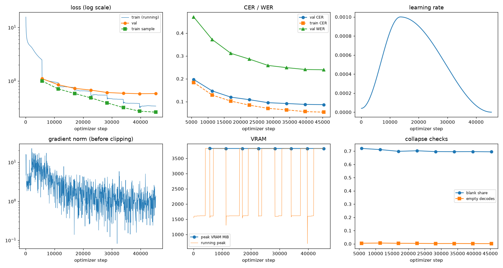
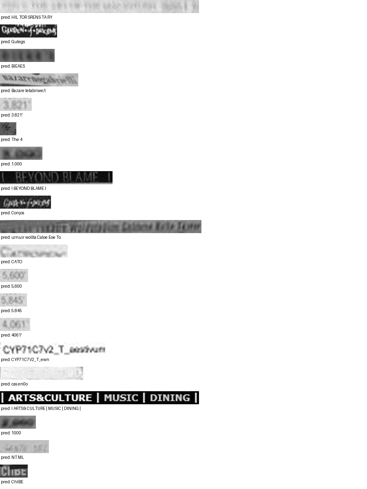

# Run report: GW-DATA-007

Generated by `glypharis.training.report`; do not edit by hand.

## Run

- Config hash `539745c4cda8021f`, git `ca7eb186d2e815554646a0177ceb9c19304cd905` (dirty: False)
- Device cuda (NVIDIA GeForce RTX 4050 Laptop GPU), precision bf16, torch 2.14.1+cu126
- Parameters 7,796,435 (29.8 MiB of weights and buffers); 348,935 training lines, 73,888 validation lines
- Epochs run 8, optimizer steps 45,368, stopped early: False; training time 0.82 h (0.82 GPU-hours)
- Data: `processed/hiertext/lines_train` 348,935 lines, sha256 b8cfff844ed2; `processed/hiertext/lines_validation` 73,888 lines, sha256 7db3ec6782ea

## Best and final epoch

| | Epoch | Step | Val CER % | Val WER % | Val loss | Train CER % |
|---|---|---|---|---|---|---|
| best (selected) | 7 | 45368 | 8.66 | 23.93 | 0.5787 | 5.37 |
| final | 7 | 45368 | 8.66 | 23.93 | 0.5787 | 5.37 |

The selected checkpoint is `best.pt`: the lowest validation CER (strict track), as the protocol requires (§7); the final epoch is shown for comparison.

Validation CER of the selected checkpoint: 8.66% [8.50, 8.82] (95% bootstrap CI over 73,888 lines).

## Diagnostics

No flags raised.

## Curves

## Worst validation lines

| Key | Reference | Prediction | CER |
|---|---|---|---|
| 976149c72a2fde3e/p1/l6 | 20 | HIL TOR SRENS TA RY | 9.50 |
| 8f80cc3eac928e4e/p21/l0 | C | Gutegs | 6.00 |
| bde51cd0a0e194b1/p34/l0 | s | BIEAES | 6.00 |
| 76a7ad3fe918c4ef/p24/l0 | na/ | Bazare tetabriwe/l | 5.33 |
| 03221b6a82a5a02e/p85/l0 | 3 | 3.821' | 5.00 |
| 1177e2fd519784db/p0/l3 | W | The 4 | 5.00 |
| 75688de8882f42fa/p11/l3 | 3 | 1.000 | 5.00 |
| 83265d4ad42b65eb/p21/l0 | \| \| | I BEYOND BLAME I | 5.00 |
| 8f80cc3eac928e4e/p22/l0 | C | Conjos | 5.00 |
| af2ddc65295391cf/p2/l4 | Walin | urnuir wollta Caloe Eoe To | 4.80 |
| 013df9c6e5b5aed4/p0/l9 | G | CATO | 4.00 |
| 03221b6a82a5a02e/p84/l0 | 5 | 5,600 | 4.00 |
| 03221b6a82a5a02e/p86/l0 | 5 | 5.845 | 4.00 |
| 03221b6a82a5a02e/p87/l0 | 4 | 4061' | 4.00 |
| 1427a2dd12744f8f/p22/l2 | _T_ | CYP71C7V2_T_ewn | 4.00 |
| 154058472bd0c3bf/p21/l0 | ND | cas en0o | 4.00 |
| 50140f555f4d26d0/p30/l0 | \| \| \| \| | I ARTS& CULTURE \| MUSIC \| DINING \| | 4.00 |
| 75688de8882f42fa/p11/l4 | 2 | 1000 | 4.00 |
| 983a43804c520cc0/p13/l0 | L | NT ML | 4.00 |
| a13413c321f8d129/p8/l4 | C | ChIBE | 4.00 |

