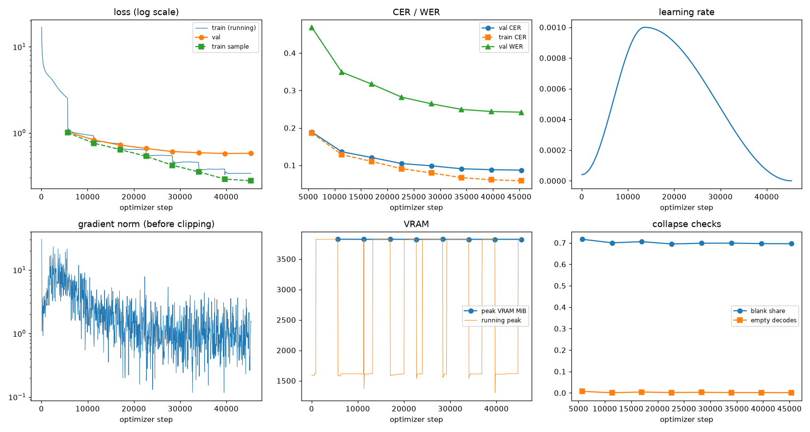
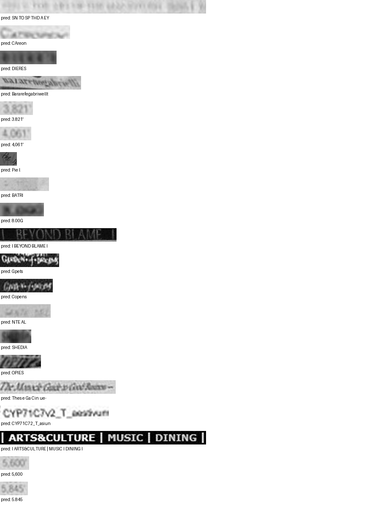

# Run report: GW-DATA-008

Generated by `glypharis.training.report`; do not edit by hand.

## Run

- Config hash `2b88c2036ebc64af`, git `ca7eb186d2e815554646a0177ceb9c19304cd905` (dirty: False)
- Device cuda (NVIDIA GeForce RTX 4050 Laptop GPU), precision bf16, torch 2.14.1+cu126
- Parameters 7,796,435 (29.8 MiB of weights and buffers); 348,935 training lines, 73,888 validation lines
- Epochs run 8, optimizer steps 45,367, stopped early: False; training time 0.80 h (0.80 GPU-hours)
- Data: `processed/hiertext/lines_train` 348,935 lines, sha256 b8cfff844ed2; `processed/hiertext/lines_validation` 73,888 lines, sha256 7db3ec6782ea

## Best and final epoch

| | Epoch | Step | Val CER % | Val WER % | Val loss | Train CER % |
|---|---|---|---|---|---|---|
| best (selected) | 7 | 45367 | 8.70 | 24.20 | 0.5796 | 5.86 |
| final | 7 | 45367 | 8.70 | 24.20 | 0.5796 | 5.86 |

The selected checkpoint is `best.pt`: the lowest validation CER (strict track), as the protocol requires (§7); the final epoch is shown for comparison.

Validation CER of the selected checkpoint: 8.70% [8.54, 8.87] (95% bootstrap CI over 73,888 lines).

## Diagnostics

No flags raised.

## Curves

## Worst validation lines

| Key | Reference | Prediction | CER |
|---|---|---|---|
| 976149c72a2fde3e/p1/l6 | 20 | SN TO SP THD A EY | 8.50 |
| 013df9c6e5b5aed4/p0/l9 | G | CAreon | 6.00 |
| bde51cd0a0e194b1/p34/l0 | s | DIERES | 6.00 |
| 76a7ad3fe918c4ef/p24/l0 | na/ | Bararefegabriwellt | 5.67 |
| 03221b6a82a5a02e/p85/l0 | 3 | 3.821' | 5.00 |
| 03221b6a82a5a02e/p87/l0 | 4 | 4,061' | 5.00 |
| 1177e2fd519784db/p0/l3 | W | Pie l | 5.00 |
| 154058472bd0c3bf/p47/l0 | P | BATRI | 5.00 |
| 75688de8882f42fa/p11/l3 | 3 | 8.00G | 5.00 |
| 83265d4ad42b65eb/p21/l0 | \| \| | I BEYOND BLAME I | 5.00 |
| 8f80cc3eac928e4e/p21/l0 | C | Gpets | 5.00 |
| 8f80cc3eac928e4e/p22/l0 | C | Copens | 5.00 |
| 983a43804c520cc0/p13/l0 | L | NTE AL | 5.00 |
| c624328101a5c91b/p9/l4 | S | SHEDIA | 5.00 |
| f1fa7e6c910f4ede/p1/l563 | M | OPIES | 5.00 |
| 102f2c6a35f05df6/p5/l0 | The | Thes e Ga Cin ue- | 4.67 |
| 1427a2dd12744f8f/p22/l2 | _T_ | CYP71C72_T_asiun | 4.33 |
| 50140f555f4d26d0/p30/l0 | \| \| \| \| | I ARTS&CULTURE \| MUSIC I DINING I | 4.14 |
| 03221b6a82a5a02e/p84/l0 | 5 | 5,600 | 4.00 |
| 03221b6a82a5a02e/p86/l0 | 5 | 5.845 | 4.00 |

