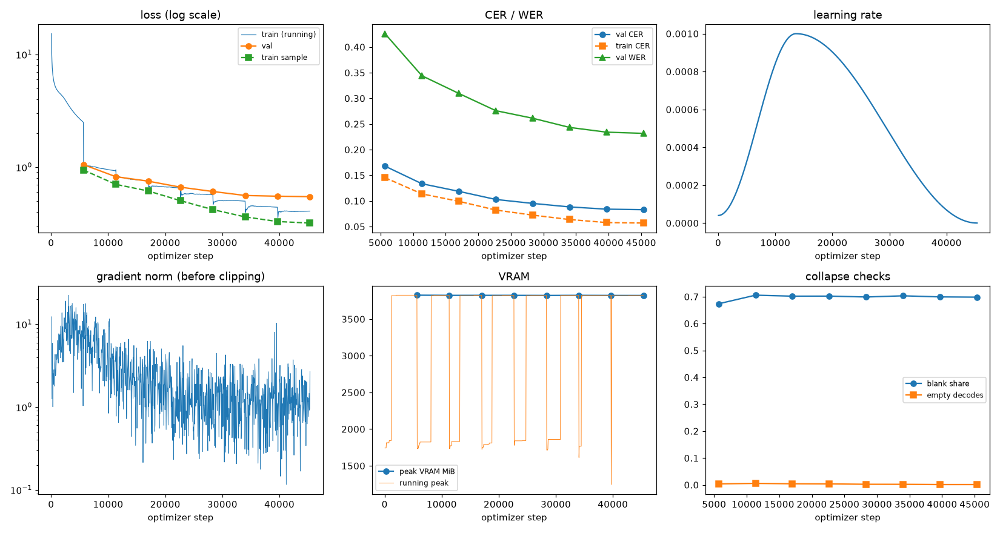
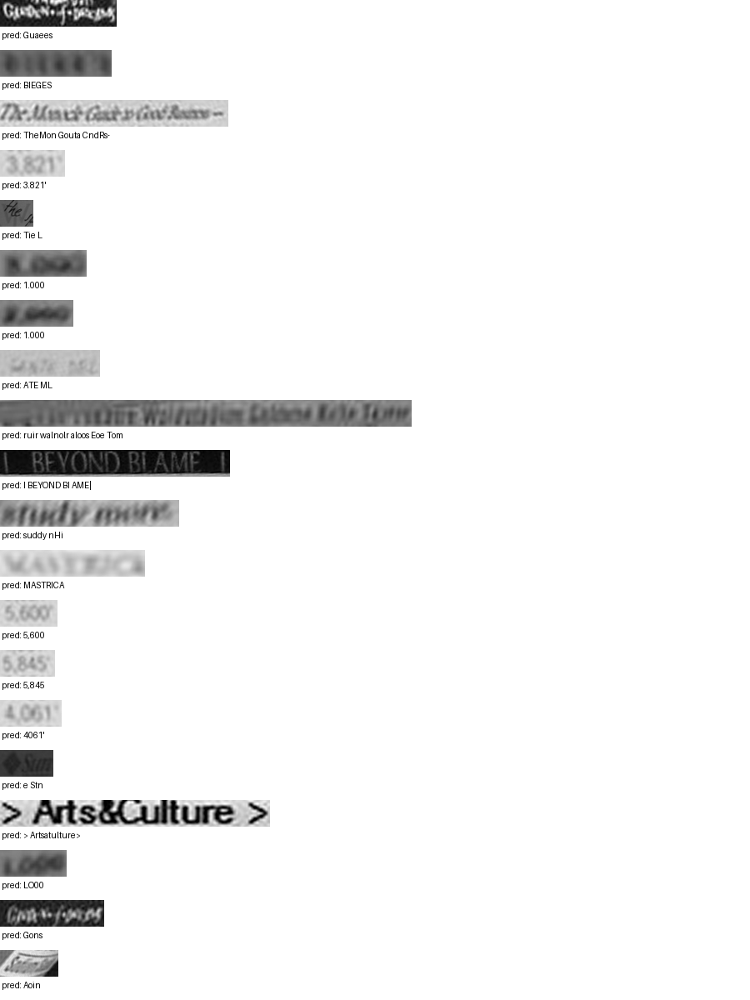

# Run report: GW-DATA-011

Generated by `glypharis.training.report`; do not edit by hand.

## Run

- Config hash `412b80a7cc078407`, git `133a8ab0d2b0f27ff72f03c05b857a3a5b57a7f4` (dirty: False)
- Device cuda (NVIDIA GeForce RTX 4050 Laptop GPU), precision bf16, torch 2.14.1+cu126
- Parameters 7,796,435 (29.8 MiB of weights and buffers); 373,935 training lines, 73,888 validation lines
- Epochs run 8, optimizer steps 45,368, stopped early: False; training time 1.02 h (1.02 GPU-hours)
- Data: `processed/hiertext/lines_train` 348,935 lines, sha256 b8cfff844ed2; `processed/glyphsynth/lines_train` 100,000 lines, sha256 762c1755f4d4; `processed/hiertext/lines_validation` 73,888 lines, sha256 7db3ec6782ea

## Best and final epoch

| | Epoch | Step | Val CER % | Val WER % | Val loss | Train CER % |
|---|---|---|---|---|---|---|
| best (selected) | 7 | 45368 | 8.29 | 23.16 | 0.5461 | 5.68 |
| final | 7 | 45368 | 8.29 | 23.16 | 0.5461 | 5.68 |

The selected checkpoint is `best.pt`: the lowest validation CER (strict track), as the protocol requires (§7); the final epoch is shown for comparison.

Validation CER of the selected checkpoint: 8.29% [8.12, 8.46] (95% bootstrap CI over 73,888 lines).

## Diagnostics

No flags raised.

## Curves

## Worst validation lines

| Key | Reference | Prediction | CER |
|---|---|---|---|
| 8f80cc3eac928e4e/p21/l0 | C | Guaees | 6.00 |
| bde51cd0a0e194b1/p34/l0 | s | BIEGES | 6.00 |
| 102f2c6a35f05df6/p5/l0 | The | TheMon Gouta CndRs- | 5.33 |
| 03221b6a82a5a02e/p85/l0 | 3 | 3.821' | 5.00 |
| 1177e2fd519784db/p0/l3 | W | Tie L | 5.00 |
| 75688de8882f42fa/p11/l3 | 3 | 1.000 | 5.00 |
| 75688de8882f42fa/p11/l4 | 2 | 1.000 | 5.00 |
| 983a43804c520cc0/p13/l0 | L | ATE ML | 5.00 |
| af2ddc65295391cf/p2/l4 | Walin | ruir walnolr aloos Eoe Tom | 4.80 |
| 83265d4ad42b65eb/p21/l0 | \| \| | I BEYOND BI AME\| | 4.67 |
| e20fbc5878d56a36/p1/l40 | 5: | suddy nHi | 4.50 |
| 013df9c6e5b5aed4/p0/l11 | sc | MASTRICA | 4.00 |
| 03221b6a82a5a02e/p84/l0 | 5 | 5,600 | 4.00 |
| 03221b6a82a5a02e/p86/l0 | 5 | 5,845 | 4.00 |
| 03221b6a82a5a02e/p87/l0 | 4 | 4061' | 4.00 |
| 3d874195d3c70081/p15/l0 | S | e Stn | 4.00 |
| 50140f555f4d26d0/p32/l0 | > > | > Artsatulture> | 4.00 |
| 75688de8882f42fa/p11/l0 | 1 | LO00 | 4.00 |
| 8f80cc3eac928e4e/p22/l0 | C | Gons | 4.00 |
| 902b8cf14489c26a/p18/l9 | S | Aoin  | 4.00 |

