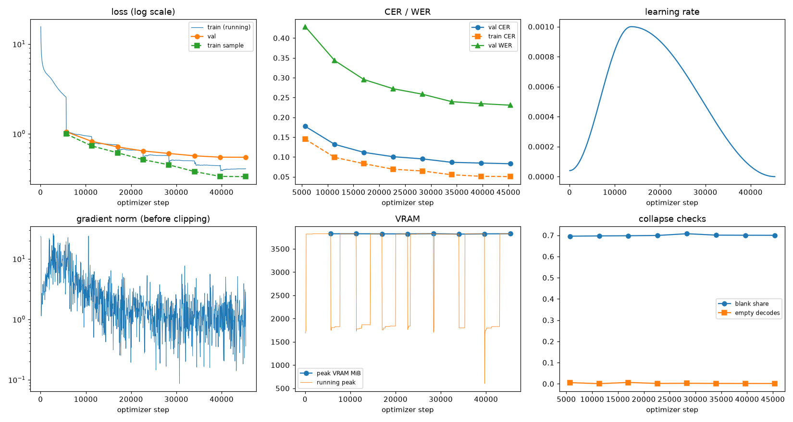
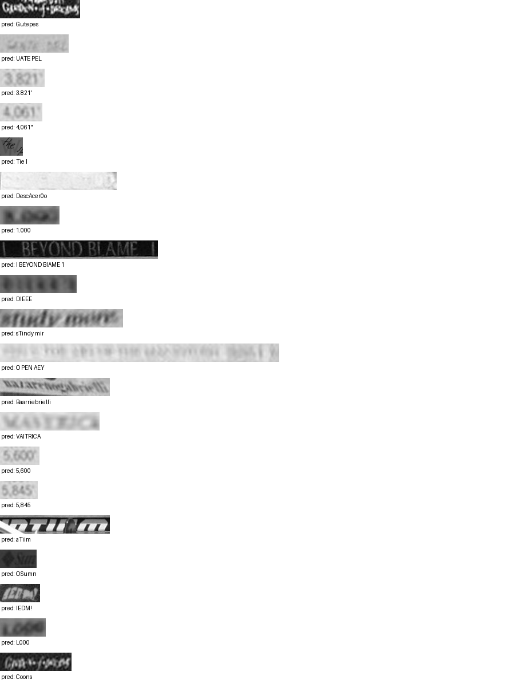

# Run report: GW-DATA-012

Generated by `glypharis.training.report`; do not edit by hand.

## Run

- Config hash `b6c93cb0a513560c`, git `133a8ab0d2b0f27ff72f03c05b857a3a5b57a7f4` (dirty: False)
- Device cuda (NVIDIA GeForce RTX 4050 Laptop GPU), precision bf16, torch 2.14.1+cu126
- Parameters 7,796,435 (29.8 MiB of weights and buffers); 373,935 training lines, 73,888 validation lines
- Epochs run 8, optimizer steps 45,368, stopped early: False; training time 1.03 h (1.03 GPU-hours)
- Data: `processed/hiertext/lines_train` 348,935 lines, sha256 b8cfff844ed2; `processed/glyphsynth/lines_train` 100,000 lines, sha256 762c1755f4d4; `processed/hiertext/lines_validation` 73,888 lines, sha256 7db3ec6782ea

## Best and final epoch

| | Epoch | Step | Val CER % | Val WER % | Val loss | Train CER % |
|---|---|---|---|---|---|---|
| best (selected) | 7 | 45368 | 8.28 | 23.06 | 0.5463 | 5.03 |
| final | 7 | 45368 | 8.28 | 23.06 | 0.5463 | 5.03 |

The selected checkpoint is `best.pt`: the lowest validation CER (strict track), as the protocol requires (§7); the final epoch is shown for comparison.

Validation CER of the selected checkpoint: 8.28% [8.12, 8.44] (95% bootstrap CI over 73,888 lines).

## Diagnostics

No flags raised.

## Curves

## Worst validation lines

| Key | Reference | Prediction | CER |
|---|---|---|---|
| 8f80cc3eac928e4e/p21/l0 | C | Gutepes | 7.00 |
| 983a43804c520cc0/p13/l0 | L | UATE PEL | 7.00 |
| 03221b6a82a5a02e/p85/l0 | 3 | 3.821' | 5.00 |
| 03221b6a82a5a02e/p87/l0 | 4 | 4,061" | 5.00 |
| 1177e2fd519784db/p0/l3 | W | Tie I | 5.00 |
| 154058472bd0c3bf/p21/l0 | ND | DescAcer0o | 5.00 |
| 75688de8882f42fa/p11/l3 | 3 | 1.000 | 5.00 |
| 83265d4ad42b65eb/p21/l0 | \| \| | I BEYOND BIAME 1 | 5.00 |
| bde51cd0a0e194b1/p34/l0 | s | DIEEE | 5.00 |
| e20fbc5878d56a36/p1/l40 | 5: | sTindy mir | 5.00 |
| 976149c72a2fde3e/p1/l6 | 20 | O PEN AEY | 4.50 |
| 76a7ad3fe918c4ef/p24/l0 | na/ | Baarriebrielli | 4.33 |
| 013df9c6e5b5aed4/p0/l11 | sc | VAITRICA | 4.00 |
| 03221b6a82a5a02e/p84/l0 | 5 | 5,600 | 4.00 |
| 03221b6a82a5a02e/p86/l0 | 5 | 5,845 | 4.00 |
| 39fd7d18c550a0f2/p23/l0 | m | aTiim | 4.00 |
| 3d874195d3c70081/p15/l0 | S | OSumn | 4.00 |
| 634e5932b6e6f347/p32/l0 | E | IEDM! | 4.00 |
| 75688de8882f42fa/p11/l0 | 1 | L000 | 4.00 |
| 8f80cc3eac928e4e/p22/l0 | C | Coons | 4.00 |

