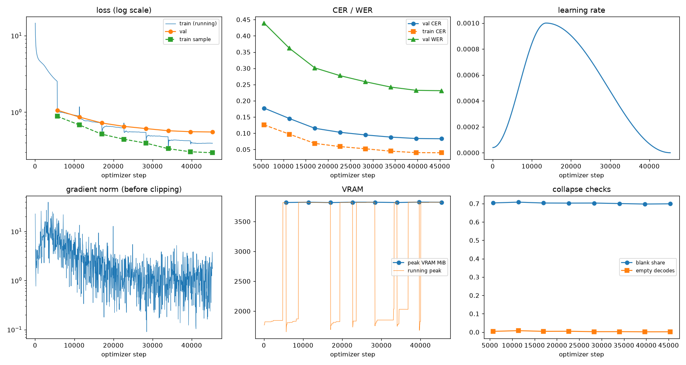
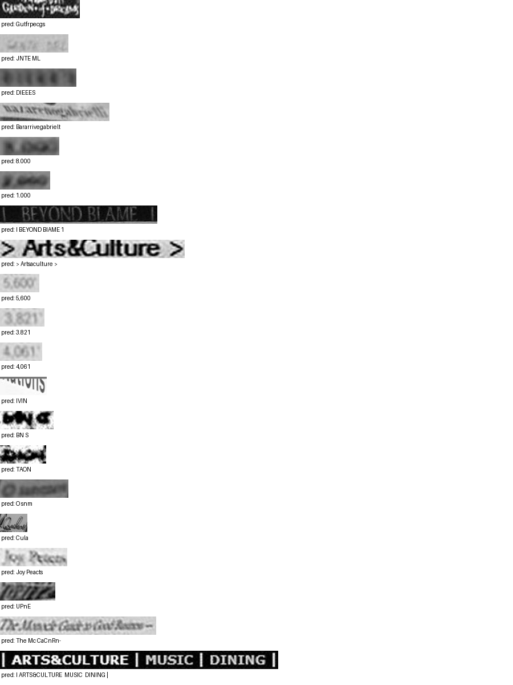

# Run report: GW-DATA-013

Generated by `glypharis.training.report`; do not edit by hand.

## Run

- Config hash `9af70bbb8bafec16`, git `133a8ab0d2b0f27ff72f03c05b857a3a5b57a7f4` (dirty: False)
- Device cuda (NVIDIA GeForce RTX 4050 Laptop GPU), precision bf16, torch 2.14.1+cu126
- Parameters 7,796,435 (29.8 MiB of weights and buffers); 398,935 training lines, 73,888 validation lines
- Epochs run 8, optimizer steps 45,380, stopped early: False; training time 1.08 h (1.08 GPU-hours)
- Data: `processed/hiertext/lines_train` 348,935 lines, sha256 b8cfff844ed2; `processed/glyphsynth/lines_train` 100,000 lines, sha256 762c1755f4d4; `processed/hiertext/lines_validation` 73,888 lines, sha256 7db3ec6782ea

## Best and final epoch

| | Epoch | Step | Val CER % | Val WER % | Val loss | Train CER % |
|---|---|---|---|---|---|---|
| best (selected) | 7 | 45380 | 8.30 | 23.10 | 0.5505 | 3.98 |
| final | 7 | 45380 | 8.30 | 23.10 | 0.5505 | 3.98 |

The selected checkpoint is `best.pt`: the lowest validation CER (strict track), as the protocol requires (§7); the final epoch is shown for comparison.

Validation CER of the selected checkpoint: 8.30% [8.15, 8.46] (95% bootstrap CI over 73,888 lines).

## Diagnostics

No flags raised.

## Curves

## Worst validation lines

| Key | Reference | Prediction | CER |
|---|---|---|---|
| 8f80cc3eac928e4e/p21/l0 | C | Gutfrpecgs | 10.00 |
| 983a43804c520cc0/p13/l0 | L | JNTE ML | 6.00 |
| bde51cd0a0e194b1/p34/l0 | s | DIEEES | 6.00 |
| 76a7ad3fe918c4ef/p24/l0 | na/ | Bararrivegabrielt | 5.33 |
| 75688de8882f42fa/p11/l3 | 3 | 8.000 | 5.00 |
| 75688de8882f42fa/p11/l4 | 2 | 1.000 | 5.00 |
| 83265d4ad42b65eb/p21/l0 | \| \| | I BEYOND BIAME 1 | 5.00 |
| 50140f555f4d26d0/p32/l0 | > > | > Artsaculture > | 4.33 |
| 03221b6a82a5a02e/p84/l0 | 5 | 5,600 | 4.00 |
| 03221b6a82a5a02e/p85/l0 | 3 | 3.821 | 4.00 |
| 03221b6a82a5a02e/p87/l0 | 4 | 4,061 | 4.00 |
| 05ee9d2ad48c11c2/p14/l1 | s | IVIN | 4.00 |
| bdd687b860d886a5/p2/l175 | A | BN S | 4.00 |
| bdd687b860d886a5/p2/l221 | D | TAON | 4.00 |
| d6cffab23f5a1e4a/p60/l0 | O | O snm | 4.00 |
| da589d39cc2c3cea/p4/l1 | Q | Cula | 4.00 |
| ebca2758a3725a0a/p20/l30 | Pc | Joy Peacts | 4.00 |
| f1fa7e6c910f4ede/p1/l563 | M | UPnE | 4.00 |
| 102f2c6a35f05df6/p5/l0 | The | The Mc CaCnRn- | 3.67 |
| 50140f555f4d26d0/p30/l0 | \| \| \| \| | I ARTS&CULTURE  MUSIC  DINING \| | 3.57 |

