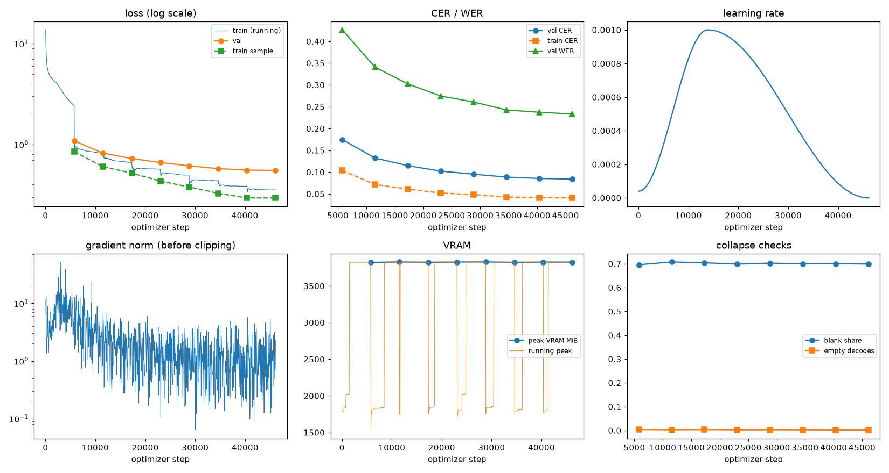
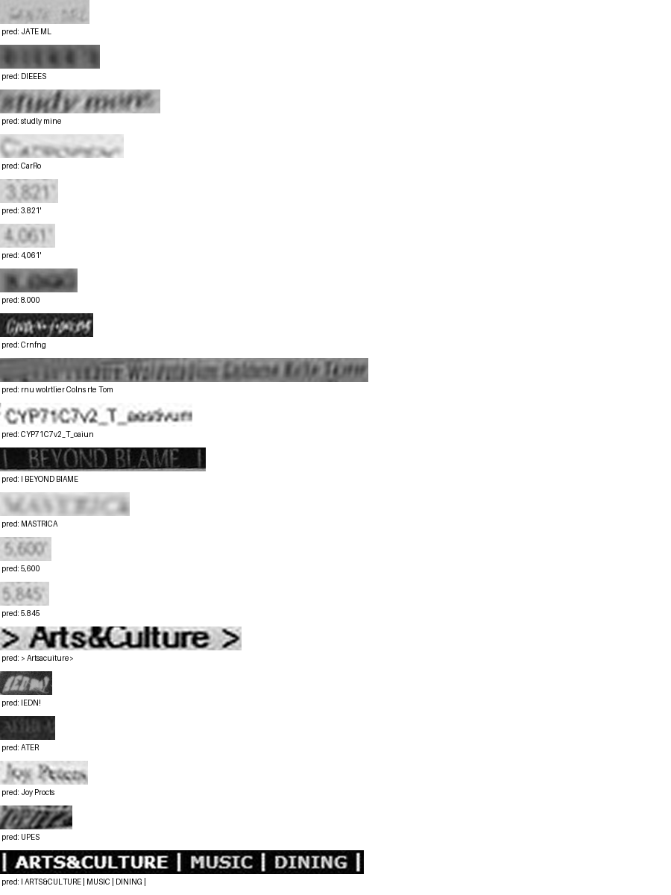

# Run report: GW-DATA-014

Generated by `glypharis.training.report`; do not edit by hand.

## Run

- Config hash `dfa5ed78263c9882`, git `133a8ab0d2b0f27ff72f03c05b857a3a5b57a7f4` (dirty: False)
- Device cuda (NVIDIA GeForce RTX 4050 Laptop GPU), precision bf16, torch 2.14.1+cu126
- Parameters 7,796,435 (29.8 MiB of weights and buffers); 448,935 training lines, 73,888 validation lines
- Epochs run 8, optimizer steps 46,141, stopped early: False; training time 1.24 h (1.24 GPU-hours)
- Data: `processed/hiertext/lines_train` 348,935 lines, sha256 b8cfff844ed2; `processed/glyphsynth/lines_train` 100,000 lines, sha256 762c1755f4d4; `processed/hiertext/lines_validation` 73,888 lines, sha256 7db3ec6782ea

## Best and final epoch

| | Epoch | Step | Val CER % | Val WER % | Val loss | Train CER % |
|---|---|---|---|---|---|---|
| best (selected) | 7 | 46141 | 8.39 | 23.33 | 0.5531 | 4.08 |
| final | 7 | 46141 | 8.39 | 23.33 | 0.5531 | 4.08 |

The selected checkpoint is `best.pt`: the lowest validation CER (strict track), as the protocol requires (§7); the final epoch is shown for comparison.

Validation CER of the selected checkpoint: 8.39% [8.24, 8.56] (95% bootstrap CI over 73,888 lines).

## Diagnostics

No flags raised.

## Curves

## Worst validation lines

| Key | Reference | Prediction | CER |
|---|---|---|---|
| 983a43804c520cc0/p13/l0 | L | JATE ML | 6.00 |
| bde51cd0a0e194b1/p34/l0 | s | DIEEES | 6.00 |
| e20fbc5878d56a36/p1/l40 | 5: | studly mine | 5.50 |
| 013df9c6e5b5aed4/p0/l9 | G | CarRo | 5.00 |
| 03221b6a82a5a02e/p85/l0 | 3 | 3.821' | 5.00 |
| 03221b6a82a5a02e/p87/l0 | 4 | 4,061' | 5.00 |
| 75688de8882f42fa/p11/l3 | 3 | 8.000 | 5.00 |
| 8f80cc3eac928e4e/p22/l0 | C | Crnfng | 5.00 |
| af2ddc65295391cf/p2/l4 | Walin | rnu wolrtlier Colns rte Tom | 4.80 |
| 1427a2dd12744f8f/p22/l2 | _T_ | CYP71C7v2_T_oaiun | 4.67 |
| 83265d4ad42b65eb/p21/l0 | \| \| | I BEYOND BIAME | 4.33 |
| 013df9c6e5b5aed4/p0/l11 | sc | MASTRICA | 4.00 |
| 03221b6a82a5a02e/p84/l0 | 5 | 5,600 | 4.00 |
| 03221b6a82a5a02e/p86/l0 | 5 | 5.845 | 4.00 |
| 50140f555f4d26d0/p32/l0 | > > | > Artsacuiture> | 4.00 |
| 634e5932b6e6f347/p32/l0 | E | IEDN! | 4.00 |
| ba5c0190fefe90ee/p35/l1 | u | ATER | 4.00 |
| ebca2758a3725a0a/p20/l30 | Pc | Joy Procts | 4.00 |
| f1fa7e6c910f4ede/p1/l563 | M | UPES | 4.00 |
| 50140f555f4d26d0/p30/l0 | \| \| \| \| | I ARTS&CULTURE \| MUSIC \| DINING \| | 3.86 |

