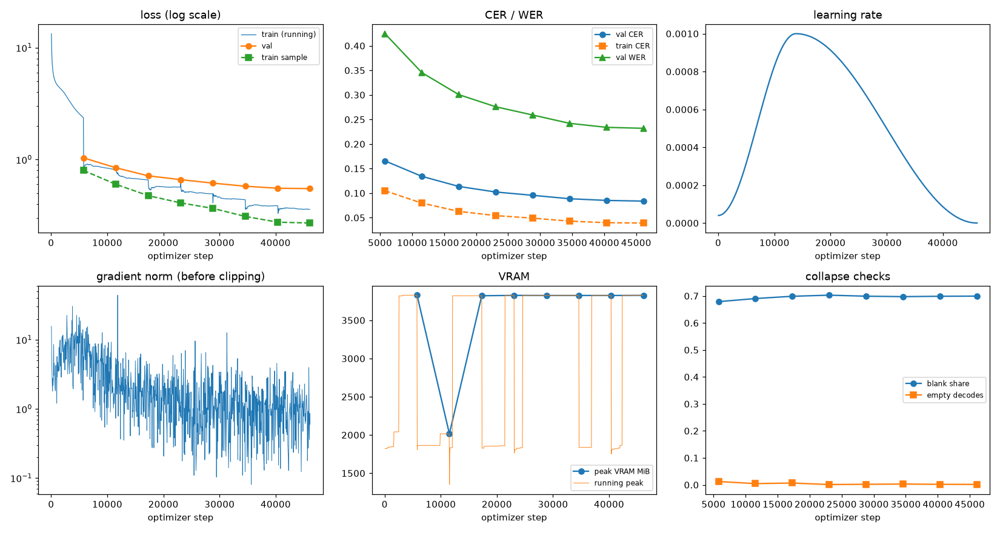
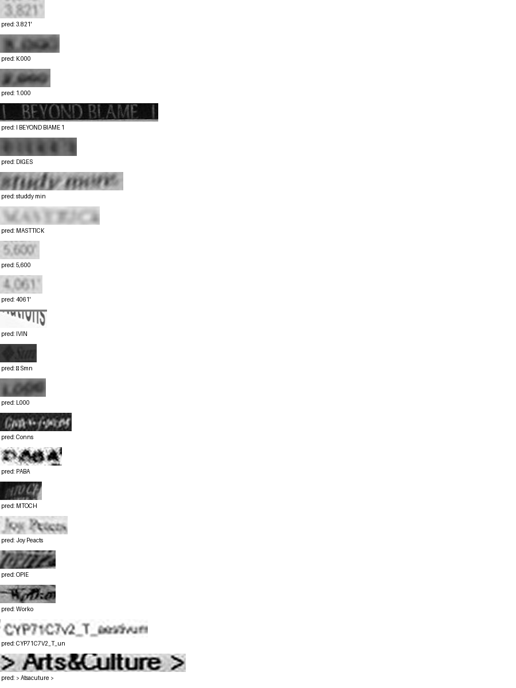

# Run report: GW-DATA-015

Generated by `glypharis.training.report`; do not edit by hand.

## Run

- Config hash `8875dc818e767655`, git `133a8ab0d2b0f27ff72f03c05b857a3a5b57a7f4` (dirty: False)
- Device cuda (NVIDIA GeForce RTX 4050 Laptop GPU), precision bf16, torch 2.14.1+cu126
- Parameters 7,796,435 (29.8 MiB of weights and buffers); 448,935 training lines, 73,888 validation lines
- Epochs run 8, optimizer steps 46,134, stopped early: False; training time 1.18 h (1.18 GPU-hours)
- Data: `processed/hiertext/lines_train` 348,935 lines, sha256 b8cfff844ed2; `processed/glyphsynth/lines_train` 100,000 lines, sha256 762c1755f4d4; `processed/hiertext/lines_validation` 73,888 lines, sha256 7db3ec6782ea

## Best and final epoch

| | Epoch | Step | Val CER % | Val WER % | Val loss | Train CER % |
|---|---|---|---|---|---|---|
| best (selected) | 7 | 46134 | 8.38 | 23.20 | 0.5496 | 3.91 |
| final | 7 | 46134 | 8.38 | 23.20 | 0.5496 | 3.91 |

The selected checkpoint is `best.pt`: the lowest validation CER (strict track), as the protocol requires (§7); the final epoch is shown for comparison.

Validation CER of the selected checkpoint: 8.38% [8.22, 8.54] (95% bootstrap CI over 73,888 lines).

## Diagnostics

No flags raised.

## Curves

## Worst validation lines

| Key | Reference | Prediction | CER |
|---|---|---|---|
| 03221b6a82a5a02e/p85/l0 | 3 | 3.821' | 5.00 |
| 75688de8882f42fa/p11/l3 | 3 | K.000 | 5.00 |
| 75688de8882f42fa/p11/l4 | 2 | 1.000 | 5.00 |
| 83265d4ad42b65eb/p21/l0 | \| \| | I BEYOND BIAME 1 | 5.00 |
| bde51cd0a0e194b1/p34/l0 | s | DIGES | 5.00 |
| e20fbc5878d56a36/p1/l40 | 5: | studdy min | 5.00 |
| 013df9c6e5b5aed4/p0/l11 | sc | MASTTICK | 4.00 |
| 03221b6a82a5a02e/p84/l0 | 5 | 5,600 | 4.00 |
| 03221b6a82a5a02e/p87/l0 | 4 | 4061' | 4.00 |
| 05ee9d2ad48c11c2/p14/l1 | s | IVIN | 4.00 |
| 3d874195d3c70081/p15/l0 | S | • Smn | 4.00 |
| 75688de8882f42fa/p11/l0 | 1 | L000 | 4.00 |
| 8f80cc3eac928e4e/p22/l0 | C | Conns | 4.00 |
| bdd687b860d886a5/p2/l220 | D | PABA | 4.00 |
| dcee27acd6d6883b/p0/l110 | C | MTOCH | 4.00 |
| ebca2758a3725a0a/p20/l30 | Pc | Joy Peacts | 4.00 |
| f1fa7e6c910f4ede/p1/l563 | M | OPIE | 4.00 |
| f61c775d6c036ba8/p0/l90 | o | Worko | 4.00 |
| 1427a2dd12744f8f/p22/l2 | _T_ | CYP71C7V2_T_un | 3.67 |
| 50140f555f4d26d0/p32/l0 | > > | > Atsacuture > | 3.67 |

