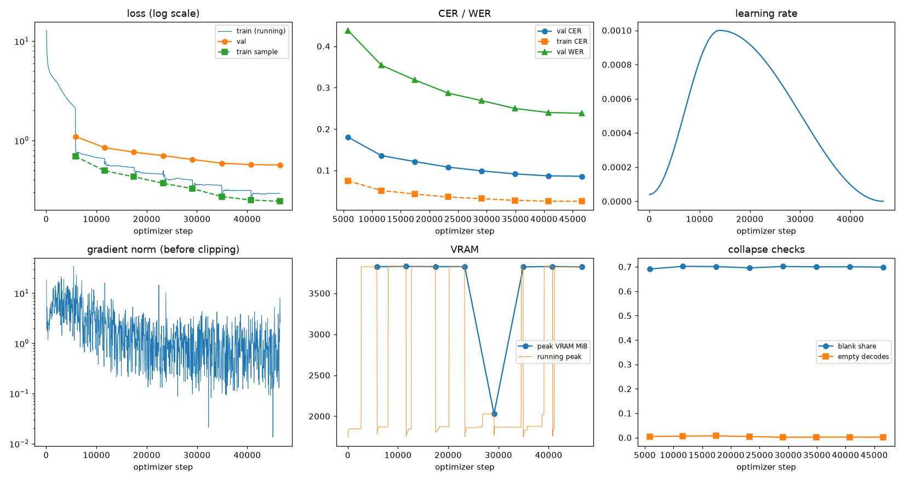

# Run report: GW-DATA-018

Generated by `glypharis.training.report`; do not edit by hand.

## Run

- Config hash `5573e42ef27c834c`, git `03b38ae4ba3bb084368bacf661ad0623728e1771` (dirty: False)
- Device cuda (NVIDIA GeForce RTX 4050 Laptop GPU), precision bf16, torch 2.14.1+cu126
- Parameters 7,796,435 (29.8 MiB of weights and buffers); 598,935 training lines, 73,888 validation lines
- Epochs run 8, optimizer steps 46,577, stopped early: False; training time 1.37 h (1.37 GPU-hours)
- Data: `processed/hiertext/lines_train` 348,935 lines, sha256 b8cfff844ed2; `processed/glyphsynth/lines_train` 100,000 lines, sha256 762c1755f4d4; `processed/glyphsynth/lines_train_ext` 150,000 lines, sha256 81f6fcd407ed; `processed/hiertext/lines_validation` 73,888 lines, sha256 7db3ec6782ea

## Best and final epoch

| | Epoch | Step | Val CER % | Val WER % | Val loss | Train CER % |
|---|---|---|---|---|---|---|
| best (selected) | 7 | 46577 | 8.57 | 23.80 | 0.5665 | 2.52 |
| final | 7 | 46577 | 8.57 | 23.80 | 0.5665 | 2.52 |

The selected checkpoint is `best.pt`: the lowest validation CER (strict track), as the protocol requires (§7); the final epoch is shown for comparison.

Validation CER of the selected checkpoint: 8.57% [8.40, 8.74] (95% bootstrap CI over 73,888 lines).

## Diagnostics

No flags raised.

## Curves

## Worst validation lines

| Key | Reference | Prediction | CER |
|---|---|---|---|
| 983a43804c520cc0/p13/l0 | L | JATE ML | 6.00 |
| bde51cd0a0e194b1/p34/l0 | s | DHEES | 5.00 |
| e20fbc5878d56a36/p1/l40 | 5: | sidty mir | 4.50 |
| 76a7ad3fe918c4ef/p24/l0 | na/ | Baarrirabrielf | 4.33 |
| 83265d4ad42b65eb/p21/l0 | \| \| | I BEYOND BIAME | 4.33 |
| af2ddc65295391cf/p2/l4 | Walin | ir walllier Ealc ole Tom | 4.20 |
| 013df9c6e5b5aed4/p0/l11 | sc | MASTRICA | 4.00 |
| 03221b6a82a5a02e/p85/l0 | 3 | 3821' | 4.00 |
| 03221b6a82a5a02e/p86/l0 | 5 | 5,845 | 4.00 |
| 03221b6a82a5a02e/p87/l0 | 4 | 4061' | 4.00 |
| 50140f555f4d26d0/p32/l0 | > > | > Atsaculture > | 4.00 |
| 7025cb4ac7cf0ec2/p7/l11 | @ | PpA" | 4.00 |
| 75688de8882f42fa/p11/l0 | 1 | L000 | 4.00 |
| 75688de8882f42fa/p11/l3 | 3 | N.00 | 4.00 |
| 75688de8882f42fa/p11/l4 | 2 | 8000 | 4.00 |
| 8f80cc3eac928e4e/p21/l0 | C | Gpec | 4.00 |
| 976149c72a2fde3e/p1/l6 | 20 |  TO P  ATY | 4.00 |
| ac24e9147bec2e53/p71/l0 | C | CGHES | 4.00 |
| dcee27acd6d6883b/p0/l110 | C | NTOCE | 4.00 |
| f1fa7e6c910f4ede/p1/l563 | M | OPIE | 4.00 |

