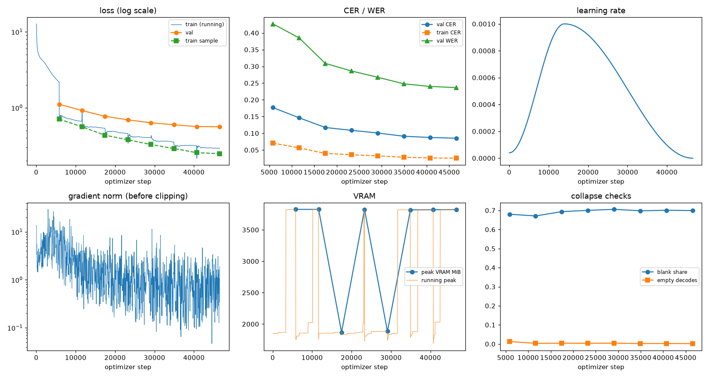
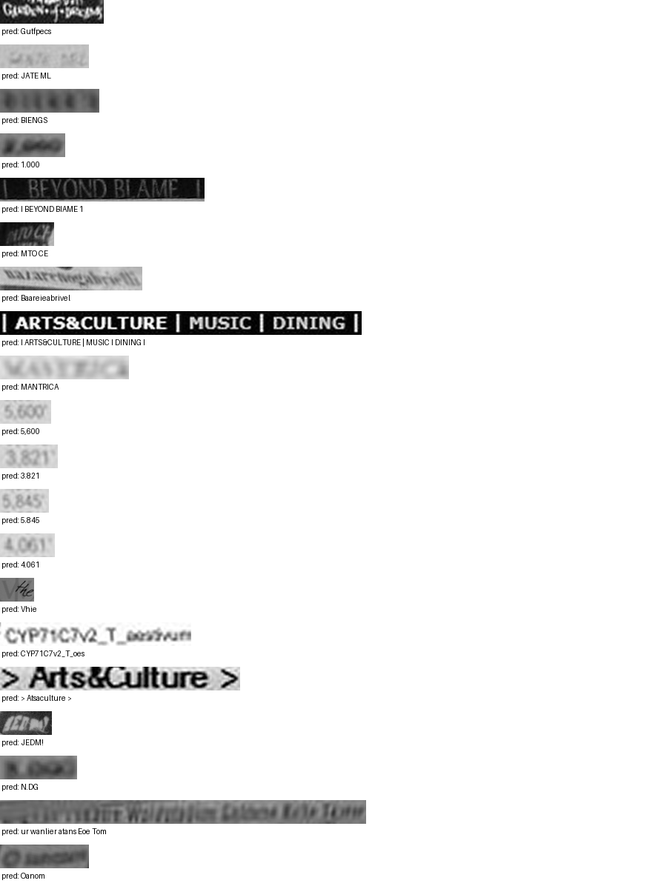

# Run report: GW-DATA-019

Generated by `glypharis.training.report`; do not edit by hand.

## Run

- Config hash `a506d6362fc6d16e`, git `03b38ae4ba3bb084368bacf661ad0623728e1771` (dirty: False)
- Device cuda (NVIDIA GeForce RTX 4050 Laptop GPU), precision bf16, torch 2.14.1+cu126
- Parameters 7,796,435 (29.8 MiB of weights and buffers); 598,935 training lines, 73,888 validation lines
- Epochs run 8, optimizer steps 46,561, stopped early: False; training time 1.40 h (1.40 GPU-hours)
- Data: `processed/hiertext/lines_train` 348,935 lines, sha256 b8cfff844ed2; `processed/glyphsynth/lines_train` 100,000 lines, sha256 762c1755f4d4; `processed/glyphsynth/lines_train_ext` 150,000 lines, sha256 81f6fcd407ed; `processed/hiertext/lines_validation` 73,888 lines, sha256 7db3ec6782ea

## Best and final epoch

| | Epoch | Step | Val CER % | Val WER % | Val loss | Train CER % |
|---|---|---|---|---|---|---|
| best (selected) | 7 | 46561 | 8.52 | 23.66 | 0.5618 | 2.55 |
| final | 7 | 46561 | 8.52 | 23.66 | 0.5618 | 2.55 |

The selected checkpoint is `best.pt`: the lowest validation CER (strict track), as the protocol requires (§7); the final epoch is shown for comparison.

Validation CER of the selected checkpoint: 8.52% [8.36, 8.69] (95% bootstrap CI over 73,888 lines).

## Diagnostics

No flags raised.

## Curves

## Worst validation lines

| Key | Reference | Prediction | CER |
|---|---|---|---|
| 8f80cc3eac928e4e/p21/l0 | C | Gutfpecs | 8.00 |
| 983a43804c520cc0/p13/l0 | L | JATE ML | 6.00 |
| bde51cd0a0e194b1/p34/l0 | s | BIENGS | 6.00 |
| 75688de8882f42fa/p11/l4 | 2 | 1.000 | 5.00 |
| 83265d4ad42b65eb/p21/l0 | \| \| | I BEYOND BIAME 1 | 5.00 |
| dcee27acd6d6883b/p0/l110 | C | MTO CE | 5.00 |
| 76a7ad3fe918c4ef/p24/l0 | na/ | Baareieabrivel | 4.33 |
| 50140f555f4d26d0/p30/l0 | \| \| \| \| | I ARTS&CULTURE \| MUSIC I DINING I | 4.14 |
| 013df9c6e5b5aed4/p0/l11 | sc | MANTRICA | 4.00 |
| 03221b6a82a5a02e/p84/l0 | 5 | 5,600 | 4.00 |
| 03221b6a82a5a02e/p85/l0 | 3 | 3.821 | 4.00 |
| 03221b6a82a5a02e/p86/l0 | 5 | 5.845 | 4.00 |
| 03221b6a82a5a02e/p87/l0 | 4 | 4.061 | 4.00 |
| 1177e2fd519784db/p14/l5 | W | Vhie | 4.00 |
| 1427a2dd12744f8f/p22/l2 | _T_ | CYP71C7v2_T_oes | 4.00 |
| 50140f555f4d26d0/p32/l0 | > > | > Atsaculture > | 4.00 |
| 634e5932b6e6f347/p32/l0 | E | JEDM! | 4.00 |
| 75688de8882f42fa/p11/l3 | 3 | N.DG | 4.00 |
| af2ddc65295391cf/p2/l4 | Walin | ur wanlier atans Eoe Tom | 4.00 |
| d6cffab23f5a1e4a/p60/l0 | O | Oanom | 4.00 |

