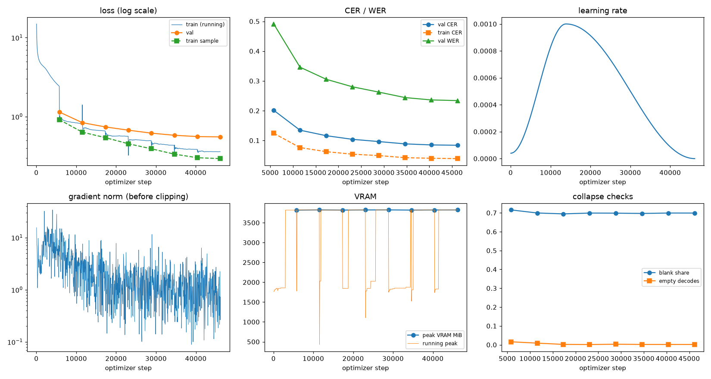
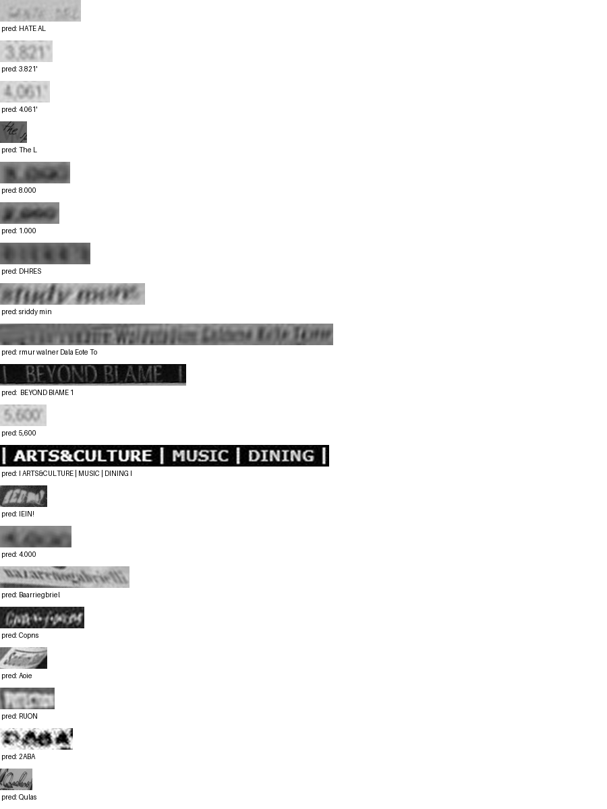

# Run report: GW-DATA-020

Generated by `glypharis.training.report`; do not edit by hand.

## Run

- Config hash `a43dfcd98fc2d65e`, git `03b38ae4ba3bb084368bacf661ad0623728e1771` (dirty: False)
- Device cuda (NVIDIA GeForce RTX 4050 Laptop GPU), precision bf16, torch 2.14.1+cu126
- Parameters 7,796,435 (29.8 MiB of weights and buffers); 448,935 training lines, 73,888 validation lines
- Epochs run 8, optimizer steps 46,198, stopped early: False; training time 1.20 h (1.20 GPU-hours)
- Data: `processed/hiertext/lines_train` 348,935 lines, sha256 b8cfff844ed2; `processed/glyphsynth/lines_train_fewfonts` 100,000 lines, sha256 a18171febee4; `processed/hiertext/lines_validation` 73,888 lines, sha256 7db3ec6782ea

## Best and final epoch

| | Epoch | Step | Val CER % | Val WER % | Val loss | Train CER % |
|---|---|---|---|---|---|---|
| best (selected) | 7 | 46198 | 8.40 | 23.40 | 0.5535 | 3.91 |
| final | 7 | 46198 | 8.40 | 23.40 | 0.5535 | 3.91 |

The selected checkpoint is `best.pt`: the lowest validation CER (strict track), as the protocol requires (§7); the final epoch is shown for comparison.

Validation CER of the selected checkpoint: 8.40% [8.24, 8.56] (95% bootstrap CI over 73,888 lines).

## Notes

- Resumed from `last.pt` at step 1,000 (epoch 0); 19 log records written after that checkpoint were moved to metrics.dropped.jsonl.

## Diagnostics

No flags raised.

## Curves

## Worst validation lines

| Key | Reference | Prediction | CER |
|---|---|---|---|
| 983a43804c520cc0/p13/l0 | L | HATE AL | 6.00 |
| 03221b6a82a5a02e/p85/l0 | 3 | 3.821' | 5.00 |
| 03221b6a82a5a02e/p87/l0 | 4 | 4.061' | 5.00 |
| 1177e2fd519784db/p0/l3 | W | The L | 5.00 |
| 75688de8882f42fa/p11/l3 | 3 | 8.000 | 5.00 |
| 75688de8882f42fa/p11/l4 | 2 | 1.000 | 5.00 |
| bde51cd0a0e194b1/p34/l0 | s | DHRES | 5.00 |
| e20fbc5878d56a36/p1/l40 | 5: | sriddy min | 5.00 |
| af2ddc65295391cf/p2/l4 | Walin | rmur walner Dala Eote To | 4.40 |
| 83265d4ad42b65eb/p21/l0 | \| \| |  BEYOND BIAME 1 | 4.33 |
| 03221b6a82a5a02e/p84/l0 | 5 | 5,600 | 4.00 |
| 50140f555f4d26d0/p30/l0 | \| \| \| \| | I ARTS&CULTURE \| MUSIC \| DINING I | 4.00 |
| 634e5932b6e6f347/p32/l0 | E | IEIN! | 4.00 |
| 75688de8882f42fa/p11/l1 | 4 | 4.000 | 4.00 |
| 76a7ad3fe918c4ef/p24/l0 | na/ | Baarriegbriel | 4.00 |
| 8f80cc3eac928e4e/p22/l0 | C | Copns | 4.00 |
| 902b8cf14489c26a/p18/l9 | S | Aoie  | 4.00 |
| bd68198a86681f49/p22/l0 | P | RUON | 4.00 |
| bdd687b860d886a5/p2/l220 | D | 2ABA | 4.00 |
| da589d39cc2c3cea/p4/l1 | Q | Qulas | 4.00 |

