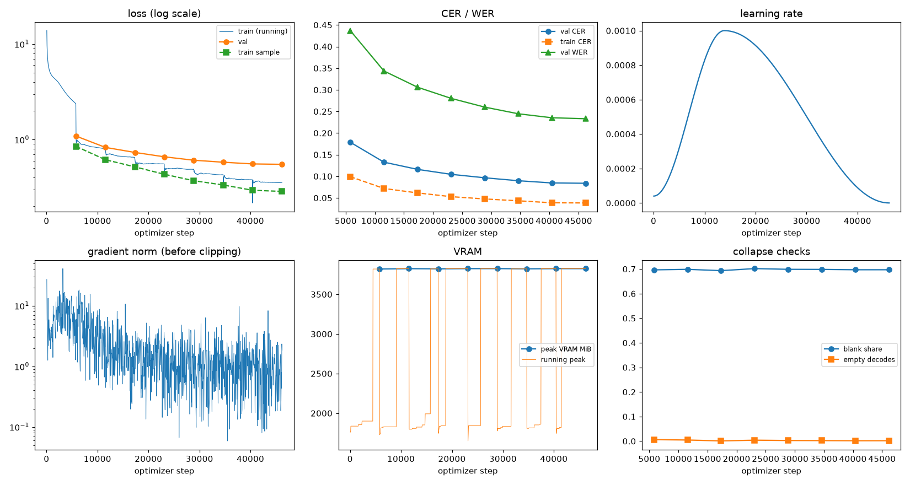

# Run report: GW-DATA-021

Generated by `glypharis.training.report`; do not edit by hand.

## Run

- Config hash `094bf4136c46b930`, git `03b38ae4ba3bb084368bacf661ad0623728e1771` (dirty: False)
- Device cuda (NVIDIA GeForce RTX 4050 Laptop GPU), precision bf16, torch 2.14.1+cu126
- Parameters 7,796,435 (29.8 MiB of weights and buffers); 448,935 training lines, 73,888 validation lines
- Epochs run 8, optimizer steps 46,222, stopped early: False; training time 1.29 h (1.29 GPU-hours)
- Data: `processed/hiertext/lines_train` 348,935 lines, sha256 b8cfff844ed2; `processed/glyphsynth/lines_train_nocapture` 100,000 lines, sha256 06daffa001d2; `processed/hiertext/lines_validation` 73,888 lines, sha256 7db3ec6782ea

## Best and final epoch

| | Epoch | Step | Val CER % | Val WER % | Val loss | Train CER % |
|---|---|---|---|---|---|---|
| best (selected) | 7 | 46222 | 8.38 | 23.31 | 0.5506 | 3.83 |
| final | 7 | 46222 | 8.38 | 23.31 | 0.5506 | 3.83 |

The selected checkpoint is `best.pt`: the lowest validation CER (strict track), as the protocol requires (§7); the final epoch is shown for comparison.

Validation CER of the selected checkpoint: 8.38% [8.22, 8.54] (95% bootstrap CI over 73,888 lines).

## Diagnostics

No flags raised.

## Curves

## Worst validation lines

| Key | Reference | Prediction | CER |
|---|---|---|---|
| 983a43804c520cc0/p13/l0 | L | NTE AEL | 6.00 |
| bde51cd0a0e194b1/p34/l0 | s | DIERES | 6.00 |
| 03221b6a82a5a02e/p85/l0 | 3 | 3.821' | 5.00 |
| 1177e2fd519784db/p0/l3 | W | Tie I | 5.00 |
| 75688de8882f42fa/p11/l3 | 3 | A.000 | 5.00 |
| 83265d4ad42b65eb/p21/l0 | \| \| | I BEYOND BIAME 1 | 5.00 |
| 8f80cc3eac928e4e/p21/l0 | C | Gfges | 5.00 |
| 902b8cf14489c26a/p18/l9 | S | Aadin | 5.00 |
| eb9c71f60af35ebe/p11/l4 | AT | LRAT EMINTI | 4.50 |
| 76a7ad3fe918c4ef/p24/l0 | na/ | naareivtabrveli | 4.33 |
| 013df9c6e5b5aed4/p0/l11 | sc | MASERICK | 4.00 |
| 03221b6a82a5a02e/p84/l0 | 5 | 5,600 | 4.00 |
| 03221b6a82a5a02e/p87/l0 | 4 | 4061' | 4.00 |
| 05ee9d2ad48c11c2/p14/l1 | s | IVIN | 4.00 |
| 50140f555f4d26d0/p32/l0 | > > | > Artsecuture > | 4.00 |
| 7238e7acffa4862b/p1/l51 | Ⅷ | 121) | 4.00 |
| 75688de8882f42fa/p11/l0 | 1 | L00G | 4.00 |
| 75688de8882f42fa/p11/l4 | 2 | 1000 | 4.00 |
| 7d5f25d3c7f2eefa/p88/l0 | m | BoKi | 4.00 |
| 8f80cc3eac928e4e/p22/l0 | C | Copns | 4.00 |

