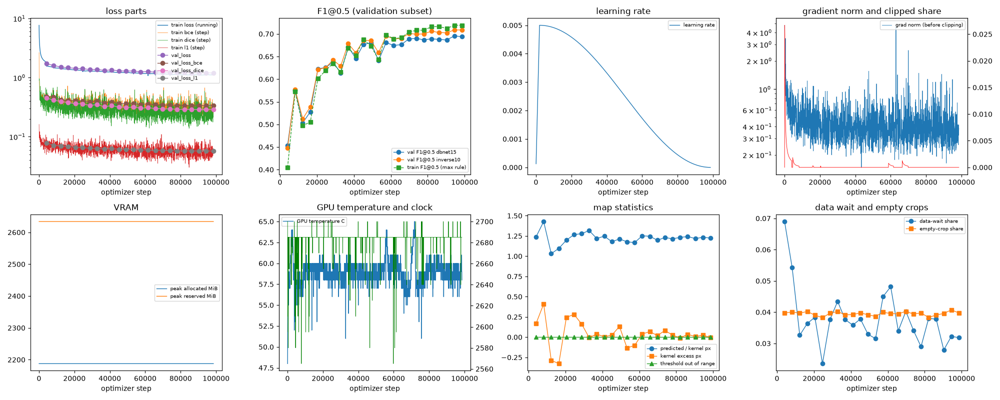
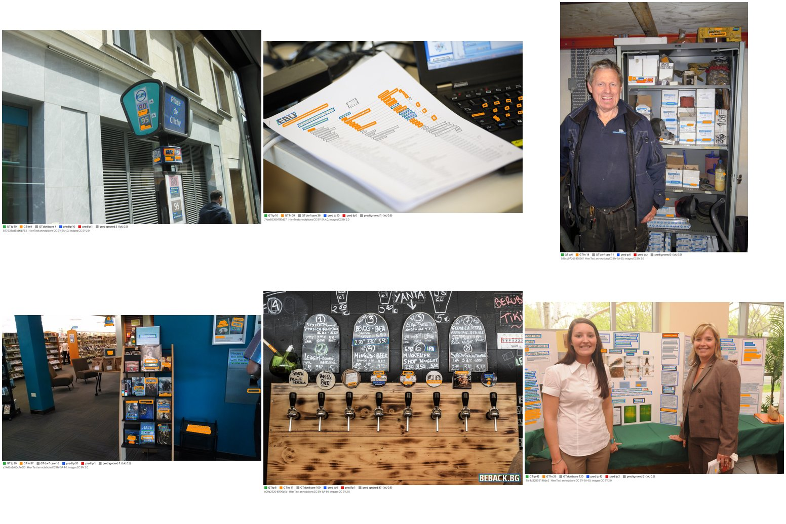
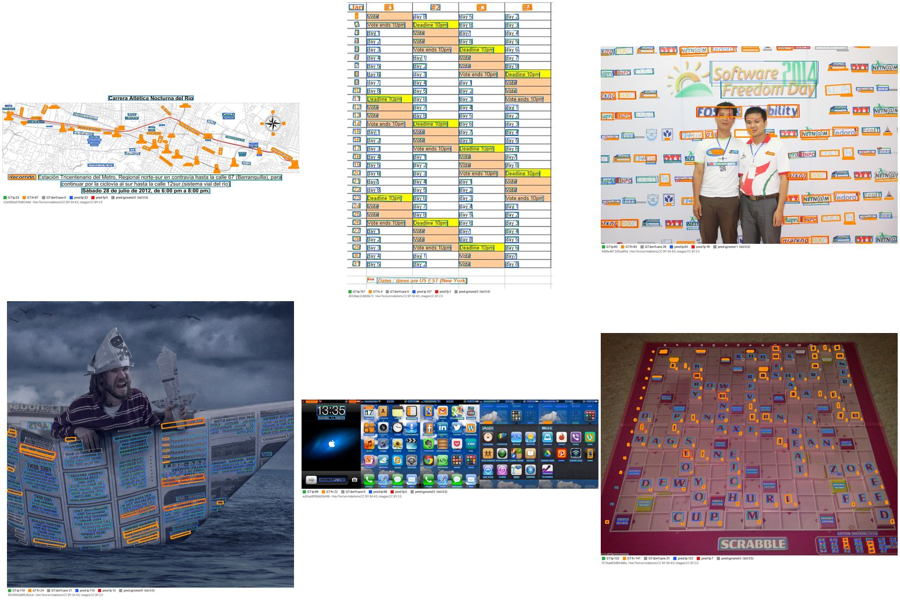
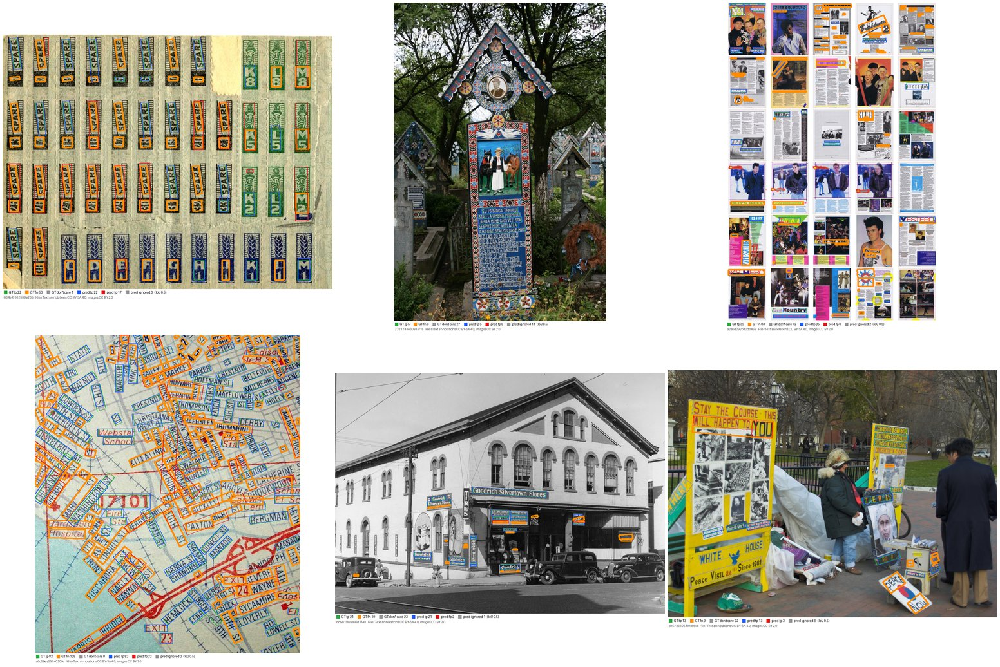
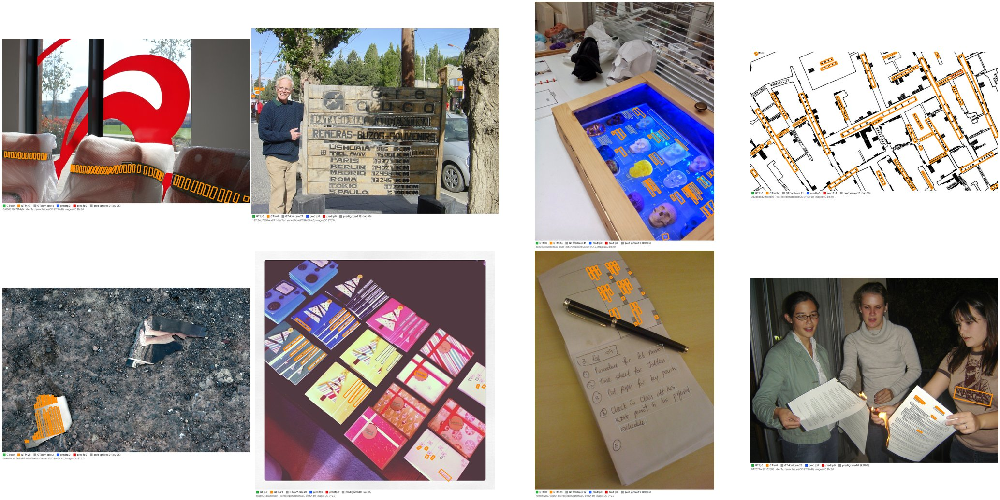

# Run report: GW-DET-001

Generated by `glypharis.training.det_report`; do not edit by hand.

## Run

- Config hash `ebd82071f0a36782`, git `0a29dddbdfa9bf7c4507cef2c668f1601f697a97` (dirty: False); `train.deterministic`: True; `det.post.box_type`: quad
- Device cuda (NVIDIA GeForce RTX 4050 Laptop GPU); precision: training bf16, evaluation fp32 (ieee)
- Versions: torch 2.14.1+cu126, torchvision 0.29.1+cu126, opencv 5.0.0, shapely 2.2.0, geos 3.14.1
- Parameters: 3,210,466 (training), 3,187,209 (inference, no threshold head); backbone mobilenet_v3_large, weights 8738ca797c879b54
- Pages: `processed/hiertext/pages_train.jsonl.gz` sha256 6f5f3871a557, `processed/hiertext/pages_validation.jsonl.gz` sha256 0655c5f795a6; validation subset of 400 pages, ID-list sha256 6b91c65bd09b
- LABEL_VERSION 1, DET_DATA_VERSION 1
- Epochs run 24, optimizer steps 98,544 of 98,544; training time 4.86 h (4.86 GPU-hours), 45.0 crops/s

## Best and final epoch (validation subset)

| | Epoch | Step | Operating point | P@0.5 | R@0.5 | F1@0.5 | F1@0.7 | Mean IoU | Val loss | Train F1@0.5 |
|---|---|---|---|---|---|---|---|---|---|---|
| best (selected) | 22 | 94438 | inverse10 | 0.9181 | 0.5773 | 0.7089 | 0.6145 | 0.8114 | 1.1971 | 0.7191 |
| final | 23 | 98544 | inverse10 | 0.9194 | 0.5767 | 0.7088 | 0.6157 | 0.8135 | 1.1964 | 0.7191 |

`best.pt` is the arg-max of the selection metric, validation F1@0.5 maximised over the pre-registered operating points (protocol §7).

## Full validation

`best.pt` on all 1,715 validation pages (74,500 care lines), checkpoint sha256 016b2b69d257, stored operating point `inverse10`. Values with 95% page-bootstrap CIs (1,000 resamples).

| Operating point | Precision@0.5 | Recall@0.5 | F1@0.5 | F1@0.7 | Mean IoU |
|---|---|---|---|---|---|
| dbnet15 | 0.9044 [0.8965, 0.9121] | 0.5789 [0.5586, 0.5978] | 0.7060 [0.6896, 0.7210] | 0.4646 [0.4506, 0.4779] | 0.7444 |
| inverse10 (stored) | 0.9243 [0.9168, 0.9316] | 0.5948 [0.5741, 0.6141] | 0.7238 [0.7075, 0.7390] | 0.6308 [0.6147, 0.6464] | 0.8103 |

`last.pt` on all 1,715 validation pages (74,500 care lines), checkpoint sha256 1419cc6c6bc0, stored operating point `inverse10`. Values with 95% page-bootstrap CIs (1,000 resamples).

| Operating point | Precision@0.5 | Recall@0.5 | F1@0.5 | F1@0.7 | Mean IoU |
|---|---|---|---|---|---|
| dbnet15 | 0.9041 [0.8961, 0.9120] | 0.5782 [0.5581, 0.5973] | 0.7053 [0.6890, 0.7204] | 0.4590 [0.4446, 0.4724] | 0.7423 |
| inverse10 (stored) | 0.9250 [0.9176, 0.9322] | 0.5948 [0.5741, 0.6143] | 0.7240 [0.7077, 0.7392] | 0.6323 [0.6160, 0.6481] | 0.8121 |

**Headline:** `best.pt` at its stored operating point `inverse10`: F1@0.5 0.7238 [0.7075, 0.7390], precision 0.9243 [0.9168, 0.9316], recall 0.5948 [0.5741, 0.6141], F1@0.7 0.6308 [0.6147, 0.6464]. The operating point was chosen on the per-epoch validation subset from two pre-registered settings; selection on validation, mildly optimistic.

Full-set arg-max operating point: `inverse10` (information only, not used for selection).

Label ceiling at the same settings (sanity check 0, 1,715 pages): F1@0.5 0.9481 [0.9383, 0.9562]; selection ceiling 0.9481 at `inverse10`.

Start-up tripwire: label ceiling F1@0.5 0.9244 at `inverse10` on 20 validation-subset pages.

## Baseline-comparable row

The 400 Phase 5 validation pages, detection only, `best.pt` at `inverse10`: precision 0.9244 [0.9085, 0.9388], recall 0.5973 [0.5492, 0.6428], F1@0.5 0.7257 [0.6879, 0.7596], F1@0.7 0.6317 [0.5937, 0.6659].

## Diagnostics

| Flag | Epoch | Step | Evidence |
|---|---|---|---|
| SLOW VALIDATION | 0 | 4106 | validation took 230.4 s, 29% of the epoch's 789.9 training seconds (alarm 25%): data_wait 5.8 s, forward 224.2 s, post 31.2 s, match 6.7 s; 14.9 boxes per page |

## Curves

## Label statistics and post-processing counters

Training labels in the best epoch: demoted small 18.8%, demoted thin kernel 0.0%, multipart kernel 0.0%, dont care 27.4%.

Post-processing counters (full validation of best.pt):

| Operating point | Components | Tiny | Truncated | Low score | Too thin | Outside | Kept | Poly fallback |
|---|---|---|---|---|---|---|---|---|
| dbnet15 | 128100 | 23596 | 0 | 50629 | 285 | 0 | 53590 | 0 |
| inverse10 | 128100 | 23596 | 0 | 50629 | 1 | 0 | 53874 | 0 |

Predictions per care line at the stored operating point: 0.72 (well above 1 hints at splits, well below at merges or misses).

## Slices (`SLICE_VERSION` 1, 1280 px long side)

At the headline operating point `inverse10`; P/R/F1@0.5 with 95% page-bootstrap CIs. `noisy_background` threshold: edge density >= 0.2376.

| Slice | Pages | Care lines | Precision@0.5 | Recall@0.5 | F1@0.5 |
|---|---|---|---|---|---|
| small_text | 360 | 21,195 | 0.9148 [0.8996, 0.9272] | 0.3979 [0.3554, 0.4358] | 0.5546 [0.5121, 0.5907] |
| rotated | 446 | 20,428 | 0.8913 [0.8769, 0.9049] | 0.3835 [0.3509, 0.4213] | 0.5363 [0.5024, 0.5734] |
| dense | 105 | 17,098 | 0.9251 [0.9036, 0.9443] | 0.4671 [0.4058, 0.5451] | 0.6208 [0.5613, 0.6860] |
| multi_line | 404 | 16,471 | 0.9484 [0.9355, 0.9588] | 0.7851 [0.7616, 0.8091] | 0.8591 [0.8428, 0.8760] |
| noisy_background | 429 | 20,849 | 0.9086 [0.8908, 0.9238] | 0.5121 [0.4712, 0.5520] | 0.6550 [0.6195, 0.6884] |

Line-level recall@0.5 of care lines, CIs from resampling pages:

| Height (min-area-rectangle short side) | Lines | Recall@0.5 |
|---|---|---|
| 0–8 px | 14,347 | 0.1968 [0.1695, 0.2266] |
| 8–12 px | 17,745 | 0.5679 [0.5369, 0.5968] |
| 12–20 px | 23,642 | 0.7198 [0.6951, 0.7417] |
| 20–40 px | 14,854 | 0.7718 [0.7465, 0.7985] |
| >= 40 px | 3,912 | 0.7500 [0.7239, 0.7748] |

| abs(text angle) (GT TL→TR direction) | Lines | Recall@0.5 |
|---|---|---|
| 0–5 ° | 53,860 | 0.6763 [0.6534, 0.6986] |
| 5–15 ° | 9,228 | 0.5501 [0.5145, 0.5834] |
| 15–45 ° | 6,345 | 0.2985 [0.2650, 0.3382] |
| >= 45 ° | 5,067 | 0.1812 [0.1340, 0.2324] |

| Box shape | Lines | Recall@0.5 |
|---|---|---|
| other care lines | 64,533 | 0.6616 [0.6397, 0.6839] |
| tall_box (long axis > 45° from horizontal) | 9,967 | 0.1625 [0.1317, 0.1942] |

## Overlays

Six pages per slice drawn by `default_rng([20261023, slice_index])` over the sorted members, independently of results, at the headline operating point. GT care: tp green, fn orange (thick); don't care grey; predictions: tp blue, fp red, ignored grey dashed. HierText annotations CC BY-SA 4.0, images CC BY 2.0.

- `small_text` (360 pages): 
- `rotated` (446 pages): 
- `dense` (105 pages): 
- `multi_line` (404 pages): 
- `noisy_background` (429 pages): 
- worst pages (lowest F1@0.5 with >= 5 care lines): 

