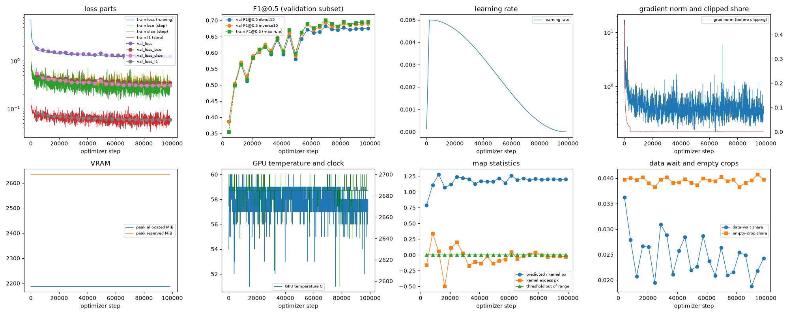
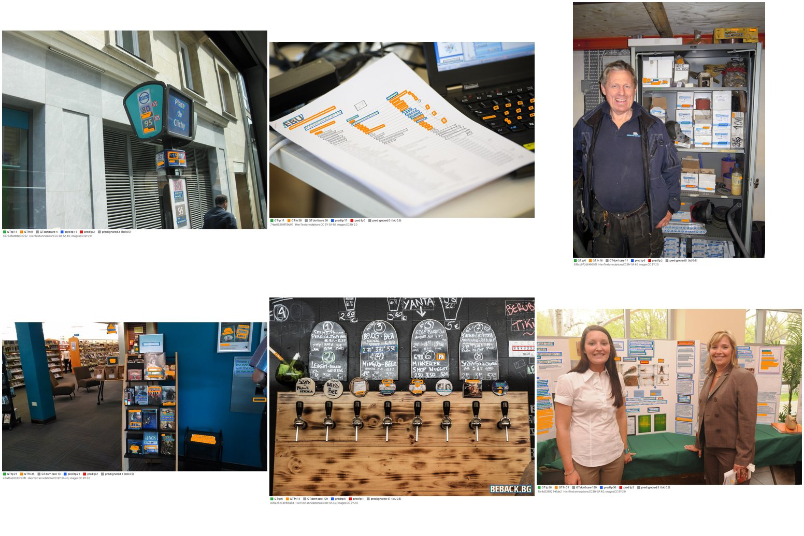
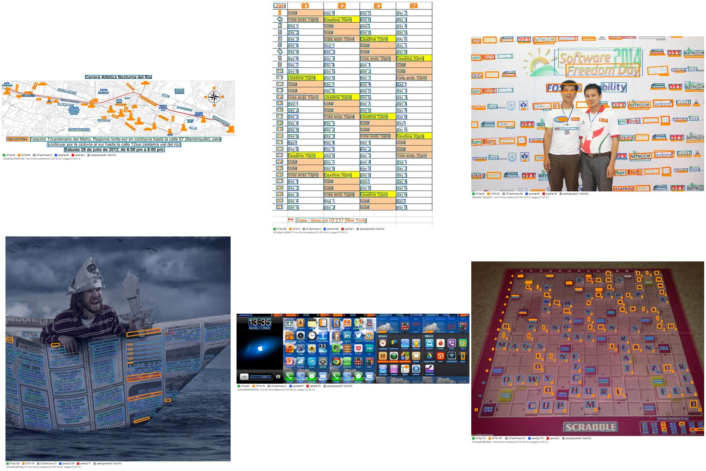
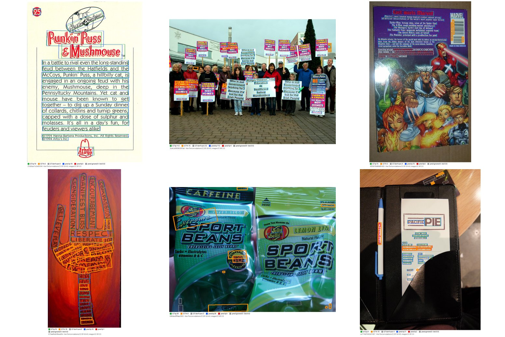
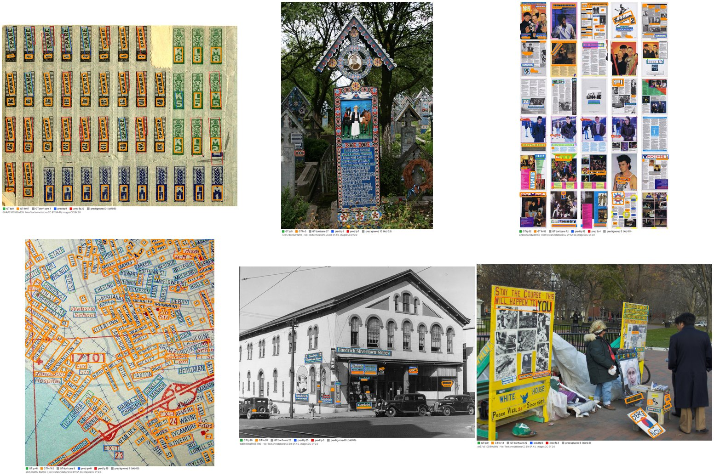
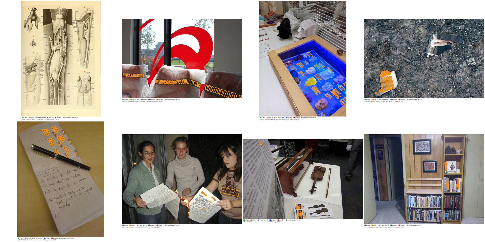

# Run report: GW-DET-002

Generated by `glypharis.training.det_report`; do not edit by hand.

## Run

- Config hash `26340926cb03c343`, git `0a29dddbdfa9bf7c4507cef2c668f1601f697a97` (dirty: False); `train.deterministic`: True; `det.post.box_type`: quad
- Device cuda (NVIDIA GeForce RTX 4050 Laptop GPU); precision: training bf16, evaluation fp32 (ieee)
- Versions: torch 2.14.1+cu126, torchvision 0.29.1+cu126, opencv 5.0.0, shapely 2.2.0, geos 3.14.1
- Parameters: 3,210,466 (training), 3,187,209 (inference, no threshold head); backbone mobilenet_v3_large, weights scratch
- Pages: `processed/hiertext/pages_train.jsonl.gz` sha256 6f5f3871a557, `processed/hiertext/pages_validation.jsonl.gz` sha256 0655c5f795a6; validation subset of 400 pages, ID-list sha256 6b91c65bd09b
- LABEL_VERSION 1, DET_DATA_VERSION 1
- Epochs run 24, optimizer steps 98,544 of 98,544; training time 4.72 h (4.72 GPU-hours), 46.4 crops/s

## Best and final epoch (validation subset)

| | Epoch | Step | Operating point | P@0.5 | R@0.5 | F1@0.5 | F1@0.7 | Mean IoU | Val loss | Train F1@0.5 |
|---|---|---|---|---|---|---|---|---|---|---|
| best (selected) | 16 | 69802 | inverse10 | 0.9115 | 0.5601 | 0.6938 | 0.5944 | 0.8085 | 1.2786 | 0.7014 |
| final | 23 | 98544 | inverse10 | 0.9214 | 0.5508 | 0.6895 | 0.6063 | 0.8149 | 1.2401 | 0.6957 |

`best.pt` is the arg-max of the selection metric, validation F1@0.5 maximised over the pre-registered operating points (protocol §7).

## Full validation

`best.pt` on all 1,715 validation pages (74,500 care lines), checkpoint sha256 29500784a346, stored operating point `inverse10`. Values with 95% page-bootstrap CIs (1,000 resamples).

| Operating point | Precision@0.5 | Recall@0.5 | F1@0.5 | F1@0.7 | Mean IoU |
|---|---|---|---|---|---|
| dbnet15 | 0.8939 [0.8852, 0.9021] | 0.5607 [0.5413, 0.5792] | 0.6891 [0.6737, 0.7044] | 0.4540 [0.4398, 0.4681] | 0.7448 |
| inverse10 (stored) | 0.9115 [0.9025, 0.9195] | 0.5736 [0.5540, 0.5926] | 0.7041 [0.6886, 0.7194] | 0.6035 [0.5874, 0.6194] | 0.8071 |

`last.pt` on all 1,715 validation pages (74,500 care lines), checkpoint sha256 70ba6db5bcdc, stored operating point `inverse10`. Values with 95% page-bootstrap CIs (1,000 resamples).

| Operating point | Precision@0.5 | Recall@0.5 | F1@0.5 | F1@0.7 | Mean IoU |
|---|---|---|---|---|---|
| dbnet15 | 0.9035 [0.8946, 0.9117] | 0.5494 [0.5303, 0.5684] | 0.6833 [0.6680, 0.6989] | 0.4532 [0.4390, 0.4675] | 0.7460 |
| inverse10 (stored) | 0.9229 [0.9139, 0.9310] | 0.5633 [0.5438, 0.5827] | 0.6996 [0.6838, 0.7153] | 0.6145 [0.5980, 0.6307] | 0.8129 |

**Headline:** `best.pt` at its stored operating point `inverse10`: F1@0.5 0.7041 [0.6886, 0.7194], precision 0.9115 [0.9025, 0.9195], recall 0.5736 [0.5540, 0.5926], F1@0.7 0.6035 [0.5874, 0.6194]. The operating point was chosen on the per-epoch validation subset from two pre-registered settings; selection on validation, mildly optimistic.

Full-set arg-max operating point: `inverse10` (information only, not used for selection).

Label ceiling (sanity check 0): not available.

Start-up tripwire: label ceiling F1@0.5 0.9244 at `inverse10` on 20 validation-subset pages.

## Baseline-comparable row

The 400 Phase 5 validation pages, detection only, `best.pt` at `inverse10`: precision 0.9145 [0.9023, 0.9266], recall 0.5751 [0.5295, 0.6189], F1@0.5 0.7061 [0.6695, 0.7403], F1@0.7 0.6088 [0.5718, 0.6431].

## Diagnostics

| Flag | Epoch | Step | Evidence |
|---|---|---|---|
| POSSIBLE OVERFITTING | 9 | 41060 | val error (1 - F1@0.5) 0.3933 is >= 10% above its best 0.3531 while train error (1 - F1@0.5) keeps falling |

## Curves

## Label statistics and post-processing counters

Training labels in the best epoch: demoted small 18.7%, demoted thin kernel 0.0%, multipart kernel 0.0%, dont care 27.4%.

Post-processing counters (full validation of best.pt):

| Operating point | Components | Tiny | Truncated | Low score | Too thin | Outside | Kept | Poly fallback |
|---|---|---|---|---|---|---|---|---|
| dbnet15 | 145936 | 26205 | 0 | 66971 | 167 | 0 | 52593 | 0 |
| inverse10 | 145936 | 26205 | 0 | 66971 | 0 | 0 | 52760 | 0 |

Predictions per care line at the stored operating point: 0.71 (well above 1 hints at splits, well below at merges or misses).

## Slices (`SLICE_VERSION` 1, 1280 px long side)

At the headline operating point `inverse10`; P/R/F1@0.5 with 95% page-bootstrap CIs. `noisy_background` threshold: edge density >= 0.2376.

| Slice | Pages | Care lines | Precision@0.5 | Recall@0.5 | F1@0.5 |
|---|---|---|---|---|---|
| small_text | 360 | 21,195 | 0.8966 [0.8784, 0.9112] | 0.3804 [0.3411, 0.4169] | 0.5342 [0.4929, 0.5690] |
| rotated | 446 | 20,428 | 0.8728 [0.8535, 0.8903] | 0.3591 [0.3262, 0.3965] | 0.5089 [0.4740, 0.5466] |
| dense | 105 | 17,098 | 0.9138 [0.8900, 0.9337] | 0.4306 [0.3718, 0.5051] | 0.5854 [0.5265, 0.6515] |
| multi_line | 404 | 16,471 | 0.9486 [0.9404, 0.9558] | 0.7738 [0.7485, 0.7985] | 0.8523 [0.8352, 0.8681] |
| noisy_background | 429 | 20,849 | 0.8822 [0.8615, 0.9005] | 0.4883 [0.4506, 0.5257] | 0.6286 [0.5939, 0.6601] |

Line-level recall@0.5 of care lines, CIs from resampling pages:

| Height (min-area-rectangle short side) | Lines | Recall@0.5 |
|---|---|---|
| 0–8 px | 14,347 | 0.1821 [0.1571, 0.2100] |
| 8–12 px | 17,745 | 0.5457 [0.5167, 0.5734] |
| 12–20 px | 23,642 | 0.7032 [0.6789, 0.7262] |
| 20–40 px | 14,854 | 0.7463 [0.7171, 0.7747] |
| >= 40 px | 3,912 | 0.6966 [0.6673, 0.7238] |

| abs(text angle) (GT TL→TR direction) | Lines | Recall@0.5 |
|---|---|---|
| 0–5 ° | 53,860 | 0.6565 [0.6342, 0.6782] |
| 5–15 ° | 9,228 | 0.5335 [0.4979, 0.5677] |
| 15–45 ° | 6,345 | 0.2690 [0.2368, 0.3082] |
| >= 45 ° | 5,067 | 0.1470 [0.1020, 0.1947] |

| Box shape | Lines | Recall@0.5 |
|---|---|---|
| other care lines | 64,533 | 0.6442 [0.6234, 0.6663] |
| tall_box (long axis > 45° from horizontal) | 9,967 | 0.1168 [0.0917, 0.1432] |

## Overlays

Six pages per slice drawn by `default_rng([20261023, slice_index])` over the sorted members, independently of results, at the headline operating point. GT care: tp green, fn orange (thick); don't care grey; predictions: tp blue, fp red, ignored grey dashed. HierText annotations CC BY-SA 4.0, images CC BY 2.0.

- `small_text` (360 pages): 
- `rotated` (446 pages): 
- `dense` (105 pages): 
- `multi_line` (404 pages): 
- `noisy_background` (429 pages): 
- worst pages (lowest F1@0.5 with >= 5 care lines): 

