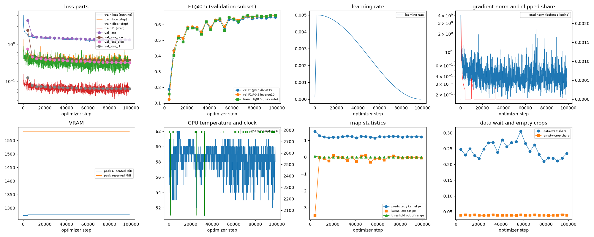
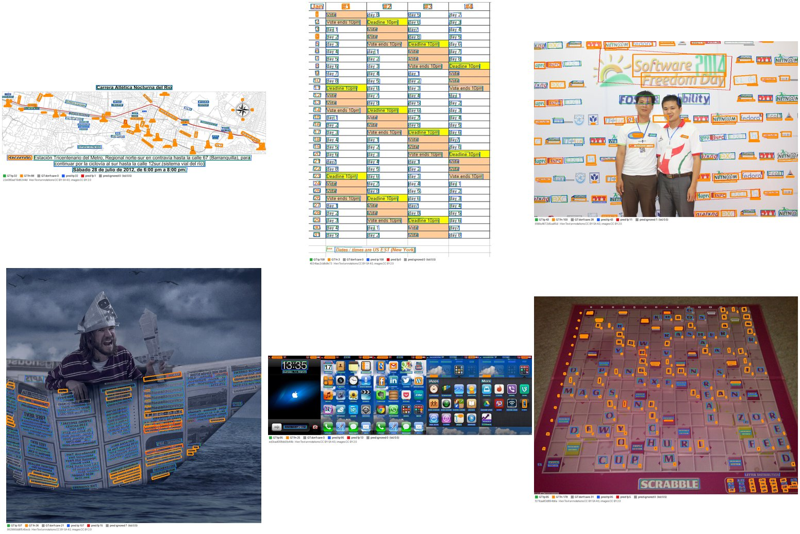
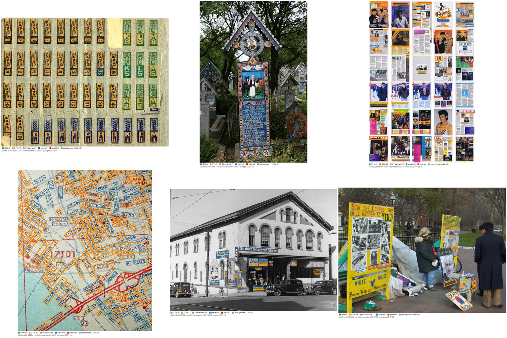

# Run report: GW-DET-003

Generated by `glypharis.training.det_report`; do not edit by hand.

## Run

- Config hash `2ba0a429ed5ba49c`, git `0a29dddbdfa9bf7c4507cef2c668f1601f697a97` (dirty: False); `train.deterministic`: True; `det.post.box_type`: quad
- Device cuda (NVIDIA GeForce RTX 4050 Laptop GPU); precision: training bf16, evaluation fp32 (ieee)
- Versions: torch 2.14.1+cu126, torchvision 0.29.1+cu126, opencv 5.0.0, shapely 2.2.0, geos 3.14.1
- Parameters: 1,120,210 (training), 1,096,953 (inference, no threshold head); backbone mobilenet_v3_small, weights 047dcff4addef86e
- Pages: `processed/hiertext/pages_train.jsonl.gz` sha256 6f5f3871a557, `processed/hiertext/pages_validation.jsonl.gz` sha256 0655c5f795a6; validation subset of 400 pages, ID-list sha256 6b91c65bd09b
- LABEL_VERSION 1, DET_DATA_VERSION 1
- Epochs run 24, optimizer steps 98,544 of 98,544; training time 4.33 h (4.33 GPU-hours), 50.6 crops/s

## Best and final epoch (validation subset)

| | Epoch | Step | Operating point | P@0.5 | R@0.5 | F1@0.5 | F1@0.7 | Mean IoU | Val loss | Train F1@0.5 |
|---|---|---|---|---|---|---|---|---|---|---|
| best (selected) | 22 | 94438 | inverse10 | 0.9128 | 0.5166 | 0.6598 | 0.5506 | 0.7959 | 1.3127 | 0.6608 |
| final | 23 | 98544 | inverse10 | 0.9162 | 0.5135 | 0.6582 | 0.5511 | 0.7975 | 1.3111 | 0.6597 |

`best.pt` is the arg-max of the selection metric, validation F1@0.5 maximised over the pre-registered operating points (protocol §7).

## Full validation

`best.pt` on all 1,715 validation pages (74,500 care lines), checkpoint sha256 9af3e12ef2da, stored operating point `inverse10`. Values with 95% page-bootstrap CIs (1,000 resamples).

| Operating point | Precision@0.5 | Recall@0.5 | F1@0.5 | F1@0.7 | Mean IoU |
|---|---|---|---|---|---|
| dbnet15 | 0.8993 [0.8890, 0.9083] | 0.5168 [0.4969, 0.5367] | 0.6564 [0.6392, 0.6733] | 0.4580 [0.4440, 0.4719] | 0.7530 |
| inverse10 (stored) | 0.9140 [0.9039, 0.9230] | 0.5266 [0.5068, 0.5467] | 0.6682 [0.6510, 0.6853] | 0.5616 [0.5452, 0.5777] | 0.7961 |

`last.pt` on all 1,715 validation pages (74,500 care lines), checkpoint sha256 50ac49dbd30f, stored operating point `inverse10`. Values with 95% page-bootstrap CIs (1,000 resamples).

| Operating point | Precision@0.5 | Recall@0.5 | F1@0.5 | F1@0.7 | Mean IoU |
|---|---|---|---|---|---|
| dbnet15 | 0.9025 [0.8922, 0.9115] | 0.5131 [0.4934, 0.5330] | 0.6542 [0.6368, 0.6713] | 0.4548 [0.4409, 0.4686] | 0.7522 |
| inverse10 (stored) | 0.9171 [0.9070, 0.9261] | 0.5228 [0.5031, 0.5428] | 0.6659 [0.6485, 0.6829] | 0.5614 [0.5450, 0.5778] | 0.7976 |

**Headline:** `best.pt` at its stored operating point `inverse10`: F1@0.5 0.6682 [0.6510, 0.6853], precision 0.9140 [0.9039, 0.9230], recall 0.5266 [0.5068, 0.5467], F1@0.7 0.5616 [0.5452, 0.5777]. The operating point was chosen on the per-epoch validation subset from two pre-registered settings; selection on validation, mildly optimistic.

Full-set arg-max operating point: `inverse10` (information only, not used for selection).

Label ceiling (sanity check 0): not available.

Start-up tripwire: label ceiling F1@0.5 0.9244 at `inverse10` on 20 validation-subset pages.

## Baseline-comparable row

The 400 Phase 5 validation pages, detection only, `best.pt` at `inverse10`: precision 0.9137 [0.8949, 0.9295], recall 0.5308 [0.4820, 0.5788], F1@0.5 0.6715 [0.6291, 0.7112], F1@0.7 0.5619 [0.5206, 0.6007].

## Diagnostics

| Flag | Epoch | Step | Evidence |
|---|---|---|---|
| THRESHOLD OUT OF RANGE | 0 | 4106 | 5.7% of threshold-mask pixels have T outside [0.2, 0.8] (alarm 5%; labels lie in [0.3, 0.7]) |
| POSTPROCESS DROPS | 0 | 4106 | at dbnet15: 22450 of 27401 components above box_thresh were dropped (too thin 22450, outside 0; alarm 50%) |
| DATA LOADER BOTTLENECK | 0 | 4106 | the loop waited for data 24.8% of the epoch (alarm 20%) |
| SLOW VALIDATION | 0 | 4106 | validation took 212.3 s, 32% of the epoch's 667.6 training seconds (alarm 25%): data_wait 5.9 s, forward 201.9 s, post 101.9 s, match 7.9 s; 12.4 boxes per page |

## Curves

## Label statistics and post-processing counters

Training labels in the best epoch: demoted small 18.8%, demoted thin kernel 0.0%, multipart kernel 0.0%, dont care 27.4%.

Post-processing counters (full validation of best.pt):

| Operating point | Components | Tiny | Truncated | Low score | Too thin | Outside | Kept | Poly fallback |
|---|---|---|---|---|---|---|---|---|
| dbnet15 | 136152 | 26843 | 0 | 61650 | 130 | 0 | 47529 | 0 |
| inverse10 | 136152 | 26843 | 0 | 61650 | 0 | 0 | 47659 | 0 |

Predictions per care line at the stored operating point: 0.64 (well above 1 hints at splits, well below at merges or misses).

## Slices (`SLICE_VERSION` 1, 1280 px long side)

At the headline operating point `inverse10`; P/R/F1@0.5 with 95% page-bootstrap CIs. `noisy_background` threshold: edge density >= 0.2376.

| Slice | Pages | Care lines | Precision@0.5 | Recall@0.5 | F1@0.5 |
|---|---|---|---|---|---|
| small_text | 360 | 21,195 | 0.8912 [0.8623, 0.9138] | 0.2967 [0.2619, 0.3286] | 0.4452 [0.4052, 0.4817] |
| rotated | 446 | 20,428 | 0.8779 [0.8610, 0.8933] | 0.3069 [0.2790, 0.3424] | 0.4548 [0.4224, 0.4949] |
| dense | 105 | 17,098 | 0.9110 [0.8851, 0.9336] | 0.3915 [0.3330, 0.4657] | 0.5477 [0.4850, 0.6183] |
| multi_line | 404 | 16,471 | 0.9333 [0.9127, 0.9493] | 0.7173 [0.6828, 0.7489] | 0.8112 [0.7860, 0.8349] |
| noisy_background | 429 | 20,849 | 0.8921 [0.8689, 0.9115] | 0.4298 [0.3902, 0.4720] | 0.5801 [0.5398, 0.6191] |

Line-level recall@0.5 of care lines, CIs from resampling pages:

| Height (min-area-rectangle short side) | Lines | Recall@0.5 |
|---|---|---|
| 0–8 px | 14,347 | 0.1135 [0.0962, 0.1342] |
| 8–12 px | 17,745 | 0.4739 [0.4448, 0.5038] |
| 12–20 px | 23,642 | 0.6680 [0.6430, 0.6920] |
| 20–40 px | 14,854 | 0.7183 [0.6854, 0.7499] |
| >= 40 px | 3,912 | 0.6986 [0.6696, 0.7251] |

| abs(text angle) (GT TL→TR direction) | Lines | Recall@0.5 |
|---|---|---|
| 0–5 ° | 53,860 | 0.6107 [0.5879, 0.6337] |
| 5–15 ° | 9,228 | 0.4744 [0.4408, 0.5069] |
| 15–45 ° | 6,345 | 0.2211 [0.1917, 0.2560] |
| >= 45 ° | 5,067 | 0.1109 [0.0786, 0.1445] |

| Box shape | Lines | Recall@0.5 |
|---|---|---|
| other care lines | 64,533 | 0.5898 [0.5696, 0.6122] |
| tall_box (long axis > 45° from horizontal) | 9,967 | 0.1174 [0.0944, 0.1412] |

## Overlays

Six pages per slice drawn by `default_rng([20261023, slice_index])` over the sorted members, independently of results, at the headline operating point. GT care: tp green, fn orange (thick); don't care grey; predictions: tp blue, fp red, ignored grey dashed. HierText annotations CC BY-SA 4.0, images CC BY 2.0.

- `small_text` (360 pages): 
- `rotated` (446 pages): 
- `dense` (105 pages): 
- `multi_line` (404 pages): 
- `noisy_background` (429 pages): 
- worst pages (lowest F1@0.5 with >= 5 care lines): 

