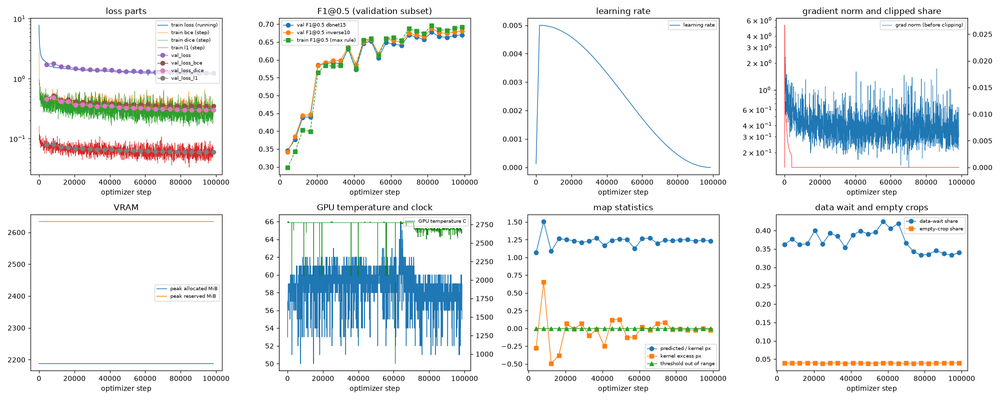
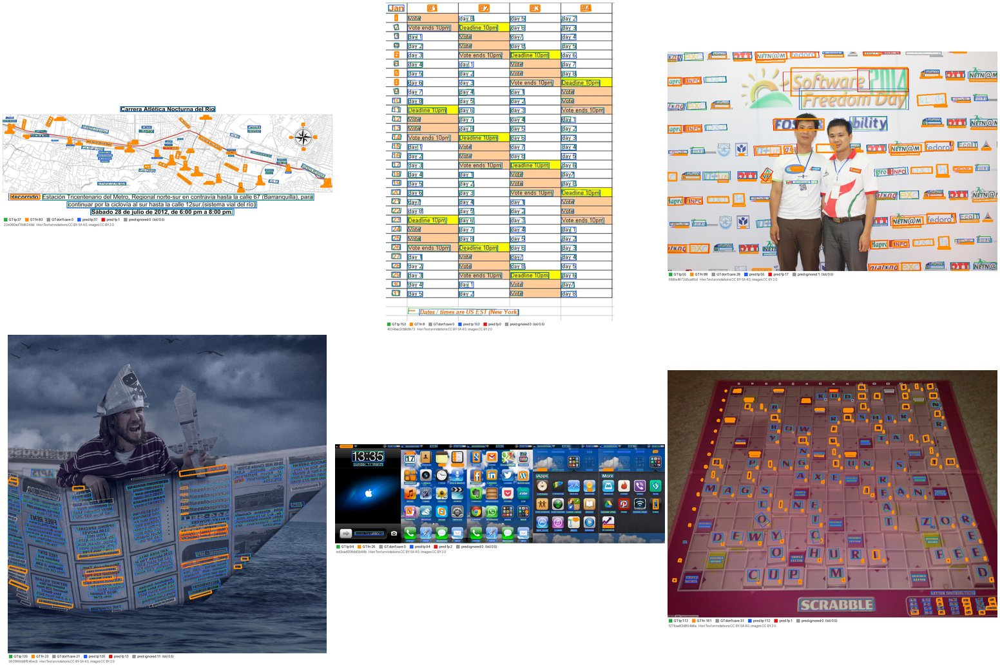
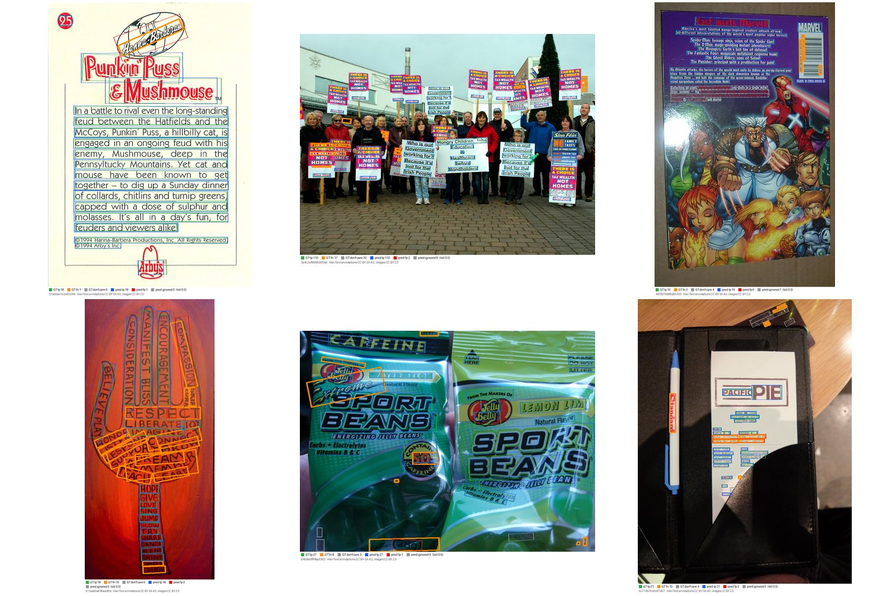
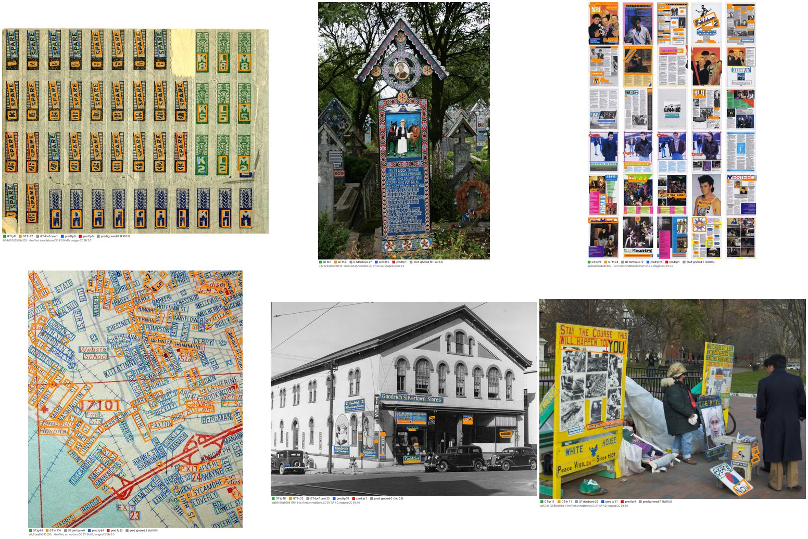
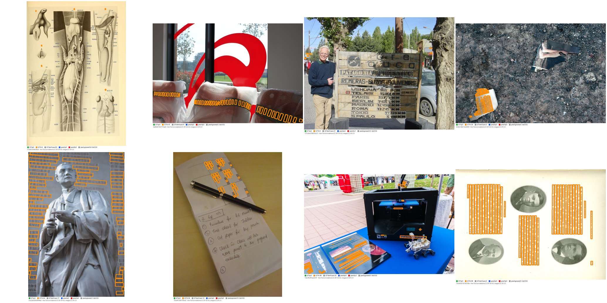

# Run report: GW-DET-007

Generated by `glypharis.training.det_report`; do not edit by hand.

## Run

- Config hash `77bb4e06c2d87384`, git `d75e3591a416383859e180d0429df3c8a6b41b96` (dirty: False); `train.deterministic`: True; `det.post.box_type`: quad
- Device cuda (NVIDIA GeForce RTX 4050 Laptop GPU); precision: training bf16, evaluation fp32 (ieee)
- Versions: torch 2.14.1+cu126, torchvision 0.29.1+cu126, opencv 5.0.0, shapely 2.2.0, geos 3.14.1
- Parameters: 3,210,466 (training), 3,187,209 (inference, no threshold head); backbone mobilenet_v3_large, weights 8738ca797c879b54
- Pages: `processed/hiertext/pages_train.jsonl.gz` sha256 6f5f3871a557, `processed/hiertext/pages_validation.jsonl.gz` sha256 0655c5f795a6; validation subset of 400 pages, ID-list sha256 6b91c65bd09b
- LABEL_VERSION 1, DET_DATA_VERSION 1
- Epochs run 24, optimizer steps 98,544 of 98,544; training time 7.51 h (7.51 GPU-hours), 29.2 crops/s

## Best and final epoch (validation subset)

| | Epoch | Step | Operating point | P@0.5 | R@0.5 | F1@0.5 | F1@0.7 | Mean IoU | Val loss | Train F1@0.5 |
|---|---|---|---|---|---|---|---|---|---|---|
| best (selected) | 19 | 82120 | inverse10 | 0.9191 | 0.5502 | 0.6883 | 0.5853 | 0.8010 | 1.2583 | 0.6968 |
| final | 23 | 98544 | inverse10 | 0.9199 | 0.5410 | 0.6813 | 0.5836 | 0.8039 | 1.2504 | 0.6915 |

`best.pt` is the arg-max of the selection metric, validation F1@0.5 maximised over the pre-registered operating points (protocol §7).

## Full validation

`best.pt` on all 1,715 validation pages (74,500 care lines), checkpoint sha256 0b673141b40f, stored operating point `inverse10`. Values with 95% page-bootstrap CIs (1,000 resamples).

| Operating point | Precision@0.5 | Recall@0.5 | F1@0.5 | F1@0.7 | Mean IoU |
|---|---|---|---|---|---|
| dbnet15 | 0.9046 [0.8960, 0.9127] | 0.5517 [0.5322, 0.5715] | 0.6854 [0.6693, 0.7008] | 0.4845 [0.4703, 0.4979] | 0.7559 |
| inverse10 (stored) | 0.9198 [0.9115, 0.9281] | 0.5625 [0.5426, 0.5823] | 0.6981 [0.6820, 0.7132] | 0.5954 [0.5793, 0.6112] | 0.8018 |

`last.pt` on all 1,715 validation pages (74,500 care lines), checkpoint sha256 d6b603e4226f, stored operating point `inverse10`. Values with 95% page-bootstrap CIs (1,000 resamples).

| Operating point | Precision@0.5 | Recall@0.5 | F1@0.5 | F1@0.7 | Mean IoU |
|---|---|---|---|---|---|
| dbnet15 | 0.9085 [0.9000, 0.9168] | 0.5443 [0.5243, 0.5639] | 0.6807 [0.6645, 0.6966] | 0.4806 [0.4660, 0.4943] | 0.7559 |
| inverse10 (stored) | 0.9236 [0.9155, 0.9322] | 0.5548 [0.5349, 0.5748] | 0.6932 [0.6771, 0.7089] | 0.5951 [0.5787, 0.6112] | 0.8042 |

**Headline:** `best.pt` at its stored operating point `inverse10`: F1@0.5 0.6981 [0.6820, 0.7132], precision 0.9198 [0.9115, 0.9281], recall 0.5625 [0.5426, 0.5823], F1@0.7 0.5954 [0.5793, 0.6112]. The operating point was chosen on the per-epoch validation subset from two pre-registered settings; selection on validation, mildly optimistic.

Full-set arg-max operating point: `inverse10` (information only, not used for selection).

Label ceiling (sanity check 0): not available.

Start-up tripwire: label ceiling F1@0.5 0.9944 at `inverse10` on 20 validation-subset pages.

## Baseline-comparable row

The 400 Phase 5 validation pages, detection only, `best.pt` at `inverse10`: precision 0.9159 [0.8995, 0.9308], recall 0.5639 [0.5145, 0.6097], F1@0.5 0.6980 [0.6575, 0.7342], F1@0.7 0.5960 [0.5561, 0.6318].

## Diagnostics

| Flag | Epoch | Step | Evidence |
|---|---|---|---|
| DATA LOADER BOTTLENECK | 0 | 4106 | the loop waited for data 36.2% of the epoch (alarm 20%) |
| POSSIBLE OVERFITTING | 9 | 41060 | val error (1 - F1@0.5) 0.4125 is >= 10% above its best 0.3639 while train error (1 - F1@0.5) keeps falling |

## Curves

## Label statistics and post-processing counters

Training labels in the best epoch: demoted small 2.5%, demoted thin kernel 1.2%, multipart kernel 0.0%, dont care 27.2%.

Post-processing counters (full validation of best.pt):

| Operating point | Components | Tiny | Truncated | Low score | Too thin | Outside | Kept | Poly fallback |
|---|---|---|---|---|---|---|---|---|
| dbnet15 | 144873 | 30372 | 0 | 63567 | 122 | 0 | 50812 | 0 |
| inverse10 | 144873 | 30372 | 0 | 63567 | 0 | 0 | 50934 | 0 |

Predictions per care line at the stored operating point: 0.68 (well above 1 hints at splits, well below at merges or misses).

## Slices (`SLICE_VERSION` 1, 1280 px long side)

At the headline operating point `inverse10`; P/R/F1@0.5 with 95% page-bootstrap CIs. `noisy_background` threshold: edge density >= 0.2376.

| Slice | Pages | Care lines | Precision@0.5 | Recall@0.5 | F1@0.5 |
|---|---|---|---|---|---|
| small_text | 360 | 21,195 | 0.9142 [0.8974, 0.9277] | 0.3503 [0.3120, 0.3851] | 0.5065 [0.4645, 0.5432] |
| rotated | 446 | 20,428 | 0.8958 [0.8817, 0.9086] | 0.3697 [0.3375, 0.4062] | 0.5234 [0.4895, 0.5605] |
| dense | 105 | 17,098 | 0.9176 [0.8947, 0.9389] | 0.4203 [0.3610, 0.4930] | 0.5765 [0.5168, 0.6429] |
| multi_line | 404 | 16,471 | 0.9379 [0.9234, 0.9497] | 0.7337 [0.7017, 0.7655] | 0.8233 [0.8008, 0.8455] |
| noisy_background | 429 | 20,849 | 0.9036 [0.8852, 0.9206] | 0.4700 [0.4305, 0.5101] | 0.6184 [0.5825, 0.6541] |

Line-level recall@0.5 of care lines, CIs from resampling pages:

| Height (min-area-rectangle short side) | Lines | Recall@0.5 |
|---|---|---|
| 0–8 px | 14,347 | 0.1571 [0.1344, 0.1819] |
| 8–12 px | 17,745 | 0.5148 [0.4847, 0.5442] |
| 12–20 px | 23,642 | 0.6949 [0.6707, 0.7173] |
| 20–40 px | 14,854 | 0.7542 [0.7239, 0.7840] |
| >= 40 px | 3,912 | 0.7370 [0.7124, 0.7607] |

| abs(text angle) (GT TL→TR direction) | Lines | Recall@0.5 |
|---|---|---|
| 0–5 ° | 53,860 | 0.6350 [0.6113, 0.6578] |
| 5–15 ° | 9,228 | 0.5294 [0.4946, 0.5625] |
| 15–45 ° | 6,345 | 0.3336 [0.2969, 0.3748] |
| >= 45 ° | 5,067 | 0.1383 [0.1020, 0.1776] |

| Box shape | Lines | Recall@0.5 |
|---|---|---|
| other care lines | 64,533 | 0.6290 [0.6080, 0.6510] |
| tall_box (long axis > 45° from horizontal) | 9,967 | 0.1315 [0.1064, 0.1574] |

## Overlays

Six pages per slice drawn by `default_rng([20261023, slice_index])` over the sorted members, independently of results, at the headline operating point. GT care: tp green, fn orange (thick); don't care grey; predictions: tp blue, fp red, ignored grey dashed. HierText annotations CC BY-SA 4.0, images CC BY 2.0.

- `small_text` (360 pages): 
- `rotated` (446 pages): 
- `dense` (105 pages): 
- `multi_line` (404 pages): 
- `noisy_background` (429 pages): 
- worst pages (lowest F1@0.5 with >= 5 care lines): 

