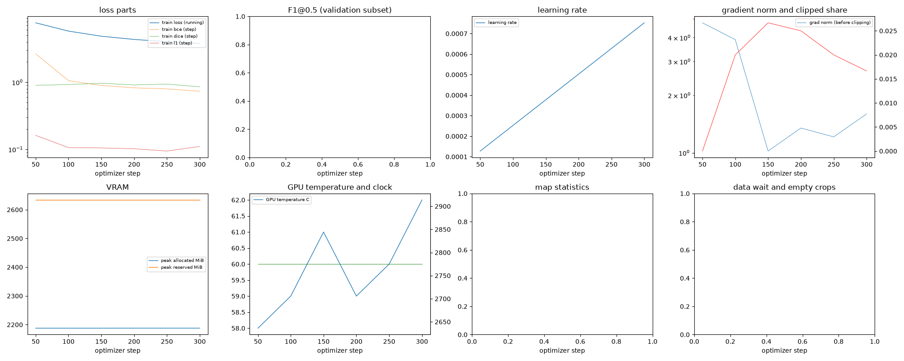

# Run report: GW-DET-008

Generated by `glypharis.training.det_report`; do not edit by hand.

## Run

- Config hash `7b10e2908ebf1dea`, git `a457ad56b881c49333e66e16a06d930e7487a922` (dirty: False); `train.deterministic`: True; `det.post.box_type`: quad
- Device cuda (NVIDIA GeForce RTX 4050 Laptop GPU); precision: training bf16, evaluation fp32 (ieee)
- Versions: torch 2.14.1+cu126, torchvision 0.29.1+cu126, opencv 5.0.0, shapely 2.2.0, geos 3.14.1
- Parameters: 3,210,466 (training), 3,187,209 (inference, no threshold head); backbone mobilenet_v3_large, weights 8738ca797c879b54
- Pages: `processed/hiertext/pages_train.jsonl.gz` sha256 6f5f3871a557, `processed/hiertext/pages_validation.jsonl.gz` sha256 0655c5f795a6; validation subset of 400 pages, ID-list sha256 6b91c65bd09b
- LABEL_VERSION 1, DET_DATA_VERSION 1
- Epochs run 0, optimizer steps 300 of 98,544; training time 0.03 h (0.03 GPU-hours), 25.6 crops/s

## Best and final epoch (validation subset)

| | Epoch | Step | Operating point | P@0.5 | R@0.5 | F1@0.5 | F1@0.7 | Mean IoU | Val loss | Train F1@0.5 |
|---|---|---|---|---|---|---|---|---|---|---|
| best (selected) | - | - | - | - | - | - | - | - | - | - |
| final | - | - | - | - | - | - | - | - | - | - |

`best.pt` is the arg-max of the selection metric, validation F1@0.5 maximised over the pre-registered operating points (protocol §7).

## Full validation

`best.pt`: not available (missing).

`last.pt` on all 1,715 validation pages (74,500 care lines), checkpoint sha256 a4257669dc25, stored operating point `dbnet15`. Values with 95% page-bootstrap CIs (1,000 resamples).

| Operating point | Precision@0.5 | Recall@0.5 | F1@0.5 | F1@0.7 | Mean IoU |
|---|---|---|---|---|---|
| dbnet15 (stored) | 0.0000 [0.0000, 0.0000] | 0.0000 [0.0000, 0.0000] | 0.0000 [0.0000, 0.0000] | 0.0000 [0.0000, 0.0000] | 0.0000 |
| inverse10 | 0.0000 [0.0000, 0.0000] | 0.0000 [0.0000, 0.0000] | 0.0000 [0.0000, 0.0000] | 0.0000 [0.0000, 0.0000] | 0.0000 |

Start-up tripwire: label ceiling F1@0.5 0.9244 at `inverse10` on 20 validation-subset pages.

## Baseline-comparable row

not available.

## Diagnostics

No flags raised.

## Curves

## Label statistics and post-processing counters

Label statistics: not available.

Post-processing counters: not available.

## Slices

not available (no full validation of best.pt).

## Overlays

not available.

