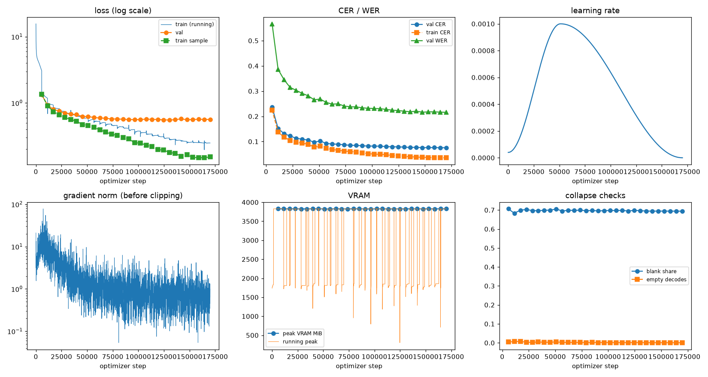
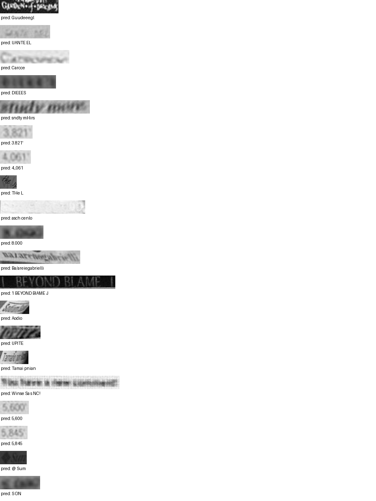

# Run report: GW-REC-001

Generated by `glypharis.training.report`; do not edit by hand.

## Run

- Config hash `a13d7c4c367626da`, git `9d07ea283c9231e7cacbefcb32c8851126d9f76a` (dirty: False)
- Device cuda (NVIDIA GeForce RTX 4050 Laptop GPU), precision bf16, torch 2.14.1+cu126
- Parameters 7,796,435 (29.8 MiB of weights and buffers); 348,935 training lines, 73,888 validation lines
- Epochs run 30, optimizer steps 170,116, stopped early: False; training time 4.71 h (4.71 GPU-hours)
- Data: `processed/hiertext/lines_train` 348,935 lines, sha256 b8cfff844ed2; `processed/hiertext/lines_validation` 73,888 lines, sha256 7db3ec6782ea

## Best and final epoch

| | Epoch | Step | Val CER % | Val WER % | Val loss | Train CER % |
|---|---|---|---|---|---|---|
| best (selected) | 29 | 170116 | 7.53 | 21.59 | 0.5616 | 3.57 |
| final | 29 | 170116 | 7.53 | 21.59 | 0.5616 | 3.57 |

The selected checkpoint is `best.pt`: the lowest validation CER (strict track), as the protocol requires (§7); the final epoch is shown for comparison.

Validation CER of the selected checkpoint: 7.53% [7.38, 7.69] (95% bootstrap CI over 73,888 lines).

## Diagnostics

| Flag | Epoch | Step | Evidence |
|---|---|---|---|
| POSSIBLE OVERFITTING | 18 | 107737 | over the last 5 validation points train loss slope -0.01817 < 0 while val loss slope 0.0007231 > 0 |
| POSSIBLE OVERFITTING | 19 | 113408 | over the last 5 validation points train loss slope -0.01549 < 0 while val loss slope 0.001831 > 0 |
| POSSIBLE OVERFITTING | 20 | 119078 | over the last 5 validation points train loss slope -0.01365 < 0 while val loss slope 0.0006838 > 0 |
| POSSIBLE OVERFITTING | 24 | 141762 | over the last 5 validation points train loss slope -0.01027 < 0 while val loss slope 0.002774 > 0 |
| POSSIBLE OVERFITTING | 25 | 147433 | over the last 5 validation points train loss slope -0.007955 < 0 while val loss slope 0.002784 > 0 |
| POSSIBLE OVERFITTING | 26 | 153104 | over the last 5 validation points train loss slope -0.006269 < 0 while val loss slope 0.002018 > 0 |
| POSSIBLE OVERFITTING | 27 | 158774 | over the last 5 validation points train loss slope -0.005392 < 0 while val loss slope 0.0001839 > 0 |
| POSSIBLE OVERFITTING | 29 | 170116 | over the last 5 validation points train loss slope -0.002689 < 0 while val loss slope 0.0009651 > 0 |

## Curves

## Worst validation lines

| Key | Reference | Prediction | CER |
|---|---|---|---|
| 8f80cc3eac928e4e/p21/l0 | C | Guudeeegl | 9.00 |
| 983a43804c520cc0/p13/l0 | L | UANTE EL | 7.00 |
| 013df9c6e5b5aed4/p0/l9 | G | Carcce | 6.00 |
| bde51cd0a0e194b1/p34/l0 | s | DIEEES | 6.00 |
| e20fbc5878d56a36/p1/l40 | 5: | sndty mHirs | 5.50 |
| 03221b6a82a5a02e/p85/l0 | 3 | 3.821' | 5.00 |
| 03221b6a82a5a02e/p87/l0 | 4 | 4.,061 | 5.00 |
| 1177e2fd519784db/p0/l3 | W | THe L | 5.00 |
| 154058472bd0c3bf/p21/l0 | ND | asch cenlo | 5.00 |
| 75688de8882f42fa/p11/l3 | 3 | 8.000 | 5.00 |
| 76a7ad3fe918c4ef/p24/l0 | na/ | Ba/areiegabrielli | 5.00 |
| 83265d4ad42b65eb/p21/l0 | \| \| | 1 BEYOND BIAME J | 5.00 |
| 902b8cf14489c26a/p18/l9 | S | Aodio | 5.00 |
| f1fa7e6c910f4ede/p1/l563 | M | UPITE | 5.00 |
| 902b8cf14489c26a/p19/l3 | Ta | Tamai pnian | 4.50 |
| b16f3b07397b7b1a/p15/l25 | The | Winse Sa s NC! | 4.33 |
| 03221b6a82a5a02e/p84/l0 | 5 | 5,600 | 4.00 |
| 03221b6a82a5a02e/p86/l0 | 5 | 5,845 | 4.00 |
| 3d874195d3c70081/p15/l0 | S | @ Sum | 4.00 |
| 75688de8882f42fa/p11/l2 | 5 | S ON | 4.00 |

