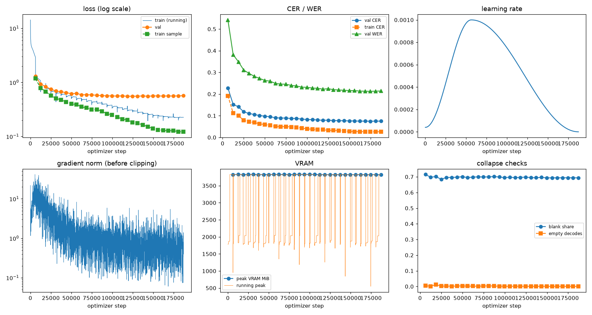
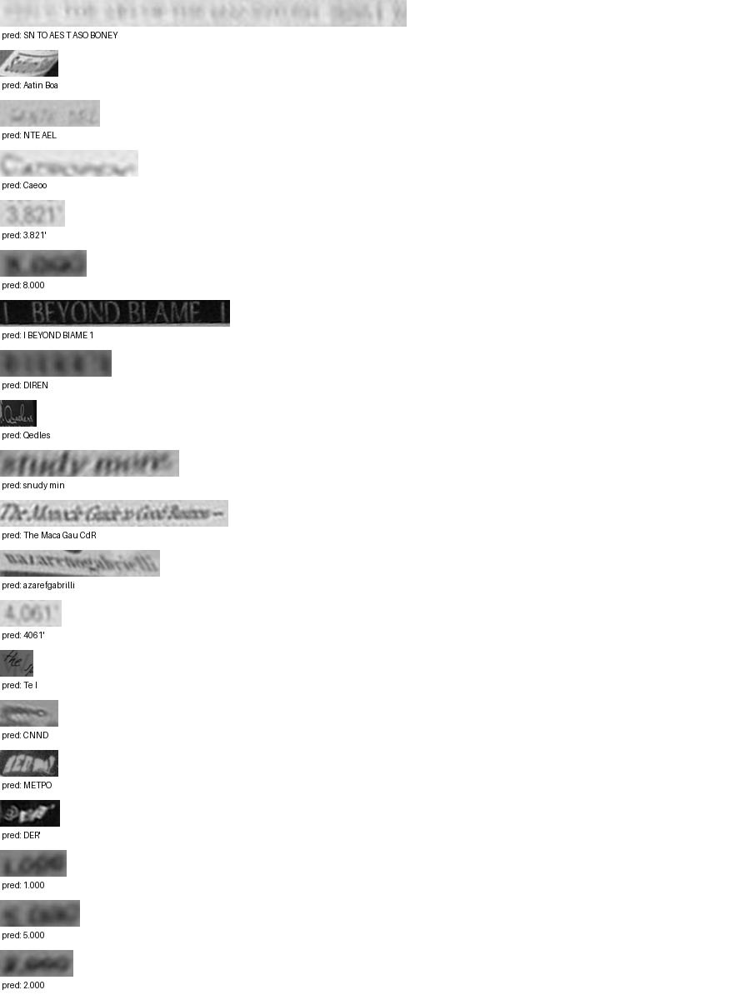

# Run report: GW-REC-002

Generated by `glypharis.training.report`; do not edit by hand.

## Run

- Config hash `5e33f43cb53dd574`, git `5124b160e2aeaf8e764762a263d228d3bfbbe87d` (dirty: False)
- Device cuda (NVIDIA GeForce RTX 4050 Laptop GPU), precision bf16, torch 2.14.1+cu126
- Parameters 7,796,435; 383,935 training lines, 73,888 validation lines
- Epochs run 30, optimizer steps 187,170, stopped early: False; training time 5.32 h (5.32 GPU-hours)
- Data: `processed/hiertext/lines_train` 348,935 lines, sha256 b8cfff844ed2; `processed/glyphsynth/lines_train` 100,000 lines, sha256 762c1755f4d4; `processed/hiertext/lines_validation` 73,888 lines, sha256 7db3ec6782ea

## Best and final epoch

| | Epoch | Step | Val CER % | Val WER % | Val loss | Train CER % |
|---|---|---|---|---|---|---|
| best (selected) | 27 | 174692 | 7.49 | 21.26 | 0.5597 | 2.58 |
| final | 29 | 187170 | 7.53 | 21.40 | 0.5679 | 2.62 |

The selected checkpoint is `best.pt`: the lowest validation CER (strict track), as the protocol requires (§7); the final epoch is shown for comparison.

Validation CER of the selected checkpoint: 7.49% [7.34, 7.64] (95% bootstrap CI over 73,888 lines).

## Notes

- best.pt re-selected on 2026-10-23 with scripts/rec_reselect.py (git d5762a0). Training chose best.pt with early stopping's min_delta (0.001 CER), so epoch 24 (7.58% val CER) stayed selected although epoch 27 reached 7.49%. Protocol §7 selects the lowest validation CER; the trainer now does. Re-scoring epoch 27's checkpoint on validation gave 7.4870% (logged 7.4870%). Nothing was retrained and no test data was read; the superseded best.pt and samples are kept as best_superseded_e024.pt and val_best_samples.superseded_e024.jsonl.
- Config hash corrected on 2026-10-23 with scripts/rec_report.py: the summary written at the end of the resumed run hashed the config including its resume pointer (e047cc28f122a3f5); 5e33f43cb53dd574 is the run's config hash, as at its start (configs/rec/gw-rec-002.yaml).

## Diagnostics

| Flag | Epoch | Step | Evidence |
|---|---|---|---|
| GRADIENT EXPLOSION | 1 | 6477 | global grad norm 1275 > 1000 |

## Curves

## Worst validation lines

| Key | Reference | Prediction | CER |
|---|---|---|---|
| 976149c72a2fde3e/p1/l6 | 20 | SN TO AES T ASO BONEY | 10.50 |
| 902b8cf14489c26a/p18/l9 | S | Aatin Boa | 9.00 |
| 983a43804c520cc0/p13/l0 | L | NTE AEL | 6.00 |
| 013df9c6e5b5aed4/p0/l9 | G | Caeoo | 5.00 |
| 03221b6a82a5a02e/p85/l0 | 3 | 3.821' | 5.00 |
| 75688de8882f42fa/p11/l3 | 3 | 8.000 | 5.00 |
| 83265d4ad42b65eb/p21/l0 | \| \| | I BEYOND BIAME 1 | 5.00 |
| bde51cd0a0e194b1/p34/l0 | s | DIREN | 5.00 |
| da589d39cc2c3cea/p3/l1 | Q | Qedles | 5.00 |
| e20fbc5878d56a36/p1/l40 | 5: | snudy min | 4.50 |
| 102f2c6a35f05df6/p5/l0 | The | The Maca Gau CdR | 4.33 |
| 76a7ad3fe918c4ef/p24/l0 | na/ | azarefgabrilli | 4.33 |
| 03221b6a82a5a02e/p87/l0 | 4 | 4061' | 4.00 |
| 1177e2fd519784db/p0/l3 | W | Te I | 4.00 |
| 3d46f7fec33d4c37/p3/l20 | G | CNND | 4.00 |
| 634e5932b6e6f347/p32/l0 | E | METPO | 4.00 |
| 7025cb4ac7cf0ec2/p7/l11 | @ | DER' | 4.00 |
| 75688de8882f42fa/p11/l0 | 1 | 1.000 | 4.00 |
| 75688de8882f42fa/p11/l2 | 5 | 5.000 | 4.00 |
| 75688de8882f42fa/p11/l4 | 2 | 2.000 | 4.00 |

