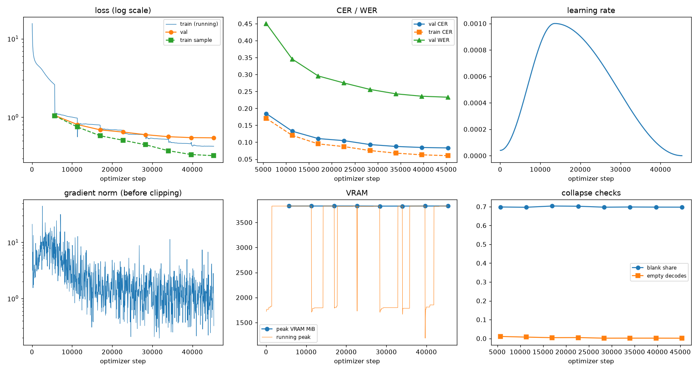
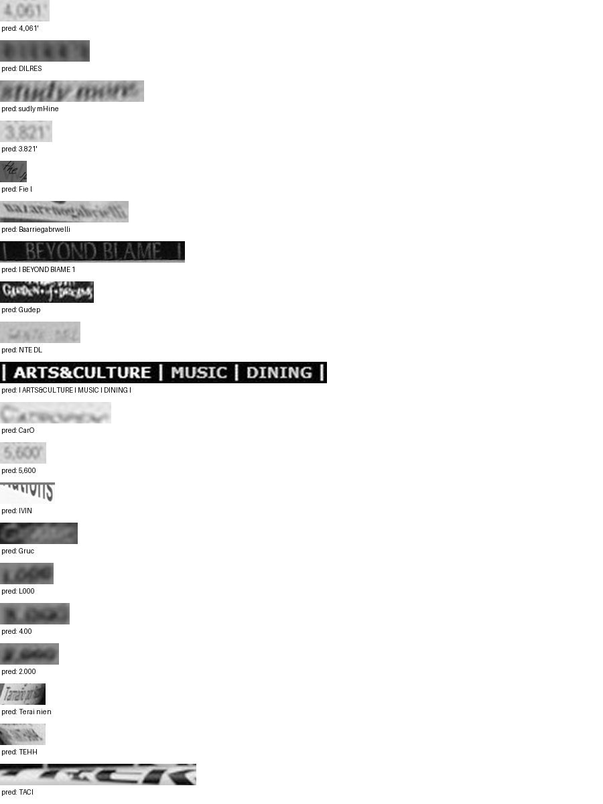

# Run report: GW-REC-003

Generated by `glypharis.training.report`; do not edit by hand.

## Run

- Config hash `e06f26593818f217`, git `2df57305e890de241d424e741c3ce2f3a2e30692` (dirty: False)
- Device cuda (NVIDIA GeForce RTX 4050 Laptop GPU), precision bf16, torch 2.14.1+cu126
- Parameters 7,796,435 (29.8 MiB of weights and buffers); 348,935 training lines, 73,888 validation lines
- Epochs run 8, optimizer steps 45,360, stopped early: False; training time 1.34 h (1.34 GPU-hours)
- Data: `processed/hiertext/lines_train` 348,935 lines, sha256 b8cfff844ed2; `processed/hiertext/lines_validation` 73,888 lines, sha256 7db3ec6782ea

## Best and final epoch

| | Epoch | Step | Val CER % | Val WER % | Val loss | Train CER % |
|---|---|---|---|---|---|---|
| best (selected) | 7 | 45360 | 8.32 | 23.30 | 0.5475 | 6.03 |
| final | 7 | 45360 | 8.32 | 23.30 | 0.5475 | 6.03 |

The selected checkpoint is `best.pt`: the lowest validation CER (strict track), as the protocol requires (§7); the final epoch is shown for comparison.

Validation CER of the selected checkpoint: 8.32% [8.16, 8.47] (95% bootstrap CI over 73,888 lines).

## Diagnostics

No flags raised.

## Curves

## Worst validation lines

| Key | Reference | Prediction | CER |
|---|---|---|---|
| 03221b6a82a5a02e/p87/l0 | 4 | 4.,061' | 6.00 |
| bde51cd0a0e194b1/p34/l0 | s | DILRES | 6.00 |
| e20fbc5878d56a36/p1/l40 | 5: | sudly mHine | 5.50 |
| 03221b6a82a5a02e/p85/l0 | 3 | 3.821' | 5.00 |
| 1177e2fd519784db/p0/l3 | W | Fie l | 5.00 |
| 76a7ad3fe918c4ef/p24/l0 | na/ | Baarriegabrwelli | 5.00 |
| 83265d4ad42b65eb/p21/l0 | \| \| | I BEYOND BIAME 1 | 5.00 |
| 8f80cc3eac928e4e/p21/l0 | C | Gudep | 5.00 |
| 983a43804c520cc0/p13/l0 | L | NTE DL | 5.00 |
| 50140f555f4d26d0/p30/l0 | \| \| \| \| | I ARTS&CULTURE I MUSIC I DINING I | 4.29 |
| 013df9c6e5b5aed4/p0/l9 | G | CarO | 4.00 |
| 03221b6a82a5a02e/p84/l0 | 5 | 5,600 | 4.00 |
| 05ee9d2ad48c11c2/p14/l1 | s | IVIN | 4.00 |
| 4ee86bd63a80b30c/p35/l0 | C | Gruc | 4.00 |
| 75688de8882f42fa/p11/l0 | 1 | L000 | 4.00 |
| 75688de8882f42fa/p11/l3 | 3 | 4.00 | 4.00 |
| 75688de8882f42fa/p11/l4 | 2 | 2.000 | 4.00 |
| 902b8cf14489c26a/p19/l3 | Ta | Terai nien | 4.00 |
| 902b8cf14489c26a/p20/l1 | A | TEHH | 4.00 |
| a73ddc9ff0bbf3a0/p2/l71 | K | TACI | 4.00 |

