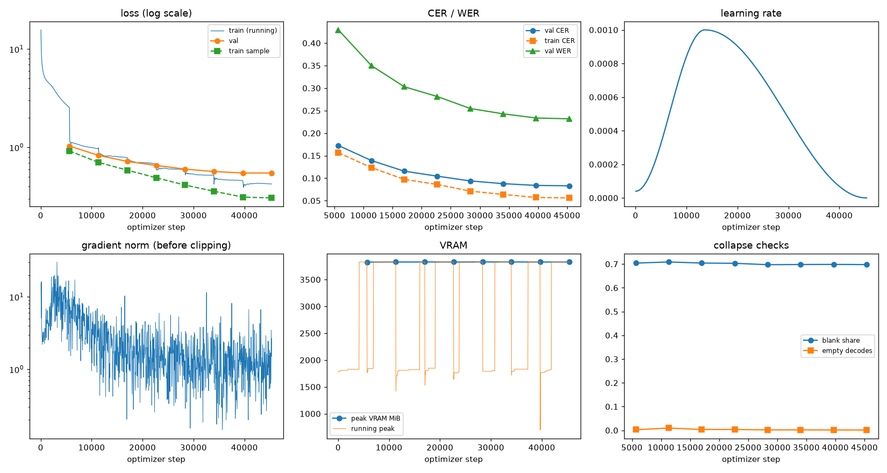
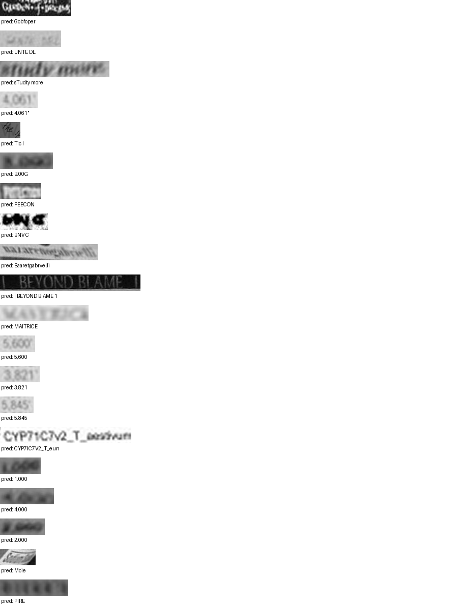

# Run report: GW-REC-004

Generated by `glypharis.training.report`; do not edit by hand.

## Run

- Config hash `13c409430f851959`, git `e853f3b3abb764c9b2f40793407d98419c61d9d3` (dirty: False)
- Device cuda (NVIDIA GeForce RTX 4050 Laptop GPU), precision bf16, torch 2.14.1+cu126
- Parameters 7,796,435 (29.8 MiB of weights and buffers); 348,935 training lines, 73,888 validation lines
- Epochs run 8, optimizer steps 45,368, stopped early: False; training time 1.31 h (1.31 GPU-hours)
- Data: `processed/hiertext/lines_train` 348,935 lines, sha256 b8cfff844ed2; `processed/hiertext/lines_validation` 73,888 lines, sha256 7db3ec6782ea

## Best and final epoch

| | Epoch | Step | Val CER % | Val WER % | Val loss | Train CER % |
|---|---|---|---|---|---|---|
| best (selected) | 7 | 45368 | 8.30 | 23.18 | 0.5481 | 5.61 |
| final | 7 | 45368 | 8.30 | 23.18 | 0.5481 | 5.61 |

The selected checkpoint is `best.pt`: the lowest validation CER (strict track), as the protocol requires (§7); the final epoch is shown for comparison.

Validation CER of the selected checkpoint: 8.30% [8.15, 8.47] (95% bootstrap CI over 73,888 lines).

## Diagnostics

No flags raised.

## Curves

## Worst validation lines

| Key | Reference | Prediction | CER |
|---|---|---|---|
| 8f80cc3eac928e4e/p21/l0 | C | Gobfoper | 8.00 |
| 983a43804c520cc0/p13/l0 | L | UNTE DL | 6.00 |
| e20fbc5878d56a36/p1/l40 | 5: | sTudty more | 5.50 |
| 03221b6a82a5a02e/p87/l0 | 4 | 4.061" | 5.00 |
| 1177e2fd519784db/p0/l3 | W | Tic I | 5.00 |
| 75688de8882f42fa/p11/l3 | 3 | B.00G | 5.00 |
| bd68198a86681f49/p22/l0 | P | PEECON | 5.00 |
| bdd687b860d886a5/p2/l175 | A | BNV C | 5.00 |
| 76a7ad3fe918c4ef/p24/l0 | na/ | Baaretgabrvelli | 4.67 |
| 83265d4ad42b65eb/p21/l0 | \| \| | \| BEYOND BIAME 1 | 4.67 |
| 013df9c6e5b5aed4/p0/l11 | sc | MAITRICE | 4.00 |
| 03221b6a82a5a02e/p84/l0 | 5 | 5,600 | 4.00 |
| 03221b6a82a5a02e/p85/l0 | 3 | 3.821 | 4.00 |
| 03221b6a82a5a02e/p86/l0 | 5 | 5.845 | 4.00 |
| 1427a2dd12744f8f/p22/l2 | _T_ | CYP7IC7V2_T_eun | 4.00 |
| 75688de8882f42fa/p11/l0 | 1 | 1.000 | 4.00 |
| 75688de8882f42fa/p11/l1 | 4 | 4.000 | 4.00 |
| 75688de8882f42fa/p11/l4 | 2 | 2.000 | 4.00 |
| 902b8cf14489c26a/p18/l9 | S | Moie | 4.00 |
| bde51cd0a0e194b1/p34/l0 | s | PIRE | 4.00 |

