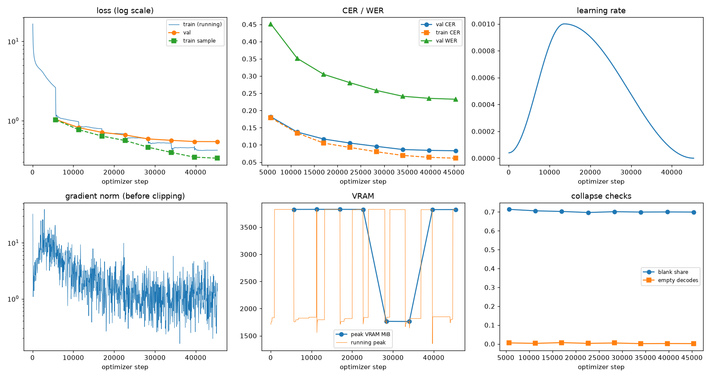
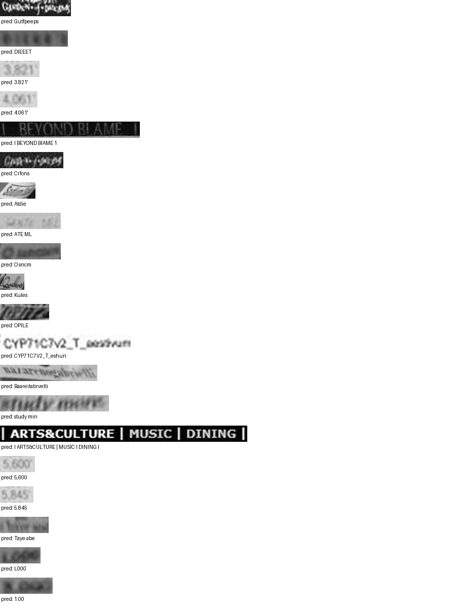

# Run report: GW-REC-005

Generated by `glypharis.training.report`; do not edit by hand.

## Run

- Config hash `3723c56e1c5c78dc`, git `498eb39672d106073ea4bb31b674354b4b11adca` (dirty: False)
- Device cuda (NVIDIA GeForce RTX 4050 Laptop GPU), precision bf16, torch 2.14.1+cu126
- Parameters 7,796,435 (29.8 MiB of weights and buffers); 348,935 training lines, 73,888 validation lines
- Epochs run 8, optimizer steps 45,367, stopped early: False; training time 1.31 h (1.31 GPU-hours)
- Data: `processed/hiertext/lines_train` 348,935 lines, sha256 b8cfff844ed2; `processed/hiertext/lines_validation` 73,888 lines, sha256 7db3ec6782ea

## Best and final epoch

| | Epoch | Step | Val CER % | Val WER % | Val loss | Train CER % |
|---|---|---|---|---|---|---|
| best (selected) | 7 | 45367 | 8.31 | 23.27 | 0.5444 | 6.16 |
| final | 7 | 45367 | 8.31 | 23.27 | 0.5444 | 6.16 |

The selected checkpoint is `best.pt`: the lowest validation CER (strict track), as the protocol requires (§7); the final epoch is shown for comparison.

Validation CER of the selected checkpoint: 8.31% [8.15, 8.47] (95% bootstrap CI over 73,888 lines).

## Notes

- Resumed from `last.pt` at step 28,000 (epoch 4); 4 log records written after that checkpoint were moved to metrics.dropped.jsonl.
- Resumed from `last.pt` at step 33,000 (epoch 5); 9 log records written after that checkpoint were moved to metrics.dropped.jsonl.
- Resumed from `last.pt` at step 44,000 (epoch 7); 6 log records written after that checkpoint were moved to metrics.dropped.jsonl.

## Diagnostics

No flags raised.

## Curves

## Worst validation lines

| Key | Reference | Prediction | CER |
|---|---|---|---|
| 8f80cc3eac928e4e/p21/l0 | C | Gutfpeeps | 9.00 |
| bde51cd0a0e194b1/p34/l0 | s | DIEEET | 6.00 |
| 03221b6a82a5a02e/p85/l0 | 3 | 3.821' | 5.00 |
| 03221b6a82a5a02e/p87/l0 | 4 | 4.061' | 5.00 |
| 83265d4ad42b65eb/p21/l0 | \| \| | I BEYOND BIAME 1 | 5.00 |
| 8f80cc3eac928e4e/p22/l0 | C | Crfons | 5.00 |
| 902b8cf14489c26a/p18/l9 | S | Atdie  | 5.00 |
| 983a43804c520cc0/p13/l0 | L | ATE ML | 5.00 |
| d6cffab23f5a1e4a/p60/l0 | O | O sncm | 5.00 |
| da589d39cc2c3cea/p4/l1 | Q | Kules | 5.00 |
| f1fa7e6c910f4ede/p1/l563 | M | OPILE | 5.00 |
| 1427a2dd12744f8f/p22/l2 | _T_ | CYP71C7V2_T_eshun | 4.67 |
| 76a7ad3fe918c4ef/p24/l0 | na/ | Baareitabrvetli | 4.67 |
| e20fbc5878d56a36/p1/l40 | 5: | study min | 4.50 |
| 50140f555f4d26d0/p30/l0 | \| \| \| \| | I ARTS&CULTURE \| MUSIC I DINING I | 4.14 |
| 03221b6a82a5a02e/p84/l0 | 5 | 5,600 | 4.00 |
| 03221b6a82a5a02e/p86/l0 | 5 | 5.845 | 4.00 |
| 2c3e413d9bae76d4/p0/l10 | od | Taye abe | 4.00 |
| 75688de8882f42fa/p11/l0 | 1 | L000 | 4.00 |
| 75688de8882f42fa/p11/l3 | 3 | 1.00 | 4.00 |

