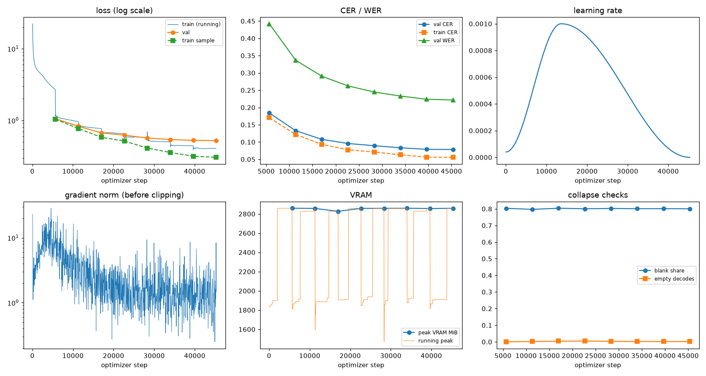
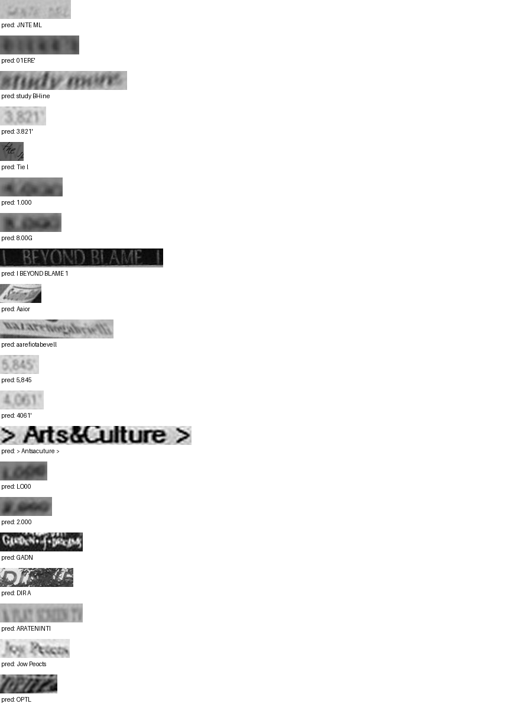

# Run report: GW-REC-006

Generated by `glypharis.training.report`; do not edit by hand.

## Run

- Config hash `37ff03a6a4e2b7bc`, git `2127740776d8b823dd4867da9fc46c6d02fcc242` (dirty: False)
- Device cuda (NVIDIA GeForce RTX 4050 Laptop GPU), precision bf16, torch 2.14.1+cu126
- Parameters 7,796,435 (29.8 MiB of weights and buffers); 348,935 training lines, 73,888 validation lines
- Epochs run 8, optimizer steps 45,339, stopped early: False; training time 2.44 h (2.44 GPU-hours)
- Data: `processed/hiertext/lines_train` 348,935 lines, sha256 b8cfff844ed2; `processed/hiertext/lines_validation` 73,888 lines, sha256 7db3ec6782ea

## Best and final epoch

| | Epoch | Step | Val CER % | Val WER % | Val loss | Train CER % |
|---|---|---|---|---|---|---|
| best (selected) | 7 | 45339 | 7.83 | 22.17 | 0.5226 | 5.57 |
| final | 7 | 45339 | 7.83 | 22.17 | 0.5226 | 5.57 |

The selected checkpoint is `best.pt`: the lowest validation CER (strict track), as the protocol requires (§7); the final epoch is shown for comparison.

Validation CER of the selected checkpoint: 7.83% [7.68, 7.99] (95% bootstrap CI over 73,888 lines).

## Diagnostics

No flags raised.

## Curves

## Worst validation lines

| Key | Reference | Prediction | CER |
|---|---|---|---|
| 983a43804c520cc0/p13/l0 | L | JNTE ML | 6.00 |
| bde51cd0a0e194b1/p34/l0 | s | 01ERE' | 6.00 |
| e20fbc5878d56a36/p1/l40 | 5: | study BHine | 5.50 |
| 03221b6a82a5a02e/p85/l0 | 3 | 3.821' | 5.00 |
| 1177e2fd519784db/p0/l3 | W | Tie l | 5.00 |
| 75688de8882f42fa/p11/l1 | 4 | 1.000 | 5.00 |
| 75688de8882f42fa/p11/l3 | 3 | 8.00G | 5.00 |
| 83265d4ad42b65eb/p21/l0 | \| \| | I BEYOND BLAME 1 | 5.00 |
| 902b8cf14489c26a/p18/l9 | S | Aaior  | 5.00 |
| 76a7ad3fe918c4ef/p24/l0 | na/ | aarefiotabevell | 4.67 |
| 03221b6a82a5a02e/p86/l0 | 5 | 5,845 | 4.00 |
| 03221b6a82a5a02e/p87/l0 | 4 | 4061' | 4.00 |
| 50140f555f4d26d0/p32/l0 | > > | > Antsacuture > | 4.00 |
| 75688de8882f42fa/p11/l0 | 1 | LO00 | 4.00 |
| 75688de8882f42fa/p11/l4 | 2 | 2.000 | 4.00 |
| 8f80cc3eac928e4e/p21/l0 | C | GADN  | 4.00 |
| e8d1be7082989099/p19/l0 | D | DIR A | 4.00 |
| eb9c71f60af35ebe/p11/l4 | AT | ARATENINTI | 4.00 |
| ebca2758a3725a0a/p20/l30 | Pc | Jow Peocts | 4.00 |
| f1fa7e6c910f4ede/p1/l563 | M | OPTL | 4.00 |

