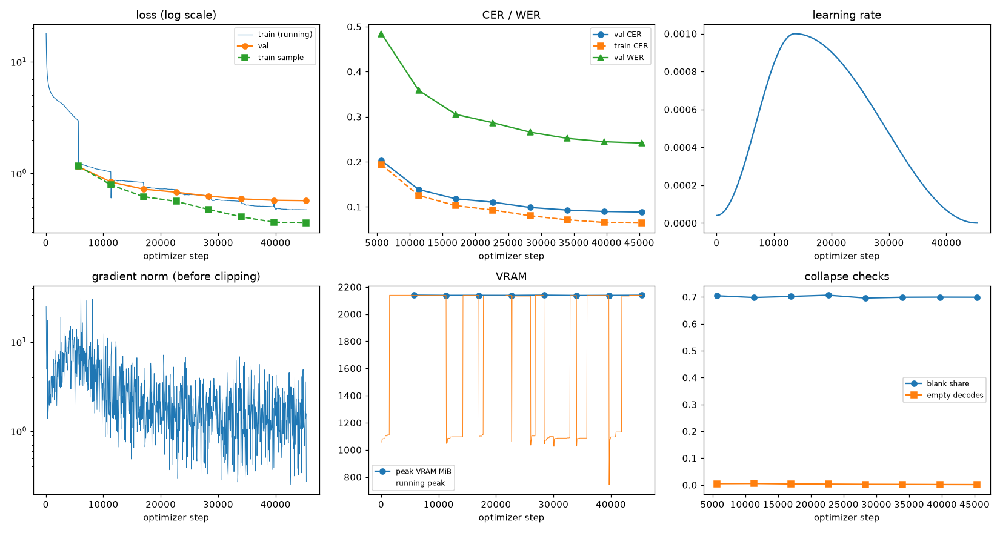
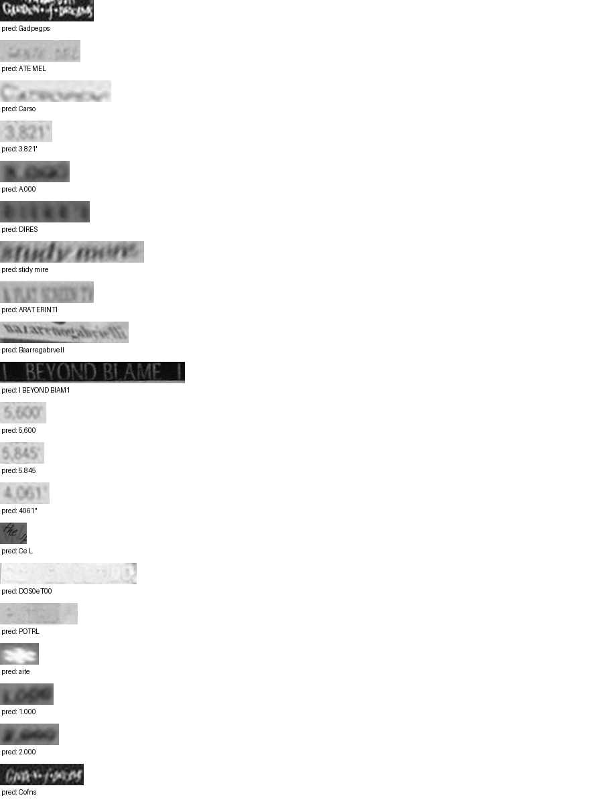

# Run report: GW-REC-007

Generated by `glypharis.training.report`; do not edit by hand.

## Run

- Config hash `4bb1c04c26fad0a2`, git `d5dde03e40abb082684c3f11976ed493711f5131` (dirty: False)
- Device cuda (NVIDIA GeForce RTX 4050 Laptop GPU), precision bf16, torch 2.14.1+cu126
- Parameters 3,897,075 (14.9 MiB of weights and buffers); 348,935 training lines, 73,888 validation lines
- Epochs run 8, optimizer steps 45,360, stopped early: False; training time 0.95 h (0.95 GPU-hours)
- Data: `processed/hiertext/lines_train` 348,935 lines, sha256 b8cfff844ed2; `processed/hiertext/lines_validation` 73,888 lines, sha256 7db3ec6782ea

## Best and final epoch

| | Epoch | Step | Val CER % | Val WER % | Val loss | Train CER % |
|---|---|---|---|---|---|---|
| best (selected) | 7 | 45360 | 8.83 | 24.15 | 0.5700 | 6.38 |
| final | 7 | 45360 | 8.83 | 24.15 | 0.5700 | 6.38 |

The selected checkpoint is `best.pt`: the lowest validation CER (strict track), as the protocol requires (§7); the final epoch is shown for comparison.

Validation CER of the selected checkpoint: 8.83% [8.67, 9.01] (95% bootstrap CI over 73,888 lines).

## Notes

- Resumed from `last.pt` at step 26,000 (epoch 4); 18 log records written after that checkpoint were moved to metrics.dropped.jsonl.
- Resumed from `last.pt` at step 30,000 (epoch 5); 3 log records written after that checkpoint were moved to metrics.dropped.jsonl.

## Diagnostics

No flags raised.

## Curves

## Worst validation lines

| Key | Reference | Prediction | CER |
|---|---|---|---|
| 8f80cc3eac928e4e/p21/l0 | C | Gadpegps | 8.00 |
| 983a43804c520cc0/p13/l0 | L | ATE MEL | 6.00 |
| 013df9c6e5b5aed4/p0/l9 | G | Carso | 5.00 |
| 03221b6a82a5a02e/p85/l0 | 3 | 3.821' | 5.00 |
| 75688de8882f42fa/p11/l3 | 3 | A.000 | 5.00 |
| bde51cd0a0e194b1/p34/l0 | s | DIRES | 5.00 |
| e20fbc5878d56a36/p1/l40 | 5: | stidy mire | 5.00 |
| eb9c71f60af35ebe/p11/l4 | AT | ARAT ERINTI | 4.50 |
| 76a7ad3fe918c4ef/p24/l0 | na/ | Baarregabrvell | 4.33 |
| 83265d4ad42b65eb/p21/l0 | \| \| | I BEYOND BIAM1 | 4.33 |
| 03221b6a82a5a02e/p84/l0 | 5 | 5,600 | 4.00 |
| 03221b6a82a5a02e/p86/l0 | 5 | 5.845 | 4.00 |
| 03221b6a82a5a02e/p87/l0 | 4 | 4061" | 4.00 |
| 1177e2fd519784db/p0/l3 | W | Ce L | 4.00 |
| 154058472bd0c3bf/p21/l0 | ND | DOS0eT00 | 4.00 |
| 154058472bd0c3bf/p47/l0 | P | POTRL | 4.00 |
| 458fde71c4282476/p67/l0 | * | aite | 4.00 |
| 75688de8882f42fa/p11/l0 | 1 | 1.000 | 4.00 |
| 75688de8882f42fa/p11/l4 | 2 | 2.000 | 4.00 |
| 8f80cc3eac928e4e/p22/l0 | C | Cofns | 4.00 |

