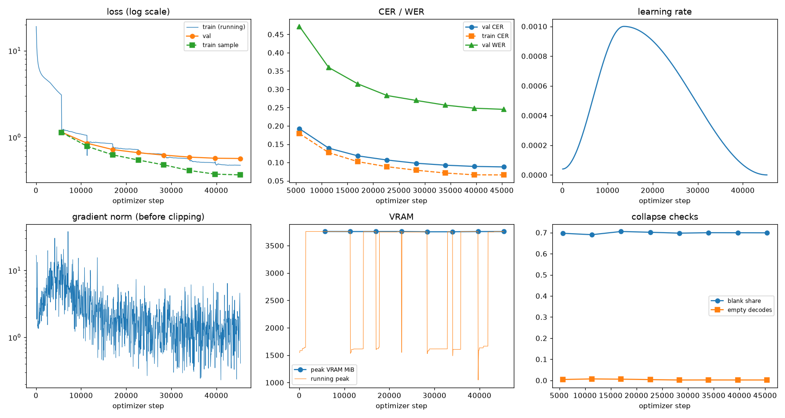
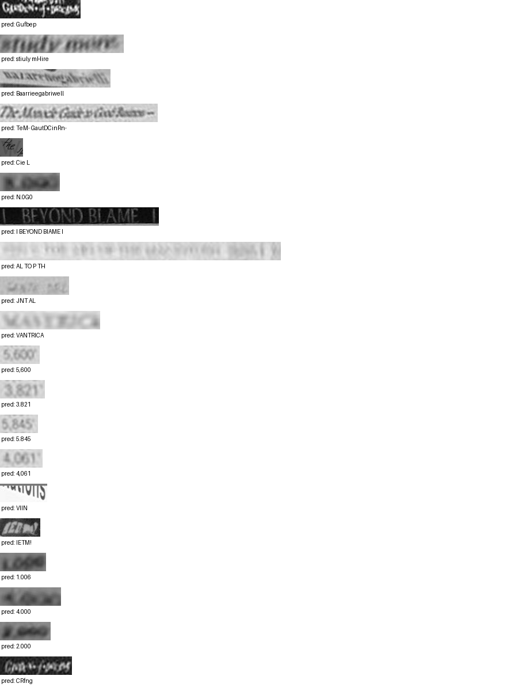

# Run report: GW-REC-008

Generated by `glypharis.training.report`; do not edit by hand.

## Run

- Config hash `1d41e0167901ed9a`, git `ea1be86451da222ac56f28198514c8f04fdffbec` (dirty: False)
- Device cuda (NVIDIA GeForce RTX 4050 Laptop GPU), precision bf16, torch 2.14.1+cu126
- Parameters 5,624,787 (21.5 MiB of weights and buffers); 348,935 training lines, 73,888 validation lines
- Epochs run 8, optimizer steps 45,360, stopped early: False; training time 1.52 h (1.52 GPU-hours)
- Data: `processed/hiertext/lines_train` 348,935 lines, sha256 b8cfff844ed2; `processed/hiertext/lines_validation` 73,888 lines, sha256 7db3ec6782ea

## Best and final epoch

| | Epoch | Step | Val CER % | Val WER % | Val loss | Train CER % |
|---|---|---|---|---|---|---|
| best (selected) | 7 | 45360 | 8.78 | 24.52 | 0.5686 | 6.59 |
| final | 7 | 45360 | 8.78 | 24.52 | 0.5686 | 6.59 |

The selected checkpoint is `best.pt`: the lowest validation CER (strict track), as the protocol requires (§7); the final epoch is shown for comparison.

Validation CER of the selected checkpoint: 8.78% [8.62, 8.94] (95% bootstrap CI over 73,888 lines).

## Diagnostics

No flags raised.

## Curves

## Worst validation lines

| Key | Reference | Prediction | CER |
|---|---|---|---|
| 8f80cc3eac928e4e/p21/l0 | C | Gufbep | 6.00 |
| e20fbc5878d56a36/p1/l40 | 5: | stiuly mHire | 6.00 |
| 76a7ad3fe918c4ef/p24/l0 | na/ | Baarrieegabriwell | 5.33 |
| 102f2c6a35f05df6/p5/l0 | The | TeM- GautDCinRn- | 5.00 |
| 1177e2fd519784db/p0/l3 | W | Cie L | 5.00 |
| 75688de8882f42fa/p11/l3 | 3 | N.0G0 | 5.00 |
| 83265d4ad42b65eb/p21/l0 | \| \| | I BEYOND BIAME I | 5.00 |
| 976149c72a2fde3e/p1/l6 | 20 | AL TO P TH | 5.00 |
| 983a43804c520cc0/p13/l0 | L | JNT AL | 5.00 |
| 013df9c6e5b5aed4/p0/l11 | sc | VANTRICA | 4.00 |
| 03221b6a82a5a02e/p84/l0 | 5 | 5,600 | 4.00 |
| 03221b6a82a5a02e/p85/l0 | 3 | 3.821 | 4.00 |
| 03221b6a82a5a02e/p86/l0 | 5 | 5.845 | 4.00 |
| 03221b6a82a5a02e/p87/l0 | 4 | 4,061 | 4.00 |
| 05ee9d2ad48c11c2/p14/l1 | s | VIIN | 4.00 |
| 634e5932b6e6f347/p32/l0 | E | IETM! | 4.00 |
| 75688de8882f42fa/p11/l0 | 1 | 1.006 | 4.00 |
| 75688de8882f42fa/p11/l1 | 4 | 4.000 | 4.00 |
| 75688de8882f42fa/p11/l4 | 2 | 2.000 | 4.00 |
| 8f80cc3eac928e4e/p22/l0 | C | CRfng | 4.00 |

