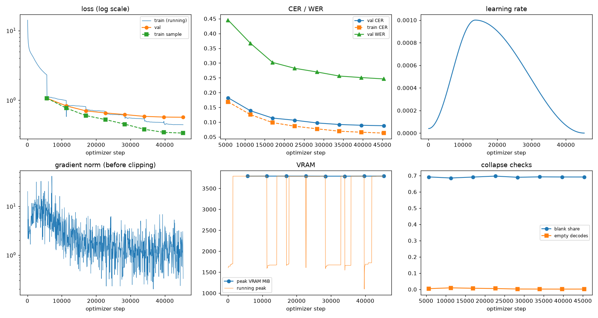

# Run report: GW-REC-009

Generated by `glypharis.training.report`; do not edit by hand.

## Run

- Config hash `b935fc8dabb29325`, git `f6ab51d67ed2dc76435fa9264c6386e1c59ad658` (dirty: False)
- Device cuda (NVIDIA GeForce RTX 4050 Laptop GPU), precision bf16, torch 2.14.1+cu126
- Parameters 6,219,475 (23.7 MiB of weights and buffers); 348,935 training lines, 73,888 validation lines
- Epochs run 8, optimizer steps 45,360, stopped early: False; training time 1.45 h (1.45 GPU-hours)
- Data: `processed/hiertext/lines_train` 348,935 lines, sha256 b8cfff844ed2; `processed/hiertext/lines_validation` 73,888 lines, sha256 7db3ec6782ea

## Best and final epoch

| | Epoch | Step | Val CER % | Val WER % | Val loss | Train CER % |
|---|---|---|---|---|---|---|
| best (selected) | 7 | 45360 | 8.78 | 24.62 | 0.5690 | 6.29 |
| final | 7 | 45360 | 8.78 | 24.62 | 0.5690 | 6.29 |

The selected checkpoint is `best.pt`: the lowest validation CER (strict track), as the protocol requires (§7); the final epoch is shown for comparison.

Validation CER of the selected checkpoint: 8.78% [8.62, 8.95] (95% bootstrap CI over 73,888 lines).

## Diagnostics

No flags raised.

## Curves

## Worst validation lines

| Key | Reference | Prediction | CER |
|---|---|---|---|
| 976149c72a2fde3e/p1/l6 | 20 | SRE POS APEI HIHASINLE | 11.00 |
| bde51cd0a0e194b1/p34/l0 | s | BIEEE'S | 7.00 |
| 983a43804c520cc0/p13/l0 | L | UNTE ML | 6.00 |
| 03221b6a82a5a02e/p85/l0 | 3 | 3.821' | 5.00 |
| 03221b6a82a5a02e/p87/l0 | 4 | 4,061' | 5.00 |
| e20fbc5878d56a36/p1/l40 | 5: | snudy mir | 4.50 |
| af2ddc65295391cf/p2/l4 | Walin | ur waltetili alone Eoe Tom | 4.40 |
| 83265d4ad42b65eb/p21/l0 | \| \| | I BEYOND BIAME  | 4.33 |
| 50140f555f4d26d0/p30/l0 | \| \| \| \| | I ARTS&CULTURE I MUSIC I DINING I | 4.29 |
| 013df9c6e5b5aed4/p0/l9 | G | Care | 4.00 |
| 03221b6a82a5a02e/p84/l0 | 5 | 5,600 | 4.00 |
| 03221b6a82a5a02e/p86/l0 | 5 | 5,845 | 4.00 |
| 05ee9d2ad48c11c2/p14/l1 | s | VINS | 4.00 |
| 1177e2fd519784db/p0/l3 | W | Te l | 4.00 |
| 1177e2fd519784db/p14/l5 | W | Vite | 4.00 |
| 3d874195d3c70081/p15/l0 | S | O Stn | 4.00 |
| 75688de8882f42fa/p11/l0 | 1 | L000 | 4.00 |
| 75688de8882f42fa/p11/l3 | 3 | N.0G | 4.00 |
| c624328101a5c91b/p9/l4 | S | SHODP | 4.00 |
| ebca2758a3725a0a/p20/l30 | Pc | Joy Peucts | 4.00 |

