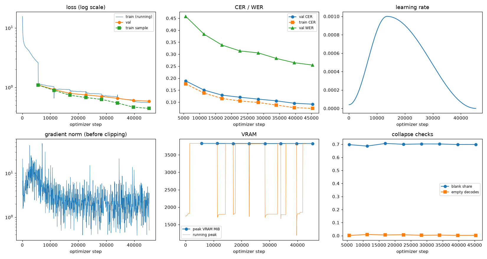
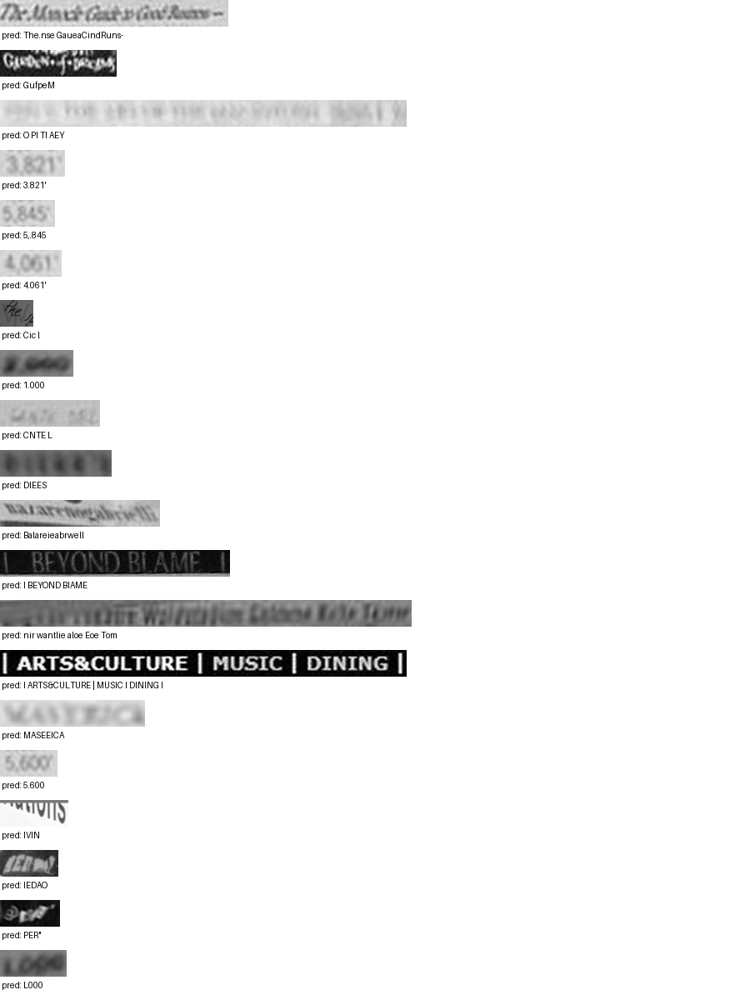

# Run report: GW-REC-010

Generated by `glypharis.training.report`; do not edit by hand.

## Run

- Config hash `2045c19597180730`, git `18a8e18a2db1a6de9b8e1df5b3cc9860ac7d9804` (dirty: False)
- Device cuda (NVIDIA GeForce RTX 4050 Laptop GPU), precision bf16, torch 2.14.1+cu126
- Parameters 7,796,435 (29.8 MiB of weights and buffers); 348,935 training lines, 73,888 validation lines
- Epochs run 8, optimizer steps 45,360, stopped early: False; training time 1.53 h (1.53 GPU-hours)
- Data: `processed/hiertext/lines_train` 348,935 lines, sha256 b8cfff844ed2; `processed/hiertext/lines_validation` 73,888 lines, sha256 7db3ec6782ea

## Best and final epoch

| | Epoch | Step | Val CER % | Val WER % | Val loss | Train CER % |
|---|---|---|---|---|---|---|
| best (selected) | 7 | 45360 | 9.17 | 25.48 | 0.5864 | 7.40 |
| final | 7 | 45360 | 9.17 | 25.48 | 0.5864 | 7.40 |

The selected checkpoint is `best.pt`: the lowest validation CER (strict track), as the protocol requires (§7); the final epoch is shown for comparison.

Validation CER of the selected checkpoint: 9.17% [9.01, 9.34] (95% bootstrap CI over 73,888 lines).

## Diagnostics

No flags raised.

## Curves

## Worst validation lines

| Key | Reference | Prediction | CER |
|---|---|---|---|
| 102f2c6a35f05df6/p5/l0 | The | The.nse GaueaCindRuns- | 6.33 |
| 8f80cc3eac928e4e/p21/l0 | C | GufpeM | 6.00 |
| 976149c72a2fde3e/p1/l6 | 20 | O PI TI AEY | 5.50 |
| 03221b6a82a5a02e/p85/l0 | 3 | 3.821' | 5.00 |
| 03221b6a82a5a02e/p86/l0 | 5 | 5,.845 | 5.00 |
| 03221b6a82a5a02e/p87/l0 | 4 | 4.061' | 5.00 |
| 1177e2fd519784db/p0/l3 | W | Cic l | 5.00 |
| 75688de8882f42fa/p11/l4 | 2 | 1.000 | 5.00 |
| 983a43804c520cc0/p13/l0 | L | CNTE L | 5.00 |
| bde51cd0a0e194b1/p34/l0 | s | DIEES | 5.00 |
| 76a7ad3fe918c4ef/p24/l0 | na/ | Balareieabrwell | 4.67 |
| 83265d4ad42b65eb/p21/l0 | \| \| | I BEYOND BIAME  | 4.33 |
| af2ddc65295391cf/p2/l4 | Walin | nir wantlie aloe Eoe Tom | 4.20 |
| 50140f555f4d26d0/p30/l0 | \| \| \| \| | I ARTS&CULTURE \| MUSIC I DINING I | 4.14 |
| 013df9c6e5b5aed4/p0/l11 | sc | MASEEICA | 4.00 |
| 03221b6a82a5a02e/p84/l0 | 5 | 5.600 | 4.00 |
| 05ee9d2ad48c11c2/p14/l1 | s | IVIN | 4.00 |
| 634e5932b6e6f347/p32/l0 | E | IEDAO | 4.00 |
| 7025cb4ac7cf0ec2/p7/l11 | @ | PER" | 4.00 |
| 75688de8882f42fa/p11/l0 | 1 | L000 | 4.00 |

