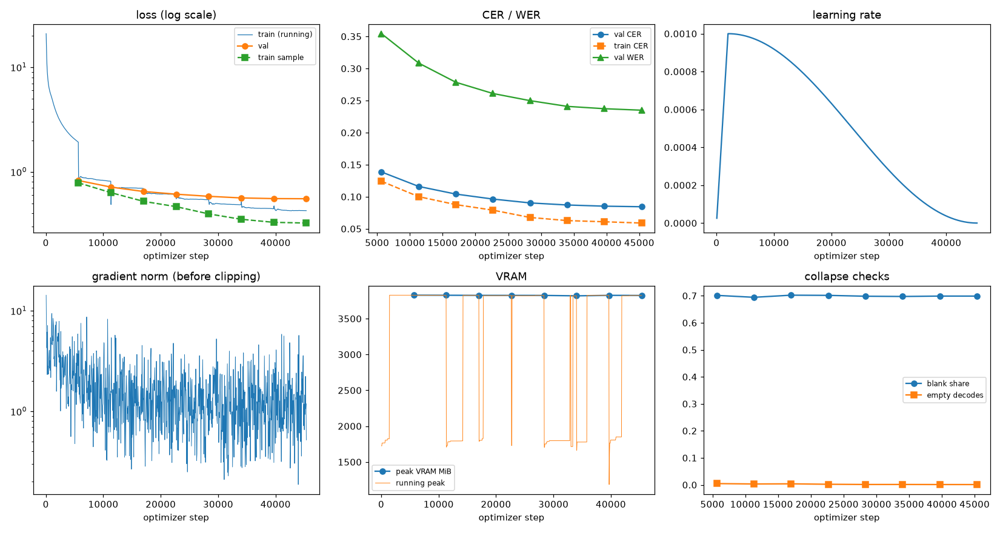
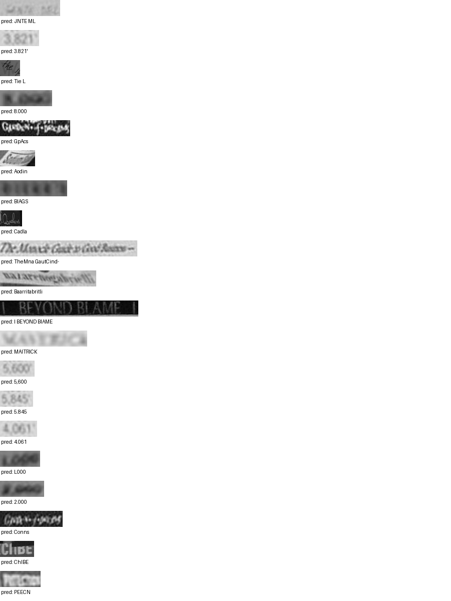

# Run report: GW-REC-011

Generated by `glypharis.training.report`; do not edit by hand.

## Run

- Config hash `5e4593b643cf63e9`, git `5279ea0125d6a9e6509c940a26a0899d44fe1264` (dirty: True)
- Device cuda (NVIDIA GeForce RTX 4050 Laptop GPU), precision bf16, torch 2.14.1+cu126
- Parameters 7,796,435 (29.8 MiB of weights and buffers); 348,935 training lines, 73,888 validation lines
- Epochs run 8, optimizer steps 45,360, stopped early: False; training time 1.40 h (1.40 GPU-hours)
- Data: `processed/hiertext/lines_train` 348,935 lines, sha256 b8cfff844ed2; `processed/hiertext/lines_validation` 73,888 lines, sha256 7db3ec6782ea

## Best and final epoch

| | Epoch | Step | Val CER % | Val WER % | Val loss | Train CER % |
|---|---|---|---|---|---|---|
| best (selected) | 7 | 45360 | 8.44 | 23.50 | 0.5521 | 5.89 |
| final | 7 | 45360 | 8.44 | 23.50 | 0.5521 | 5.89 |

The selected checkpoint is `best.pt`: the lowest validation CER (strict track), as the protocol requires (§7); the final epoch is shown for comparison.

Validation CER of the selected checkpoint: 8.44% [8.28, 8.60] (95% bootstrap CI over 73,888 lines).

## Notes

- Resumed from `last.pt` at step 33,000 (epoch 5); 12 log records written after that checkpoint were moved to metrics.dropped.jsonl.

## Diagnostics

No flags raised.

## Curves

## Worst validation lines

| Key | Reference | Prediction | CER |
|---|---|---|---|
| 983a43804c520cc0/p13/l0 | L | JNTE ML | 6.00 |
| 03221b6a82a5a02e/p85/l0 | 3 | 3.821' | 5.00 |
| 1177e2fd519784db/p0/l3 | W | Tie L | 5.00 |
| 75688de8882f42fa/p11/l3 | 3 | 8.000 | 5.00 |
| 8f80cc3eac928e4e/p21/l0 | C | GpAcs | 5.00 |
| 902b8cf14489c26a/p18/l9 | S | Aodin | 5.00 |
| bde51cd0a0e194b1/p34/l0 | s | BIAGS | 5.00 |
| da589d39cc2c3cea/p3/l1 | Q | Cadla | 5.00 |
| 102f2c6a35f05df6/p5/l0 | The | TheMna GautCind- | 4.33 |
| 76a7ad3fe918c4ef/p24/l0 | na/ | Baarritabritli | 4.33 |
| 83265d4ad42b65eb/p21/l0 | \| \| | I BEYOND BIAME  | 4.33 |
| 013df9c6e5b5aed4/p0/l11 | sc | MAITRICK | 4.00 |
| 03221b6a82a5a02e/p84/l0 | 5 | 5,600 | 4.00 |
| 03221b6a82a5a02e/p86/l0 | 5 | 5.845 | 4.00 |
| 03221b6a82a5a02e/p87/l0 | 4 | 4.061 | 4.00 |
| 75688de8882f42fa/p11/l0 | 1 | L000 | 4.00 |
| 75688de8882f42fa/p11/l4 | 2 | 2.000 | 4.00 |
| 8f80cc3eac928e4e/p22/l0 | C | Conns | 4.00 |
| a13413c321f8d129/p8/l4 | C | ChIBE | 4.00 |
| bd68198a86681f49/p22/l0 | P | PEECN | 4.00 |

