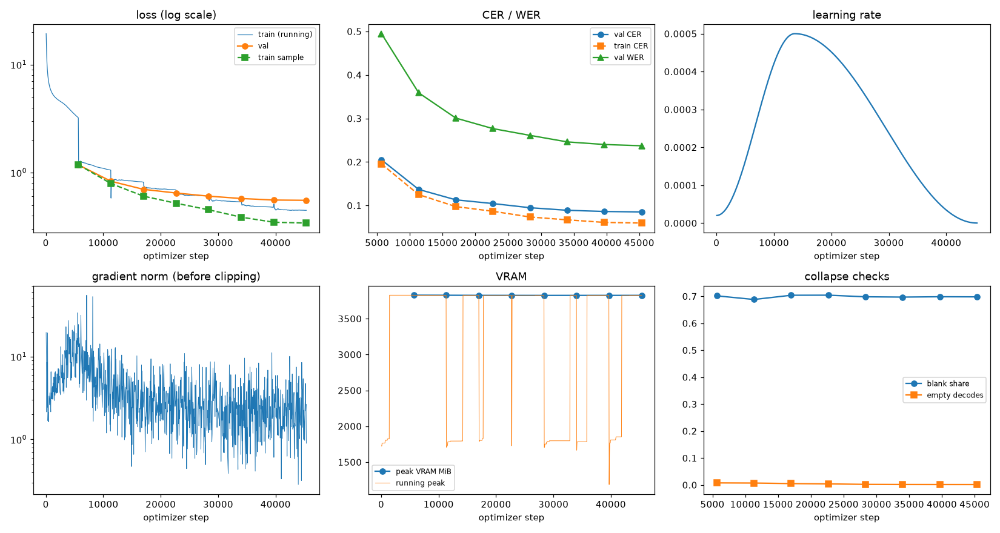
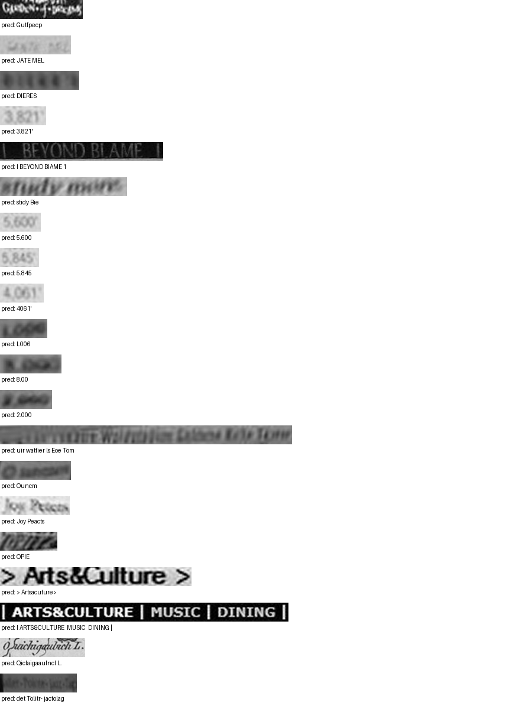

# Run report: GW-REC-012

Generated by `glypharis.training.report`; do not edit by hand.

## Run

- Config hash `56071b24884d28f8`, git `6869f417e52d2261eeac53f9c21365aa20e84089` (dirty: False)
- Device cuda (NVIDIA GeForce RTX 4050 Laptop GPU), precision bf16, torch 2.14.1+cu126
- Parameters 7,796,435 (29.8 MiB of weights and buffers); 348,935 training lines, 73,888 validation lines
- Epochs run 8, optimizer steps 45,360, stopped early: False; training time 1.00 h (1.00 GPU-hours)
- Data: `processed/hiertext/lines_train` 348,935 lines, sha256 b8cfff844ed2; `processed/hiertext/lines_validation` 73,888 lines, sha256 7db3ec6782ea

## Best and final epoch

| | Epoch | Step | Val CER % | Val WER % | Val loss | Train CER % |
|---|---|---|---|---|---|---|
| best (selected) | 7 | 45360 | 8.51 | 23.72 | 0.5534 | 5.96 |
| final | 7 | 45360 | 8.51 | 23.72 | 0.5534 | 5.96 |

The selected checkpoint is `best.pt`: the lowest validation CER (strict track), as the protocol requires (§7); the final epoch is shown for comparison.

Validation CER of the selected checkpoint: 8.51% [8.35, 8.68] (95% bootstrap CI over 73,888 lines).

## Diagnostics

No flags raised.

## Curves

## Worst validation lines

| Key | Reference | Prediction | CER |
|---|---|---|---|
| 8f80cc3eac928e4e/p21/l0 | C | Gutfpecp | 8.00 |
| 983a43804c520cc0/p13/l0 | L | JATE MEL | 7.00 |
| bde51cd0a0e194b1/p34/l0 | s | DIERES | 6.00 |
| 03221b6a82a5a02e/p85/l0 | 3 | 3.821' | 5.00 |
| 83265d4ad42b65eb/p21/l0 | \| \| | I BEYOND BIAME 1 | 5.00 |
| e20fbc5878d56a36/p1/l40 | 5: | stidy Bie | 4.50 |
| 03221b6a82a5a02e/p84/l0 | 5 | 5.600 | 4.00 |
| 03221b6a82a5a02e/p86/l0 | 5 | 5.845 | 4.00 |
| 03221b6a82a5a02e/p87/l0 | 4 | 4061' | 4.00 |
| 75688de8882f42fa/p11/l0 | 1 | L006 | 4.00 |
| 75688de8882f42fa/p11/l3 | 3 | 8.00 | 4.00 |
| 75688de8882f42fa/p11/l4 | 2 | 2.000 | 4.00 |
| af2ddc65295391cf/p2/l4 | Walin | uir wattier ls Eoe Tom | 4.00 |
| d6cffab23f5a1e4a/p60/l0 | O | Ouncm | 4.00 |
| ebca2758a3725a0a/p20/l30 | Pc | Joy Peacts | 4.00 |
| f1fa7e6c910f4ede/p1/l563 | M | OPIE | 4.00 |
| 50140f555f4d26d0/p32/l0 | > > | > Artsacuture> | 3.67 |
| 50140f555f4d26d0/p30/l0 | \| \| \| \| | I ARTS&CULTURE  MUSIC  DINING \| | 3.57 |
| 141c2ff280973553/p107/l0 | O L. | Qiclaigaaulncl L. | 3.50 |
| ab3ae4cdd3fcd47e/p18/l1 | e-ejp | det Tolitr- jactolag | 3.40 |

