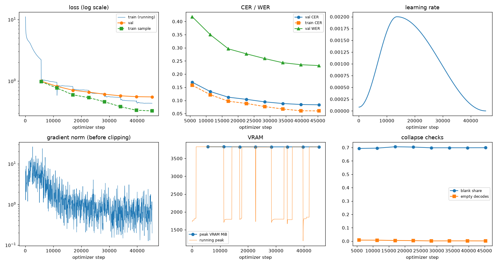
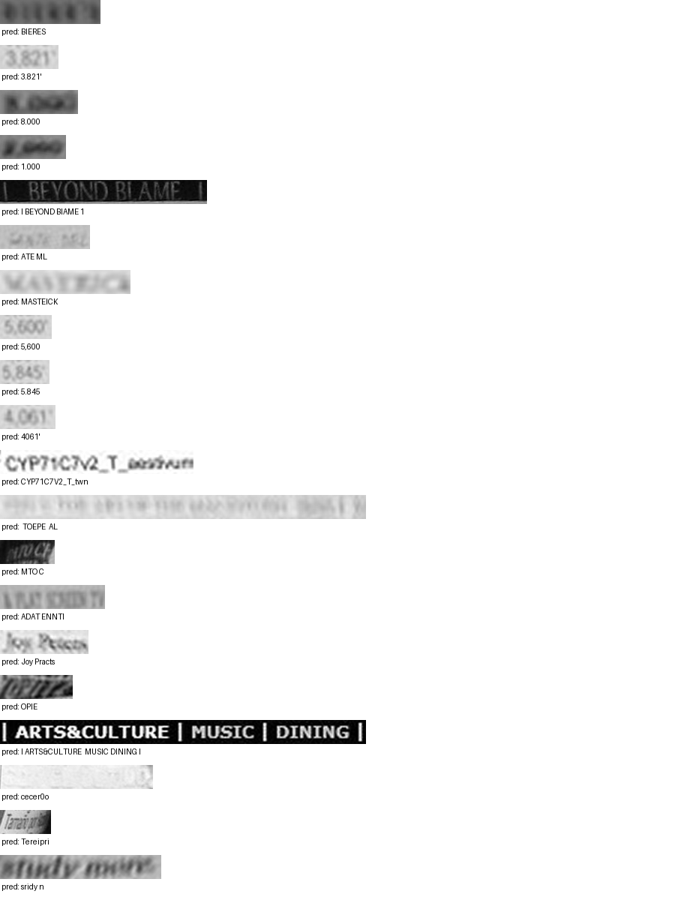

# Run report: GW-REC-013

Generated by `glypharis.training.report`; do not edit by hand.

## Run

- Config hash `ab5a198536d17275`, git `6869f417e52d2261eeac53f9c21365aa20e84089` (dirty: False)
- Device cuda (NVIDIA GeForce RTX 4050 Laptop GPU), precision bf16, torch 2.14.1+cu126
- Parameters 7,796,435 (29.8 MiB of weights and buffers); 348,935 training lines, 73,888 validation lines
- Epochs run 8, optimizer steps 45,360, stopped early: False; training time 0.96 h (0.96 GPU-hours)
- Data: `processed/hiertext/lines_train` 348,935 lines, sha256 b8cfff844ed2; `processed/hiertext/lines_validation` 73,888 lines, sha256 7db3ec6782ea

## Best and final epoch

| | Epoch | Step | Val CER % | Val WER % | Val loss | Train CER % |
|---|---|---|---|---|---|---|
| best (selected) | 7 | 45360 | 8.34 | 23.26 | 0.5507 | 6.02 |
| final | 7 | 45360 | 8.34 | 23.26 | 0.5507 | 6.02 |

The selected checkpoint is `best.pt`: the lowest validation CER (strict track), as the protocol requires (§7); the final epoch is shown for comparison.

Validation CER of the selected checkpoint: 8.34% [8.18, 8.50] (95% bootstrap CI over 73,888 lines).

## Diagnostics

No flags raised.

## Curves

## Worst validation lines

| Key | Reference | Prediction | CER |
|---|---|---|---|
| bde51cd0a0e194b1/p34/l0 | s | BIERES | 6.00 |
| 03221b6a82a5a02e/p85/l0 | 3 | 3.821' | 5.00 |
| 75688de8882f42fa/p11/l3 | 3 | 8.000 | 5.00 |
| 75688de8882f42fa/p11/l4 | 2 | 1.000 | 5.00 |
| 83265d4ad42b65eb/p21/l0 | \| \| | I BEYOND BIAME 1 | 5.00 |
| 983a43804c520cc0/p13/l0 | L | ATE ML | 5.00 |
| 013df9c6e5b5aed4/p0/l11 | sc | MASTEICK | 4.00 |
| 03221b6a82a5a02e/p84/l0 | 5 | 5,600 | 4.00 |
| 03221b6a82a5a02e/p86/l0 | 5 | 5.845 | 4.00 |
| 03221b6a82a5a02e/p87/l0 | 4 | 4061' | 4.00 |
| 1427a2dd12744f8f/p22/l2 | _T_ | CYP71C7V2_T_twn | 4.00 |
| 976149c72a2fde3e/p1/l6 | 20 |  TOEPE  AL | 4.00 |
| dcee27acd6d6883b/p0/l110 | C | MTO C | 4.00 |
| eb9c71f60af35ebe/p11/l4 | AT | ADAT ENNTI | 4.00 |
| ebca2758a3725a0a/p20/l30 | Pc | Joy Practs | 4.00 |
| f1fa7e6c910f4ede/p1/l563 | M | OPIE | 4.00 |
| 50140f555f4d26d0/p30/l0 | \| \| \| \| | I ARTS&CULTURE  MUSIC DINING I | 3.71 |
| 154058472bd0c3bf/p21/l0 | ND | cecer0o | 3.50 |
| 902b8cf14489c26a/p19/l3 | Ta | Tereipri | 3.50 |
| e20fbc5878d56a36/p1/l40 | 5: | sridy n | 3.50 |

