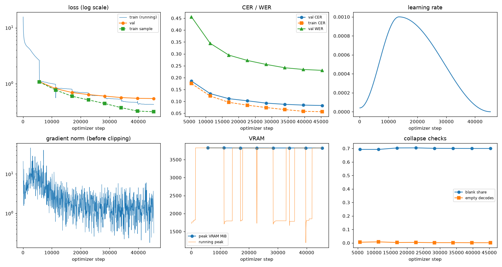
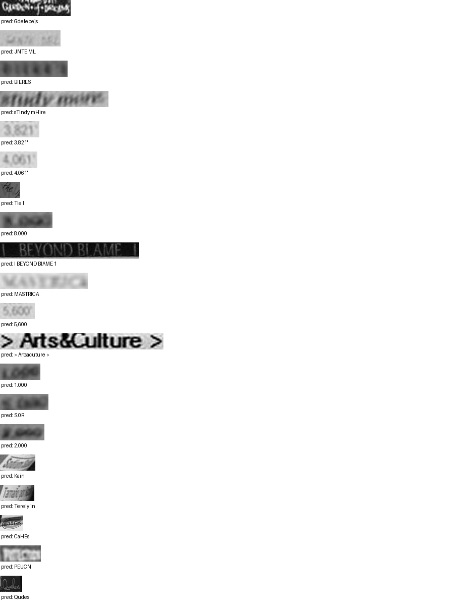

# Run report: GW-REC-014

Generated by `glypharis.training.report`; do not edit by hand.

## Run

- Config hash `c0bdfae67510a583`, git `f1fe886c0b00aba4193910813dcda0d4fbd0de11` (dirty: False)
- Device cuda (NVIDIA GeForce RTX 4050 Laptop GPU), precision bf16, torch 2.14.1+cu126
- Parameters 7,796,435 (29.8 MiB of weights and buffers); 348,935 training lines, 73,888 validation lines
- Epochs run 8, optimizer steps 45,360, stopped early: False; training time 0.97 h (0.97 GPU-hours)
- Data: `processed/hiertext/lines_train` 348,935 lines, sha256 b8cfff844ed2; `processed/hiertext/lines_validation` 73,888 lines, sha256 7db3ec6782ea

## Best and final epoch

| | Epoch | Step | Val CER % | Val WER % | Val loss | Train CER % |
|---|---|---|---|---|---|---|
| best (selected) | 7 | 45360 | 8.28 | 23.06 | 0.5427 | 5.65 |
| final | 7 | 45360 | 8.28 | 23.06 | 0.5427 | 5.65 |

The selected checkpoint is `best.pt`: the lowest validation CER (strict track), as the protocol requires (§7); the final epoch is shown for comparison.

Validation CER of the selected checkpoint: 8.28% [8.12, 8.43] (95% bootstrap CI over 73,888 lines).

## Diagnostics

No flags raised.

## Curves

## Worst validation lines

| Key | Reference | Prediction | CER |
|---|---|---|---|
| 8f80cc3eac928e4e/p21/l0 | C | Gdefepejs | 9.00 |
| 983a43804c520cc0/p13/l0 | L | JNTE ML | 6.00 |
| bde51cd0a0e194b1/p34/l0 | s | BIERES | 6.00 |
| e20fbc5878d56a36/p1/l40 | 5: | sTindy mHire | 6.00 |
| 03221b6a82a5a02e/p85/l0 | 3 | 3.821' | 5.00 |
| 03221b6a82a5a02e/p87/l0 | 4 | 4.061' | 5.00 |
| 1177e2fd519784db/p0/l3 | W | Tie l | 5.00 |
| 75688de8882f42fa/p11/l3 | 3 | 8.000 | 5.00 |
| 83265d4ad42b65eb/p21/l0 | \| \| | I BEYOND BIAME 1 | 5.00 |
| 013df9c6e5b5aed4/p0/l11 | sc | MASTRICA | 4.00 |
| 03221b6a82a5a02e/p84/l0 | 5 | 5,600 | 4.00 |
| 50140f555f4d26d0/p32/l0 | > > | > Artsacuture > | 4.00 |
| 75688de8882f42fa/p11/l0 | 1 | 1.000 | 4.00 |
| 75688de8882f42fa/p11/l2 | 5 | S.0R | 4.00 |
| 75688de8882f42fa/p11/l4 | 2 | 2.000 | 4.00 |
| 902b8cf14489c26a/p18/l9 | S | Kain  | 4.00 |
| 902b8cf14489c26a/p19/l3 | Ta | Tereiy in | 4.00 |
| ac24e9147bec2e53/p75/l0 | C | CaHEs | 4.00 |
| bd68198a86681f49/p22/l0 | P | PEUCN | 4.00 |
| da589d39cc2c3cea/p3/l1 | Q | Qudes | 4.00 |

