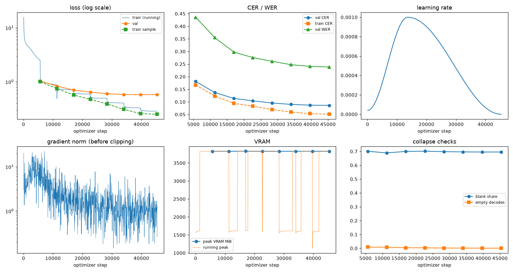
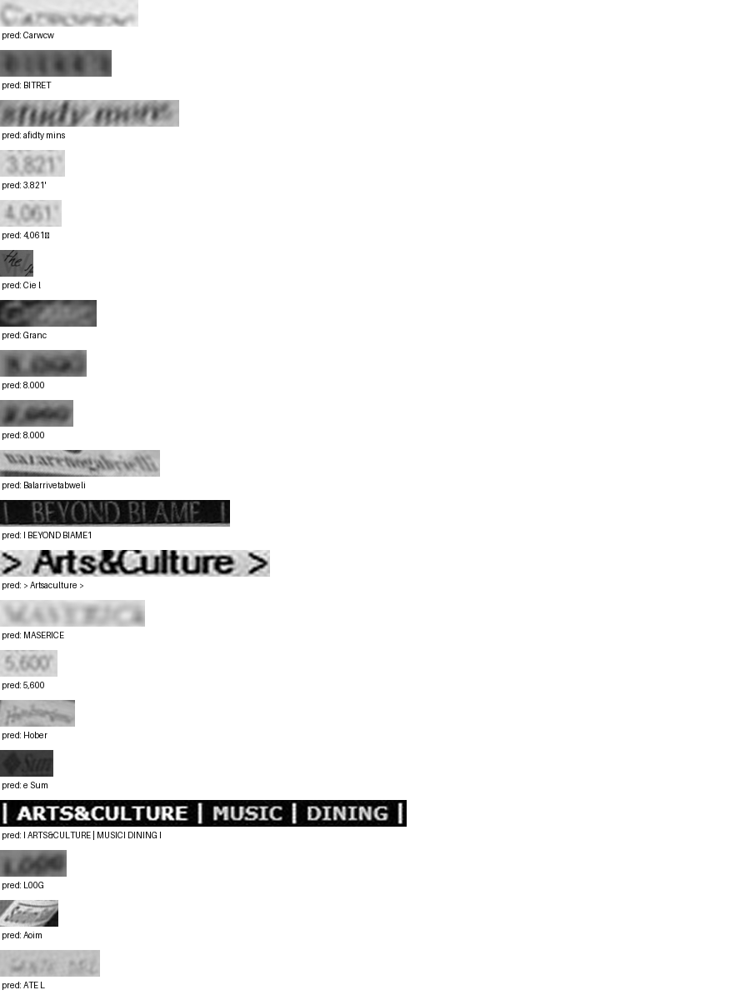

# Run report: GW-REC-017

Generated by `glypharis.training.report`; do not edit by hand.

## Run

- Config hash `c538853fd93dbece`, git `6d9a8c86d8e804d14fc3cc18d9a9717a39cc053a` (dirty: False)
- Device cuda (NVIDIA GeForce RTX 4050 Laptop GPU), precision bf16, torch 2.14.1+cu126
- Parameters 7,796,435 (29.8 MiB of weights and buffers); 348,935 training lines, 73,888 validation lines
- Epochs run 8, optimizer steps 45,360, stopped early: False; training time 1.16 h (1.16 GPU-hours)
- Data: `processed/hiertext/lines_train` 348,935 lines, sha256 b8cfff844ed2; `processed/hiertext/lines_validation` 73,888 lines, sha256 7db3ec6782ea

## Best and final epoch

| | Epoch | Step | Val CER % | Val WER % | Val loss | Train CER % |
|---|---|---|---|---|---|---|
| best (selected) | 7 | 45360 | 8.59 | 23.86 | 0.5815 | 5.08 |
| final | 7 | 45360 | 8.59 | 23.86 | 0.5815 | 5.08 |

The selected checkpoint is `best.pt`: the lowest validation CER (strict track), as the protocol requires (§7); the final epoch is shown for comparison.

Validation CER of the selected checkpoint: 8.59% [8.43, 8.76] (95% bootstrap CI over 73,888 lines).

## Diagnostics

No flags raised.

## Curves

## Worst validation lines

| Key | Reference | Prediction | CER |
|---|---|---|---|
| 013df9c6e5b5aed4/p0/l9 | G | Carwcw | 6.00 |
| bde51cd0a0e194b1/p34/l0 | s | BITRET | 6.00 |
| e20fbc5878d56a36/p1/l40 | 5: | afidty mins | 5.50 |
| 03221b6a82a5a02e/p85/l0 | 3 | 3.821' | 5.00 |
| 03221b6a82a5a02e/p87/l0 | 4 | 4,061˚ | 5.00 |
| 1177e2fd519784db/p0/l3 | W | Cie l | 5.00 |
| 4ee86bd63a80b30c/p35/l0 | C | Granc | 5.00 |
| 75688de8882f42fa/p11/l3 | 3 | 8.000 | 5.00 |
| 75688de8882f42fa/p11/l4 | 2 | 8.000 | 5.00 |
| 76a7ad3fe918c4ef/p24/l0 | na/ | Balarrivetabweli | 5.00 |
| 83265d4ad42b65eb/p21/l0 | \| \| | I BEYOND BIAME1 | 4.67 |
| 50140f555f4d26d0/p32/l0 | > > | > Artsaculture > | 4.33 |
| 013df9c6e5b5aed4/p0/l11 | sc | MASERICE | 4.00 |
| 03221b6a82a5a02e/p84/l0 | 5 | 5,600 | 4.00 |
| 05ba0bfd03748680/p35/l0 | H | Hober | 4.00 |
| 3d874195d3c70081/p15/l0 | S | e Sum | 4.00 |
| 50140f555f4d26d0/p30/l0 | \| \| \| \| | I ARTS&CULTURE \| MUSICI DINING I | 4.00 |
| 75688de8882f42fa/p11/l0 | 1 | L00G | 4.00 |
| 902b8cf14489c26a/p18/l9 | S | Aoim | 4.00 |
| 983a43804c520cc0/p13/l0 | L | ATE L | 4.00 |

