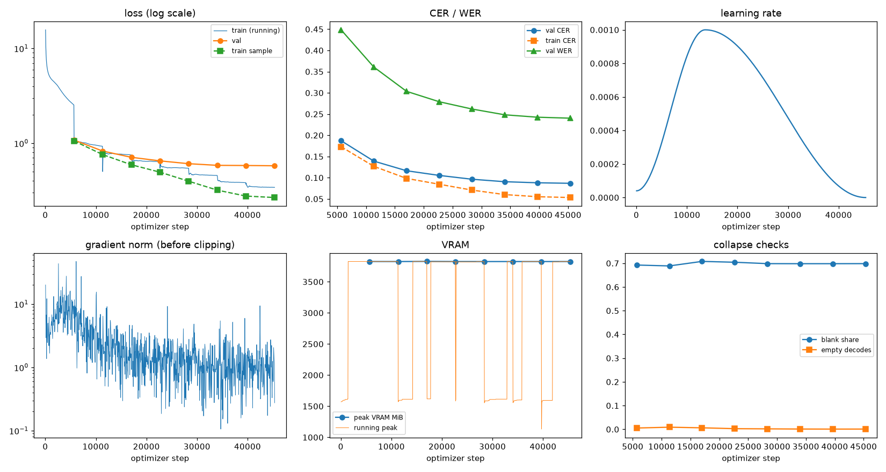
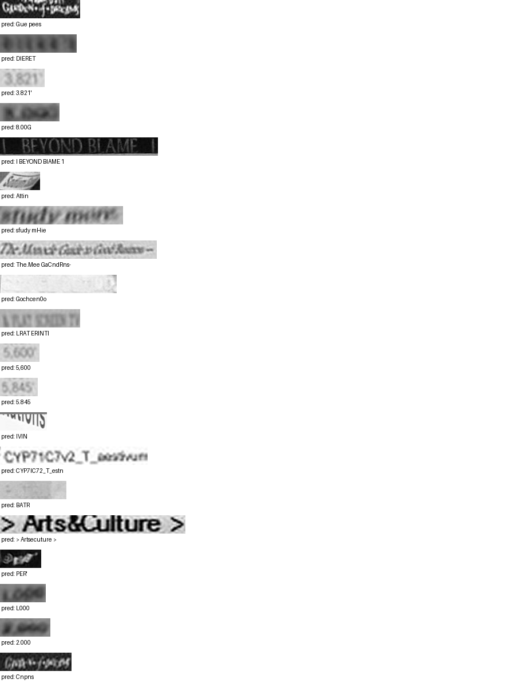

# Run report: GW-REC-018

Generated by `glypharis.training.report`; do not edit by hand.

## Run

- Config hash `b166c17245a2c205`, git `cd074b506a68f552384dd170a580d55a020c74ec` (dirty: False)
- Device cuda (NVIDIA GeForce RTX 4050 Laptop GPU), precision bf16, torch 2.14.1+cu126
- Parameters 7,796,435 (29.8 MiB of weights and buffers); 348,935 training lines, 73,888 validation lines
- Epochs run 8, optimizer steps 45,360, stopped early: False; training time 1.18 h (1.18 GPU-hours)
- Data: `processed/hiertext/lines_train` 348,935 lines, sha256 b8cfff844ed2; `processed/hiertext/lines_validation` 73,888 lines, sha256 7db3ec6782ea

## Best and final epoch

| | Epoch | Step | Val CER % | Val WER % | Val loss | Train CER % |
|---|---|---|---|---|---|---|
| best (selected) | 7 | 45360 | 8.68 | 24.03 | 0.5784 | 5.33 |
| final | 7 | 45360 | 8.68 | 24.03 | 0.5784 | 5.33 |

The selected checkpoint is `best.pt`: the lowest validation CER (strict track), as the protocol requires (§7); the final epoch is shown for comparison.

Validation CER of the selected checkpoint: 8.68% [8.52, 8.85] (95% bootstrap CI over 73,888 lines).

## Diagnostics

No flags raised.

## Curves

## Worst validation lines

| Key | Reference | Prediction | CER |
|---|---|---|---|
| 8f80cc3eac928e4e/p21/l0 | C | Gue pees | 8.00 |
| bde51cd0a0e194b1/p34/l0 | s | DIERET | 6.00 |
| 03221b6a82a5a02e/p85/l0 | 3 | 3.821' | 5.00 |
| 75688de8882f42fa/p11/l3 | 3 | 8.00G | 5.00 |
| 83265d4ad42b65eb/p21/l0 | \| \| | I BEYOND BIAME 1 | 5.00 |
| 902b8cf14489c26a/p18/l9 | S | Attin  | 5.00 |
| e20fbc5878d56a36/p1/l40 | 5: | sfudy mHie | 5.00 |
| 102f2c6a35f05df6/p5/l0 | The | The.Mee GaCndRns- | 4.67 |
| 154058472bd0c3bf/p21/l0 | ND | Gochcen0o | 4.50 |
| eb9c71f60af35ebe/p11/l4 | AT | LRAT ERINTI | 4.50 |
| 03221b6a82a5a02e/p84/l0 | 5 | 5,600 | 4.00 |
| 03221b6a82a5a02e/p86/l0 | 5 | 5.845 | 4.00 |
| 05ee9d2ad48c11c2/p14/l1 | s | IVIN | 4.00 |
| 1427a2dd12744f8f/p22/l2 | _T_ | CYP7IC72_T_estn | 4.00 |
| 154058472bd0c3bf/p47/l0 | P | BATR | 4.00 |
| 50140f555f4d26d0/p32/l0 | > > | > Artsecuture > | 4.00 |
| 7025cb4ac7cf0ec2/p7/l11 | @ | PER' | 4.00 |
| 75688de8882f42fa/p11/l0 | 1 | L000 | 4.00 |
| 75688de8882f42fa/p11/l4 | 2 | 2.000 | 4.00 |
| 8f80cc3eac928e4e/p22/l0 | C | Cnpns | 4.00 |

