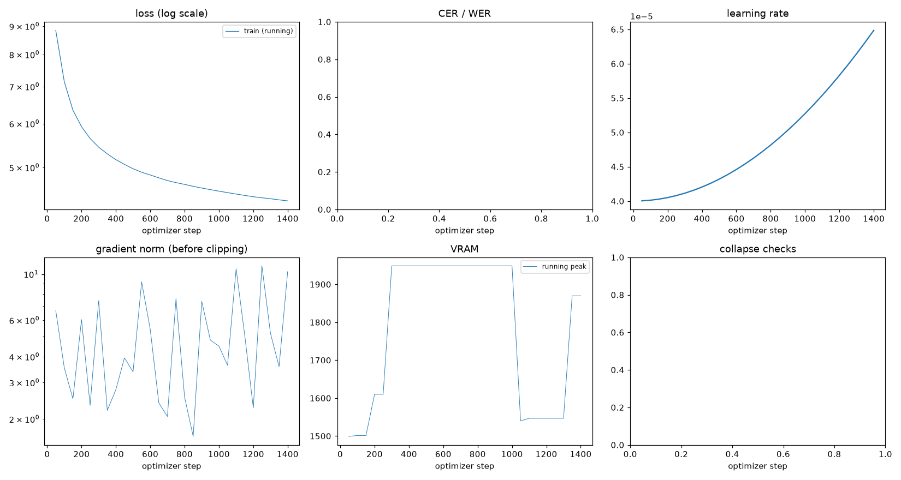

# Run report: GW-REC-019

Generated by `glypharis.training.report`; do not edit by hand.

## Run

- Config hash `4ce881d56bad5a78`, git `fbcd6df49d208f5827bb9666c10186ca30eeb286` (dirty: False)
- Device cuda (NVIDIA GeForce RTX 4050 Laptop GPU), precision bf16, torch 2.14.1+cu126
- Parameters 7,796,435 (29.8 MiB of weights and buffers); 348,935 training lines, 73,888 validation lines
- Epochs run 0, optimizer steps 1,444, stopped early: False; training time 0.04 h (0.04 GPU-hours)
- Data: `processed/hiertext/lines_train` 348,935 lines, sha256 b8cfff844ed2; `processed/hiertext/lines_validation` 73,888 lines, sha256 7db3ec6782ea

## Best and final epoch

| | Epoch | Step | Val CER % | Val WER % | Val loss | Train CER % |
|---|---|---|---|---|---|---|
| best (selected) | - | - | - | - | - | - |
| final | - | - | - | - | - | - |

The selected checkpoint is `best.pt`: the lowest validation CER (strict track), as the protocol requires (§7); the final epoch is shown for comparison.

## Notes

- Resumed from `last.pt` at step 1,000 (epoch 0); 9 log records written after that checkpoint were moved to metrics.dropped.jsonl.
- Resumed from `last.pt` at step 1,000 (epoch 0); 9 log records written after that checkpoint were moved to metrics.dropped.jsonl.

## Diagnostics

No flags raised.

## Curves

## Worst validation lines

| Key | Reference | Prediction | CER |
|---|---|---|---|
