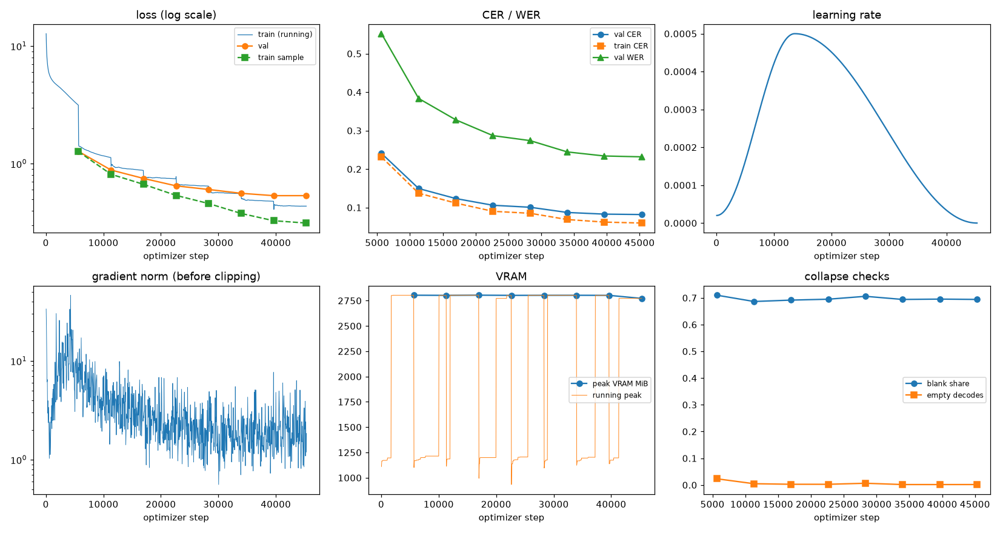
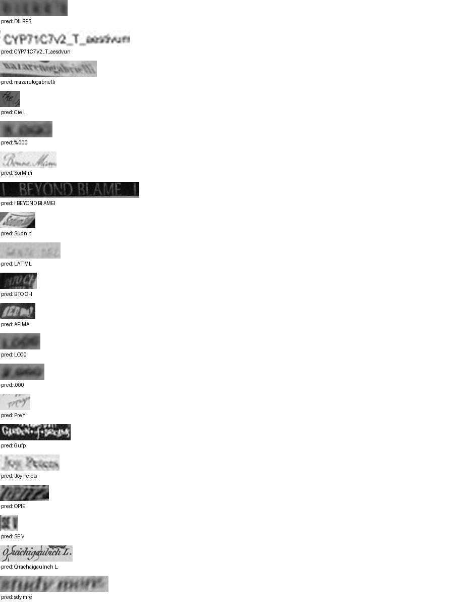

# Run report: GW-REC-020

Generated by `glypharis.training.report`; do not edit by hand.

## Run

- Config hash `2adea41a8bc6945a`, git `d5dde03e40abb082684c3f11976ed493711f5131` (dirty: False)
- Device cuda (NVIDIA GeForce RTX 4050 Laptop GPU), precision bf16, torch 2.14.1+cu126
- Parameters 7,928,835 (30.2 MiB of weights and buffers); 348,935 training lines, 73,888 validation lines
- Epochs run 8, optimizer steps 45,301, stopped early: False; training time 4.64 h (4.64 GPU-hours)
- Data: `processed/hiertext/lines_train` 348,935 lines, sha256 b8cfff844ed2; `processed/hiertext/lines_validation` 73,888 lines, sha256 7db3ec6782ea

## Best and final epoch

| | Epoch | Step | Val CER % | Val WER % | Val loss | Train CER % |
|---|---|---|---|---|---|---|
| best (selected) | 7 | 45301 | 8.18 | 23.19 | 0.5354 | 5.97 |
| final | 7 | 45301 | 8.18 | 23.19 | 0.5354 | 5.97 |

The selected checkpoint is `best.pt`: the lowest validation CER (strict track), as the protocol requires (§7); the final epoch is shown for comparison.

Validation CER of the selected checkpoint: 8.18% [8.03, 8.35] (95% bootstrap CI over 73,888 lines).

## Diagnostics

No flags raised.

## Curves

## Worst validation lines

| Key | Reference | Prediction | CER |
|---|---|---|---|
| bde51cd0a0e194b1/p34/l0 | s | DILRES | 6.00 |
| 1427a2dd12744f8f/p22/l2 | _T_ | CYP71C7V2_T_aesdvun | 5.33 |
| 76a7ad3fe918c4ef/p24/l0 | na/ | mazaretogabrielli | 5.33 |
| 1177e2fd519784db/p0/l3 | W | Cie l | 5.00 |
| 75688de8882f42fa/p11/l3 | 3 | %.000 | 5.00 |
| 7d5f25d3c7f2eefa/p88/l0 | m | SorMim | 5.00 |
| 83265d4ad42b65eb/p21/l0 | \| \| | I BEYOND BI AMEI | 5.00 |
| 902b8cf14489c26a/p18/l9 | S | Sudn h | 5.00 |
| 983a43804c520cc0/p13/l0 | L | LAT ML | 5.00 |
| dcee27acd6d6883b/p0/l110 | C | BTO CH | 5.00 |
| 634e5932b6e6f347/p32/l0 | E | AEIMA | 4.00 |
| 75688de8882f42fa/p11/l0 | 1 | LO00 | 4.00 |
| 75688de8882f42fa/p11/l4 | 2 | .000 | 4.00 |
| 7d5f25d3c7f2eefa/p78/l3 | y | PreY | 4.00 |
| 8f80cc3eac928e4e/p21/l0 | C | Gufp | 4.00 |
| ebca2758a3725a0a/p20/l30 | Pc | Joy Peicts | 4.00 |
| f1fa7e6c910f4ede/p1/l563 | M | OPIE | 4.00 |
| f6749f3e0397a464/p12/l6 | Ⅺ | SE V | 4.00 |
| 141c2ff280973553/p107/l0 | O L. | Q rachaigaulnch L. | 3.75 |
| e20fbc5878d56a36/p1/l40 | 5: | sdy mre | 3.50 |

