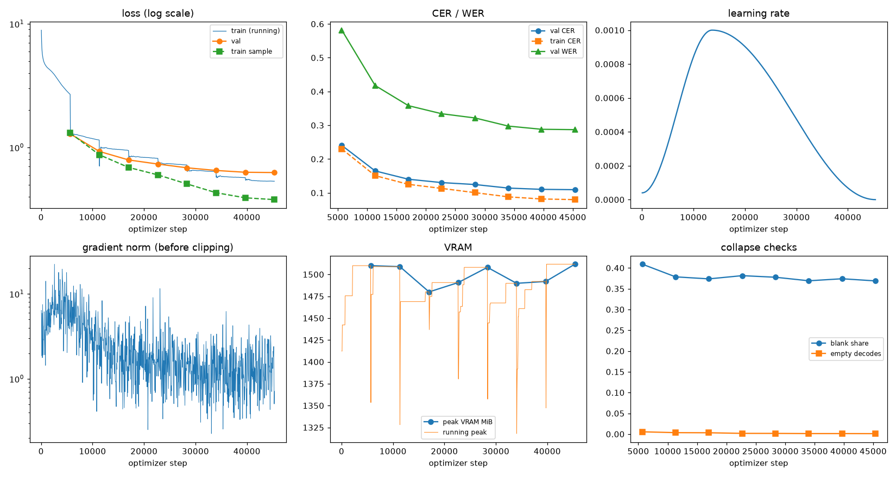
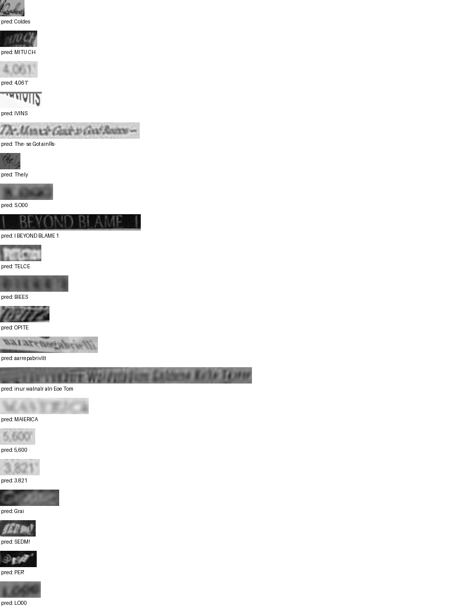

# Run report: GW-REC-021

Generated by `glypharis.training.report`; do not edit by hand.

## Run

- Config hash `d9ad7e799b724194`, git `96fc774b9ee5a1d548cbfc124615ec4062dcdadb` (dirty: False)
- Device cuda (NVIDIA GeForce RTX 4050 Laptop GPU), precision bf16, torch 2.14.1+cu126
- Parameters 7,796,435 (29.8 MiB of weights and buffers); 348,935 training lines, 73,888 validation lines
- Epochs run 8, optimizer steps 45,371, stopped early: False; training time 0.74 h (0.74 GPU-hours)
- Data: `processed/hiertext/lines_train` 348,935 lines, sha256 b8cfff844ed2; `processed/hiertext/lines_validation` 73,888 lines, sha256 7db3ec6782ea

## Best and final epoch

| | Epoch | Step | Val CER % | Val WER % | Val loss | Train CER % |
|---|---|---|---|---|---|---|
| best (selected) | 7 | 45371 | 10.93 | 28.71 | 0.6264 | 7.99 |
| final | 7 | 45371 | 10.93 | 28.71 | 0.6264 | 7.99 |

The selected checkpoint is `best.pt`: the lowest validation CER (strict track), as the protocol requires (§7); the final epoch is shown for comparison.

Validation CER of the selected checkpoint: 10.93% [10.70, 11.14] (95% bootstrap CI over 73,888 lines).

## Diagnostics

No flags raised.

## Curves

## Worst validation lines

| Key | Reference | Prediction | CER |
|---|---|---|---|
| da589d39cc2c3cea/p4/l1 | Q | Coldes | 6.00 |
| dcee27acd6d6883b/p0/l110 | C | MITU CH | 6.00 |
| 03221b6a82a5a02e/p87/l0 | 4 | 4,061' | 5.00 |
| 05ee9d2ad48c11c2/p14/l1 | s | IVINS | 5.00 |
| 102f2c6a35f05df6/p5/l0 | The | The- se Got ainRs- | 5.00 |
| 1177e2fd519784db/p0/l3 | W | Thely | 5.00 |
| 75688de8882f42fa/p11/l3 | 3 | S.O00 | 5.00 |
| 83265d4ad42b65eb/p21/l0 | \| \| | I BEYOND BLAME 1 | 5.00 |
| bd68198a86681f49/p22/l0 | P | TELCE | 5.00 |
| bde51cd0a0e194b1/p34/l0 | s | BIEES | 5.00 |
| f1fa7e6c910f4ede/p1/l563 | M | OPITE | 5.00 |
| 76a7ad3fe918c4ef/p24/l0 | na/ | aarrepabrivllt | 4.33 |
| af2ddc65295391cf/p2/l4 | Walin | inur walnalr aln Eoe Tom | 4.20 |
| 013df9c6e5b5aed4/p0/l11 | sc | MAIERICA | 4.00 |
| 03221b6a82a5a02e/p84/l0 | 5 | 5,600 | 4.00 |
| 03221b6a82a5a02e/p85/l0 | 3 | 3.821 | 4.00 |
| 4ee86bd63a80b30c/p35/l0 | C | Grai | 4.00 |
| 634e5932b6e6f347/p32/l0 | E | SEDM! | 4.00 |
| 7025cb4ac7cf0ec2/p7/l11 | @ | PER' | 4.00 |
| 75688de8882f42fa/p11/l0 | 1 | LO00 | 4.00 |

