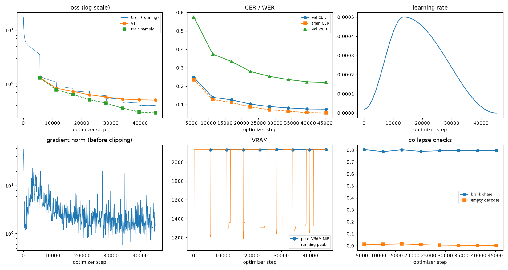
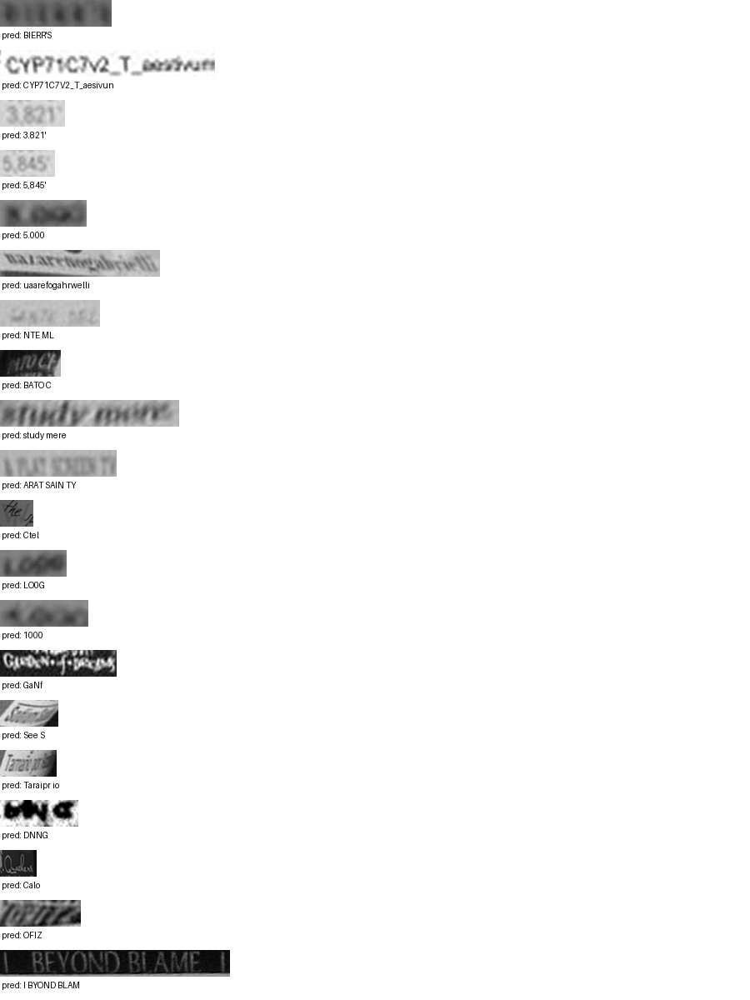

# Run report: GW-REC-022

Generated by `glypharis.training.report`; do not edit by hand.

## Run

- Config hash `bd959b40b49f7879`, git `3d088a6b57c951ea96bd42949e2d59a70df47273` (dirty: False)
- Device cuda (NVIDIA GeForce RTX 4050 Laptop GPU), precision bf16, torch 2.14.1+cu126
- Parameters 7,928,835 (30.2 MiB of weights and buffers); 348,935 training lines, 73,888 validation lines
- Epochs run 8, optimizer steps 45,295, stopped early: False; training time 4.65 h (4.65 GPU-hours)
- Data: `processed/hiertext/lines_train` 348,935 lines, sha256 b8cfff844ed2; `processed/hiertext/lines_validation` 73,888 lines, sha256 7db3ec6782ea

## Best and final epoch

| | Epoch | Step | Val CER % | Val WER % | Val loss | Train CER % |
|---|---|---|---|---|---|---|
| best (selected) | 7 | 45295 | 7.56 | 22.08 | 0.4991 | 5.46 |
| final | 7 | 45295 | 7.56 | 22.08 | 0.4991 | 5.46 |

The selected checkpoint is `best.pt`: the lowest validation CER (strict track), as the protocol requires (§7); the final epoch is shown for comparison.

Validation CER of the selected checkpoint: 7.56% [7.41, 7.72] (95% bootstrap CI over 73,888 lines).

## Diagnostics

No flags raised.

## Curves

## Worst validation lines

| Key | Reference | Prediction | CER |
|---|---|---|---|
| bde51cd0a0e194b1/p34/l0 | s | BIERR'S | 7.00 |
| 1427a2dd12744f8f/p22/l2 | _T_ | CYP71C7V2_T_aesivun | 5.33 |
| 03221b6a82a5a02e/p85/l0 | 3 | 3.821' | 5.00 |
| 03221b6a82a5a02e/p86/l0 | 5 | 5,845' | 5.00 |
| 75688de8882f42fa/p11/l3 | 3 | 5.000 | 5.00 |
| 76a7ad3fe918c4ef/p24/l0 | na/ | uaarefogahrwelli | 5.00 |
| 983a43804c520cc0/p13/l0 | L | NTE ML | 5.00 |
| dcee27acd6d6883b/p0/l110 | C | BATO C | 5.00 |
| e20fbc5878d56a36/p1/l40 | 5: | study mere | 5.00 |
| eb9c71f60af35ebe/p11/l4 | AT | ARAT SAIN TY | 5.00 |
| 1177e2fd519784db/p0/l3 | W | Ctel | 4.00 |
| 75688de8882f42fa/p11/l0 | 1 | LO0G | 4.00 |
| 75688de8882f42fa/p11/l1 | 4 | 1000 | 4.00 |
| 8f80cc3eac928e4e/p21/l0 | C | GaNf | 4.00 |
| 902b8cf14489c26a/p18/l9 | S | See S | 4.00 |
| 902b8cf14489c26a/p19/l3 | Ta | Taraipr io | 4.00 |
| bdd687b860d886a5/p2/l175 | A | DNNG | 4.00 |
| da589d39cc2c3cea/p3/l1 | Q | Calo | 4.00 |
| f1fa7e6c910f4ede/p1/l563 | M | OFIZ | 4.00 |
| 83265d4ad42b65eb/p21/l0 | \| \| | I BYOND BLAM  | 3.67 |

