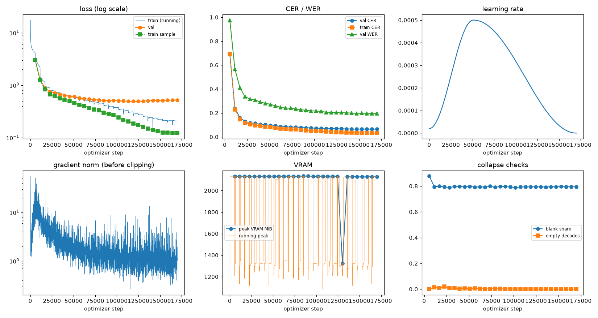
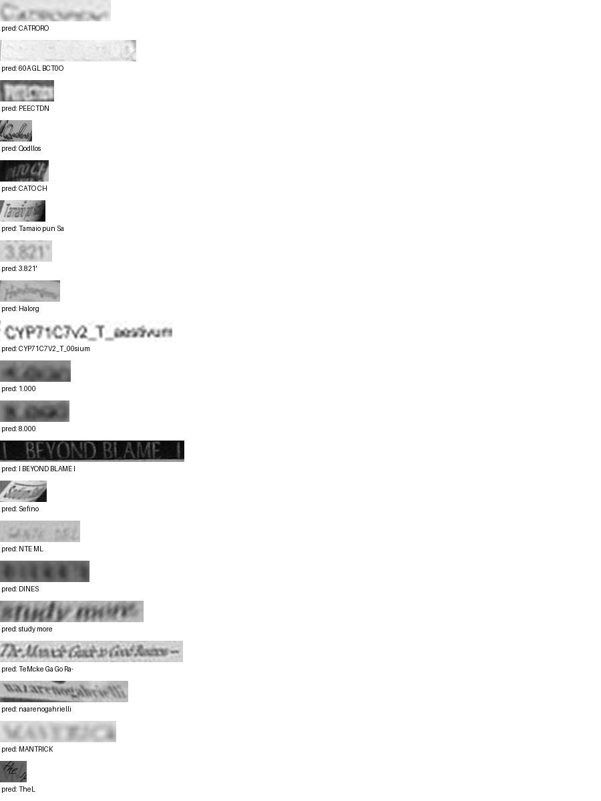

# Run report: GW-REC-024

Generated by `glypharis.training.report`; do not edit by hand.

## Run

- Config hash `25ed190976b840d9`, git `74d2052cf7c8a833b0ffa5e0cd4ceb32c53d8561` (dirty: False)
- Device cuda (NVIDIA GeForce RTX 4050 Laptop GPU), precision bf16, torch 2.14.1+cu126
- Parameters 7,928,835 (30.2 MiB of weights and buffers); 348,935 training lines, 73,888 validation lines
- Epochs run 30, optimizer steps 169,860, stopped early: False; training time 19.31 h (19.31 GPU-hours)
- Data: `processed/hiertext/lines_train` 348,935 lines, sha256 b8cfff844ed2; `processed/hiertext/lines_validation` 73,888 lines, sha256 7db3ec6782ea

## Best and final epoch

| | Epoch | Step | Val CER % | Val WER % | Val loss | Train CER % |
|---|---|---|---|---|---|---|
| best (selected) | 29 | 169860 | 6.46 | 19.65 | 0.5220 | 3.18 |
| final | 29 | 169860 | 6.46 | 19.65 | 0.5220 | 3.18 |

The selected checkpoint is `best.pt`: the lowest validation CER (strict track), as the protocol requires (§7); the final epoch is shown for comparison.

Validation CER of the selected checkpoint: 6.46% [6.33, 6.60] (95% bootstrap CI over 73,888 lines).

## Notes

- Resumed from `last.pt` at step 127,000 (epoch 22); 1 log records written after that checkpoint were moved to metrics.dropped.jsonl.

## Diagnostics

No flags raised.

## Curves

## Worst validation lines

| Key | Reference | Prediction | CER |
|---|---|---|---|
| 013df9c6e5b5aed4/p0/l9 | G | CATRORO | 7.00 |
| 154058472bd0c3bf/p21/l0 | ND | 60A GL BCT0O | 6.00 |
| bd68198a86681f49/p22/l0 | P | PEECTDN | 6.00 |
| da589d39cc2c3cea/p4/l1 | Q | Qodllos | 6.00 |
| dcee27acd6d6883b/p0/l110 | C | CATO CH | 6.00 |
| 902b8cf14489c26a/p19/l3 | Ta | Tamaio pun Sa | 5.50 |
| 03221b6a82a5a02e/p85/l0 | 3 | 3.821' | 5.00 |
| 05ba0bfd03748680/p35/l0 | H | Halorg | 5.00 |
| 1427a2dd12744f8f/p22/l2 | _T_ | CYP71C7V2_T_00sium | 5.00 |
| 75688de8882f42fa/p11/l1 | 4 | 1.000 | 5.00 |
| 75688de8882f42fa/p11/l3 | 3 | 8.000 | 5.00 |
| 83265d4ad42b65eb/p21/l0 | \| \| | I BEYOND BLAME I | 5.00 |
| 902b8cf14489c26a/p18/l9 | S | Sefino | 5.00 |
| 983a43804c520cc0/p13/l0 | L | NTE ML | 5.00 |
| bde51cd0a0e194b1/p34/l0 | s | DINES | 5.00 |
| e20fbc5878d56a36/p1/l40 | 5: | study more | 5.00 |
| 102f2c6a35f05df6/p5/l0 | The | TeMcke Ga Go Ra- | 4.67 |
| 76a7ad3fe918c4ef/p24/l0 | na/ | naarenogahrielli | 4.67 |
| 013df9c6e5b5aed4/p0/l11 | sc | MANTRICK | 4.00 |
| 1177e2fd519784db/p0/l3 | W | TheL | 4.00 |

