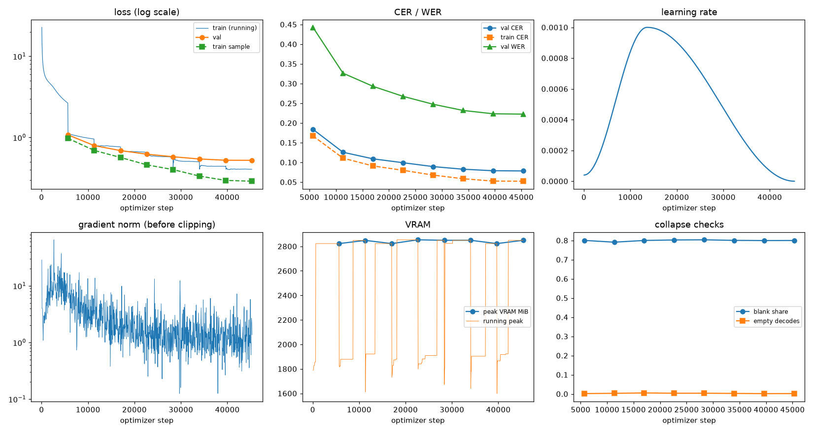
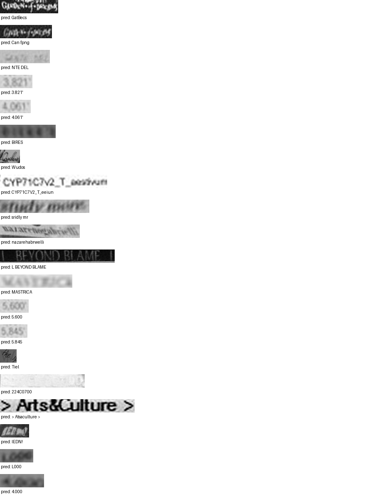

# Run report: GW-REC-025

Generated by `glypharis.training.report`; do not edit by hand.

## Run

- Config hash `04ad00897695342f`, git `fad34c92d684fbbad93391bc88c6c95a2494a70c` (dirty: False)
- Device cuda (NVIDIA GeForce RTX 4050 Laptop GPU), precision bf16, torch 2.14.1+cu126
- Parameters 7,796,435 (29.8 MiB of weights and buffers); 348,935 training lines, 73,888 validation lines
- Epochs run 8, optimizer steps 45,343, stopped early: False; training time 2.02 h (2.02 GPU-hours)
- Data: `processed/hiertext/lines_train` 348,935 lines, sha256 b8cfff844ed2; `processed/hiertext/lines_validation` 73,888 lines, sha256 7db3ec6782ea

## Best and final epoch

| | Epoch | Step | Val CER % | Val WER % | Val loss | Train CER % |
|---|---|---|---|---|---|---|
| best (selected) | 7 | 45343 | 7.82 | 22.25 | 0.5229 | 5.22 |
| final | 7 | 45343 | 7.82 | 22.25 | 0.5229 | 5.22 |

The selected checkpoint is `best.pt`: the lowest validation CER (strict track), as the protocol requires (§7); the final epoch is shown for comparison.

Validation CER of the selected checkpoint: 7.82% [7.67, 7.98] (95% bootstrap CI over 73,888 lines).

## Diagnostics

No flags raised.

## Curves

## Worst validation lines

| Key | Reference | Prediction | CER |
|---|---|---|---|
| 8f80cc3eac928e4e/p21/l0 | C | GatBecs | 7.00 |
| 8f80cc3eac928e4e/p22/l0 | C | Can fpng | 7.00 |
| 983a43804c520cc0/p13/l0 | L | NTE DEL | 6.00 |
| 03221b6a82a5a02e/p85/l0 | 3 | 3.821' | 5.00 |
| 03221b6a82a5a02e/p87/l0 | 4 | 4.061' | 5.00 |
| bde51cd0a0e194b1/p34/l0 | s | BIRES | 5.00 |
| da589d39cc2c3cea/p4/l1 | Q | Wudos | 5.00 |
| 1427a2dd12744f8f/p22/l2 | _T_ | CYP71C7V2_T_eeiun | 4.67 |
| e20fbc5878d56a36/p1/l40 | 5: | sridly mr | 4.50 |
| 76a7ad3fe918c4ef/p24/l0 | na/ | nazarehabrwelli | 4.33 |
| 83265d4ad42b65eb/p21/l0 | \| \| | L BEYOND BLAME  | 4.33 |
| 013df9c6e5b5aed4/p0/l11 | sc | MASTRICA | 4.00 |
| 03221b6a82a5a02e/p84/l0 | 5 | 5.600 | 4.00 |
| 03221b6a82a5a02e/p86/l0 | 5 | 5.845 | 4.00 |
| 1177e2fd519784db/p0/l3 | W | Tiel | 4.00 |
| 154058472bd0c3bf/p21/l0 | ND | 224C0700 | 4.00 |
| 50140f555f4d26d0/p32/l0 | > > | > Atsaculture > | 4.00 |
| 634e5932b6e6f347/p32/l0 | E | IEDN! | 4.00 |
| 75688de8882f42fa/p11/l0 | 1 | L000 | 4.00 |
| 75688de8882f42fa/p11/l1 | 4 | 4.000 | 4.00 |

