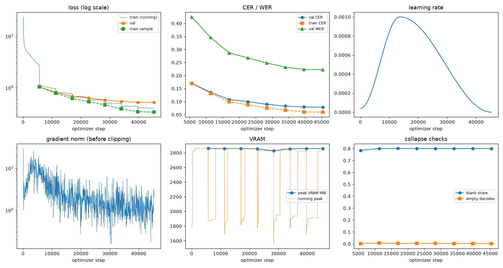
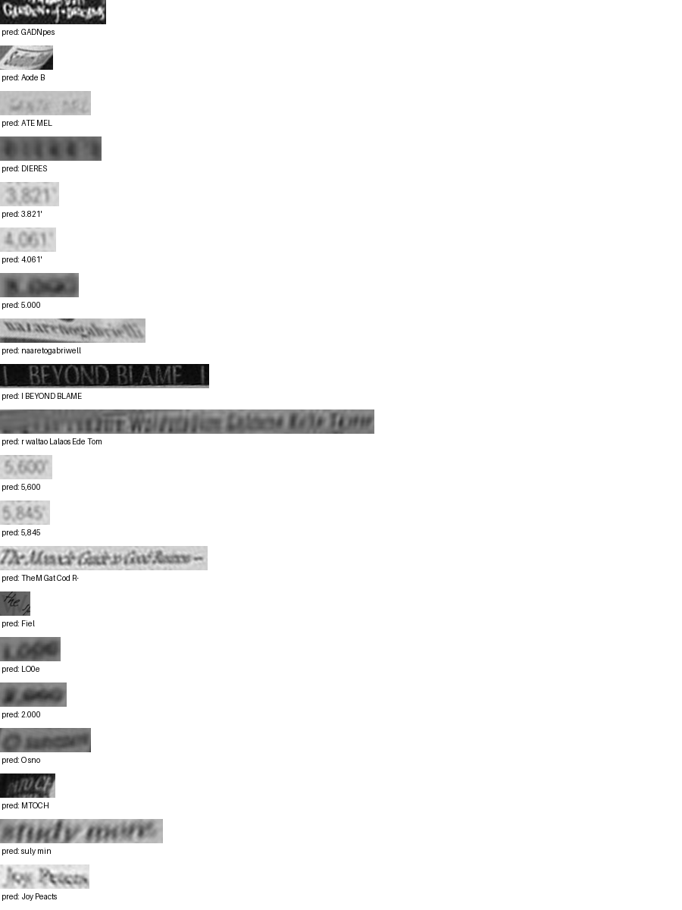

# Run report: GW-REC-026

Generated by `glypharis.training.report`; do not edit by hand.

## Run

- Config hash `a5495de0a43ef148`, git `fad34c92d684fbbad93391bc88c6c95a2494a70c` (dirty: False)
- Device cuda (NVIDIA GeForce RTX 4050 Laptop GPU), precision bf16, torch 2.14.1+cu126
- Parameters 7,796,435 (29.8 MiB of weights and buffers); 348,935 training lines, 73,888 validation lines
- Epochs run 8, optimizer steps 45,346, stopped early: False; training time 2.10 h (2.10 GPU-hours)
- Data: `processed/hiertext/lines_train` 348,935 lines, sha256 b8cfff844ed2; `processed/hiertext/lines_validation` 73,888 lines, sha256 7db3ec6782ea

## Best and final epoch

| | Epoch | Step | Val CER % | Val WER % | Val loss | Train CER % |
|---|---|---|---|---|---|---|
| best (selected) | 7 | 45346 | 7.83 | 22.20 | 0.5182 | 5.94 |
| final | 7 | 45346 | 7.83 | 22.20 | 0.5182 | 5.94 |

The selected checkpoint is `best.pt`: the lowest validation CER (strict track), as the protocol requires (§7); the final epoch is shown for comparison.

Validation CER of the selected checkpoint: 7.83% [7.68, 7.99] (95% bootstrap CI over 73,888 lines).

## Diagnostics

No flags raised.

## Curves

## Worst validation lines

| Key | Reference | Prediction | CER |
|---|---|---|---|
| 8f80cc3eac928e4e/p21/l0 | C | GADNpes | 7.00 |
| 902b8cf14489c26a/p18/l9 | S | Aode B | 6.00 |
| 983a43804c520cc0/p13/l0 | L | ATE MEL | 6.00 |
| bde51cd0a0e194b1/p34/l0 | s | DIERES | 6.00 |
| 03221b6a82a5a02e/p85/l0 | 3 | 3.821' | 5.00 |
| 03221b6a82a5a02e/p87/l0 | 4 | 4.061' | 5.00 |
| 75688de8882f42fa/p11/l3 | 3 | 5.000 | 5.00 |
| 76a7ad3fe918c4ef/p24/l0 | na/ | naaretogabriwell | 4.67 |
| 83265d4ad42b65eb/p21/l0 | \| \| | I BEYOND BLAME  | 4.33 |
| af2ddc65295391cf/p2/l4 | Walin | r waltao Lalaos Ede Tom | 4.20 |
| 03221b6a82a5a02e/p84/l0 | 5 | 5,600 | 4.00 |
| 03221b6a82a5a02e/p86/l0 | 5 | 5,845 | 4.00 |
| 102f2c6a35f05df6/p5/l0 | The | TheM Gat Cod R- | 4.00 |
| 1177e2fd519784db/p0/l3 | W | Fiel | 4.00 |
| 75688de8882f42fa/p11/l0 | 1 | LO0e | 4.00 |
| 75688de8882f42fa/p11/l4 | 2 | 2.000 | 4.00 |
| d6cffab23f5a1e4a/p60/l0 | O | O sno | 4.00 |
| dcee27acd6d6883b/p0/l110 | C | MTOCH | 4.00 |
| e20fbc5878d56a36/p1/l40 | 5: | suly min | 4.00 |
| ebca2758a3725a0a/p20/l30 | Pc | Joy Peacts | 4.00 |

